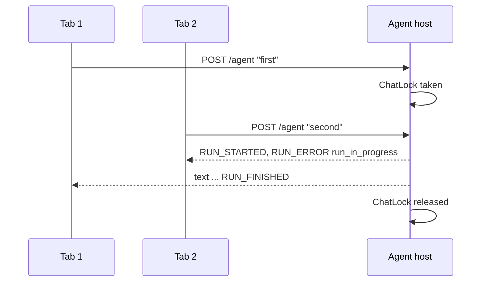

# 0007. One writer per chat, safe defaults for the safety lists, retryable unknown outcomes, and cost limits

- Status: Accepted
- Date: 2026-11-03
- Scope: agent (Bank.Agent.Host, Bank.Agent.Mcp, eval, chat-ui)
- Design plan reference: `phase2-design-plan.md` sections 6 (security), 7 ("the model per role and cost limits are decided later"); agent ADRs 0002, 0003, 0005; `docs/reviews/phase-2-agent-code-review.md` (findings F1 to F15)
- Decided by: Majid for the cost profile (model choice and limit values, 2026-11-03: "cheap"). Claude for the rest; Majid delegated the other phase 2 decisions on 2026-11-03.
- Changes: ADR 0002 (default model, key check), ADR 0003 (outcome of a confirmed change, upload tool name), ADR 0005 (which reads are marked, what the history replays, host-only tool names).

## Context

A code review of phase 2 found four problems that need a decision, not only a fix:

1. **Two runs on one chat could both start** (F1). One browser has one cookie, so two tabs share one session and one chat. The code relied on the unique `(chat, sequence)` index, but that index catches only two runs that read the same last number at the same moment. Usually the second run got the next number and started too: both answers were streamed and stored interleaved, and a run that lost a later race broke its stream without an error.
2. **Safety decisions depended on name lists that failed open** (F2, F3). Only six reads were marked untrusted; a new read, or `customer_get` with a customer's own name and address, was not. The host recognised the host-only tools by copying two names from the MCP server; a rename there would have handed the raw document to the model. And customer text that the model had put into a table came back in later turns as the assistant's own words, without markers.
3. **A confirmed change that timed out could not be retried safely** (F4). The host removed the pending change before running it. If the bank did not answer, the change might still have happened, but the only way forward was to ask the agent again, which made a new confirmation id, so a new idempotency key, so possibly a second transfer.
4. **Nothing limited the cost** (F5). The largest model with 8000 output tokens for every call, the whole chat sent every turn, and no limit on runs. The test logins are public (workspace ADR 0007), so anyone who reaches the chat could spend the API key.

## Decision

### One writer per chat

`HostSession.ChatLock` (a `SemaphoreSlim(1, 1)`) allows one writer on the session's chat at a time.

- A run (`AgUiEndpoint.Events`) tries the lock without waiting. If another run holds it, the run ends at once with `RUN_ERROR` `run_in_progress` and stores nothing. The lock is released in a `finally`, also when the browser goes away.
- An action of the person (`ActionEndpoints.RecordAsync`: confirm, cancel, form, upload) waits for the lock while it stores its outcome. The action already happened at the bank, so it must not be refused; a run lasts seconds.
- `ChatStore.AppendActionAsync` and its retry loop are gone. The unique index stays as the last guard.

### Safe defaults for the safety lists

- **Every read is untrusted unless the bank alone wrote it.** `MarkUntrusted.BankOnlyReads` names the exceptions (business date, products, slots, simulation, payoff quote, currencies, trial balance, portfolio report); every other read, including any new one, comes back between the markers.
- **The MCP server says which tools are host-only**, with the name prefix `host_` (`ToolSets.HostOnlyPrefix`): `host_document_upload` and `host_customer_document`. The host keeps every tool with that prefix away from the model (`McpBankTools.OpenAsync`). A test in `Bank.Agent.Mcp.Tests` checks that exactly these two tools carry it.
- **The history keeps the markers.** `Logic/ChatHistory` builds what the model sees from the stored chat. Typed text stays as it is; every component and every action result comes back between the markers, for the whole chat, not only in the turn that read it.

### A no-answer outcome that can be retried

`ActionEndpoints.RunAsync` now returns four outcomes: `done`, `failed` (the bank refused; final), `cancelled`, and `unknown` (no answer: timeout or broken connection). On `unknown` the host puts the pending change (or document request) back, so pressing Confirm again (or uploading again) sends the same id as `Idempotency-Key`; the bank makes it at most once. The chat UI keeps the buttons and says so; the agent is told only after the second press.

### Cost limits (Majid's choice, "cheap" profile)

| Setting (`Agent:Model:…`) | Value | Effect |
| --- | --- | --- |
| `Name` | `claude-sonnet-5-5` | the agent's model (was `claude-opus-5-5`) |
| `ReaderName` | `claude-haiku-5-5` | the document reader's model (`ReaderModel`), separate from the agent's |
| `MaxOutputTokens` | 2000 | longest answer per model call (was 8000) |
| `HistoryMessages` | 20 | the newest stored messages the model sees each turn |
| `RunsPerMinute` | 5 | runs per user and minute (`RunLimiter`); the next one gets `RUN_ERROR` `too_many_runs` |

Every run logs its input and output token counts with the chat id (counts only, never content). The evaluation set uses the same defaults (`new ModelOptions()`), so it measures what runs.

### Smaller fixes from the same review

- The evaluation runner stores and replays history like the chat (`ChatHistory`, text and components in `TurnWriter`'s order), instead of keeping raw tool results (F6).
- `AgUiEndpoint.Events` is split into named steps (`TurnAsync`, `BuildAgent`, `UntilFailure`); `UntilFailure` turns a model failure into one `null`, so the loop is a plain `await foreach` (F7).
- `ToolResult` moved to `Features/Agent` with its own `ToolAnswer`; the JSON options are `Features/HostJson` (F8). `AuthEndpoints.cs` is split into `SessionGuard.cs`, `SessionCookie.cs`, `ChatClientHeader.cs` and `Problems.cs` (F11).
- `HostSessions` finds idle sessions in one place (`IdleLocked`); the sweeper closes an idle session's chat first and forgets the session after, so a failed close is retried on the next sweep (F9, F13).
- `ActionEndpoints.OpenAsync` returns a small result record instead of three nullables, and reads only the chat's header, not its messages (F10, F15).
- The chat list returns the guard's own problem, so a bank outage says "try again" instead of sending the person to the login (F12).
- A missing model key stops the start outside Development (and the test host), like the gateway key; Staging no longer runs the echo silently (F14).

## Rationale

- **An in-memory lock** fits because the host is one process and sessions already live in its memory (ADR 0001). It states the rule ("one answer at a time per session") in one line, instead of a database race and a misleading comment. Refusing the second run, rather than queueing it, keeps the stream simple and gives the person a clear reason.
- **Fail-safe lists**: forgetting to update a list should cost a few extra tokens, never a hole. The change/read split already worked this way (a tool without `ReadOnlyHint == true` is a change); now the untrusted marking and the host-only split do too.
- **The prefix lives on the server** because the server defines the tools. The host still needs the two full names to call them, but a wrong name there breaks the feature (fail closed), it does not expose the tool.
- **`unknown` is what the idempotency key is for.** Without it, the key protected only a double click, not the case where it matters most.
- **Limits in configuration**, so a different profile needs no code change (design plan ADR 24). Per username, not per session, so a new login does not reset the count.

## Alternatives considered

- **Queue the second run** behind the first: no error for the person, but the stream waits with no feedback, and two tabs would answer each other's questions in turn.
- **A database lock** (`SELECT … FOR UPDATE` on the chat row): works across several host processes, which we do not have; more code and a held transaction during a model call.
- **A third MCP path, `/mcp/host`**, for the host-only tools: the clearest separation, but a second connection per upload or document read for little gain over the prefix plus test.
- **Wrap only components that may hold customer text**: needs knowledge of each component's data; wrapping all of them costs a few tokens and cannot be forgotten.
- **ASP.NET Core's rate-limiting middleware on `POST /agent`, partitioned by cookie**: runs before the session is known, so it could only count per cookie; the limiter in the endpoint counts per user.
- **Keep Opus for the agent and only cap tokens and runs** (the "moderate" profile): better answers, about twice the price per token. Majid chose the cheap profile for the demo.

## Consequences

- A second tab gets "Another message is still being answered" while the first one runs.
- Sonnet and Haiku should be checked with the evaluation set before the agent goes live; if answers get worse, change `Agent:Model:Name` (configuration only).
- With 20 messages of history, the model forgets older parts of a long chat; it reads the bank's data again through the tools.
- Five runs per minute per user: the admin test login is shared by every tester, so they share its limit.
- More reads are wrapped in markers: slightly more tokens per tool result.
- Renaming the two host-only MCP tools is a change on both sides; the MCP server and the host must be deployed together.
- The lock is per process: if the host ever runs as several instances, F1 comes back and needs the database lock above.
