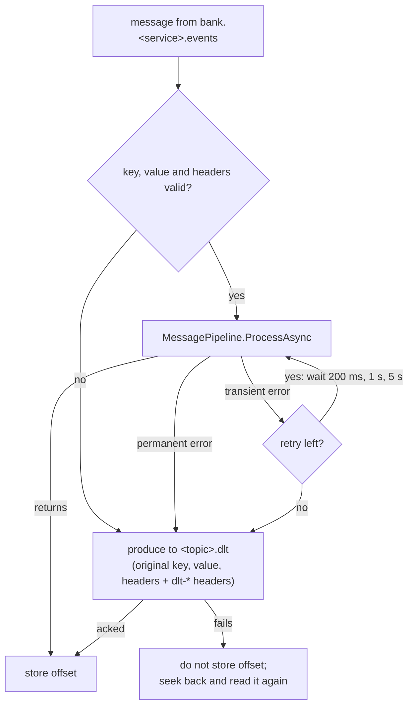

# 0013. Retry a failed message in the consumer, then send it to the dead-letter topic

- Status: Accepted (D1, decided by Majid in slice 1.3)
- Date: 2026-10-30
- Scope: bank-contracts (Bank.Messaging.Kafka), used by every service
- Design plan reference: section 4, ADR row 09; `docs/implementation-decisions.md`, Messaging details

## Context

**The goal.** A message that fails in a handler must not be lost, and it must not stop the service for good. The design plan (ADR 09) sets the rule: three retries with increasing backoff, then a dead-letter topic. Infinite retries are rejected.

**Why it is hard.** Kafka keeps order only inside a partition. For each partition and consumer group it stores **one number**, the committed offset, which means "everything before this is done". So while one message is not done, the consumer cannot move past it without giving up on it. Every retry strategy has to choose between two goods:

- **Order per key.** Events about one loan or account must be applied in the order they happened: `LoanDisbursed` before `InstallmentPaid`.
- **Progress.** One broken message should not hold back every other message in its partition.

**Two kinds of failure.** They need different treatment:

- **Transient:** the database is briefly down, a lock timed out, a deadlock. The same message will succeed a second later.
- **Permanent:** the message can never succeed, however often it is tried. Examples: a MODEL version this service does not know (`UnsupportedSchemaVersionException` from `MessagePipeline`), JSON that does not deserialize, a missing `message-id` or `schema-uri` header, a schema URI that does not parse.

**What existed before.** `MessagePipeline.ProcessAsync` (slice 1.2) runs each handler in its own transaction and lets an exception propagate; the transport decides what happens next. `docs/implementation-decisions.md` said "3 attempts, backoff 200 ms, 1 s, 5 s", while the stage file's test said "retried three times, then sent to the DLT". Three delays mean three retries, so the two texts disagreed on the number of executions.

## Decision

Retry inside the consumer, blocking the partition. One failing message follows this path:

1. **Retry in place.** `KafkaConsumerService` calls `ProcessAsync` again on the same message. No other message of that partition is read meanwhile.
2. **Four executions in total.** One first attempt plus three retries, waiting 200 ms, 1 s and 5 s before them (about 6.2 s in the worst case, plus handler time). `RetryBackoff.DelayAfter` returns the wait after each failed attempt, or null when none is left. The delays come from `Kafka:RetryDelays`, with these values as defaults.
3. **Permanent errors skip the retries** and go straight to the dead-letter topic (`FailureClassification.IsPermanent`): `UnsupportedSchemaVersionException`, `JsonException`, `InvalidMessageException` (missing or malformed key, value or headers). Everything else counts as transient.
4. **A business-key violation is transient** (Majid's decision). It is retried and then dead-lettered like any other failure, so a person sees the duplicate fact instead of it being hidden in a log.
5. **Dead-letter topic `<topic>.dlt`**, for example `bank.operations.events.dlt`. One per source topic. The message keeps the original key, value and headers, and gets the headers `dlt-reason` (`invalid-message`, `permanent` or `retries-exhausted`), `dlt-exception`, `dlt-attempts`, `dlt-original-topic`, `dlt-original-partition`, `dlt-original-offset`, `dlt-consumer-group` and `dlt-failed-at`.
6. **Offsets.** Auto-commit is on, but offsets are **stored** by hand (`EnableAutoOffsetStore = false`), only after `ProcessAsync` returned or the dead-letter produce was acknowledged. If the dead-letter produce fails, the offset is not stored; the consumer seeks back and reads the same message again. A message is never lost silently.
7. Nothing reads the dead-letter topics in phase 1. Messages there are inspected in Kafka UI and replayed by hand.

## Rationale

- **Order is a business requirement here.** It is the reason the message key is the entity id. Only a blocking retry keeps it without extra machinery, because nothing behind the failing message overtakes it.
- **Most real failures in this system are transient.** A PostgreSQL restart or a lock timeout lasts seconds, so a few seconds of retry fix them without a person.
- **The price is small at demo volume.** At most about 6 s of delay for one partition, and only while a message is failing. More partitions shrink it further (`Kafka:Partitions`, default 3).
- **Permanent errors gain nothing from retries.** Sending them straight to the dead-letter topic saves the blocked seconds.
- **The inbox makes re-reading safe.** Every "read it again" path (crash before the offset is stored, failed dead-letter produce) relies on the inbox from ADR 0007.

## Alternatives considered

- **A. Retry inside the consumer, blocking the partition.** Chosen; see above.
- **B. Retry topics** (`<topic>.retry-1s`, `<topic>.retry-5s`, then `.dlt`). The failed message moves to a delay topic and the main partition continues at once. Rejected: later messages with the same key overtake the failed one, so per-key order breaks. It also needs two more topics per source topic and consumers that wait until a message is due.
- **C. No retry: every failure goes to the dead-letter topic at once.** Rejected: every transient failure needs a person to replay the message, and it contradicts design plan ADR 09.
- **D. Park the key in the database** (raised by Majid). A message that still fails after its retries goes into a `parked_message` table with its key. Every later message whose key is parked is parked too, so it cannot overtake. A background job retries each key's parked messages in order. Kafka's offset moves on normally, so the partition never waits, and order per key holds. Rejected for phase 1: one more table, a background job and a database lookup per message, for a delay that demo volume never feels. It stays the best upgrade path if one service needs it, because the inbox already makes re-applying safe.
- **E. Store the last offset per key and seek back** (raised by Majid). A table `key_progress (message_key, partition, last_offset)`, updated in the handler's transaction. When a key is stuck, the consumer seeks back to the lowest unfinished offset and skips every message with `offset <= last_offset[key]`. No payloads need to be stored, because Kafka keeps them. Rejected:
  - Kafka has no index by key: messages of all keys are interleaved, so each retry re-reads the partition from the stuck point.
  - It does not replace the inbox: the outbox can send one message twice, at two different offsets, and only the message id shows they are the same.
  - Offsets are only comparable inside one partition. Changing the partition count moves keys to other partitions (`hash(key) % partitions`), and a key stuck longer than the topic's retention loses the message it must go back to.

| | A. Blocking (chosen) | D. Park in database | E. Offset per key + seek back |
| --- | --- | --- | --- |
| Order per key | kept | kept | kept |
| Other keys wait | yes, seconds | no | no |
| What it adds | nothing | table + background job | table + seek and skip logic |
| Breaks when partitions change | no | no | **yes** |
| Breaks after retention | no | no | **yes** |

## Consequences

- Easier: order per key holds even when handlers fail. A broken message sits in one place, with the reason and the last error in its headers.
- Harder: a slow handler or a long database outage delays its whole partition, and after about 6 s every message of that time goes to the dead-letter topic and needs a manual replay.
- A duplicate fact (business-key violation) costs the full retry time before it reaches the dead-letter topic.
- To watch: if one service ever needs more throughput or less delay, move it to alternative D in a new ADR. The handlers do not change.
