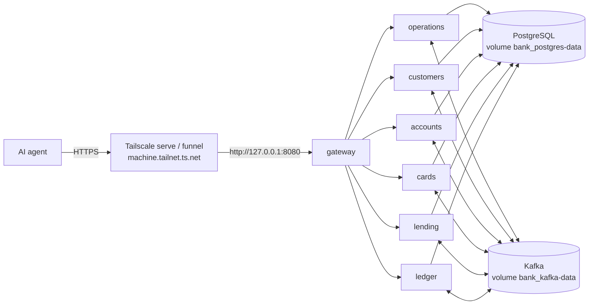

# Hosting the demo bank on a private host machine

The demo bank runs on a private host machine for one consumer, the phase 2 AI agent. The setup has to run all the time, survive a reboot without losing data, and be reachable from outside the host machine at `https://<machine>.<tailnet>.ts.net`.

The Aspire AppHost cannot do this: it starts with an empty database on every run and gives the gateway a changing port. This guide reuses the EC2 setup (`docker-compose.aws.yml`) instead. The same containers run under Docker Compose with persistent volumes, and Tailscale takes the place of the AWS security group.



| File | Role |
| --- | --- |
| `docker-compose.aws.yml` | The whole stack: six services, gateway, PostgreSQL, Kafka, Kafka UI, Mailpit, Aspire dashboard. Unchanged. |
| `docker-compose.home.yml` | Overrides only what differs at home: local images, local file storage, gateway on `127.0.0.1:8080`. |
| `env/*.env` (gitignored) | Database passwords, connection strings and the gateway's API key. On EC2, `start-bank.sh` writes these from Secrets Manager. At home, step 3 writes them. |

All commands run from the repository root unless a step says otherwise.

## 1. Check the prerequisites

```bash
docker compose version     # 2.24 or later (needed for !override and optional env files)
dotnet --version           # 10.x
tailscale status           # this machine is logged in
jq --version               # the checks in step 7 read JSON with jq (install jq first)
# Enable the Docker service at boot, so the bank starts too.
```

The host machine must not sleep or power off while the bank should be reachable.

## 2. Run the tests and build the images

The shared packages go into the local feed first. The services restore them from there.

```bash
cd core_banking
dotnet pack bank-contracts -c Release -o .local-feed
dotnet pack bank-platform/src/Bank.ServiceDefaults -c Release -o .local-feed

# The code is green before it becomes an image (platform plus end-to-end: about 6 minutes, needs Docker).
(cd bank-platform && dotnet test)

# One image per service in the local Docker daemon, built with the SDK (no Dockerfile, same as CI).
for s in operations customers accounts cards lending ledger identity; do
  (cd "bank-$s" && dotnet publish "src/Bank.${s^}.Api" -c Release --os linux --arch "$(uname -m | sed 's/x86_64/x64/;s/aarch64/arm64/')" /t:PublishContainer \
     -p:ContainerRepository="bank-$s" -p:ContainerImageTags=home) || break
done
(cd bank-gateway && dotnet publish src/Bank.Gateway -c Release --os linux --arch "$(uname -m | sed 's/x86_64/x64/;s/aarch64/arm64/')" /t:PublishContainer \
   -p:ContainerRepository=bank-gateway -p:ContainerImageTags=home)

docker images 'bank-*'     # eight images tagged "home"
```

## 3. Write the passwords (once)

PostgreSQL creates the roles only on an empty volume, so the passwords are generated once and kept. The guard keeps a second run from overwriting them.

```bash
cd core_banking/bank-platform/deploy
if [ ! -f env/postgres.env ]; then
  umask 077 && mkdir -p env
  services=(operations customers accounts cards lending ledger)
  {
    echo "POSTGRES_PASSWORD=$(openssl rand -hex 16)"
    for s in "${services[@]}"; do echo "${s^^}_DB_PASSWORD=$(openssl rand -hex 16)"; done
  } > env/postgres.env
  for s in "${services[@]}"; do
    pw=$(grep "^${s^^}_DB_PASSWORD=" env/postgres.env | cut -d= -f2)
    echo "ConnectionStrings__${s}-db=Host=postgres;Port=5432;Database=bank;Username=${s};Password=${pw}" > "env/${s}.env"
  done
fi
# The key every caller sends to the gateway in X-Api-Key. The gateway refuses to start without it.
if [ ! -f env/gateway.env ]; then
  (umask 077 && echo "Gateway__ApiKey=$(openssl rand -hex 32)" > env/gateway.env)
fi
git status --short env     # prints nothing: env/ is ignored
```

The agent (and anything else that calls the bank) needs this key. Give it from `env/gateway.env` through the agent's own secret store, never in a tracked file or a chat. To change the key, write a new value to the file and run `bank up -d --wait`: Compose recreates the gateway.

`bank-platform/docker-compose.yml` (infrastructure only) uses the same project name, `bank`, and the same volume names. If it was ever started with other passwords, the roles already exist with those passwords. In that case, remove the old volumes first. This deletes their data:

```bash
docker volume ls --filter name=bank_     # anything listed is from an earlier run
docker compose -f docker-compose.aws.yml -f docker-compose.home.yml down -v
```

## 4. Start the bank

```bash
cd core_banking/bank-platform/deploy
docker compose -f docker-compose.aws.yml -f docker-compose.home.yml up -d --wait
docker compose -f docker-compose.aws.yml -f docker-compose.home.yml ps    # every service healthy
curl -fsS http://127.0.0.1:8080/health; echo                             # Healthy
```

Every container has `restart: unless-stopped`, so after a reboot Docker starts the bank again with the same data.

Pages on this machine only: Aspire dashboard `http://localhost:18888` (logs, traces), Mailpit `http://localhost:8025`, Kafka UI `http://localhost:8081`.

If the dashboard image does not pull (`aspire-dashboard:13.6` is not checked yet), add `dashboard: { image: mcr.microsoft.com/dotnet/aspire-dashboard:<existing tag> }` to `docker-compose.home.yml`.

## 5. Load the initial data (once, on a fresh bank)

The import tool replays customers, accounts, loans, transactions and standing orders day by day through the gateway, then checks balances against statements and the trial balance. It refuses to run on a bank that already has its customers. It reads the gateway's key from `Import__ApiKey`:

```bash
export Import__ApiKey="$(cut -d= -f2- ../bank-platform/deploy/env/gateway.env)"   # from core_banking/bank-data-import
```

Option A, the 5-customer synthetic fixture (works now, about 2–5 minutes):

```bash
cd core_banking/bank-data-import
dotnet run --project src/Bank.DataImport -- --gateway http://127.0.0.1:8080 \
  --data tests/Bank.DataImport.IntegrationTests/Fixture
echo "exit code: $?"           # 0 = imported and verified
grep Verification data/import-report.md    # Verification: passed
```

Option B, the real databasesample.com export (about 100 customers, two years): put the CSV files in `data/raw/` (gitignored), check the column names in `src/Bank.DataImport/appsettings.json` (`Import:Columns`) against the files, then run the same command without `--data`. This takes much longer, because every business day is closed one at a time.

Option C, generated synthetic data (100 customers, one year; no download, no personal data). The generator writes the six files into `data/raw/` with the column names the tool expects. Its history meets the import's selection targets: 44 borrowers, 14 with late payments, 2 who stop paying and reach Default, and 20 standing orders. All loan amounts and terms fall inside the product ranges. About 9,000 transactions and 363 business days are replayed, so expect a long run.

```bash
cd core_banking/bank-data-import
python3 tools/generate-sample-data.py            # --years 2 for two years, --seed N for another data set
dotnet run --project src/Bank.DataImport -- --gateway http://127.0.0.1:8080
grep Verification data/import-report.md          # Verification: passed
```

To start over with an empty bank: `docker compose -f docker-compose.aws.yml -f docker-compose.home.yml down -v`, then steps 4 and 5. The passwords in `env/` stay valid, because the roles are created again from them.

## 6. Publish the gateway through Tailscale

Use A unless the agent cannot join the tailnet. Both serve `https://<machine>.<tailnet>.ts.net` with a certificate from Tailscale. Plain `http://` is not served. The real name is not written in this repository (it would point anyone to the host machine); the command in step 7 prints it.

```bash
# A: only devices in the tailnet (the agent runs on a machine logged in to Tailscale)
sudo tailscale serve --bg 8080

# B: the whole internet (the agent runs in the cloud, e.g. calls from an LLM provider)
sudo tailscale funnel --bg 8080       # the first time, it prints a link to enable Funnel for this tailnet

tailscale serve status                # shows what is published
sudo tailscale serve reset            # stops A; "sudo tailscale funnel reset" stops B
```

`serve` and `funnel` write the same entry for port 443; `funnel` only adds the internet flag, so running both leaves one entry. After `funnel` is turned on, the public relays take a few minutes (about 3 on 2026-11-03) before every one of them serves the URL; until then, devices outside the tailnet may get a TLS error.

With Funnel, anyone who knows the URL can reach the gateway. Two locks then guard it: the API key (the caller is the trusted agent) and a login (on whose behalf it acts; workspace ADR 0007). The logins are test logins: `admin/admin` is written in the code, and a customer logs in with the national id as username and password. So anyone who has the API key and reads this repository can act as staff or as any customer. Keep only synthetic data in this bank.

## 7. Test the running bank

Run the checks locally first, then through Tailscale. With serve, the tailnet URL answers only on devices in the tailnet. With Funnel, also test from a device outside it, such as a phone on mobile data.

```bash
TS_URL="https://$(tailscale status --json | python3 -c 'import sys,json;print(json.load(sys.stdin)["Self"]["DNSName"].rstrip("."))')"   # this machine's tailnet name
for GW in http://127.0.0.1:8080 "$TS_URL"; do
  echo "== $GW"
  K="X-Api-Key: $(cut -d= -f2- core_banking/bank-platform/deploy/env/gateway.env)"
  curl -fsS "$GW/health"; echo                                                        # Healthy
  curl -s -o /dev/null -w 'no key: %{http_code}\n' "$GW/api/lending/loan-products"                 # 401
  curl -s -o /dev/null -w 'no login: %{http_code}\n' -H "$K" "$GW/api/lending/loan-products"       # 401
  # Log in as admin; every login gets a new token, and the previous admin session ends (session_replaced).
  T=$(curl -fsS -H "$K" -H 'Content-Type: application/json' -d '{"username":"admin","password":"admin"}' "$GW/api/identity/login" | jq -r .token)
  A=(-H "$K" -H "Authorization: Bearer $T")   # from here on, the key and the token
  curl -fsS "${A[@]}" "$GW/api/operations/currencies"; echo                             # SEK, EUR, USD (active after the import)
  curl -fsS "${A[@]}" "$GW/api/operations/business-days/current"; echo                  # one Open day
  curl -fsS "${A[@]}" "$GW/api/lending/loan-products"; echo                             # includes PURCHASE
  for c in SEK EUR USD; do
    curl -fsS "${A[@]}" "$GW/api/ledger/trial-balance?currency=$c" | jq -c '{currency, balanced: (.totalDebit == .totalCredit)}'
  done                                                                                # balanced: true
done
```

Then check that the data survives a restart:

```bash
cd core_banking/bank-platform/deploy
docker compose -f docker-compose.aws.yml -f docker-compose.home.yml restart
docker compose -f docker-compose.aws.yml -f docker-compose.home.yml up -d --wait
K="X-Api-Key: $(cut -d= -f2- env/gateway.env)"
T=$(curl -fsS -H "$K" -H 'Content-Type: application/json' -d '{"username":"admin","password":"admin"}' http://127.0.0.1:8080/api/identity/login | jq -r .token)
curl -fsS -H "$K" -H "Authorization: Bearer $T" http://127.0.0.1:8080/api/operations/business-days/current; echo   # same date as before
```

Rebooting the host machine is the full check: after login, step 7 passes again without running any command.

## Bring the bank back up (quick guide)

The bank is already installed: images built, passwords and the API key in `env/`, data in the volumes, the Tailscale entry saved. Nothing below deletes data.

```bash
cd ~/repos/banking_demo/core_banking/bank-platform/deploy
alias bank='docker compose -f docker-compose.aws.yml -f docker-compose.home.yml'

bank ps                                    # 1. what is running? After a reboot, usually everything already is.
bank up -d --wait                          # 2. start whatever is stopped (safe to run any time)
curl -fsS http://127.0.0.1:8080/health; echo                  # 3. Healthy
tailscale serve status                     # 4. shows the tailnet URL with "(tailnet only)"
sudo tailscale serve --bg 8080             #    only if step 4 shows nothing
curl -fsS "https://$(tailscale status --json | python3 -c 'import sys,json;print(json.load(sys.stdin)["Self"]["DNSName"].rstrip("."))')/health"; echo   # 5. Healthy
```

If `bank up` fails with "no such image", the images were removed: run the image build in step 2 again. Do not run `bank down -v` and do not delete `env/`: `-v` erases all data, and new passwords no longer match the database roles. If a step still fails, `bank logs --tail 50 <service>` shows why.

## Day to day

```bash
cd core_banking/bank-platform/deploy
alias bank='docker compose -f docker-compose.aws.yml -f docker-compose.home.yml'
bank ps                      # status
bank logs -f gateway         # one service's log (or the dashboard at :18888)
bank stop / bank up -d --wait
```

After a code change: run step 2 again, then `bank up -d --wait`. Compose recreates only the containers whose image changed, and the data stays.

## What to watch

- Files uploaded to Customers live inside its container and are lost when it is recreated (step 2 after a change). A volume would need its owner set for the container's non-root user.
- The host machine is the server. While it sleeps, is offline or is rebooting, the agent gets no answer.
- The real-dataset column mapping is still unchecked (`docs/progress.md`, open questions).
