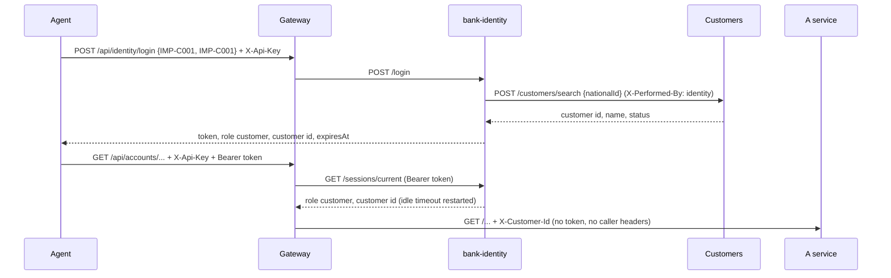

# 0007. Log callers in through an identity service with one sliding session per user

- Status: Accepted
- Date: 2026-11-03
- Scope: workspace (new bank-identity, bank-gateway, bank-customers, bank-platform, bank-data-import)
- Design plan reference: section 3, ADR row 13 (simulated authentication), section 11 (out of scope: real authentication)
- Decided by: Majid in the chat of 2026-11-03 (all choices below marked "Majid"); details by Claude on his delegation.

## Context

Until now the gateway checked a shared API key and then believed the identity headers the caller sent. `X-Customer-Id` marked a customer's call and `X-Performed-By` named staff. The key proves that the caller is the trusted agent, but the agent could put any customer's id in the header and act for that customer. The bank is reachable from the internet (Tailscale Funnel), and Majid wants to share test logins with other people. So the gateway must know on whose behalf the agent acts, and must set the identity headers itself instead of taking them from the caller.

The caller is always the AI agent. The person it acts for is a different identity: an admin (bank staff) or a customer.

## Decision

1. **A separate service, `bank-identity`** (Majid). It has `POST /login`, `POST /logout` and `GET /sessions/current`. It owns no table and publishes no event.
2. **Test logins** (Majid). The admin is hard-coded in the code as `admin` / `admin`. A customer logs in with their national id as both username and password, for example `IMP-C001` / `IMP-C001`. A wrong pair and an unknown national id get the same 401 `invalid_credentials`.
3. **National id lookup over HTTP** (Majid). On a customer login, the identity service calls `POST /customers/search` in Customers with the new `nationalId` filter (exact match, after trimming) and `X-Performed-By: identity`. If Customers cannot be reached, the login gets 503 `customers_unavailable`. The admin login does not need Customers.
4. **A new random token on every login** (Majid). The token is 32 random bytes in URL-safe Base64 and has no meaning of its own. The caller sends it on every request as `Authorization: Bearer <token>`.
5. **One session per user** (Majid). A new login with the same username ends the previous session at once. The old token's next request gets 401 `session_replaced` ("Someone logged in with your username."); after that, the old token is simply unknown (`invalid_token`).
6. **Sliding idle timeout of 5 minutes** (Majid). Every valid request restarts it. After 5 minutes without a request, the next request gets 401 `session_expired`. The value is configuration (`Identity:IdleTimeout`), not a literal in the logic.
7. **Sessions in memory** (Majid). They live in a dictionary behind `ISessionStore`. A restart of the identity service logs everyone out.
8. **Every `/api` call needs a token** (Majid), except calls to `/api/identity/*` (login, logout and "who am I"). This includes the data import and the end-to-end tests, which log in as admin.
9. **The gateway sets the identity headers** (Claude). For each request it calls `GET http://identity/sessions/current` with the caller's `Authorization` header. It drops any `X-Customer-Id` or `X-Performed-By` the caller sent, and then sets `X-Performed-By: admin` for the admin or `X-Customer-Id: <customer id>` for a customer. It does not forward the token. A refused token gets identity's own 401 body; if identity is down, the answer is 503 `identity_unavailable`. The API key check stays in front of all of this.
10. **Technical time** (Claude). Session times come from `TimeProvider`, not from `IBusinessClock`. Idle time is wall-clock time, not a business date.

## Rationale

- An opaque token with a server-side session meets every requirement directly: a new token per login, one session per user, the old session ended at once, and a sliding timeout. A JWT cannot be revoked before it expires, and a sliding timeout would mean issuing a new JWT on every request.
- Checking the token in the identity service on every request keeps all session rules in one place. The gateway only turns a session into the headers the services already understand, so no service changed (ADR 0006 checks keep working as they are).
- Replacing the old session, instead of refusing the new login, means that a user who closed the browser without logging out is never locked out for 5 minutes.
- The national id is a business key that people know, is unique (`ux_customer_national_id`) and already exists for every customer. No new number had to be introduced.
- In memory is enough for one instance and a 5-minute timeout: a restart costs one login.

## Alternatives considered

- **Login inside the gateway** (no new service): simpler and one network hop less, but it mixes routing with user rules. Rejected by Majid.
- **Keycloak**: the industry standard, but too heavy for test logins, and the design plan leaves it for later.
- **National ids in an event** (`CustomerRegistered` 1-1-0 with a local copy in identity): keeps the "events only" rule. But it needs a contract change, a backfill for the 100 existing customers (their events carry no national id), and it would still show a closed customer as active until an event says otherwise. Rejected by Majid in favour of the HTTP lookup.
- **Hashed passwords from user secrets**: the workspace rule for secrets (`.claude/rules/secrets.md`). Majid chose hard-coded test logins on purpose, so that he can share them with testers.
- **Tokens optional, old headers still accepted**: breaks nothing, but adds no protection, because a caller could simply leave the token out.
- **Sessions in PostgreSQL**: they would survive restarts and allow several instances, but they cost a schema, a role, a migration and a write on every request. Rejected by Majid.

## Consequences

- **Two exceptions to workspace rules, accepted by Majid for testing.** First, the admin password and the customer login scheme are public: anyone who has the gateway's API key and reads this repository can act as staff or as any customer. Second, identity calls Customers over HTTP, the one direct call between services. Both exceptions must go before real users or real data arrive (phase 2: real credentials, hashed and stored as secrets).
- The audit columns now record `admin` for every staff change, also for the data import (it used to record `import`). An admin login elsewhere (the agent, a tester) ends the import's session and stops the import.
- Every request costs one extra HTTP call from the gateway to identity. This is fine for the demo; a short cache in the gateway would trade a few seconds of staleness for speed.
- Customer logins depend on Customers being up; admin logins do not.
- Only one identity instance may run, because the sessions live in its memory.
- Tests: `bank-identity` unit tests (session rules, credentials) and integration tests (login, replacement, expiry, logout, Customers down); gateway tests for the header handling; platform routing tests and end-to-end scenarios now log in.
