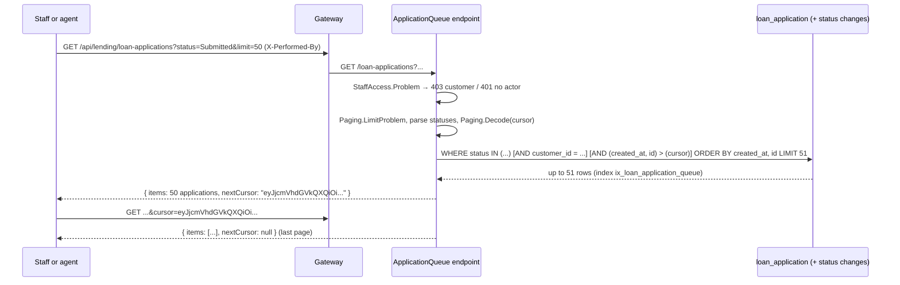

# Slice 2: The loan application review queue

This document has three parts. Part 1 is the big picture: staff and, later, the agent need the applications waiting for review, oldest first, one page at a time. Part 2 covers the building blocks: keyset paging, the staff-only check, the endpoint and its index. Part 3 explains why, including the three workspace ADRs decided in this slice. Tests, limits and questions come after.

---

## Part 1. The big picture

### 1.1 The goal

Until now an application could only be read by its id. Nobody could ask "which applications are waiting?". The review queue answers that. It lists applications filtered by status (for example `Submitted` and `UnderReview`) and by customer, oldest first, so the longest-waiting customer is served first. The phase 2 agent will work through this list.

### 1.2 Why it is hard

- **The list moves while it is read.** New applications arrive between two page requests. With "skip 50, take 50" paging, a row can then show up twice or be skipped.
- **It shows many customers' data.** A customer must never call it. Authentication is still simulated, so the check can only use the headers the gateway passes on.
- **It must stay fast.** It is a filter plus a sort, and it needs an index that serves both.

---

## Part 2. The building blocks and how they connect



### 2.1 `Paging` and `Page<T>`

`core_banking/bank-lending/src/Bank.Lending.Api/Features/Paging.cs`. A page is `{ items, nextCursor }`. The cursor is the sort values of the last row returned, as JSON, base64url-encoded. For the queue that is `{ createdAt, id }`. The client never reads it; it sends it back for the next page.

- `LimitProblem`: `limit` is 1–200, default 50, otherwise 400 `invalid_limit`.
- `Decode`: a cursor that is not base64url, not JSON, or missing a field gives null, and the endpoint answers 400 `invalid_cursor`. `RespectRequiredConstructorParameters` makes `{}` fail instead of becoming a key full of defaults.
- `ToPage`: the endpoint reads `limit + 1` rows. If the extra row exists, there is a next page, and the cursor is built from the last row *shown*. The extra row is not returned.

### 2.2 `StaffAccess`

`core_banking/bank-lending/src/Bank.Lending.Api/Features/Problems.cs`. It returns 403 `staff_only` when `X-Customer-Id` is present, and 401 `missing_actor` when `X-Performed-By` is missing. Otherwise it returns null and the endpoint continues.

### 2.3 The endpoint `GET /loan-applications`

`core_banking/bank-lending/src/Bank.Lending.Api/Features/Applications/ApplicationQueue.cs`. Query parameters:

- `status` (repeatable, case-insensitive; 400 `invalid_status` for an unknown one),
- `customerId`,
- `limit` and `cursor`.

The keyset condition is `EF.Functions.GreaterThan(ValueTuple.Create(a.CreatedAt, a.Id), ...)`, which Npgsql turns into the SQL row comparison `(created_at, id) > (@p1, @p2)`. Sorting and comparing both happen in PostgreSQL, so they use the same uuid ordering. Each item is the existing `ApplicationResponse` with its status history, so the reviewer sees the same shape as `GET /loan-applications/{id}`.

### 2.4 The index `ix_loan_application_queue`

`Data/LendingDbContext.cs` and the migration `AddApplicationQueueIndex`: `(status, created_at, id)`. For one status, the rows are already in queue order inside the index, so PostgreSQL reads the next 51 and stops. The customer filter uses the existing index on `customer_id`; one customer has few applications.

### 2.5 The gateway

No change. `GET /api/lending/loan-applications` reaches the endpoint through the existing catch-all route.

---

## Part 3. Why it is designed this way

### 3.1 Majid's decisions (D1)

- **Keyset paging with an opaque cursor** for all three lists: **workspace ADR 0004**. Majid chose keyset over offset and a mix of the two. On his delegation, Claude decided there is no total count: only `nextCursor`, and the extra row tells whether there is more.

On Majid's delegation of 2026-11-03, Claude decided the other two questions of this work:

- **ADR 0005**: searches whose filters can hold personal data are `POST .../search` with a body. The queue's filters are only statuses and ids, so it stays a GET with query parameters.
- **ADR 0006**: a staff-only read refuses `X-Customer-Id` (403) *and* requires `X-Performed-By` (401). The older staff-only actions only do the first; for reads of personal data there should always be a named actor.

### 3.2 Claude's choices (D2)

- **Sort by `created_at`**, the time the application row was written. It is set at submission and never changes, so it is a stable "oldest first". The business date of submission is in the first history entry.
- **Statuses as a repeatable parameter** (`?status=Submitted&status=UnderReview`): a reviewer usually wants both.
- **Items are the full `ApplicationResponse`**, history included, so there is one shape to learn.
- **`Paging` is copied per service**, not put in `Bank.Common`. That avoids a release of every shared package (ADR 0004).
- **401 for a missing actor**, the same status the gateway uses for `missing_identity`.

### 3.3 Patterns

- **Keyset (seek) pagination** with an opaque cursor.
- **Over-fetch by one** to know whether there is a next page without counting.
- **Guard clause**: `StaffAccess.Problem(http) ?? Paging.LimitProblem(limit)` stops early with a problem response.
- **Covering sort index**: the index matches filter + sort, so the database stops after one page.

---

## What was tested

`tests/Bank.Lending.IntegrationTests/ApplicationQueueTests.cs` (Testcontainers PostgreSQL):

- five applications walked with `limit=2`: three pages, in submission order, the last with `nextCursor = null`;
- an empty queue, and a page exactly as long as what is left (no empty extra page);
- an application submitted between two page requests appears once, at the end;
- filter by one status, by two statuses, by customer, and by both;
- a customer caller gets 403 `staff_only`, a caller without `X-Performed-By` gets 401 `missing_actor`;
- `limit` 0 and 201, a garbage cursor, an empty-JSON cursor and an unknown status each give 400 with their code.

```text
$ cd core_banking/bank-lending && dotnet test
Passed!  - Failed: 0, Passed: 1577, Skipped: 0, Total: 1577 - Bank.Lending.UnitTests.dll
Passed!  - Failed: 0, Passed:   65, Skipped: 0, Total:   65 - Bank.Lending.IntegrationTests.dll
```

## What to watch later

- A cursor is tied to its filters. A client that changes the filters but keeps the cursor gets the new filter "after" the old position. That is harmless, but surprising.
- The staff-only actions (review, approve, disburse, reports) still accept a call without an actor (ADR 0006, consequences).
- `X-Performed-By` is still taken as given. Anyone with the gateway key can claim to be staff until phase 2 adds real authentication.

## Check your understanding

1. Why does the endpoint read `limit + 1` rows, and why is the cursor built from row `limit` and not from row `limit + 1`?
2. What would go wrong if the sort were only `created_at`, without `id`?
3. Why is the index `(status, created_at, id)` and not `(created_at, status)`?
