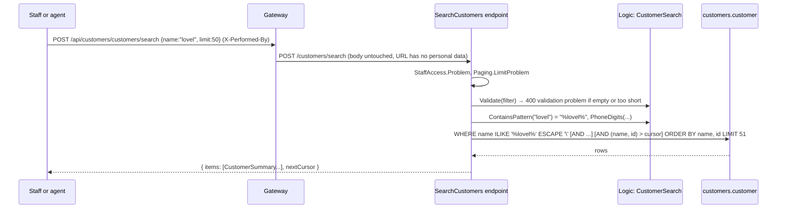

# Slice 3: Search customers

This document has three parts. Part 1 is the big picture: staff and the agent must find a customer from what a caller says, without spreading personal data into URLs and logs. Part 2 covers the building blocks: the pure matching rules, the endpoint, the database function and the log test. Part 3 explains why, including bank-customers ADR 0001. Tests, limits and questions come after.

---

## Part 1. The big picture

### 1.1 The goal

A caller says "I'm Ada Lovelace, my number is 070-111 11 11". Staff, or later the agent, must find that customer to answer the next question: their accounts, their loan application. So Customers needs a search by name, email, phone or customer number, one page at a time.

### 1.2 Why it is hard

- **People type data loosely.** Part of a name, any letter case, phone numbers with spaces, dashes or a `+`.
- **The filters are personal data.** A URL like `/customers?email=ada@example.com` ends up in access logs, proxies, traces and browser history. Logs written by the service itself must not hold them either.
- **User input can be a pattern.** In SQL `LIKE`, `%` and `_` are wildcards. Without escaping, the term `%%` would match every customer.
- **Only staff may search.** One search can list many customers.

---

## Part 2. The building blocks and how they connect



### 2.1 `Logic/CustomerSearch.cs` (pure)

`core_banking/bank-customers/src/Bank.Customers.Api/Logic/CustomerSearch.cs`, written test first:

- `CustomerSearchFilter(Name, Email, Phone, CustomerNumber)`: the four filters. Every one given must match.
- `Validate`: at least one filter, a name term of at least 2 characters, a phone of at least 5 digits. The errors have the shape of a validation problem, as `CustomerRules.Validate` already does for registration.
- `ContainsPattern`: `"a_b"` becomes `"%a\_b%"`. The term's own `%`, `_` and `\` are escaped, so they match literally.
- `PhoneDigits`: `"+46 70-111 11 11"` becomes `"46701111111"`.

### 2.2 The endpoint `POST /customers/search`

`core_banking/bank-customers/src/Bank.Customers.Api/Features/Customers/SearchCustomers.cs`. The body is `{ name, email, phone, customerNumber, limit, cursor }`. The cursor goes in the body too, because it contains a customer's name (ADR 0004). Each filter adds a `Where`:

- name: `EF.Functions.ILike(c.Name, pattern, "\")`, which becomes `ILIKE ... ESCAPE '\'`;
- email: `c.Email.ToLower() == email`;
- phone: `RegexpReplace(c.Phone, "[^0-9]", "", "g") == digits`;
- customer number: `c.Id == id`.

The sort is `(name, id)`. Two customers called "Ann Berg" are told apart by the id, so paging never skips or repeats one. Each hit is a `CustomerSummary` (id, name, email, phone, status). The national id and address stay behind `GET /customers/{id}`.

### 2.3 `CustomersDbContext.RegexpReplace`

`core_banking/bank-customers/src/Bank.Customers.Api/Data/CustomersDbContext.cs`. A C# method mapped to PostgreSQL's built-in `regexp_replace`, with the `'g'` flag ("replace all"). It throws if called outside a query. It changes no schema, so there is no migration (`has-pending-model-changes` confirms this).

### 2.4 `Paging` and `StaffAccess` (copies)

`Features/Paging.cs` is the same contract as in Lending (ADR 0004). The new `Features/Problems.cs` holds `Problems.Of` (Customers had none) and `StaffAccess` (ADR 0006: 403 `staff_only`, 401 `missing_actor`).

### 2.5 The log test

`tests/Bank.Customers.IntegrationTests/Support/CapturingLoggerProvider.cs` keeps every log line. `CustomersApp` registers it with a provider-specific filter at `Trace`, so it sees every level, whatever `appsettings.json` says. The test then searches by name, email and phone. It checks that log lines were written, and that none of them contains the name, the email or the digits.

---

## Part 3. Why it is designed this way

### 3.1 Decisions (D1, decided by Claude on Majid's delegation)

- **bank-customers ADR 0001**: contains matching for names, exact matching for email, phone digits and customer number, and **no new index**. `pg_trgm` was the strongest alternative. But the service roles cannot `CREATE EXTENSION`, so it would add a manual superuser step on the live home bank and on AWS, for no gain at about 100 customers.
- **Customer number = customer id.** The data model has no other customer number, and inventing one would be a new business rule.
- Workspace ADRs 0004 (keyset), 0005 (POST for personal-data searches) and 0006 (staff-only reads) apply as decided in slice 2.

### 3.2 Claude's choices (D2)

- **A summary, not the full record**, in search results: less personal data per call.
- **Minimum lengths** (name 2 characters, phone 5 digits), so a one-letter search does not list everyone.
- **The design changed while building**: the first version used `Regex.Replace` in LINQ. The phone test failed, because the translation replaced only the first non-digit. The explicit `regexp_replace(..., 'g')` mapping replaced it.

### 3.3 Patterns

- **Functional core**: input rules are pure and unit-tested; the query is in the feature.
- **Escaping user input in patterns**, the LIKE version of "never build SQL from input".
- **Data minimization**: the search returns only what is needed to pick a customer.
- **Testing for absence**: a test that proves something (personal data) is *not* written anywhere.

---

## What was tested

- `tests/Bank.Customers.UnitTests/CustomerSearchTests.cs`: phone digits, wildcard escaping, and the validation rules.
- `tests/Bank.Customers.IntegrationTests/CustomerSearchTests.cs` (Testcontainers PostgreSQL): name contains and sort; email, phone and customer number exact, and combined; `_` and `%%` matched literally; three pages over five customers, three with the same name; a customer (403) and a caller without an actor (401) refused; no filter, a short name, `limit=0` and a cursor missing its id are 400; no search value in any log line.

```text
$ cd core_banking/bank-customers && dotnet test
Passed!  - Failed: 0, Passed: 45, Skipped: 0, Total: 45 - Bank.Customers.UnitTests.dll
Passed!  - Failed: 0, Passed: 36, Skipped: 0, Total: 36 - Bank.Customers.IntegrationTests.dll
```

## What to watch later

- The search reads the whole table. At tens of thousands of customers, add `pg_trgm` or expression indexes (ADR 0001, consequences).
- `+46 70…` and `070…` do not match each other. A phone normalization rule (country code) is a business decision for later.
- The data import and registration store phones as typed. A stored, normalized phone column would make the match indexable.

## Check your understanding

1. What would the search `{ "name": "%%" }` return without `ContainsPattern`'s escaping, and why?
2. Why does the cursor of this search have to travel in the body, while the review queue's cursor may sit in the URL?
3. The log test registers its provider with a `Trace` filter. What would the test prove, or fail to prove, without that filter?
