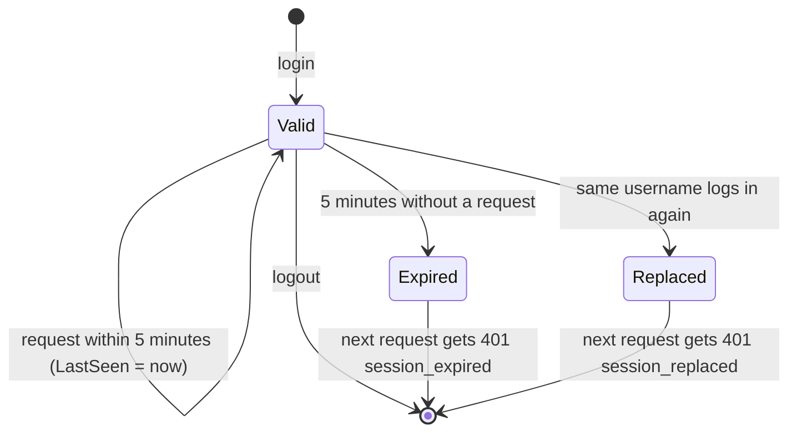

# Identity: test logins and sessions

This document has three parts. Part 1 is the big picture: the agent must say on whose behalf it acts, and the gateway must stop believing the identity headers a caller sends. Part 2 covers the building blocks: the new `bank-identity` service, the gateway's token check, the national id search in Customers, and the changes to the platform, the import and the tests. Part 3 explains why it is built this way (workspace ADR 0007). Tests, limits and questions come after.

---

## Part 1. The big picture

### 1.1 The goal

The caller of the bank's API is always the AI agent. The agent acts for a person: an admin (bank staff) or a customer. Until now, the gateway checked one shared API key and then simply believed two headers: `X-Customer-Id` ("this call is for customer X") and `X-Performed-By` ("staff member Y makes this call"). So anyone with the key could put any customer's id in the header and read or move that customer's money.

The goal is to make the person explicit and checked:

- The person logs in once: `admin` / `admin`, or a customer with their national id as both username and password (`IMP-C001` / `IMP-C001`).
- Each login returns a new random token. The agent sends it on every later request.
- A user has at most one session. A second login, from anywhere, ends the first one, and the first one hears why on its next request.
- After 5 minutes without a request, the session ends and the user must log in again.

### 1.2 Why it is hard

- **Trust moves.** The services already understand `X-Customer-Id` and `X-Performed-By`. If the gateway still forwarded what the caller sent, a token would protect nothing. So the gateway must drop those headers and create them itself from the session.
- **The national id lives in another service.** Only Customers knows which customer has national id `IMP-C001`. The workspace rule says services talk only through events, and no event carries the national id.
- **Sessions have state that changes over time.** "Valid", "expired" and "replaced" depend on the clock and on other logins. Tests must not wait 5 real minutes.
- **Everything that called the API before must now log in:** the data import, the platform tests and the end-to-end scenarios.

---

## Part 2. The building blocks and how they connect

### 2.1 One request from login to service

```mermaid
sequenceDiagram
    participant A as Agent
    participant G as Gateway (GatewayMiddleware)
    participant I as bank-identity
    participant C as Customers (POST /customers/search)
    participant S as Accounts
    A->>G: POST /api/identity/login {"username":"IMP-C001","password":"IMP-C001"} + X-Api-Key
    Note over G: /api/identity/* needs no token
    G->>I: POST /login
    I->>I: Credentials.CustomerNationalId → "IMP-C001"
    I->>C: POST /customers/search {nationalId:"IMP-C001", limit:1}, X-Performed-By: identity
    C-->>I: {items:[{id, name, status:"Active"}]}
    I->>I: InMemorySessionStore.Start → new token; an older session of IMP-C001 is marked replaced
    I-->>A: {token, role:"customer", customerId, name, expiresAt}
    A->>G: GET /api/accounts/accounts/{id} + X-Api-Key + Authorization: Bearer token
    Note over G: drop caller's X-Customer-Id / X-Performed-By
    G->>I: GET /sessions/current (Bearer token)
    I->>I: SessionRules.Check → Valid; LastSeen = now (idle timeout restarts)
    I-->>G: {username, role:"customer", customerId}
    G->>S: GET /accounts/{id} + X-Customer-Id: customerId (no token)
    S-->>A: the account (only if it belongs to that customer)
```

### 2.2 When a session ends



After the one 401 that explains the end, the token is forgotten, and any later use gets `invalid_token`. An ended session that nobody asks about is forgotten one idle period later, during a later login.

### 2.3 The pure rules: `bank-identity/src/Bank.Identity.Api/Logic/SessionRules.cs`

- `Principal`: who the session acts for (username, role, and for a customer the id and name).
- `SessionEntry`: one login: token, principal, `LastSeen`, and `ReplacedAt` when a newer login replaced it.
- `SessionRules.Check(entry, now, idleTimeout)` returns `Unknown`, `Replaced`, `Expired` or `Valid`. "Replaced" wins over "expired", because it is the more useful answer.
- `SessionRules.ExpiresAt` is `LastSeen + idleTimeout`. `SessionRules.CanForget` says when an ended entry may be dropped.
- `Credentials.IsAdmin` holds the hard-coded `admin` / `admin`. `Credentials.CustomerNationalId` accepts a login when username and password are the same non-blank value of at most 32 characters (the column's size), and never `admin`.

These functions take the time and the timeout as parameters. They have no clock, no dictionary and no I/O, so the unit tests can check every edge (one tick before the timeout, exactly at the timeout) without waiting.

### 2.4 The session store: `Sessions/SessionStore.cs`

- `IdentityOptions.IdleTimeout` comes from `Identity:IdleTimeout` in `appsettings.json` (5 minutes). Startup fails if it is not positive.
- `ISessionStore` has three operations: `Start(principal)`, `Use(token)` and `End(token)`.
- `InMemorySessionStore` keeps two dictionaries behind one lock: token → entry, and username → active token. `Start` marks the user's previous entry as replaced and creates a token from 32 random bytes (`RandomNumberGenerator`, URL-safe Base64). `Use` asks `SessionRules.Check`: a valid entry gets `LastSeen = now`, and an expired or replaced entry is removed after this one answer.
- The time comes from `TimeProvider` (the system clock in production, `TestClock` in tests). This is technical time, so the business clock (`IBusinessClock`) is not involved.

### 2.5 The endpoints: `Features/SessionEndpoints.cs`

- `POST /login` tries the admin first, then the customer path. For a customer it calls `CustomerDirectory` and accepts only status `Active`. Every failure is the same 401 `invalid_credentials`, so a caller cannot find out which national ids exist. If Customers does not answer, the result is 503 `customers_unavailable`.
- `GET /sessions/current` is what the gateway calls on every request. It returns the session view, or a 401 with code `missing_token`, `invalid_token`, `session_expired` or `session_replaced`.
- `POST /logout` ends a valid session (204).
- `Bearer.Token` reads `Authorization: Bearer <token>`, and `Problems` builds the problem answers with a `code` field, like every other service does.

### 2.6 The Customers lookup: `Features/CustomerDirectory.cs` and the Customers search

- `CustomerDirectory` is a typed `HttpClient` with base address `http://customers`. Aspire service discovery (or `services__customers__http__0` in Compose) turns that into the real address. It sends `POST /customers/search {nationalId, limit: 1}` with `X-Performed-By: identity`, because the search is staff-only (ADR 0006).
- In Customers, `CustomerSearchFilter` and `SearchCustomers.Request` got an optional `NationalId`. The query compares it exactly after trimming. The unique index `ux_customer_national_id` guarantees at most one hit. The national id travels in the body (ADR 0005) and is never logged.

### 2.7 The gateway: `bank-gateway/src/Bank.Gateway/GatewayMiddleware.cs`

For every `/api` request, in this order:

1. Check the API key (unchanged). The key says the caller is the trusted agent.
2. Remove `X-Api-Key`, `X-Customer-Id` and `X-Performed-By`. Nothing the caller says about identity survives.
3. For `/api/identity/*`, forward as is. Login needs no token, and identity reads the token itself for logout.
4. Otherwise, with no `Bearer` token, answer 401 `missing_token` without calling identity.
5. Call `GET http://identity/sessions/current` with the token (`AskIdentityAsync`, named HttpClient `identity` in `Program.cs`). A 401 from identity goes back to the agent unchanged, so the agent sees `session_replaced` with its message. No answer at all is 503 `identity_unavailable`.
6. Set `X-Customer-Id` for a customer, or `X-Performed-By: admin` for the admin. Remove the token, add the correlation id, and forward.

`Program.cs` refuses to start when `identity` is missing from `Gateway:Services`, and `appsettings.json` now lists it. YARP therefore routes `/api/identity/{**rest}` like any other service, and `/health` includes identity.

### 2.8 Running it: platform, Compose and CI

- `bank-platform/src/Bank.AppHost/AppHost.cs`: an `identity` project that references and waits for `customers`, with no database and no Kafka. The gateway references and waits for identity.
- `deploy/docker-compose.aws.yml` and `docker-compose.home.yml`: an `identity` container (`bank-identity` image) with `services__customers__http__0`. The gateway gets `services__identity__http__0` and waits for it. `home-hosting.md` builds the eighth image, and its smoke test logs in with `curl` and `jq`.
- `.github/workflows/bank-identity.yml`: build and test, plus an arm64 image on master, the same as the gateway. `bank-platform.yml` also watches `bank-identity/src/**`.

### 2.9 Everything that had to log in

- **Data import** (`bank-data-import/src/Bank.DataImport/Importer.cs`): `LoginAsync` runs first in `RunAsync` and puts the token on the shared `HttpClient`. `ImportOptions.Actor` became `Username` / `Password` (default `admin`).
- **Platform tests** (`GatewayRoutingTests`): log in as admin, then check each service. A new case checks `/api/identity/sessions/current` through the gateway.
- **End-to-end tests** (`BankFixture`, `BankSteps`): `RegisterCustomerAsync` remembers each customer's national id, and `Customer(id)` logs in with it. `Staff` logs in as admin. Tokens are cached per user. A `session_*` 401 (for example after five idle minutes while days are being closed) logs in again and repeats the request once.

---

## Part 3. Why it is designed this way

### 3.1 Majid's decisions (D1, workspace ADR 0007)

- **A separate service, not code inside the gateway.** User rules and routing stay apart, and the gateway stays a thin proxy. The price is one more container and one HTTP hop per request.
- **Test logins: hard-coded admin, national id as password.** These are easy to share with testers, and no new number had to be invented. The price is that they are public: anyone with the API key who reads the repository can be anyone. This is an accepted exception to the secrets rule, for testing only.
- **HTTP lookup instead of an event.** No contract change and no backfill, and the customer's status is always current. The price is the one direct call between services, and customer logins fail while Customers is down.
- **A new token per login, one session per user, the new login wins.** A user who closed the window without logging out is never locked out, and the old session learns why it ended.
- **5-minute sliding timeout.** It limits how long a forgotten token stays useful.
- **Sessions in memory.** No schema, no migration and no write per request. The price is that a restart logs everyone out and only one instance can run.
- **Every `/api` call needs a token,** including the import. This is the only option that really stops a caller from claiming to be someone else. The price is that the audit columns now say `admin` where they used to say `import`.

### 3.2 Claude's choices (D2)

- **Opaque token plus server-side session instead of a JWT.** A JWT cannot be revoked before it expires, so "the new login ends the old one at once" and "sliding timeout" would both need extra machinery. With a server-side session, both are a dictionary update.
- **The gateway asks identity on every request,** with no cache. The answer is always current (a replaced session stops at once), and the cost is small at demo traffic.
- **Identity's 401 body is passed through unchanged,** so the agent gets the exact reason and message from the service that knows it.
- **Same 401 for every wrong login,** so the login cannot be used to test which national ids exist.
- **`TimeProvider` for session time.** The business clock is for banking dates. Idle time is wall-clock time, and `TimeProvider` lets the tests move time by hand.
- **"Replaced" is reported once, then forgotten.** That is enough for the message the user asked for, and it keeps memory bounded.
- **Login catches any lookup failure as 503.** When Customers is down, the resilience handler throws its own timeout exception rather than `HttpRequestException`. The first test run showed this as a 500.

### 3.3 How the design changed during the conversation

The first idea was two hard-coded users, `admin/admin` and `user/user`. Majid then replaced `user/user` with "any customer, by national id", so a login maps to a real customer and their data. "One login only" first meant either refusing the second login or ending the first one. Majid chose ending the first one, with a 401 that says why on the old session's first request.

### 3.4 Patterns used

- **Token-based session authentication** with a server-side session store.
- **Forward authentication** (also called "auth request"): the gateway delegates the token check to a separate service before proxying.
- **Header enrichment at the edge:** identity is set by the gateway and never taken from the client.
- **Functional core, imperative shell:** pure `SessionRules` and `Credentials`, and a thin store and endpoints around them.
- **Ports and adapters, in a small way:** `ISessionStore` lets a database store replace the dictionary later.

---

## What was tested

| Project | Scenarios | Result |
| --- | --- | --- |
| `Bank.Identity.UnitTests` | timeout edges, replaced beats expired, forgetting, credential rules | 22 passed |
| `Bank.Identity.IntegrationTests` | admin and customer login, wrong logins, new token per login, replacement message once, users independent, expiry, sliding timeout, logout, missing token, Customers down | 15 passed |
| `Bank.Gateway.IntegrationTests` | admin and customer headers, caller headers replaced, token not forwarded, missing token, refused token passed through, login without token, identity down, API key, startup checks | 22 passed |
| `Bank.Customers.UnitTests` / `IntegrationTests` | national id filter valid alone, exact match after trimming | 46 / 37 passed |
| `Bank.Platform.IntegrationTests` | identity healthy in the AppHost, login and every service through the gateway | 49 passed |
| `Bank.EndToEndTests` | the five scenarios, staff as admin and customers by national id | 5 passed (4 min 45 s) |
| `Bank.DataImport.UnitTests` / `IntegrationTests` | import through the AppHost after an admin login | 33 / 1 passed |

Command: `dotnet test` in each folder.

## What to watch later

- The logins are public test logins. Replace them before real users or real data: real credentials, hashed, stored as secrets.
- An admin login anywhere ends every other admin session, including a running import.
- One identity instance only. A restart logs everyone out.
- One extra HTTP call per request. If it ever matters, add a short cache in the gateway, and accept that a replaced session works a few seconds longer.
- The home bank still runs the old images. Until it is rebuilt (`home-hosting.md`, step 2), the old header behaviour is live.

## Check your understanding

1. Why would forwarding the caller's `X-Customer-Id` make the whole login useless?
2. What would break, or need extra work, if the token were a JWT?
3. Where is "5 minutes" written, and why is it not in `SessionRules`?
4. A user logs in on two laptops, one after the other. What does each laptop see on its next request, and on the request after that?
5. Why does identity call Customers over HTTP here, when the rest of the bank uses events? What would the event-based version have cost?
6. Why does the gateway check the token before the request reaches Accounts, and not Accounts itself?
