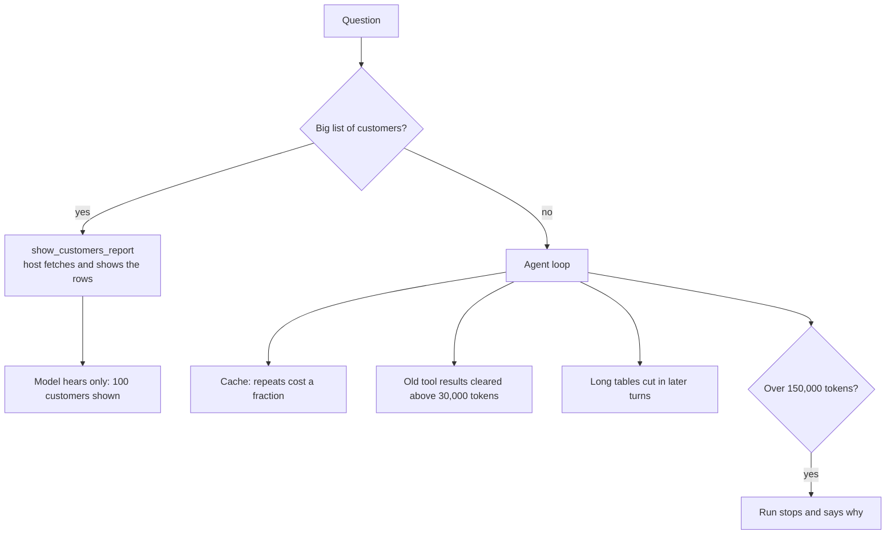

# Phase 2 fix: why one question cost 2.38 USD, and the controls added

Same order as every learning document: the big picture first, then the parts, then why.

## The big picture

An agent loop is expensive in a way that is easy to miss: **every model call sends everything before it again.** Ask for 100 customers one by one and each call carries all the earlier results, so the bill grows with the square of the work. One question used 1.14 million input tokens and never finished.

There are two kinds of fix, and the first is worth more:

1. Keep big data away from the model altogether.
2. For what must go through the model, send less of it, pay less for repeats, and stop a run that goes too far.

## The parts

**The report (`CustomersReportTool`).** Normally a table is a tool call whose arguments the model writes. Here the model only says what the report should hold, and the host does the rest. The MCP server combines the bank's reads, because the bank has no single read for this.

**The limit per run.** After each model call the host adds up the input tokens. Above 150,000 it stops, and the person is told to ask for something smaller.

**Caching.** The provider remembers what it just read, and the next call pays much less for that same beginning. It only works if the beginning stays identical, so the instructions and the tool list must not change within a run.

**Clearing old tool results.** The provider swaps old tool results for a short note before the model reads them. The newest five stay. This is one half of the prompt compression; the other half is in `ChatHistory`, which cuts long tables replayed in later turns.

**The wrapper (`CostControlledModel`).** Caching and clearing are set in one place, so no other file names the provider.

**The right message.** The chat used to call every failure a bank outage, and that hid a spent account limit. Now each failure has its own note, and the log has the provider's own message.

## Why this way

- Background work was considered and left for later: it makes waiting easier but costs the same. See agent ADR 0009.
- Clearing and caching pull against each other: clearing throws away the cache after that point. That is why clearing waits until it can save at least 5,000 tokens.
- The limit is a guard rail. A normal answer stays far below it, and every value is configuration, so it can change without a rebuild.
