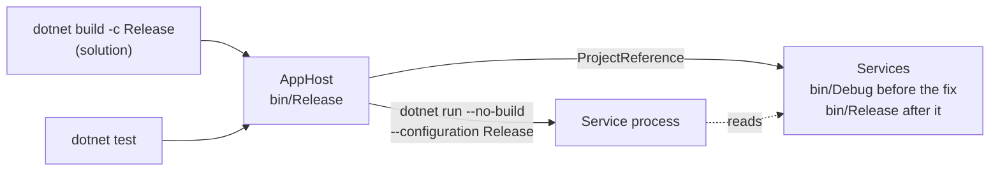

# Fix: CI timed out starting the AppHost

## The big picture

The `bank-platform` and `bank-data-import` workflows failed on GitHub: the tests that start the whole system waited until their timeout (`TaskCanceledException` from `StartAsync`). The same tests passed in a working copy, which hid the problem. A fresh clone that follows the CI steps failed every time, so the cause was in the build, not in the code the tests exercise.

Without this fix, nobody can trust these two workflows, and anyone who builds a fresh clone in Release gets the same hang.

## The building blocks and how they connect

1. **The solution build.** MSBuild treats a referenced project that the solution does not list differently: it drops the parent's `Configuration`. `Bank.Platform.slnx` lists the AppHost but not the services, so they were built as `Debug`.
2. **The AppHost at run time.** Aspire starts each service with `dotnet run --no-build --configuration Release`, using the configuration the AppHost itself was built with. The file `bin/Release/net10.0/Bank.Accounts.Api` did not exist, so the process exited with code 1.
3. **The hang.** Services that never start never become healthy, and resources that wait for them keep waiting. The test only sees its own timeout. The DCP logs showed `exit status 1` for the services and `no endpoints configured` on their proxies.
4. **The fix.** `core_banking/bank-platform/Directory.Build.props` sets `ShouldUnsetParentConfigurationAndPlatform` to `false`, so the AppHost passes its configuration on to everything it references.

A working copy passed because an older build had left `bin/Release` folders behind.

## Why it is designed this way

- **One property next to the AppHost wins.** The property is read by the project that holds the references, so this one line fixes both workflows, because `bank-data-import` builds the same AppHost.
- **Listing every service in each solution was rejected.** `Bank.DataImport.slnx` already lists most services, yet `bank-identity` and the two agent projects were added later and missed. A list like that drifts each time the AppHost gains a service. The existing entries stay, because they do no harm and show those projects in the IDE.
- **Building the test project instead of the solution was rejected.** It would fix CI only. A person who runs `dotnet build -c Release` in the folder would still get the hang.
- **The price:** the property is an MSBuild detail that few people know, so the file carries a comment explaining it.

These were Claude's choices (D2).

## What was tested

Every CI step on a fresh clone with an empty `HOME`, without `bin` or `obj` folders:

| Workflow | Before | After |
| --- | --- | --- |
| `bank-platform` integration tests | 12 failed, about 5 minutes | 55 passed, 43 seconds |
| `bank-data-import` tests | failed on GitHub after about 10 minutes | 33 unit and 1 integration passed, 46 seconds |

The "after" build also has only `bin/Release` for the Accounts, Identity and Agent projects. The `bank-e2e` workflow has not been run with this fix.

## What to watch later

- A service that cannot start still shows up as a plain timeout in these tests. The real reason is only in the service output or the DCP logs.
- A project built outside the AppHost, from a solution that does not list it, still falls back to `Debug`.

## Check your understanding

1. Why did the tests pass in a working copy and fail in a fresh clone?
2. Why does the fix belong to the project holding the references, not to the services?
3. What would you look at first if a new service made this test time out again?
