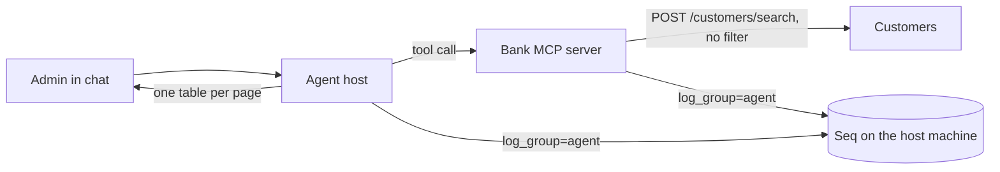

# Phase 2 fix: customer lists, runs that end in silence, and logs in Seq

Same order as every learning document: the big picture first, then the parts, then why.

## The big picture

The admin asked the chat for all customers with their national ids. The agent first said it could not, then went silent twice. Behind that were three separate gaps:

- the bank had no way to list customers, and its search did not return the national id;
- the agent, with no direct way, guessed names, and a run could stop with no message at all;
- finding the cause meant reading container logs by hand.

The fix closes each gap at its own level: the bank, the agent, and the platform.

## The parts

**The bank (bank-customers ADR 0002).** `POST /customers/search` with no filter lists every customer, and each row has `nationalId`. It stays staff only. A filter that is given but blank is refused, so a caller that lost its value never gets the whole list.

**The agent's tool and instructions.** `customers_search` says that no filter lists everyone and accepts `nationalId`. The instructions say: one table per page, never join pages, never guess.

**The silence check (agent ADR 0008).** The model writes a table by writing all its rows as tool arguments, and those count against the output limit. Too many rows, and the call is cut off with no exception. After the loop the host now asks: did the person get anything since the last tool, and did the model hit the limit? If so, the run ends with `no_answer`, and the UI says the answer stopped early.

**Logs in Seq (bank-platform ADR 0005).** `Bank.ServiceDefaults` sends logs to `Seq:ServerUrl` when it is set. Seq has no group object, so a group is a property (`log_group`) that every event of a container carries, plus a saved filter in Seq, called a signal.

## Why this way

- The national id was already readable one customer at a time; the list saves a call per customer. It is also the test login's password (workspace ADR 0007), which is acceptable only because the data and the logins are test data.
- The limit on the answer stays a cost limit. Long lists go page by page instead of raising it.
- The group is configuration, so adding the bank's logs later changes no code.
