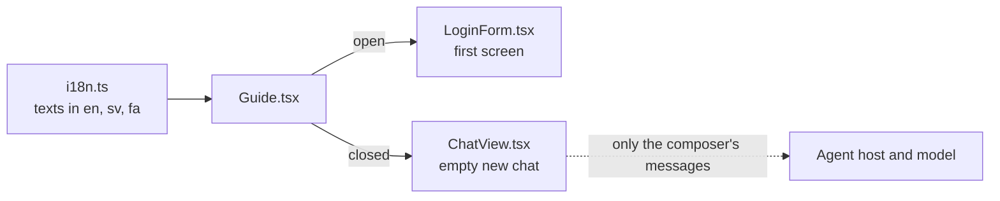

# Fix: a guide on the first screen

## The big picture

The repository is about to become public, and the login page is what a visitor meets first. It showed a form and the test logins, but nothing about what the app is, what can be asked or what to be careful with. The last point matters most: the test logins are public and messages leave for a model provider, so a visitor who types real personal data would expose it.

The goal is that a visitor knows three things before logging in: what the app is for, how to use it and what its limits are.

## The building blocks



- **`agent/chat-ui/src/Guide.tsx`**: the guide, a native `<details>` with three headed parts. Its `open` prop decides how it starts; the person can toggle it either way.
- **`agent/chat-ui/src/i18n.ts`**: one key per sentence, in the same typed dictionary as every other UI text, so a missing translation fails the compile.
- **`agent/chat-ui/src/LoginForm.tsx`**: shows the guide open, below the form and the test logins.
- **`agent/chat-ui/src/ChatView.tsx`**: shows it closed inside `ThreadPrimitive.Empty`, so it leaves when the first message is sent.
- **`agent/chat-ui/src/styles.css`**: the `.guide` rules. The guide takes the full width, because it is reading text and not a chat message.

## Why it is designed this way

These are Claude's choices (D2).

- **Below the form, not above it.** Someone sent back by an ended session wants to log in again at once. The guide's title and first part are still visible without scrolling on a laptop. The price: on a phone the guide starts after one scroll.
- **On both first screens.** "The first page" can mean the login or the new chat, and someone who logged in still needs the limits. Closed in the chat, it costs one line.
- **UI text, not a model answer.** The text is the same every time, costs no tokens and is shown before any login. A test checks that it is not part of what is sent to the agent.
- **Fixed numbers in the text.** The 5 idle minutes and 5 messages a minute are written out, because concrete limits help the reader. The price: the text does not follow `Agent:IdleTimeout` or `Agent:Model:RunsPerMinute`. Serving them from the host was rejected as too much for one sentence; a comment in `i18n.ts` points to the settings.

## What was tested

`LoginForm.test.tsx` (open, with the three parts), `ChatView.test.tsx` (closed, not sent to the agent) and `i18n.test.tsx` (Persian). Screenshots of the login on a laptop, Persian on a phone and a new chat showed no sideways scrolling.

```bash
cd agent/chat-ui && npx vitest run    # 7 files, 43 tests passed
```

The Playwright tests were not rerun, because they need the whole system running.

## What to watch later

- Change the guide's text when a limit in `appsettings.json` changes.
- The list of capabilities names only what the tools do today; add new ones when they are built.

## Check your understanding

- Why is the warning about real personal data stronger here than in a normal bank app?
- What would break if the guide were sent as the first assistant message of the chat?
