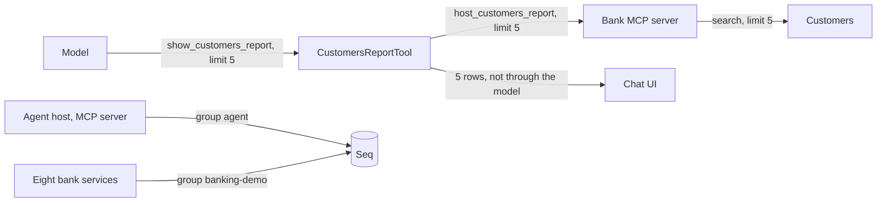

# Fix: a limit on the customers report, and the bank's logs in Seq

## The big picture

Two things came from one failed request. The admin asked for the first five customers and got all of them. Finding the cause of an earlier error also showed that only the agent's logs reached Seq, so one request could not be followed from the chat into the bank.

The goal is that a report shows what was asked for, and that an error anywhere can be found in one place.

## The building blocks

- **`agent/src/Bank.Agent.Host/Features/Agent/CustomersReportTool.cs`**: takes an optional `limit` and tells the model how many were shown.
- **`agent/src/Bank.Agent.Mcp/AdminTools.cs`**, `CustomersReportAsync`: stops reading at `limit`, so it makes account and loan calls only for those customers.
- **`agent/src/Bank.Agent.Host/Logic/AgentInstructions.cs`**: tells the model to pass the number the admin asks for.
- **`core_banking/bank-platform/deploy/docker-compose.home.yml`**: the `x-seq-logs` block gives each bank service the Seq address, its group and quieter log levels. `Bank.ServiceDefaults` does the sending (bank-platform ADR 0005).

## Why it is designed this way

These are Claude's choices (D2), apart from sending the bank's logs to Seq, which Majid decided on 2026-11-04.

- **The limit goes all the way to the bank.** Cutting the table in the host would be simpler, but a report with accounts would still make a bank call per customer for all of them.
- **"First" means first by name.** That is the bank's search order, the only stable one it offers. The price: "the first five" may not be the five oldest customers.
- **Settings in the home Compose file.** AWS, CI and tests stay as they were. The price: the same block repeats for each service.

## What was tested

`AdminToolsTests` (the bank is asked for that many, and `more` is set), `AgentToolTests` (the limit reaches the bank, and the model is told). The commands and results are in `docs/progress.md` and the commit. A backup was taken before the services were recreated.

## What to watch later

- The model decides to pass `limit`. There is no evaluation case for it yet, because running the set needs a key and costs money.
- Whether events arrive in Seq was checked only by reaching its port and its ingest path; reading them needs a login to Seq.

## Check your understanding

- Why does the limit belong in the MCP tool and not only in the table?
- Why are the log levels set in the Compose file and not in each service's `appsettings.json`?
