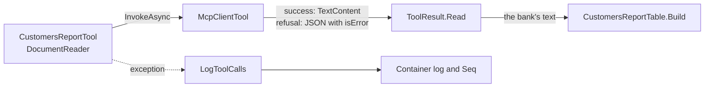

# Fix: the customers report and document reading failed on real tool answers

## The big picture

The admin asked for customers and got "the system gave an error twice". Reading an uploaded document was broken the same way. Both worked in every test, and both failed against the real MCP server.

The log made it worse. It said only `failed, 23 characters`, because the model is given the fixed text `Error: Function failed.` and nothing recorded the real exception. The goal of this fix is that both tools work, a test double can no longer hide this, and the next tool failure can be read from the log.

## The building blocks



- **`agent/src/Bank.Agent.Host/Features/Agent/ToolResult.cs`**: reads a tool's answer. A successful MCP tool answers with `TextContent`, which the code did not know. It serialized the object, so `{"customers":...}` arrived inside a wrapper, and `GetProperty("customers")` threw. It now takes the text.
- **`agent/src/Bank.Agent.Host/Features/AgUi/AgUiEndpoint.cs`**, `LogToolCalls`: a tool that throws now also logs an error with the exception's type and stack trace. The agent host and the MCP server send their logs to Seq as well (bank-platform ADR 0005).
- **`agent/tests/Bank.Agent.IntegrationTests/Support/AnswersLikeMcp.cs`**: makes the scripted report and document tools answer with `TextContent`, as the real ones do.
- **`AdminToolsTests`** in `Bank.Agent.Mcp.Tests`: pins the two answer shapes against the real SDK.

## Why it is designed this way

These are Claude's choices (D2).

- **Fix the one reader.** Every caller goes through `ToolResult.Read`, so reads marked as untrusted and receipts of changes also get the bare text now.
- **Type and stack trace, not the message.** An exception message could hold customer data, so it stays out of the log. This follows agent ADR 0009.
- **Test the shape against the SDK.** The old doubles returned a string, which is why the tests stayed green. Their shape now has a test that fails if the SDK changes it.

## What was tested

The new tests failed before the fix: the report test, the document test and the `ToolResult` test.

```bash
cd agent
dotnet test tests/Bank.Agent.UnitTests          # 106 passed
dotnet test tests/Bank.Agent.Mcp.Tests          # 53 passed
dotnet test tests/Bank.Agent.IntegrationTests   # 59 passed
```

## What to watch later

- The bank services did not send logs to Seq at first; `fix-report-limit-and-bank-logs.md` added them.
- Tools with structured results answer with a JSON element and not `TextContent`. `ToolResult.Read` handles both.
- The report had no limit, so "the first five" got the whole list; `fix-report-limit-and-bank-logs.md` added one.

## Check your understanding

- Why did a test double returning a string keep this bug hidden?
- Why does the log record the exception's type but not its message?
