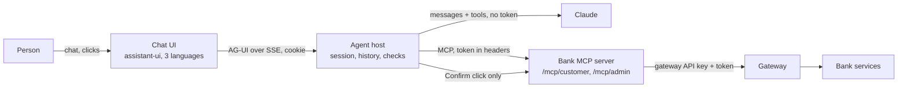

# Phase 2 overview: the bank's AI agent

This is the map of the whole phase. Each stage has its own learning document with the details; read this first.

---

## Part 1. The big picture

### What we built

A chat in front of the bank. A customer or the admin logs in and talks in English, Swedish or Persian. An AI agent (Claude) answers with the bank's own numbers, shows tables, cards, charts and diagrams, asks for exact values with forms, and makes changes (transfers, loan applications, approvals, closing the day) only after the person presses Confirm.

### What makes it hard

- A language model can misunderstand, invent numbers, or be talked into things (prompt injection).
- The model must never see the bank token, never pick another customer, and never be the one who approves.
- Everything must be traceable, and the bank stays the security boundary.

### The answer in one picture

The model chooses; our code acts. The host decides which tools exist, the person's click decides every change, and the bank decides who may do what.

---

## Part 2. The stages and how they build on each other

| Stage | What it added | The idea to remember | Document |
| --- | --- | --- | --- |
| 1 | Chat shell, login, sessions, chats stored; echo instead of a model | The host is a backend-for-frontend: the browser never holds the bank token | `stage-1-chat-shell.md` |
| 2 | Claude, the MCP server with customer reads, tables and cards | Tool calling: the model asks, our code runs; the token goes in headers, never in arguments | `stage-2-first-agent.md` |
| 3 | Every customer change behind a confirmation, forms, uploads, charts, diagrams, old chats | Human in the loop, enforced by the host; the confirmation id is the idempotency key | `stage-3-forms-and-changes.md` |
| 4 | The admin's own tool set on `/mcp/admin`; bank staff-only fixes | Least privilege twice: the tool set, and the bank's own checks | `stage-4-admin.md` |
| 5 | Loan advisor, review, arrears follow-up, management report; untrusted content | Prompt injection defence in layers: markers, a reader without tools, the click | `stage-5-workflows.md` |
| 6 | Three languages and right to left; the evaluation set; the home bank | Tests guard the code; evaluation guards the model's behaviour | `stage-6-languages-and-evaluation.md` |

### The four safety lines, from the outside in

1. **The bank** checks every call: a customer token gets 403 on staff work (stage 4 fixed three holes).
2. **The tool set** per role: a customer's agent never sees admin tools (stage 4).
3. **The confirmation**: a change runs only after the person's click, with a key that makes it run once (stage 3).
4. **The markers and the reader**: customer text and documents reach the model as data only (stage 5).

The instructions to the model come last on purpose: they guide, they do not protect.

---

## Part 3. Why it is designed this way

- **MCP between agent and bank** (decision A2): one standard place for the tools, no business logic, and the gateway stays the door into the bank.
- **UI components as tools** (A8): the model cannot draw, but it can call `show_table`; the host checks the data before the browser draws it.
- **Changes only by the person's click** (A11): the model has no tool that confirms.
- **Small tools, the model composes**: workflows are instructions, not code; the click and the bank keep them safe.
- **Simple and readable over clever**: one MCP server with two paths, one dictionary for languages, rule-based evaluation. Each can grow when a real need appears.

Decisions in detail: agent ADRs 0001 to 0006 (`agent/docs/adr/`).

## What is left for Majid

- Set the Anthropic key and `env/bank-mcp.env` on the home bank (`home-hosting.md` section 8), then start `bank-mcp` and `agent`.
- Run the evaluation set once with the key to get the first score.
- Review and merge the phase 2 branches (stage 2 to stage 6, each built on the one before).
