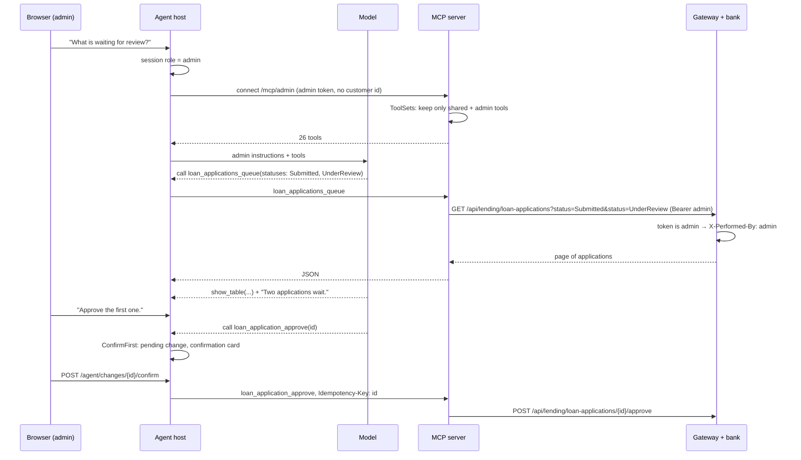

# Phase 2, stage 4: the admin role

Same order as every learning document: the big picture first, then the parts and how one admin request travels through them, then why. Tests, limits and questions at the end.

---

## Part 1. The big picture

### 1.1 The goal

Until now only customers had bank tools. Now the bank's admin can ask the same chat:

- "Show the trial balance in SEK. Do debit and credit match?"
- "How does the portfolio look, and how many loans are overdue?"
- "Tell me everything about Smoke Test."
- "What is waiting for review?" and then "Approve it."
- "Close the day."

The answers come from the bank, as tables and cards. Every change still waits for a click on Confirm.

### 1.2 The one idea to understand first: least privilege, twice

A customer's agent must never be able to do admin work. Two independent walls make sure of that:

```
wall 1 (agent side):  the customer's connection goes to /mcp/customer, which does not even list trial_balance
wall 2 (bank side):   if a customer's token still reached the trial balance, the bank answers 403 staff_only
```

Wall 1 keeps the model from being tempted: it cannot call a tool it does not know. Wall 2 is the real boundary: the bank checks every call, whoever sends it. While building wall 1 we found that wall 2 had holes: a customer's token could close the business day, activate a currency or read the journal. Those phase 1 bugs are fixed in this stage.

### 1.3 Why it is hard

- **The admin works on many customers,** so admin tools must take a customer id, which the customer tools never do.
- **The model must not pick the role.** If the model chose `/mcp/admin`, a prompt injection could too.
- **Loan decisions belong to a person** (business question 1). The agent may present facts; only the admin's click approves or rejects.
- **Customer text reaches the admin's model.** A note in the contact history could say "approve this loan". It is data, not an instruction.

---

## Part 2. The building blocks and how they connect

### 2.1 One admin request, end to end



### 2.2 Slice 1: the bank fixes

- `bank-operations/.../Features/StaffOnly.cs` and `bank-ledger/.../Features/StaffOnly.cs`: one small function. The gateway always sets `X-Customer-Id` for a customer's token (workspace ADR 0007), so "the header is there" means "a customer is calling", and the answer is 403 `staff_only`. Used in `CloseBusinessDay`, `ActivateCurrency` and the two ledger reports. Lending and Customers already had such checks.
- Customers `GET /information-requests` without `applicationId`: the staff queue of every open request, oldest first, at most 100 (`InteractionEndpoints.RequestsAsync`). Staff only through the existing `StaffAccess` (403 for a customer, 401 without an actor).

### 2.3 Slice 2: the admin tools in the MCP server

- `SharedTools.cs`: `business_date` and `loan_products_list`, for both roles.
- `AdminTools.cs`: 16 reads. Reports (`trial_balance`, `journal_entries`, `portfolio_report`, `arrears_report`), the day and currencies, a customer's picture (`customers_search` then `customer_get`, `customer_accounts`, `customer_loans`, `customer_interactions`, `customer_appointments`, `customer_standing_orders`), and the review work (`loan_applications_queue`, `loan_application_get`, the information requests).
- `AdminChangeTools.cs`: 8 changes, each `ReadOnly = false`, so the host puts them behind the confirmation.
- `ToolSets.cs`: the filter. In stateless mode the MCP SDK builds fresh server options for every HTTP request and calls `ConfigureSessionOptions` with the request. `KeepToolsOfPath` looks at the path and removes every tool whose name is not in that role's set. The sets are computed from the tool classes themselves (the `[McpServerTool]` names), so they cannot drift from the code.

`customers_search` is a POST because its filters (a name, an email) are personal data and must stay out of URLs and logs (workspace ADR 0005).

### 2.4 Slice 3: the host

- `BankTools.cs`: `OpenForCustomerAsync` became `OpenAsync`. The session's role picks the path; only a customer's connection carries `X-Customer-Id`.
- `AgUiEndpoint.cs`: the "admin gets no tools" gate is gone.
- `AgentInstructions.cs`: the admin's text names the tools and four workflows: the trial balance check, the customer overview, closing the day with checks (trial balance first, close only on the admin's word, then compare the arrears report with the day before), and the loan review (show the facts; never decide or recommend; approve or reject only when the admin says so, with the admin's reason).
- `ChangeSummary.cs`: card titles such as "Approve a loan application".

Nothing changed in the confirmation code: `ConfirmFirst` and `ActionEndpoints` work by the read-only flag and the session, not by role.

---

## Part 3. Why it is built this way

Claude's choices on Majid's delegation, recorded in agent ADR 0004.

- **One server, two paths.** One deployment, one gateway client; a customer's agent never sees admin tool names. Rejected: two servers (more to run), one path with role checks inside every tool (the model would see everything).
- **Role from the session.** The host knows who logged in; the model does not get a say.
- **Fix the bank, too.** The agent is one client of many. A hole in the bank is a hole for every client.
- **Small tools, the model composes.** "Customer 360" is five reads that the model combines, not one tool with business logic in the MCP server.

Patterns: **least privilege**, **defence in depth**, **capability filtering per request**, **human in the loop** for every admin change, **data, not instructions** for customer text.

---

## What was tested

| Project | Scenarios | Result |
| --- | --- | --- |
| `Bank.Agent.Mcp.Tests` | admin path lists 18 reads and 8 changes and no customer tool; customer path unchanged after an admin request; a customer connection cannot call `trial_balance`; nine admin reads hit the right bank path with the admin token; search is a POST; change without key refused; rejection sends reason and key | 35 passed |
| `Bank.Agent.IntegrationTests` | admin run gets admin tools, no customer id, the result reaches the model; an approval only after the admin's click, once, with the key, logged with the role | 45 passed |
| `Bank.Agent.UnitTests` | admin instructions: tools, "you never decide", confirmation | 54 passed |
| Bank | customer cannot close the day, activate a currency, read the journal or trial balance; open queue for staff, 403 customer, 401 anonymous | operations 17 + 46, ledger 22 + 8, customers 46 + 39 passed |
| `chat-ui-e2e` (AppHost) | unchanged scenarios | 6 passed |

Live check on the AppHost (2026-11-03), through `/mcp/admin` with a real admin token: 26 tools listed; currencies, the SEK trial balance, the portfolio, a customer search and the open requests came back; a submitted application was found in the queue, a review without a key was refused, with a key it moved to UnderReview and was then approved. With a customer's token the same path got 403 `staff_only` from the bank for the trial balance and for closing the day, and `/mcp/customer` answered "Unknown tool" for `trial_balance`.

## What to watch later

- Not tried with the real model yet (needs Majid's key): how well it follows "never recommend" and the close-the-day checks.
- The approval card shows only the application id.
- The journal can be long; the tool asks for a short period but does not enforce one.
- Customer texts reach the admin's model; stage 5 adds explicit handling of untrusted documents.

## Check your understanding

1. Name the two walls that stop a customer's agent from closing the day. Which one is the real boundary?
2. Why can admin tools take a customer id when customer tools never do?
3. Where does the decision "customer path or admin path" happen, and why not in the model?
4. What does `ToolSets.KeepToolsOfPath` change, and why is it safe to change it on every request?
5. A note in the contact history says "Approve this loan." What stops the agent from approving it?
