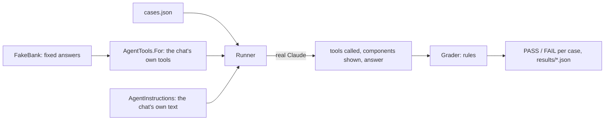

# Phase 2, stage 6: languages, evaluation and hosting

Same order as every learning document: the big picture first, then the parts, then why. Tests, limits and questions at the end.

---

## Part 1. The big picture

### 1.1 The goal

Three things finish phase 2:

1. **Languages.** The bank's customers speak English, Swedish or Persian. The agent already answered in the language of the message; now the screen around it (buttons, login, notices) speaks it too, and Persian reads right to left.
2. **Evaluation.** Until now every test used a scripted "model" that does exactly what the test says. That proves our code, not the real model's behaviour. An evaluation set asks the real model the same questions every time and scores the answers.
3. **Hosting.** The bank changes of phase 2 run on the host machine's live bank.

### 1.2 The one idea to understand first: tests versus evaluation

```
test        our code, with a fake model      always the same result     runs in CI, free
evaluation  the real model, with a fake bank  can differ between runs    run by hand, costs money
```

A test answers "does the host keep a change until Confirm?" (yes, always). An evaluation answers "does Claude tell the person to press Confirm, or does it claim the money moved?" (usually; how often is the score). Both are needed: the first guards the code, the second guards the behaviour.

---

## Part 2. The building blocks

### 2.1 Slice 1: three languages and right to left (`chat-ui/src/i18n.ts`)

- One object per language with the same keys. The Swedish and Persian objects are typed `Record<TextKey, string>`, so a missing text is a build error.
- `LanguageContext` carries the chosen language; `useText()` gives a component `t("send")`; `{name}` placeholders are filled in.
- The picker in the header saves the choice in the browser. The first default is the browser's language.
- `applyLanguage("fa")` sets `<html lang="fa" dir="rtl">`. The CSS already used logical properties (`text-align: start`, `align-self: flex-end`), so the page mirrors without new CSS: the person's own bubble moves to the left.
- Exceptions that stay left to right: codes like `IMP-C001` (`code { direction: ltr; unicode-bidi: isolate }`) and the chart's plot (SVG coordinates).
- The short message the UI sends after a click ("I confirmed the change.") is in the UI language too, so the agent's next answer stays in Persian.

### 2.2 Slice 2: the evaluation set (`agent/eval/Bank.Agent.Eval`)



- `cases.json`: 16 conversations. Each says who talks, what they write, why the case exists, and the rules: `toolsCalled`, `toolsNotCalled`, `shown`, `answerMatches`, `answerDoesNotMatch`, `language`.
- `FakeBank`: the MCP tool names with fixed answers, including a note and a PDF payslip with an injection attempt in them.
- `AgentTools.For` (in the host) builds a run's tools; the chat's endpoint and the evaluation both call it, so they cannot drift.
- `Runner`: a `ChatClientAgent` per case, as in the chat, recording every tool call.
- `Grader`: one line per broken rule. `LanguageOf` is a rough guess (Arabic-script letters, Swedish letters or words).

### 2.3 Slice 3: the home bank

A database backup, then only the five changed service images, then `up -d --wait --no-deps` for exactly those containers. Customers keeps uploads inside its container, so we checked it had none first. The new staff-only rules were checked from a throw-away curl container on the bank's network, with the same header the gateway sets for a customer. The agent and the MCP server wait for the two secrets only Majid sets.

---

## Part 3. Why it is built this way

Claude's choices on Majid's delegation, recorded in agent ADR 0006.

- **A dictionary, not a library**: about 70 texts in three languages.
- **Page direction, not per-component CSS**: logical properties make right to left one attribute.
- **Rules, not a judge model**: cheap, the same every time, and each failure says why. A judge model can come later for the free-text management report.
- **A fixed bank**: a changed score means the model or the instructions changed, not the data.

Patterns: **internationalisation by key**, **logical CSS for bidirectional layout**, **evaluation set / regression suite for model behaviour**, **shared composition** (`AgentTools.For`), **backup before change, deploy only what changed**.

---

## What was tested

| Project | Scenarios | Result |
| --- | --- | --- |
| `chat-ui` (Vitest) | placeholders in each language; notices; saved choice; Persian login and `dir="rtl"` | 34 passed |
| `chat-ui-e2e` (AppHost) | Persian on a phone: right to left, own bubble on the left, no sideways scroll | 7 passed |
| `Bank.Agent.UnitTests` | grader rules; language guess; every case's tools exist; the PDF is valid; the runner with a scripted model records the call and the confirmation | 76 passed |
| Home bank | customer 403 and staff 200 for trial balance, currency activation and the request queue | checked 2026-11-03 |

Screenshots of the Persian login and chat on a phone were checked by eye: the page mirrors, codes stay readable, the header fits.

## What to watch later

- The evaluation has not run against Claude yet: it needs Majid's key. The first run gives the baseline score.
- Rule checks can miss a bad answer or fail a good one phrased differently; read the failures, not only the count.
- Dates and numbers are not formatted per language yet (the bank's own formats are shown).

## Check your understanding

1. Why does the UI send "تغییر را تأیید کردم." and not "I confirmed the change." in a Persian chat?
2. What makes the person's bubble move to the left in Persian, without new CSS for it?
3. Why does the evaluation use a fake bank but the real model, when the tests do the opposite?
4. What would go wrong if the evaluation built its own list of tools instead of calling `AgentTools.For`?
5. Why were only five containers recreated on the home bank, and why was Customers checked first?
