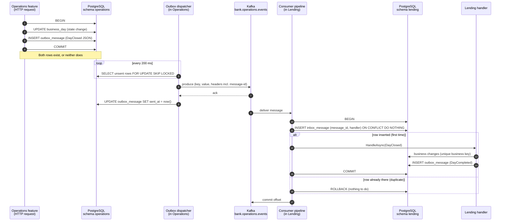

# The path of one event

Before slice 1.2. This page follows one event from the moment service A changes its data to the moment service B has reacted. Slices 1.2 and 1.3 build every box in the diagram. The table after it says what a crash at each step leaves behind. That table is the reason the outbox, the inbox and the idempotent handler exist.

Example used throughout: Operations closes the day and publishes `DayClosed(2026-10-30)`. Lending consumes it and runs its end-of-day work. Any other pair of services works the same way.

## The sequence

Steps 1–4 are one database transaction in A. Steps 10–15 (or 10, 11, 16 for a duplicate) are one database transaction in B. Nothing in between is transactional: Kafka and PostgreSQL never share a transaction.

## If it crashes at this step

| Crash after step | What is left | What happens next | What protects us |
| --- | --- | --- | --- |
| 2 or 3 (before COMMIT) | Nothing. The transaction rolls back. | The caller gets an error and can retry. No event was announced for a change that did not happen. | State and outbox row in the same transaction |
| 4 (committed, dispatcher has not run) | State changed, outbox row unsent | The dispatcher finds the row on its next poll, even after a restart | The outbox is durable; it is just a table |
| 6 (sent to Kafka, no ack received) | Unsent row; Kafka may or may not have the message | The dispatcher sends it again. Kafka may now hold it twice | At-least-once delivery, so the consumer must tolerate duplicates |
| 7 (acked, `sent_at` not written) | Message in Kafka, row still unsent | Sent again on the next poll: a duplicate with the **same message-id** | The inbox in B recognises the message-id |
| 8 (row marked sent) | Done on A's side | — | — |
| 10–14 (B's transaction open) | B's transaction rolls back: no inbox row, no business change, no outgoing event | The offset was not committed, so Kafka delivers the message again | Inbox row, effect and outgoing outbox row in one transaction |
| 15 (B committed, offset not committed) | Effect applied, inbox row written | Kafka delivers the message again; the inbox insert finds the row and B does nothing | The inbox key `(message_id, handler)` |
| 17 (offset committed) | Done | — | — |
| Any step, with a handler bug | The handler throws every time | Retried, then sent to the dead-letter topic (slice 1.3) so the partition moves on | Retry and DLT |

Two more cases the table does not show:

- **Two dispatcher instances.** `FOR UPDATE SKIP LOCKED` makes each one take different rows. Without it, both would send the same rows (harmless thanks to the inbox, but wasteful).
- **The same business effect under two different message-ids.** This happens if A publishes the same fact twice by mistake, for example a retried HTTP request. The inbox cannot catch it, because the ids differ. A unique business key on the effect itself catches it, for example `(loan_id, installment_no)` (design plan ADR 08).

## What to explain back

Cover each crash point in your own words. For each one, name what is in A's database, what is in Kafka, and what is in B's database. Then say which mechanism makes the end result correct.

The key idea in one line: **we cannot make "write to the database" and "send to Kafka" atomic, so we make sending repeatable (outbox) and receiving repeatable without harm (inbox and business keys).**
