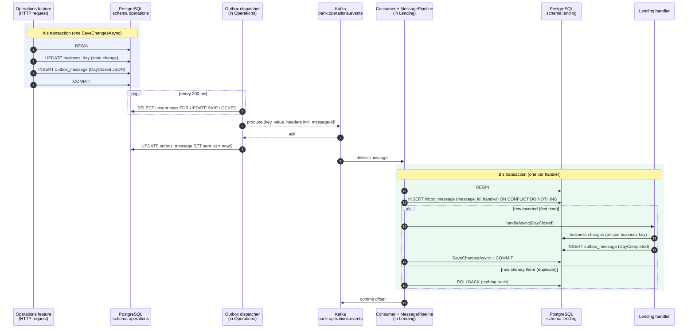

# The path of one event

Companion page to slices 1.2 and 1.3. It follows one event from the moment service A changes its data to the moment service B has reacted, and says what a crash at each step leaves behind.

---

## Part 1. The big picture

### 1.1 The goal

> A fact that service A saved reaches service B, and B applies it **exactly once in effect**: never zero times, never twice.

Example used throughout: Operations closes the business day and publishes `DayClosed(2026-10-30)`. Lending consumes it, runs its end-of-day work, and replies with `DayCompleted`. Any other pair of services works the same way.

### 1.2 Why it is hard

The path crosses three systems: A's database, Kafka, and B's database. **No transaction covers more than one of them.** A process can crash between any two steps. So:

- A can save its change but crash before telling Kafka, and the fact is lost.
- A can tell Kafka and then fail to save, and B reacts to a change that never happened.
- Kafka will deliver a message again if B crashes after doing the work but before saying "done". So B **will** see duplicates.

We cannot make "write to the database" and "send to Kafka" atomic. Instead we make **sending repeatable** (the outbox) and **receiving repeatable without harm** (the inbox and business keys).

---

## Part 2. The building blocks and how they connect

### 2.1 The whole path

Steps 1–4 are one transaction in A. Steps 10–15 (or 10, 11, 16 for a duplicate) are one transaction in B. Nothing in between is transactional.

### 2.2 The parts, in the order a message meets them

- **The feature in A** (slice 1.2): changes its entities and calls `IEventPublisher.PublishAsync`. The publisher only adds an `outbox_message` row to the same `DbContext`, so one `SaveChangesAsync` writes both (steps 1–4).
- **`outbox_message`** (slice 1.2): a table in A's own schema. An unsent row (`sent_at` empty) is a fact waiting to be announced. It survives restarts.
- **The outbox dispatcher** (slice 1.2): a background loop in A. Every 200 ms it locks unsent rows with `SKIP LOCKED` (step 5), sends them through `IMessageTransport` (steps 6–7), and marks them sent (step 8).
- **Kafka** (slice 1.3): the topic `bank.operations.events`. The message key is the entity id, so messages about one entity stay in order. The `message-id` header is the event's `EventId`.
- **The Kafka consumer** (slice 1.3): reads the topic in consumer group `bank.lending` (step 9), hands each message to `MessagePipeline`, and commits the offset only after it returns (step 17). On repeated failure it retries, then sends the message to the dead-letter topic.
- **`MessagePipeline` and `inbox_message`** (slice 1.2): for each handler, one transaction. It first inserts the inbox row `(message_id, handler)` (step 11). If the row already exists, the handler already applied this message, and nothing happens (step 16).
- **The handler in B** (slice 1.2): changes Lending's entities and may publish follow-up events. It never saves. The pipeline saves the effect, the inbox row and the follow-up outbox rows together (steps 12–15).
- **The business key** (each service, later stages): a unique constraint on the effect itself, such as `(loan_id, installment_no)`, rejects the same fact sent twice under two message ids.

---

## Part 3. Why it is designed this way

Each mechanism exists because of one crash point. The table shows them.

### 3.1 If it crashes at this step

| Crash after step | What is left | What happens next | What protects us |
| --- | --- | --- | --- |
| 2 or 3 (before COMMIT) | Nothing. The transaction rolls back | The caller gets an error and can retry. No event exists for a change that did not happen | State and outbox row in one transaction |
| 4 (committed, dispatcher has not run) | State changed, outbox row unsent | The dispatcher finds the row on its next poll, even after a restart | The outbox is durable; it is just a table |
| 6 (sent to Kafka, no ack received) | Unsent row; Kafka may or may not have the message | The dispatcher sends it again. Kafka may now hold it twice | At-least-once delivery, so the consumer must tolerate duplicates |
| 7 (acked, `sent_at` not written) | Message in Kafka, row still unsent | Sent again on the next poll: a duplicate with the **same message-id** | The inbox in B recognises the message-id |
| 8 (row marked sent) | Done on A's side | — | — |
| 10–14 (B's transaction open) | B's transaction rolls back: no inbox row, no business change, no outgoing event | The offset was not committed, so Kafka delivers the message again | Inbox row, effect and outgoing outbox row in one transaction |
| 15 (B committed, offset not committed) | Effect applied, inbox row written | Kafka delivers the message again; the inbox insert finds the row and B does nothing | The inbox key `(message_id, handler)` |
| 17 (offset committed) | Done | — | — |
| Any step, with a handler bug | The handler throws every time | Retried, then sent to the dead-letter topic (slice 1.3), so the partition moves on | Retry and DLT |

Two more cases the table does not show:

- **Two dispatcher instances.** `FOR UPDATE SKIP LOCKED` makes each one take different rows (ADR 0006). Without it, both would send the same rows: harmless thanks to the inbox, but wasteful.
- **The same business effect under two message ids.** This happens if A publishes the same fact twice by mistake, for example after a retried HTTP request. The inbox cannot catch it, because the ids differ. The business key catches it (design plan ADR 08).

### 3.2 The decisions behind the path

| Mechanism | Decision | Where |
| --- | --- | --- |
| Outbox in the same `SaveChangesAsync` as the state change | Messaging tables in each service's model | bank-contracts ADR 0012, workspace ADR 0002 |
| Dispatcher polls with `SKIP LOCKED` every 200 ms | D1, Majid | bank-contracts ADR 0006 |
| Inbox key `(message_id, handler_name)` | D1, Majid | bank-contracts ADR 0007 |
| Offset committed only after processing; retry, then DLT | Retry strategy, D1 in slice 1.3 | `docs/implementation-decisions.md`, ADR in slice 1.3 |
| Unique business key on financial effects | Design plan | design plan ADR 08 |

**Rejected:** relying on Kafka's exactly-once transactions alone (design plan ADR 08). They cover Kafka-to-Kafka, not Kafka-to-PostgreSQL, so steps 7–8 and 15–17 would still be exposed.

**Price:** every message may arrive more than once, so every handler must be written to be idempotent, and the outbox and inbox tables grow until a cleanup job exists.

---

## Check your understanding

1. For each crash point in the table, say in your own words what is in A's database, what is in Kafka, and what is in B's database. Then name the mechanism that makes the end result correct.
2. Why does B commit the Kafka offset **after** its database commit, and not before? What would a crash in between lose in each order?
3. Which crash points would still be unsafe if the inbox key were removed and only the business key remained?
