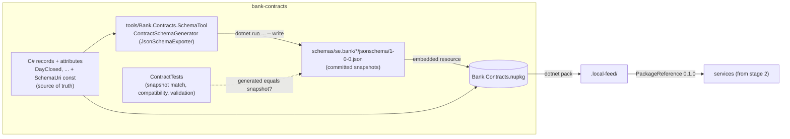

# Slice 1.1: Contracts

What this slice built: the `bank-contracts` folder and its first package, `Bank.Contracts`. It holds `Money`, the event interface, the first five events, the JSON Schemas generated from them, and the tests that keep the two in sync. Nothing here talks to a database or Kafka yet; that is slices 1.2 and 1.3.

## 1. The concepts

### Value object: `Money`

A value object is a small type that is defined only by its values. Two `Money(10, "SEK")` are the same money, just as two copies of the number 10 are the same number. It has no id and no lifecycle.

**What problem it solves.** In banking, an amount without a currency is meaningless and dangerous. With a plain `decimal balance`, nothing stops `balance + eurPayment`, and the ledger is silently wrong. `Money` makes the currency part of the value. The operators (`+`, `-`, `<`, ...) check it, and mixing currencies throws `CurrencyMismatchException`.

**Why `decimal`, never `double`.** `double` is binary floating point. It cannot represent 0.1 exactly, so `0.1 + 0.2 == 0.30000000000000004`. `decimal` stores base-10 digits, so 0.10 stays 0.10. For money that difference becomes real öre lost or created.

**Why `Money` never rounds.** Rounding is a business decision: which unit (SEK has 2 minor units), which rule (AwayFromZero), and *when*. In an annuity schedule you round each installment and push the leftover into the last one (design plan ADR 16). If `Money` rounded inside `*`, those leftovers would appear in random places. So `Money * 0.0695m / 12` keeps all its digits, and you round on purpose with `MoneyRounding` (slice 1.2).

**Why the JSON amount is a string.** `{ "amount": "1234.50", "currency": "SEK" }`. JavaScript, and many JSON libraries in other languages, read every JSON number as a `double`. A string forces the reader to parse it as a decimal. It also keeps the scale: `1234.50` stays `"1234.50"`, not `1234.5`.

### Contract-first design

A *contract* is the promise a publisher makes to everyone who reads its events: these fields, these types, this meaning. Contract-first means you write the contract before the code that publishes it, and the contract lives on its own, outside any one service.

**Without it**, Lending would read Operations' events by guessing their shape from Operations' code. A rename in Operations would break Lending, and nobody would know until runtime.

### JSON Schema and Iglu-style URIs

A JSON Schema is a JSON file that describes another JSON document: which properties it has, their types, which are required, and patterns such as `^[A-Z]{3}$`. Any language can validate a message against it, so the contract is not tied to C#.

Here the schemas are generated from the C# records, not written by hand (ADR 0003, see section 7). The generated files are committed as *snapshots*, so the contract is still a plain JSON file anyone can read and review in a diff.

Each schema is named by a URI such as `iglu:se.bank/day_closed/jsonschema/1-0-0`. That is vendor / name / format / version, the naming style of Snowplow's Iglu. The same four parts appear in three places, and the tests check that they agree:

```
URI in the record:   iglu:se.bank/day_closed/jsonschema/1-0-0
File path:           schemas/se.bank/day_closed/jsonschema/1-0-0.json
"self" in the file:  { "vendor": "se.bank", "name": "day_closed", "format": "jsonschema", "version": "1-0-0" }
```

We validate with standard JSON Schema draft 2020-12 and keep `self` as an extra keyword. We take Iglu's naming and versioning without needing an Iglu server.

### SchemaVer: MODEL-REVISION-ADDITION

SemVer (1.2.3) is about code APIs. SchemaVer is about *data*: will a reader that knows the old version still understand messages in the new one? We keep its three-part format but use only two of the bumps:

| Bump | Example | Meaning | Our rule (checked in CI) |
| --- | --- | --- | --- |
| ADDITION | 1-0-0 → 1-0-1 | Every old message is valid under the new schema | Only new **optional** fields; nothing removed, retyped, or made required/optional |
| MODEL | 1-0-1 → 2-0-0 | Any other change | Anything; a consumer that knows only MODEL 1 sends a MODEL 2 message to the dead-letter topic (slice 1.3) |

REVISION stays 0: a bump to it fails the compatibility test.

**Without it**, a consumer receiving `day_closed/1-0-1` could not tell whether it is safe to read with its 1-0-0 record. With SchemaVer it knows: same MODEL means read it with the record you have.

### Contract tests

These are tests whose subject is the contract itself, not behaviour. They turn "remember to update the schema too" from a promise into a red build.

## 2. How the pieces fit



## 3. What was built, file by file

Everything is under `core_banking/bank-contracts/`.

| File | What it is |
| --- | --- |
| `Directory.Build.props` | Settings shared by every project: net10.0, nullable on, warnings are errors, version 0.1.0 |
| `Directory.Packages.props` | Central package management: every NuGet version is set once here, never in a `.csproj` |
| `nuget.config` | Package sources: nuget.org and `../.local-feed` |
| `Bank.Contracts.slnx` | Solution file (the new XML format) |
| `CLAUDE.md` | Notes and gotchas for this folder |
| `schemas/se.bank/<event>/jsonschema/1-0-0.json` | The five generated snapshots: `currency_activated`, `business_day_opened`, `day_closed`, `day_completed`, `test_event` |
| `src/Bank.Contracts/Money.cs` | The value object and its operators; it validates that the currency is a three-letter upper-case code |
| `src/Bank.Contracts/CurrencyMismatchException.cs` | Thrown when two currencies are combined; carries `Left` and `Right` |
| `src/Bank.Contracts/Money.cs` (`MoneyJsonConverter`, `Money.JsonSchema()`) | The converter reads and writes the string-amount JSON shape and rejects numbers, exponents, commas and bad codes; `JsonSchema()` describes that shape for the schema tool, next to the converter |
| `src/Bank.Contracts/Events/IIntegrationEvent.cs` | `EventId`, `OccurredOn` (business date), `PerformedBy`, with the descriptions and constraints every schema uses for them |
| `src/Bank.Contracts/Events/*.cs` | `CurrencyActivated`, `BusinessDayOpened`, `DayClosed`, `DayCompleted`, each with `[Description]` and field attributes |
| `src/Bank.Contracts/Events/TestEvent.cs` | For messaging tests only: `Key` (ordering), `Sequence`, `Amount` (exercises `Money` in a schema) |
| `src/Bank.Contracts/Schema/SchemaKey.cs` | Parses and formats `iglu:` URIs, orders versions, maps a key to its file path |
| `src/Bank.Contracts/Schema/ContractSchemas.cs` | Lists and reads the embedded schemas |
| `src/Bank.Contracts/ContractJson.cs` | The one `JsonSerializerOptions` for events: camelCase, strict numbers, required and non-nullable fields enforced on read |
| `tests/.../MoneyTests.cs`, `MoneyJsonTests.cs` | Arithmetic, comparison, mismatch, validation, JSON shape |
| `tests/.../SchemaKeyTests.cs` | URI parsing, path, ordering |
| `tests/.../ContractTests.cs` | **The snapshot test** and the schema checks (see below) |
| `tests/.../ContractSchemaGeneratorTests.cs`, `SchemaCompatibilityTests.cs` | Tests of the generator and the compatibility checker themselves |
| `tools/Bank.Contracts.SchemaTool/*.cs` | The snapshot tool (ADR 0004): `ContractCatalog` (finds the records), `ContractSchemaGenerator`, `SchemaSnapshots` (compares, writes missing snapshots), `Program` (`write` and `check`) |
| `tests/.../SchemaSnapshotsTests.cs` | The tool writes only missing files, never overwrites, and writes them exactly as committed |
| `tests/.../Support/*.cs` | `SchemaCompatibility`, `SampleFactory` |
| `docs/adr/0001-package-layout.md`, `0002-...` (superseded), `0003-generate-event-schemas-from-records.md`, `0004-write-schema-snapshots-with-a-separate-tool.md` | The ADRs of this slice |
| `.github/workflows/bank-contracts.yml` (repo root) | CI: restore, build, test; runs only when this folder changes; publishes nothing |

### What `ContractTests` checks

For every record that implements `IIntegrationEvent`:

1. It has a valid `public const string SchemaUri`, and it is the **latest** version of its schema.
2. **Snapshot:** the schema generated from the record now is equal to the committed snapshot for that `SchemaUri`. A missing snapshot fails with the command that writes it.
3. **Validation:** a sample instance serialized to JSON passes the schema, with patterns and formats enforced.

The generator maps `Guid` → string/uuid, `DateOnly` → string/date, `int` → integer, `Money` → object with string `amount` and `currency`, and a constructor parameter without a default → `required`. `ContractSchemaGeneratorTests` checks each mapping, and that a bare `decimal` or an unmapped attribute is refused.

For every schema file: path, `self` and URI agree; the common fields `eventId`, `occurredOn` and `performedBy` are required; the first version is `1-0-0`; each next version is a legal step (ADDITION or MODEL).

I proved the checks really fail. I temporarily added `string? Reason = null` to `DayClosed`:

- With `SchemaUri` still `1-0-0`, the snapshot test failed: `DayClosed no longer matches the published schema iglu:se.bank/day_closed/jsonschema/1-0-0.`
- With `SchemaUri` bumped to `1-0-1` and its snapshot written, all tests passed.
- With the field made required (`string Reason`) under `1-0-1`, the compatibility test failed: `'reason' changed between required and optional; an ADDITION may only add optional fields.`

Then I reverted all three.

## 4. Patterns used and why

- **Value object** (`Money`): makes invalid states (an amount without a currency, mixed currencies) impossible or loud.
- **Records for contracts**: immutable, value equality, short syntax. An event is a fact that happened, so it should never change after creation.
- **Code as source of truth, schema as a committed snapshot** (ADR 0003): one copy of each contract, still readable outside .NET, and an incompatible change fails the build.
- **Snapshot testing**: generated output is compared with a reviewed file; changing it is a deliberate step, never a side effect.
- **Test the test**: `ContractSchemaGeneratorTests` checks the generator's mappings, so a generator bug cannot hide inside every snapshot.
- **Central package management**: one place to upgrade a library, so all projects use the same version.
- **Fail fast at the boundary**: `Money`'s constructor and the JSON converter reject bad input right where it enters, not three services later.

## 5. D2 choices I made (Claude decides and explains)

| Choice | Why |
| --- | --- |
| `Money` validates the currency as three upper-case ASCII letters | ISO 4217 format; catches `"sek"` and typos early. It does *not* check that the currency is active; that is Operations' business rule. |
| `Money.Zero(currency)` helper | Starting point for sums, so `Money.Zero("SEK") + ...` replaces `new Money(0, ...)` everywhere |
| Comparing different currencies throws; equality does not | `<` across currencies has no answer. `==` does: they are simply not equal |
| All event records, `IIntegrationEvent` and `TestEvent` in one flat `Bank.Contracts.Events` | First grouped by publishing service (`Bank.Contracts.Operations`, `Bank.Contracts.Testing`); Majid later chose one flat folder so everything about events sits together, like `Bank.Contracts.Schema`. The publisher is in each record's `[Description]` and in section 6 of the design plan. The test event stays in this assembly so the contract tests cover it too |
| `SchemaUri` as a `const`, not a static abstract interface member | Static abstract members would forbid `List<IIntegrationEvent>`; the contract test checks that the const exists |
| Schemas do not set `additionalProperties: false` (except inside `Money`) | An older consumer that validates must accept messages from a newer ADDITION that has extra optional fields |
| Schemas use draft 2020-12 with an extra `self` block | Standard tooling validates them; Iglu naming without an Iglu server |
| `ContractJson.Options`: Web defaults + strict numbers | camelCase as in the schemas; `"2"` is not accepted as the number 2 |
| JsonSchema.Net in the test project, the generator in the tool | `Bank.Contracts` stays dependency-free; the package never contains the generator |
| Descriptions and constraints as attributes (`System.ComponentModel`, `DataAnnotations`) | In-box attributes the generator can read; the schema keeps its descriptions and patterns |
| `ContractJson.Options` enforces required and non-nullable fields on read | A consumer rejects exactly what the schema rejects, instead of filling in `Guid.Empty` or null |
| The generator applies `Money` and attributes in its own pass, not in `TransformSchemaNode` | The exporter skips that callback for a second `Money` field |
| The tool's `write` writes only missing files | A published snapshot can never be overwritten by accident |
| `SampleFactory` has per-name samples for `Code` and `Service` | Fields with a pattern need a matching value; the test says when one is missing |
| No XML doc file generation | With warnings as errors it would force a comment on every public member; key types have summaries anyway |

## 6. Check your understanding

1. Someone adds a new **required** field `reason` to `day_closed` and saves it as `1-0-1`. Which test fails, and what version should it have been instead? Why can't an ADDITION add a required field?
2. Why is `Money(1000m, "SEK") * 0.0695m / 12` left unrounded, and what could go wrong in a 60-month loan schedule if `Money` rounded each multiplication itself?

## 7. Change on 2026-10-30: schemas generated from records

The slice first used hand-written schemas as the source of truth, with a reflection test that compared each record with its schema (ADR 0002). The same day Majid changed this D1 decision (ADR 0003): every event was written twice, and the comparer existed only to keep the copies equal. Now the record is the only copy, the schema is generated from it and committed as a snapshot, and only ADDITION or MODEL bumps are allowed. The five generated snapshots are equal, as JSON, to the hand-written files, so no contract changed.

## 8. Change on 2026-10-30: a separate tool writes the snapshots

At first the contract test also wrote a missing snapshot when `WRITE_SCHEMA_SNAPSHOTS=1` was set, then failed on purpose so a second `dotnet test` would embed and check it. Majid decided that a test should only check (ADR 0004). Now `tools/Bank.Contracts.SchemaTool` holds the generator and has two commands: `write` writes missing snapshots, `check` only compares. Neither ever overwrites a published file. The tests reference the tool, use the same generator and only read.

Adding an event is now: write the record, run `dotnet run --project tools/Bank.Contracts.SchemaTool -- write`, look at the new file in the diff, run `dotnet test` once. The build that `dotnet test` starts embeds the new file, so no second run is needed.

**Pattern:** command-query separation at the tool level. The command that changes files (`write`) is separate from everything that only reads (`check`, the tests), so running the tests can never change the repository.

Later the same day, `Money`'s JSON knowledge moved into one file: `Money.cs` holds the type, `MoneyJsonConverter` and `Money.JsonSchema()` (a raw JSON string). The generator no longer knows `Money` by name. For every property type it looks for `public static JsonObject JsonSchema()` and uses it when present; otherwise it uses the shape `JsonSchemaExporter` produces. A type with a custom converter but no `JsonSchema()` fails generation, because the exporter cannot see what a converter writes and would describe it as "anything".

Then the convention became an interface: `IJsonSchemaProvider` (now in `Bank.Contracts.Schema`) with `static abstract JsonObject JsonSchema()`, implemented by `Money`. The compiler now checks the method's name and return type. Because a static abstract member can only be called through a type parameter, the generator calls a small generic helper `SchemaOf<T>() where T : IJsonSchemaProvider` with `MakeGenericMethod(type)`. Only value types like `Money` implement it; `IIntegrationEvent` stays free of static abstract members, so it can still be used as an ordinary type (`List<IIntegrationEvent>`).
