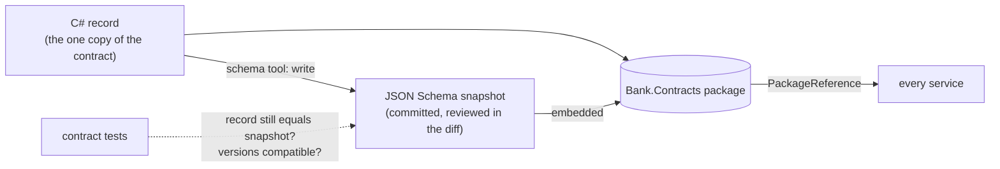
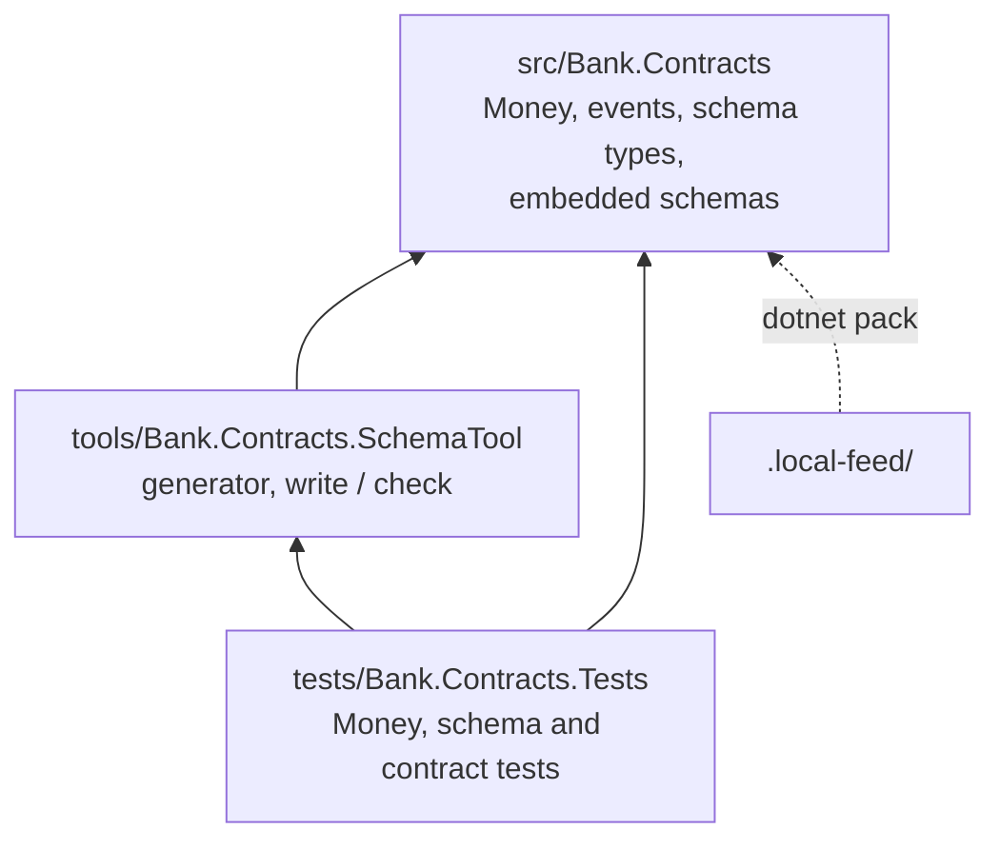
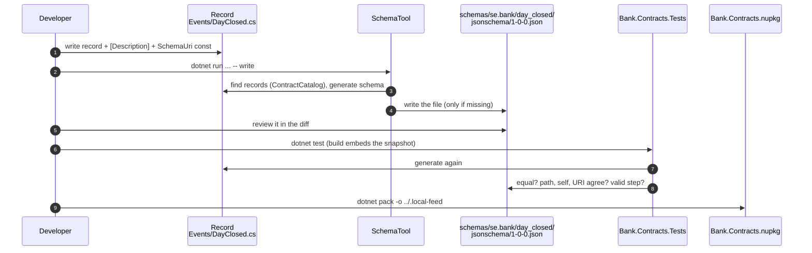

# Slice 1.1: Contracts

This document has three parts:

1. **The big picture**: what a contract between services is, and why it is hard to keep one correct.
2. **The building blocks**: the folder, the `Bank.Contracts` package, the schemas, the schema tool and the tests, and how they work together.
3. **Why it is designed this way**: the decisions, the alternatives we rejected, and the price we pay. This includes how the design changed during the slice (hand-written schemas first, generated schemas in the end).

At the end: what was tested, what to watch later, and questions to check your understanding.

---

## Part 1. The big picture

### 1.1 The goal

Six services will talk to each other only through events. Slice 1.1 builds the **language** they talk in:

> Every event has one agreed shape, written down once, that any reader can check, and that can only change in ways old readers survive.

It also builds the one type every financial field uses: `Money`.

Nothing here talks to a database or Kafka. That is slices 1.2 and 1.3.

### 1.2 Why it is hard: three problems

**Problem 1, amounts without currencies.** With a plain `decimal balance`, nothing stops `balance + eurPayment`. The ledger is then silently wrong. A `double` is worse still: it cannot hold 0.1 exactly, so `0.1 + 0.2` is `0.30000000000000004`, and öre appear or disappear.

**Problem 2, a contract nobody owns.** Lending reads the events of Operations. If Lending guesses their shape from Operations' code, a rename in Operations breaks Lending, and nobody notices until it runs. The shape must live outside both services, in a form any language can read.

**Problem 3, change over time.** Events are stored and replayed, and services are upgraded one at a time. So a consumer will receive messages in versions it has never seen. It must be able to tell, from the message alone, whether its own code can still read it.

### 1.3 The solution in one picture



- **A value object for money.** `Money(decimal Amount, string Currency)` carries its currency everywhere. Mixing currencies throws. It never rounds by itself.
- **Records as the source of truth.** Each event is a C# record. A JSON Schema is **generated** from it and committed as a file, so non-.NET readers and reviewers still get a plain JSON contract.
- **Versions with a meaning.** Every schema has a name like `iglu:se.bank/day_closed/jsonschema/1-0-0`. The last part says what kind of change it was. Same MODEL means "your code can read it".
- **Tests that guard the contract.** If a record changes without a new schema version, or a new version breaks old readers, the build turns red.

### 1.4 The concepts behind it

**Value object.** A small type defined only by its values. Two `Money(10, "SEK")` are the same money, just as two copies of 10 are the same number. It has no id and no lifecycle.

**Contract-first design.** The contract is the promise a publisher makes to every reader: these fields, these types, this meaning. It is written before the code that publishes it, and it lives on its own.

**JSON Schema.** A JSON file that describes other JSON documents: properties, types, required fields, patterns such as `^[A-Z]{3}$`. Any language can validate a message against it.

**SchemaVer.** SemVer (1.2.3) is about code APIs. SchemaVer (MODEL-REVISION-ADDITION) is about *data*: can a reader of the old version read messages in the new one?

| Bump | Example | Meaning | Our rule (checked by tests) |
| --- | --- | --- | --- |
| ADDITION | 1-0-0 → 1-0-1 | Every old message is valid under the new schema | Only new **optional** fields; nothing removed, retyped, or made required |
| MODEL | 1-0-1 → 2-0-0 | Any other change | Anything. A consumer that knows only MODEL 1 sends a MODEL 2 message to the dead-letter topic (slice 1.3) |

REVISION stays 0. A bump to it fails the compatibility test.

**Contract tests.** Tests whose subject is the contract itself, not behaviour. They turn "remember to update the schema too" into a red build.

---

## Part 2. The building blocks and how they connect

### 2.1 The folder and the projects

Everything lives in `core_banking/bank-contracts/` and is built by `Bank.Contracts.slnx`.



An arrow means "references". `Bank.Contracts` references no package at all, so the package never ships the generator or JsonSchema.Net.

The folder-wide files:

| File | What it does |
| --- | --- |
| `Directory.Build.props` | Settings for every project: net10.0, nullable on, warnings are errors, version 0.1.0 |
| `Directory.Packages.props` | Central package management: each NuGet version is set once, never in a `.csproj` |
| `nuget.config` | Package sources: nuget.org and `../.local-feed` |
| `CLAUDE.md` | Notes and gotchas for this folder |
| `.github/workflows/bank-contracts.yml` (repo root) | CI: restore, build, test; runs only when this folder changes; publishes nothing |

### 2.2 How a new event travels from idea to package

Follow `DayClosed` through the parts:



The sections below explain each part.

### 2.3 `Money` (`src/Bank.Contracts/Money.cs`, `CurrencyMismatchException.cs`)

`Money(decimal Amount, string Currency)` is a record.

- The constructor checks that the currency is three upper-case letters (ISO 4217 format).
- `+`, `-`, `<`, `>`, `<=`, `>=` check that both sides have the same currency, otherwise they throw `CurrencyMismatchException` (with `Left` and `Right`).
- `Money * decimal` scales an amount, for example by an interest rate.
- `Money.Zero(currency)` is the starting point for sums.
- `Money` never rounds. Rounding happens on purpose through `MoneyRounding` in `Bank.Common` (slice 1.2).

The same file holds `MoneyJsonConverter` and `Money.JsonSchema()`, so everything about Money's JSON sits together:

```json
{ "amount": "1234.50", "currency": "SEK" }
```

The amount is a **string**. The converter writes it with its scale (`1234.50`, not `1234.5`) and rejects JSON numbers, exponents, commas and bad currency codes on read.

### 2.4 The events (`src/Bank.Contracts/Events/`)

`IIntegrationEvent` is the interface every event implements:

| Property | Meaning |
| --- | --- |
| `EventId` | Unique id; later the message id and the inbox key |
| `OccurredOn` | The **business** date, from `IBusinessClock`, never the system clock |
| `PerformedBy` | Who caused it; `system` by default |

It also carries the descriptions and constraints that every schema uses for these three fields.

The five records of this slice:

| Record | Own fields | Used by |
| --- | --- | --- |
| `CurrencyActivated` | `Code`, `MinorUnits` | Operations (stage 2) |
| `BusinessDayOpened` | `Date` | Operations |
| `DayClosed` | `Date` | Operations |
| `DayCompleted` | `Date`, `Service` | Accounts and Lending reply to Operations |
| `TestEvent` | `Key`, `Sequence`, `Amount` | messaging tests only: `Key` for ordering, `Amount` to exercise `Money` in a schema |

Each record has:

- a `[Description]` on the type and on every field (the schema keeps them);
- constraints as attributes, for example `[RegularExpression("^[a-z]+$")]` on `Service`;
- `public const string SchemaUri = "iglu:se.bank/<name>/jsonschema/<version>"`, which ties the record to its snapshot.

### 2.5 The schema types (`src/Bank.Contracts/Schema/`)

| Type | What it does |
| --- | --- |
| `SchemaKey` | Parses and prints `iglu:{vendor}/{name}/{format}/{MODEL}-{REVISION}-{ADDITION}`, orders versions, and gives the file path `schemas/se.bank/<name>/jsonschema/<version>.json` |
| `EventSchemaUri` | Reads a record's `SchemaUri` constant by reflection, cached. The tool, and later the publisher and the handler registration, share it |
| `ContractSchemas` | Lists and reads the schemas embedded in the package |
| `IJsonSchemaProvider` | `static abstract JsonObject JsonSchema()`. A value type whose JSON a converter writes (only `Money` today) describes its own schema through it |

The same name appears in three places, and the tests check that they agree:

```
URI in the record:   iglu:se.bank/day_closed/jsonschema/1-0-0
File path:           schemas/se.bank/day_closed/jsonschema/1-0-0.json
"self" in the file:  { "vendor": "se.bank", "name": "day_closed", "format": "jsonschema", "version": "1-0-0" }
```

### 2.6 `ContractJson` (`src/Bank.Contracts/ContractJson.cs`)

The one `JsonSerializerOptions` for events, used by the schema generator, the outbox publisher and the inbox pipeline:

- camelCase names, as in the schemas;
- strict numbers: `"2"` is not the number 2;
- required and non-nullable fields enforced on read, so a consumer rejects what the schema rejects instead of filling in `Guid.Empty` or null.

### 2.7 The snapshots (`schemas/se.bank/<event>/jsonschema/1-0-0.json`)

Five generated files: `currency_activated`, `business_day_opened`, `day_closed`, `day_completed`, `test_event`. They use JSON Schema draft 2020-12, with an extra `self` block for the Iglu name. They are embedded as resources in `Bank.Contracts`, so a service can read them at run time.

### 2.8 The schema tool (`tools/Bank.Contracts.SchemaTool/`)

A console app with two commands:

- `write`: generate and write every **missing** snapshot. It never overwrites a published file.
- `check`: generate and compare only; changes nothing.

| File | What it does |
| --- | --- |
| `ContractCatalog.cs` | Finds every record that implements `IIntegrationEvent` |
| `ContractSchemaGenerator.cs` | Builds the schema with .NET's `JsonSchemaExporter`, then a second pass: adds `$schema`, `self` and descriptions, maps attributes to keywords, and uses `IJsonSchemaProvider` for types like `Money` |
| `SchemaSnapshots.cs` | Compares generated and committed schemas; writes the missing ones |
| `Program.cs` | The `write` and `check` commands |

The generator's mappings: `Guid` → string/uuid, `DateOnly` → string/date, `int` → integer, `Money` → its own object shape, a constructor parameter without a default → `required`. It **refuses**:

- a bare `decimal` (money needs a currency);
- a record without a `[Description]`;
- a validation attribute it cannot map;
- a type with a custom converter that does not implement `IJsonSchemaProvider`, because the exporter cannot see what a converter writes.

### 2.9 The tests (`tests/Bank.Contracts.Tests/`)

| File | What it checks |
| --- | --- |
| `MoneyTests.cs` | Arithmetic, comparison, currency mismatch, currency validation |
| `MoneyJsonTests.cs` | The JSON shape, and rejection of numbers, exponents, commas and bad codes |
| `SchemaKeyTests.cs` | URI parsing, file path, version order |
| `ContractTests.cs` | The contract itself (below) |
| `ContractSchemaGeneratorTests.cs` | Each mapping and each refusal of the generator |
| `SchemaCompatibilityTests.cs` | The compatibility checker: what an ADDITION may and may not do |
| `SchemaSnapshotsTests.cs` | `write` only writes missing files, never overwrites, and writes them exactly as committed |
| `Support/SchemaCompatibility.cs` | The checker that compares two consecutive versions |
| `Support/SampleFactory.cs` | Builds a sample of each record, with matching values for fields that have a pattern |

`ContractTests` checks, for every record:

1. it has a valid `SchemaUri`, and it points at the **latest** version of its schema;
2. **snapshot**: the schema generated now equals the committed one. A missing snapshot fails with the command that writes it;
3. **validation**: a serialized sample passes its schema, with patterns and formats enforced.

And for every schema file: path, `self` and URI agree; `eventId`, `occurredOn` and `performedBy` are required; the latest version has a record; each next version is a legal step.

---

## Part 3. Why it is designed this way

### 3.1 How the design changed during the slice

| Step | What changed | Why |
| --- | --- | --- |
| 1. Hand-written schemas (ADR 0002) | Schemas written by hand as the source of truth; a reflection test compared each record with its schema | The first D1 choice |
| 2. Generated schemas (ADR 0003, supersedes 0002) | The record became the only copy; schemas generated with `JsonSchemaExporter` and committed as snapshots | Every event was written twice, and the comparer existed only to keep the copies equal |
| 3. A separate tool writes snapshots (ADR 0004, amends 0003) | At first a test wrote a missing snapshot when `WRITE_SCHEMA_SNAPSHOTS=1` was set. Now `SchemaTool write` does it, and tests only check | A test should never change the repository |
| 4. Money's JSON in one place | `MoneyJsonConverter` and `Money.JsonSchema()` moved into `Money.cs`; the generator stopped knowing `Money` by name | Everything about a type's JSON belongs next to the type |
| 5. `IJsonSchemaProvider` | The `JsonSchema()` convention became an interface with a static abstract member | The compiler now checks the name and return type |
| 6. Namespaces (ADR 0005) | Events first grouped by publisher (`Bank.Contracts.Operations`); then all under `Bank.Contracts.Events`, and schema types under `Bank.Contracts.Schema` | Everything about events sits together; the publisher is in each record's description |

The five generated snapshots are equal, as JSON, to the hand-written files of step 1. So no contract changed while the design did.

### 3.2 Decisions you made (D1)

#### Records are the source of truth, schemas are generated snapshots (ADR 0003)

**Why.** One copy of each contract. The compiler checks every publisher and consumer against it. The committed snapshot keeps a plain JSON contract for reviewers and other languages, and a contract change shows up in the diff.

**Rejected.**
- Hand-written schemas as the source of truth, with a reflection test (ADR 0002): every event written twice.
- Code generated from schemas: a generator to maintain, and C# that nobody may edit.
- A schema registry (Iglu Server, Confluent Schema Registry): an extra server, licence limits, or ties to Kafka.

**Price.** The schema is only as good as the generator, so the generator needs its own tests. Some JSON Schema features cannot be expressed with attributes.

#### A separate tool writes the snapshots (ADR 0004)

**Why.** Running the tests can never change a file. Writing is a deliberate command, and it never overwrites a published snapshot.

**Rejected.** A test that writes when an environment variable is set: easy to run by accident, and it needed a second `dotnet test` to embed the new file.

**Price.** One more project and one more command to remember when you add an event.

#### Namespaces `Events` and `Schema` (ADR 0005)

**Why.** A reader finds all events in one place, and the schema plumbing apart from them.

**Rejected.** One namespace per publishing service: the owner is visible, but the test event and shared types have no natural home.

**Price.** The publisher of an event is not visible in its namespace; it is in the record's description and in section 6 of the design plan.

### 3.3 Design choices I made (D2)

| Choice | Why |
| --- | --- |
| `Money` validates the currency as three upper-case ASCII letters | Catches `"sek"` and typos early. It does *not* check that the currency is active; that is Operations' business rule |
| `Money.Zero(currency)` | Starting point for sums instead of `new Money(0, ...)` everywhere |
| Comparing different currencies throws; equality does not | `<` across currencies has no answer. `==` does: they are not equal |
| `SchemaUri` is a `const`, not a static abstract interface member | Static abstract members would forbid `List<IIntegrationEvent>`; the contract test checks that the const exists |
| `IJsonSchemaProvider` only on value types like `Money` | `IIntegrationEvent` stays an ordinary interface |
| The generator calls `SchemaOf<T>() where T : IJsonSchemaProvider` through `MakeGenericMethod` | A static abstract member can only be called through a type parameter |
| The generator applies `Money` and attributes in its own pass, not in `TransformSchemaNode` | The exporter skips that callback for a second `Money` field |
| No `additionalProperties: false` on events (only inside `Money`) | An older consumer must accept a newer ADDITION's extra optional fields |
| Draft 2020-12 with an extra `self` block | Standard tools validate it; Iglu naming without an Iglu server |
| Descriptions and constraints as in-box attributes (`System.ComponentModel`, `DataAnnotations`) | The generator can read them, and the schema keeps them |
| JsonSchema.Net only in the tests; the generator only in the tool | `Bank.Contracts` has no dependencies |
| `TestEvent` lives in `Bank.Contracts` | The contract tests cover it too |
| `SampleFactory` has per-name samples for `Code` and `Service` | Fields with a pattern need a matching value; the test says when one is missing |
| No XML doc file generation | With warnings as errors it would force a comment on every public member; key types have summaries anyway |

### 3.4 Patterns used

- **Value object** (`Money`): invalid states, such as an amount without a currency or mixed currencies, are impossible or loud.
- **Records for contracts**: immutable, with value equality. An event is a fact that happened, so it never changes.
- **Single source of truth with a committed snapshot**: one copy of each contract, still readable outside .NET.
- **Snapshot testing**: generated output is compared with a reviewed file; changing it is a deliberate step.
- **Command-query separation at the tool level**: `write` changes files; `check` and the tests only read.
- **Test the test**: `ContractSchemaGeneratorTests` checks the generator, so a generator bug cannot hide inside every snapshot.
- **Fail fast at the boundary**: `Money`'s constructor, the JSON converter and the generator reject bad input where it enters.
- **Central package management**: one place to upgrade a library.

---

## 4. What was tested

| File | Count | What |
| --- | --- | --- |
| `MoneyTests` | 13 | Arithmetic, comparison, mismatch, currency validation |
| `MoneyJsonTests` | 8 | JSON shape and rejected inputs |
| `SchemaKeyTests` | 5 | Parsing, path, order |
| `ContractTests` | 12 | Snapshot match, latest version, validation, path/self/URI, common fields, compatibility |
| `ContractSchemaGeneratorTests` | 12 | Mappings and refusals |
| `SchemaCompatibilityTests` | 7 | ADDITION and MODEL rules, REVISION unused, steps of one |
| `SchemaSnapshotsTests` | 5 | `write` and `check` |

The counts are test methods; theories run once per record or per case, so `dotnet test` reports more.

I proved the checks really fail. I added `string? Reason = null` to `DayClosed` for a moment:

- With `SchemaUri` still `1-0-0`, the snapshot test failed: `DayClosed no longer matches the published schema iglu:se.bank/day_closed/jsonschema/1-0-0.`
- With `SchemaUri` bumped to `1-0-1` and its snapshot written, all tests passed.
- With the field made required (`string Reason`) under `1-0-1`, the compatibility test failed: `'reason' changed between required and optional; an ADDITION may only add optional fields.`

Then I reverted all three.

Command and result (2026-10-30):

```
cd core_banking/bank-contracts && dotnet test tests/Bank.Contracts.Tests
Passed!  - Failed: 0, Passed: 106, Skipped: 0, Total: 106 - Bank.Contracts.Tests.dll (net10.0)
```

## 5. What to watch later

- A MODEL bump means two record types for one event (for example `DayClosedV2`). How services move from one MODEL to the next is not designed yet.
- Some JSON Schema features (`oneOf`, conditional fields) cannot be expressed with attributes. If an event needs one, the generator must grow, with a test first.
- The package is only on the local feed. GitHub Packages comes later (design plan ADR 10).

## 6. Check your understanding

1. Someone adds a new **required** field `reason` to `day_closed` and saves it as `1-0-1`. Which test fails, and what version should it have been? Why can't an ADDITION add a required field?
2. Why is `Money(1000m, "SEK") * 0.0695m / 12` left unrounded, and what could go wrong in a 60-month loan schedule if `Money` rounded each multiplication itself?
3. Why is the JSON amount a string and not a number? Name a reader that would lose information with a number.
4. A developer changes a field of `DayClosed` and runs `dotnet test` before running the schema tool. What happens, and why can the tests never "fix" it by themselves?
