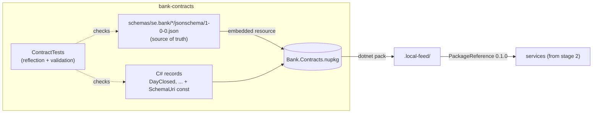

# Slice 1.1: Contracts

What this slice built: the `bank-contracts` folder and its first package, `Bank.Contracts`. It holds `Money`, the event interface, the first five events with their JSON Schemas, and the tests that keep records and schemas in sync. Nothing here talks to a database or Kafka yet; that is slices 1.2 and 1.3.

## 1. The concepts

### Value object: `Money`

A value object is a small type that is defined only by its values. Two `Money(10, "SEK")` are the same money, just as two copies of the number 10 are the same number. It has no id and no lifecycle.

**What problem it solves.** In banking, an amount without a currency is meaningless and dangerous. With a plain `decimal balance`, nothing stops `balance + eurPayment`, and the ledger is silently wrong. `Money` makes the currency part of the value. The operators (`+`, `-`, `<`, ...) check it, and mixing currencies throws `CurrencyMismatchException`.

**Why `decimal`, never `double`.** `double` is binary floating point. It cannot represent 0.1 exactly, so `0.1 + 0.2 == 0.30000000000000004`. `decimal` stores base-10 digits, so 0.10 stays 0.10. For money that difference becomes real öre lost or created.

**Why `Money` never rounds.** Rounding is a business decision: which unit (SEK has 2 minor units), which rule (AwayFromZero), and *when*. In an annuity schedule you round each installment and push the leftover into the last one (design plan ADR 16). If `Money` rounded inside `*`, those leftovers would appear in random places. So `Money * 0.0695m / 12` keeps all its digits, and you round on purpose with `MoneyRounding` (slice 1.2).

**Why the JSON amount is a string.** `{ "amount": "1234.50", "currency": "SEK" }`. JavaScript, and many JSON libraries in other languages, read every JSON number as a `double`. A string forces the reader to parse it as a decimal. It also keeps the scale: `1234.50` stays `"1234.50"`, not `1234.5`.

### Contract-first design

A *contract* is the promise a publisher makes to everyone who reads its events: these fields, these types, this meaning. Contract-first means you write the contract before the code that publishes it, and the contract lives on its own, outside any one service.

**Without it**, Lending would read Operations' events by guessing their shape from Operations' code. A rename in Operations would break Lending, and nobody would know until runtime.

### JSON Schema and Iglu-style URIs

A JSON Schema is a JSON file that describes another JSON document: which properties it has, their types, which are required, and patterns such as `^[A-Z]{3}$`. Any language can validate a message against it, so the contract is not tied to C#.

Each schema is named by a URI such as `iglu:se.bank/day_closed/jsonschema/1-0-0`. That is vendor / name / format / version, the naming style of Snowplow's Iglu. The same four parts appear in three places, and the tests check that they agree:

```
URI in the record:   iglu:se.bank/day_closed/jsonschema/1-0-0
File path:           schemas/se.bank/day_closed/jsonschema/1-0-0.json
"self" in the file:  { "vendor": "se.bank", "name": "day_closed", "format": "jsonschema", "version": "1-0-0" }
```

We validate with standard JSON Schema draft 2020-12 and keep `self` as an extra keyword. We take Iglu's naming and versioning without needing an Iglu server.

### SchemaVer: MODEL-REVISION-ADDITION

SemVer (1.2.3) is about code APIs. SchemaVer is about *data*: will a reader that knows the old version still understand messages in the new one?

| Bump | Example | Meaning | Our rule (checked in CI) |
| --- | --- | --- | --- |
| ADDITION | 1-0-0 → 1-0-1 | Every old message is valid under the new schema | Only new **optional** fields; nothing removed, retyped, or made required/optional |
| REVISION | 1-0-1 → 1-1-0 | Some old messages may not be valid any more | No field removed or retyped; new required fields allowed |
| MODEL | 1-1-0 → 2-0-0 | Breaking change | Anything; a consumer that knows only MODEL 1 sends a MODEL 2 message to the dead-letter topic (slice 1.3) |

**Without it**, a consumer receiving `day_closed/1-0-1` could not tell whether it is safe to read with its 1-0-0 record. With SchemaVer it knows: same MODEL means read it with the record you have.

### Contract tests

These are tests whose subject is the contract itself, not behaviour. They turn "remember to update the schema too" from a promise into a red build.

## 2. How the pieces fit



## 3. What was built, file by file

Everything is under `core_banking/bank-contracts/`.

| File | What it is |
| --- | --- |
| `Directory.Build.props` | Settings shared by every project: net10.0, nullable on, warnings are errors, version 0.1.0 |
| `Directory.Packages.props` | Central package management: every NuGet version is set once here, never in a `.csproj` |
| `nuget.config` | Package sources: nuget.org and `../.local-feed` |
| `Bank.Contracts.slnx` | Solution file (the new XML format) |
| `CLAUDE.md` | Notes and gotchas for this folder |
| `schemas/se.bank/<event>/jsonschema/1-0-0.json` | The five schemas: `currency_activated`, `business_day_opened`, `day_closed`, `day_completed`, `test_event` |
| `src/Bank.Contracts/Money.cs` | The value object and its operators; it validates that the currency is a three-letter upper-case code |
| `src/Bank.Contracts/CurrencyMismatchException.cs` | Thrown when two currencies are combined; carries `Left` and `Right` |
| `src/Bank.Contracts/MoneyJsonConverter.cs` | Reads and writes the string-amount JSON shape; rejects numbers, exponents, commas and bad codes |
| `src/Bank.Contracts/IIntegrationEvent.cs` | `EventId`, `OccurredOn` (business date), `PerformedBy` |
| `src/Bank.Contracts/Operations/*.cs` | `CurrencyActivated`, `BusinessDayOpened`, `DayClosed`, `DayCompleted` |
| `src/Bank.Contracts/Testing/TestEvent.cs` | For messaging tests only: `Key` (ordering), `Sequence`, `Amount` (exercises `Money` in a schema) |
| `src/Bank.Contracts/SchemaKey.cs` | Parses and formats `iglu:` URIs, orders versions, maps a key to its file path |
| `src/Bank.Contracts/ContractSchemas.cs` | Lists and reads the embedded schemas |
| `src/Bank.Contracts/ContractJson.cs` | The one `JsonSerializerOptions` for events: camelCase, strict numbers |
| `tests/.../MoneyTests.cs`, `MoneyJsonTests.cs` | Arithmetic, comparison, mismatch, validation, JSON shape |
| `tests/.../SchemaKeyTests.cs` | URI parsing, path, ordering |
| `tests/.../ContractTests.cs` | **The reflection test** and the schema checks (see below) |
| `tests/.../RecordSchemaComparerTests.cs`, `SchemaCompatibilityTests.cs` | Tests of the checkers themselves, fed deliberately wrong input |
| `tests/.../Support/*.cs` | `ContractCatalog` (finds the records), `RecordSchemaComparer`, `SchemaCompatibility`, `SampleFactory` |
| `docs/adr/0001-package-layout.md`, `0002-schema-record-sync-by-reflection-test.md` | The two ADRs of this slice |
| `.github/workflows/bank-contracts.yml` (repo root) | CI: restore, build, test; runs only when this folder changes; publishes nothing |

### What `ContractTests` checks

For every record that implements `IIntegrationEvent`:

1. It has `public const string SchemaUri`, the schema exists, and it is the **latest** version.
2. **Reflection:** the record's properties and the schema's `properties` are the same set of names. Types match (`Guid` → string/uuid, `DateOnly` → string/date, `int` → integer, `Money` → object with string `amount` and `currency`). `required` lists exactly the non-nullable ones.
3. **Validation:** a sample instance serialized to JSON passes the schema, with patterns and formats enforced.

For every schema file: path, `self` and URI agree; the common fields `eventId`, `occurredOn` and `performedBy` are required; the first version is `1-0-0`; each next version is a legal SchemaVer step.

I proved the checks really fail. I temporarily added `string? Reason` to `DayClosed` and changed one schema pattern, then ran the tests. They failed with `'reason': record property is not in the schema.` and `/service: The string value is not a match for the indicated regular expression`. Then I reverted both changes.

## 4. Patterns used and why

- **Value object** (`Money`): makes invalid states (an amount without a currency, mixed currencies) impossible or loud.
- **Records for contracts**: immutable, value equality, short syntax. An event is a fact that happened, so it should never change after creation.
- **Schema as source of truth, checked by tests** (ADR 0002): the contract is readable outside .NET, and drift fails the build.
- **Test the test**: `RecordSchemaComparerTests` feeds the comparer wrong schemas. A checker that is never seen failing might always pass.
- **Central package management**: one place to upgrade a library, so all projects use the same version.
- **Fail fast at the boundary**: `Money`'s constructor and the JSON converter reject bad input right where it enters, not three services later.

## 5. D2 choices I made (Claude decides and explains)

| Choice | Why |
| --- | --- |
| `Money` validates the currency as three upper-case ASCII letters | ISO 4217 format; catches `"sek"` and typos early. It does *not* check that the currency is active; that is Operations' business rule. |
| `Money.Zero(currency)` helper | Starting point for sums, so `Money.Zero("SEK") + ...` replaces `new Money(0, ...)` everywhere |
| Comparing different currencies throws; equality does not | `<` across currencies has no answer. `==` does: they are simply not equal |
| Records in `Bank.Contracts.Operations`; `TestEvent` in `Bank.Contracts.Testing` | Namespaces by publishing service; the test event lives next to the other records so the contract tests cover it too |
| `SchemaUri` as a `const`, not a static abstract interface member | Static abstract members would forbid `List<IIntegrationEvent>`; the contract test checks that the const exists |
| Schemas do not set `additionalProperties: false` (except inside `Money`) | An older consumer that validates must accept messages from a newer ADDITION that has extra optional fields |
| Schemas use draft 2020-12 with an extra `self` block | Standard tooling validates them; Iglu naming without an Iglu server |
| `ContractJson.Options`: Web defaults + strict numbers | camelCase as in the schemas; `"2"` is not accepted as the number 2 |
| JsonSchema.Net in the test project only | Validation is a test concern for now; `Bank.Contracts` stays dependency-free |
| `SampleFactory` has per-name samples for `Code` and `Service` | Fields with a pattern need a matching value; the test says when one is missing |
| No XML doc file generation | With warnings as errors it would force a comment on every public member; key types have summaries anyway |

## 6. Check your understanding

1. Someone adds a new **required** field `reason` to `day_closed` and saves it as `1-0-1`. Which test fails, and what version should it have been instead? Why can't an ADDITION add a required field?
2. Why is `Money(1000m, "SEK") * 0.0695m / 12` left unrounded, and what could go wrong in a 60-month loan schedule if `Money` rounded each multiplication itself?
