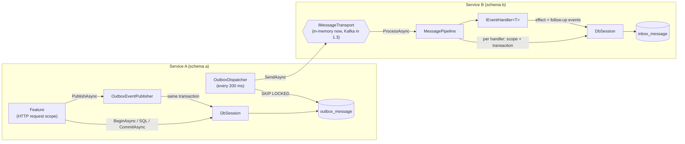

# Slice 1.2: Outbox and inbox

What this slice built: three new packages in `bank-contracts`. `Bank.Common` holds small shared types. `Bank.Messaging` makes "change my data and announce it" atomic on the sending side and "react exactly once in effect" on the receiving side. `Bank.Testing` holds the test helpers. There is still no Kafka: a transport seam (`IMessageTransport`) sits where Kafka will plug in during slice 1.3, and the tests use an in-memory broker. Read `event-path.md` first. This slice builds every box in that diagram except Kafka.

## 1. The concepts

### The dual-write problem

A feature has to do two things: commit its change to PostgreSQL and send an event to Kafka. These are two systems, and no transaction spans both.

- Commit first, then send: a crash in between means the change happened and nobody hears about it. Lending never learns that the day was closed.
- Send first, then commit: a crash in between, or a failed commit, means an event announces a change that never happened.

Retries do not fix either order. Either order can lose or invent a fact.

### Transactional outbox

Don't send the event. Write it into a table, `outbox_message`, **in the same transaction** as the change. Now both commit or neither does, because they are one database transaction. A separate loop, the **dispatcher**, reads committed rows and sends them. It marks each row as sent only after the broker has acknowledged it.

The price: the dispatcher can crash after sending and before marking. Then it sends the row again. So the outbox gives **at-least-once** delivery, never exactly-once.

### At-least-once and idempotent consumers

If duplicates are certain, the receiver must make them harmless. A handler is *idempotent* when applying a message twice has the same effect as applying it once. There are two layers:

1. **Inbox**: before running the handler, insert `(message_id, handler_name)` into `inbox_message`. The insert is in the same transaction as the handler's effect. If the row already exists, this handler already applied this message, so skip it.
2. **Business key**: a unique constraint on the effect itself, such as `(loan_id, installment_no)`. It catches the same *fact* published twice under *different* message ids, for example when a feature runs twice because of a retried HTTP request. The inbox cannot catch that, because the ids differ.

### "Exactly once in effect"

Kafka delivers at least once, and the outbox sends at least once. But the inbox, the business key and the single transaction on each side make the *effect* happen once. That is the goal of stage 1, stated precisely.

### Polling with `FOR UPDATE SKIP LOCKED`

```sql
SELECT ... FROM outbox_message WHERE sent_at IS NULL ORDER BY position LIMIT 100 FOR UPDATE SKIP LOCKED
```

`FOR UPDATE` locks the selected rows until the dispatcher commits. `SKIP LOCKED` makes a second dispatcher skip those rows instead of waiting for them, so it takes the next free ones. Two instances work in parallel and never send the same row in the same moment.

### Migrations

A migration is a numbered SQL script that moves a schema from one version to the next. The runner remembers which scripts ran in a journal table, `schema_migration`. Every migration tool solves three problems, and ours solves them in about 100 lines:

| Problem | Our answer |
| --- | --- |
| Which scripts already ran? | `schema_migration` with one row per script |
| Two instances start at once | `pg_advisory_xact_lock` on the schema name; the second waits, then finds nothing to do |
| Someone edits a script that already ran | A SHA-256 checksum per script; a mismatch stops startup |

PostgreSQL DDL is transactional, so the whole run is one transaction. A failing script leaves the schema exactly as it was.

## 2. How the pieces fit



Each service has its own role, its own schema and its own `NpgsqlDataSource`. The tests run two such "services" against one PostgreSQL container, which is exactly how the platform will run the real six.

## 3. What was built, file by file

Everything is under `core_banking/bank-contracts/`.

### `src/Bank.Common`

| File | What it is |
| --- | --- |
| `MoneyRounding.cs` | `Round(money, minorUnits)` with `MidpointRounding.AwayFromZero`; the only place money is rounded |
| `PerformedBy.cs` | `"system"` default, the `X-Performed-By` header name, trim and length check |
| `Result.cs` | `Result<T>` and `Error(Code, Message)` for business rule failures (becomes 422 later); implicit conversions from a value or an `Error` |
| `IBusinessClock.cs`, `IFileStorage.cs`, `IEmailSender.cs`, `IExchangeRateProvider.cs`, `IAccountNumberGenerator.cs` | Interfaces only; implementations come with the services that need them |

### `src/Bank.Messaging`

| File | What it is |
| --- | --- |
| `IEventPublisher.cs`, `IEventHandler.cs` | The public interfaces, unchanged from the stage file |
| `DbSession.cs` | The scoped connection and transaction (ADR 0009) |
| `BankMessagingOptions.cs` | `ServiceName`, `PollingInterval` (200 ms), `BatchSize` (100), validated at startup |
| `Migrations/0001_outbox_and_inbox.sql` | The two tables |
| `Outbox/OutboxEventPublisher.cs` | Serializes with `ContractJson.Options`, reads `SchemaUri` from the record, inserts into the outbox. Throws without a transaction |
| `Outbox/OutboxDispatcher.cs` | One poll (ADR 0006); public so tests can call it directly |
| `Outbox/OutboxDispatcherService.cs` | The hosted loop around it; survives database outages |
| `Transport/TransportMessage.cs`, `IMessageTransport.cs` | The seam to the broker: payload plus the four header values |
| `Inbox/SchemaRouting.cs` | Pure function: which known record reads an incoming schema version |
| `Inbox/EventHandlerRegistration.cs` | One registered handler, with its schema and inbox name |
| `Inbox/MessagePipeline.cs` | The receiving side (ADR 0007), returns `Handled`, `Duplicate` or `NotSubscribed`, throws `UnsupportedSchemaVersionException` for an unknown MODEL |
| `Migrations/MigrationScript.cs`, `MigrationScripts.cs`, `SqlMigrationRunner.cs`, `MigrationStartupService.cs` | The runner (ADR 0008) and its startup hook |
| `ServiceCollectionExtensions.cs` | `AddBankMessaging`, `AddEventHandler<TEvent, THandler>`, `AddSqlMigrations` |

### `src/Bank.Testing`

| File | What it is |
| --- | --- |
| `PostgresFixture.cs` | One `postgres:18-alpine` container; `CreateServiceSchemaAsync` makes a role plus a schema it owns and returns its connection string |
| `InMemoryTransport.cs` | Records sent messages and hands them to subscribers; `FailSends` simulates a broker outage |
| `Eventually.cs` | Retries an assertion until a timeout, for work done by the background dispatcher |
| `FakeBusinessClock.cs`, `InMemoryFakes.cs` | Fakes for the `Bank.Common` interfaces |

### Also changed

- `src/Bank.Contracts/Schema/EventSchemaUri.cs`: reads a record's `SchemaUri` const. It moved here from the schema tool, so the tool and the publisher share one implementation.
- `docs/adr/0006`–`0009`, `CLAUDE.md`, and the Database section of `docs/implementation-decisions.md`.

### Tests

| Project | Tests | What they prove |
| --- | --- | --- |
| `Bank.Common.Tests` | 16 | Rounding (midpoint away from zero, 0 and 3 minor units), PerformedBy, Result |
| `Bank.Messaging.UnitTests` | 6 | Schema routing: exact, newer and older ADDITION, other MODEL, unknown MODEL, not subscribed |
| `Bank.Messaging.IntegrationTests` | 19 | See below |

The integration tests, against a real PostgreSQL:

- **Outbox**
  - A committed event reaches the other service, and a poll before the commit sees nothing.
  - Rollback publishes nothing.
  - Disposing the session without a commit publishes nothing.
  - Publishing without a transaction fails.
  - A failed send stays in the outbox and is sent on a later poll.
  - Three concurrent dispatchers never send a row twice.
- **Inbox**
  - A duplicate message is applied once, and so are five concurrent deliveries of one message.
  - The same fact under a new message id is stopped by the business key.
  - The handler's effect, the inbox row and the outgoing event commit together or not at all.
  - Each handler applies a message once, even when another handler failed.
  - A newer ADDITION is read with the known record.
  - An unknown MODEL is rejected without any change.
  - An event without a handler is skipped.
- **Migrations**
  - Scripts are applied once.
  - An edited script stops the run.
  - A failing script rolls back the whole run.
  - Concurrent runs apply each script once.
  - Line endings do not change the checksum.

One test found a real bug. `MigrationScript` first stored its checksum in a property set at construction. `script with { Sql = ... }` copied that stored value, so an edited script still carried the old checksum. The checksum is now computed when it is read.

## 4. Patterns used and why

- **Transactional outbox**: makes "change and announce" one atomic step without a distributed transaction.
- **Idempotent consumer with an inbox**: makes at-least-once delivery safe.
- **Unit of work through scoped DI** (`DbSession`): one connection and one transaction per request or message, with no repository or unit-of-work wrapper on top. The DI scope *is* the unit.
- **Seam / port** (`IMessageTransport`): the messaging logic is complete and tested before Kafka exists. Slice 1.3 adds an adapter, not a rewrite.
- **Competing consumers on a table** (`SKIP LOCKED`): several dispatchers share the work safely.
- **Tolerant reader** (`SchemaRouting`): a consumer reads newer ADDITIONs with the record it knows and ignores the fields it does not know.
- **Fail fast**: no transaction at publish time, an edited migration, two handlers with the same name, or a missing `ServiceName` all fail loudly at the earliest point.

## 5. D2 choices I made (Claude decides and explains)

| Choice | Why |
| --- | --- |
| Added `tests/Bank.Common.Tests` (not in the stage file's layout) | `MoneyRounding` is financial logic and gets its test first |
| Outbox `id` = the event's `EventId` | The message id is the event id. Publishing the same event object twice fails on the primary key |
| `position` identity column for order, not `created_at` | Timestamps can tie, and they come from the application clock |
| `payload` as `jsonb` | It can be inspected with SQL. Key order and whitespace may change, but the meaning does not |
| `attempts` and `last_error` on the outbox row | Diagnosis without logs |
| Dispatcher stops a batch at the first failed send | Keeps order per key (ADR 0006) |
| Handler name = class name, not full name | Moving a class to another namespace does not change the inbox key. Duplicates fail at startup |
| One scope and transaction per handler | Handlers are independent (ADR 0007) |
| `NotSubscribed` messages are skipped, not dead-lettered | A topic holds every event of its publisher, and a service handles only some of them |
| Unqualified SQL; the schema comes from the role's search path | The same SQL works in every service. The platform roles in slice 1.4 get the same default |
| The migration runner lives in `Bank.Messaging` | It is the only shared Npgsql package. A separate `Bank.Data` package would be a new package for about 100 lines |
| Migrations run in `IHostedLifecycleService.StartingAsync` | The host calls it before any `StartAsync`, so the dispatcher never polls a missing table, whatever the registration order |
| `DbSession` is a class, not an interface | One implementation, and tests use real PostgreSQL |
| Options validated with `Validate(...)` and `ValidateOnStart` | No extra DataAnnotations package for two checks |
| Each integration test gets its own role and schema; one container for the run (`AssemblyFixture`) | Tests run in parallel without seeing each other's rows, and the container starts once (about 2 s) |
| Kafka Testcontainers fixture moved to slice 1.3 | It would be untested code until a Kafka test exists |
| `postgres:18-alpine` | The current major version. Slice 1.4 should use the same image |
| `InMemoryFakes` account numbers are `TEST-000001` | The real format is still an open question |

## 6. Things to watch later

- `outbox_message` and `inbox_message` grow without limit. A cleanup job (delete sent and old rows) is not built yet.
- With two dispatcher instances, per-key order can break (ADR 0006). Phase 1 runs one per service.
- Retries, the dead-letter topic and offset commits belong to the transport, in slice 1.3. Today an exception from `ProcessAsync` simply propagates.

## 7. Check your understanding

1. In the test `Each_handler_applies_a_message_once_even_when_another_handler_failed`, `RecordTestEvent` commits and `AuditTestEvent` throws. Walk through the redelivery: what happens to each handler, and what would go wrong if the inbox key were `message_id` alone?
2. A feature calls `PublishAsync` and then `CommitAsync`, and the dispatcher process is killed right after Kafka acknowledges the message but before `UPDATE outbox_message SET sent_at`. What does Kafka hold afterwards? Which row decides that Lending's effect still happens only once?
3. Why does the migration runner take its advisory lock **before** `CREATE TABLE IF NOT EXISTS schema_migration`, and not after?
