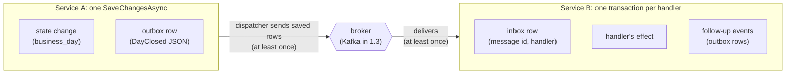
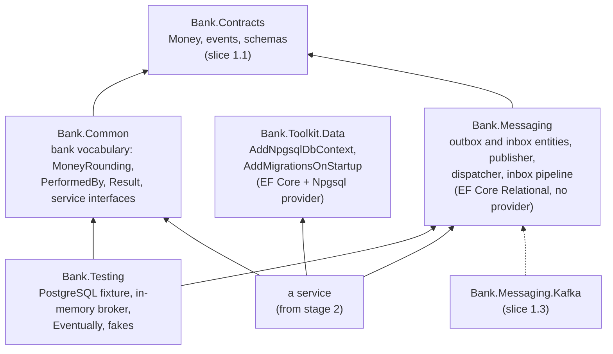
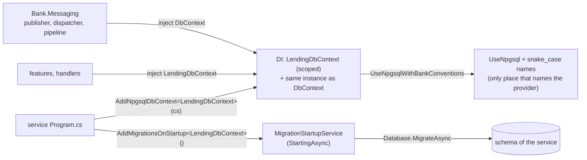
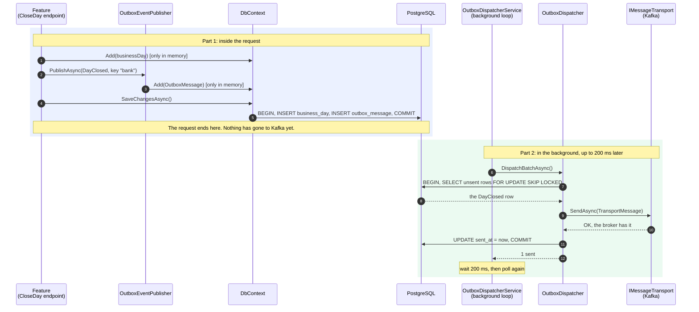
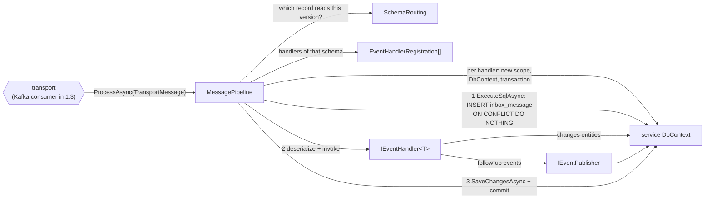
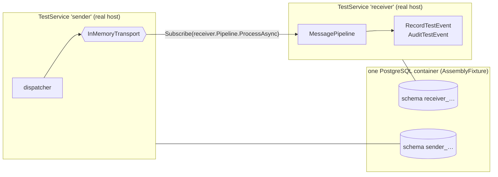

# Slice 1.2: Outbox and inbox

This document has three parts:

1. **The big picture**: what we are trying to achieve and why it is hard.
2. **The building blocks**: which projects, entities and classes we built, what each one does, and how they connect, first for database access, then the sending side, then the receiving side, then the tests.
3. **Why it is designed this way**: the decisions, the alternatives we rejected, and the price we pay. This includes how the design changed during the slice (Dapper first, EF Core in the end).

At the end: what was tested, what to watch later, and questions to check your understanding. `event-path.md` in this folder is the companion page: it follows one event step by step and says what a crash at each step leaves behind.

---

## Part 1. The big picture

### 1.1 The goal

Stage 1 must make this sentence true:

> An event can travel from one service's database transaction, through the broker, to another service's handler, **exactly once in effect**.

A concrete example: Operations closes the business day. That is a change in Operations' own table (`business_day`). Lending must hear about it (`DayClosed`) and run its end-of-day work exactly once, never zero times and never twice.

Slice 1.2 builds everything in that path **except Kafka**. Kafka arrives in slice 1.3 and plugs into a seam that this slice leaves for it.

### 1.2 Why it is hard: two problems

**Problem 1, the sending side (the dual write).** The feature must do two things: save its change to PostgreSQL and send an event to the broker. These are two different systems, and no transaction covers both.

| Order | Crash in between | Result |
| --- | --- | --- |
| Save, then send | The event is never sent | The day is closed, but Lending never knows |
| Send, then save | The save fails or never happens | Lending closes a day that Operations never closed |

Either order can lose a fact or invent one, and retrying does not fix it.

**Problem 2, the receiving side (duplicates).** No broker can promise "exactly once" across a crash. If the consumer crashes after doing the work but before telling the broker "done", the broker delivers the message again. So duplicates are certain, and the receiver must make them harmless.

### 1.3 The solution in one picture



- **Sending: transactional outbox.** The feature does not send the event. It adds the event as a row to its own `outbox_message` table, and the **same `SaveChangesAsync`** that saves the state change saves the row. Both are written in one transaction, or neither is. A separate loop, the **dispatcher**, sends saved rows to the broker and marks them as sent. If it crashes between sending and marking, it sends the row again. So delivery is **at least once**.
- **Receiving: inbox plus idempotent handler.** Before a handler runs, a row `(message id, handler name)` is inserted into `inbox_message`, **in the same transaction** as the handler's effect and any events the handler publishes. If the row already exists, this handler already applied this message, so it is skipped. Duplicates become harmless.
- **Business keys** close the last gap. When the same fact is published twice under two different message ids, the inbox cannot tell, because the ids differ. A unique constraint on the effect itself, such as `(loan_id, installment_no)`, rejects the second copy.

At least once on the wire, plus "a duplicate changes nothing" at the receiver, gives **exactly once in effect**.

### 1.4 What else this slice had to provide

- **A unit of work** that holds the feature's changes and the outbox row until one save. With EF Core, this is the service's own **`DbContext`**.
- **Tables and their versions.** The outbox and inbox tables, and later every service's own tables, are created by **EF Core migrations**, applied when the service starts.
- **One place that knows the database provider**, so the rest of the code uses only EF Core's provider-neutral API.
- **Test helpers** to run two "services" against a real PostgreSQL without Kafka. This is `Bank.Testing`.

It also set a rule for shared code (ADR 0011):

- **`Bank.Common`** is the bank's shared business vocabulary, the things the services' business code talks to directly: money rounding, `PerformedBy`, `Result<T>` and the interfaces for external services.
- **`Bank.Toolkit.<Area>`** packages hold technical building blocks that have nothing to do with banking. The first one is **`Bank.Toolkit.Data`**: registering a `DbContext` on PostgreSQL and applying its migrations at startup.

---

## Part 2. The building blocks and how they connect

### 2.1 The projects

All of them live in `core_banking/bank-contracts/` and are built by `Bank.Contracts.slnx`.



An arrow means "references".

- `Bank.Toolkit.Data` references no `Bank.*` package: it knows nothing about money, events or business rules.
- `Bank.Messaging` references EF Core's relational layer but **not** the Npgsql provider. A service brings both packages together.
- Nothing here references Kafka.

| Project | Packed as NuGet | Tests |
| --- | --- | --- |
| `src/Bank.Common` | yes | `tests/Bank.Common.Tests` (unit) |
| `src/Bank.Toolkit.Data` | yes | `tests/Bank.Toolkit.Data.IntegrationTests` (PostgreSQL in Docker) |
| `src/Bank.Messaging` | yes | `tests/Bank.Messaging.UnitTests` (unit), `tests/Bank.Messaging.IntegrationTests` (PostgreSQL in Docker) |
| `src/Bank.Testing` | yes | used by the integration tests |

`dotnet-ef` is installed as a local tool (`dotnet-tools.json` in the folder; `dotnet tool restore` installs it).

### 2.2 The tables

Two tables are created in each service's own schema by that service's migrations. They are defined in `Bank.Messaging/Model`, and `modelBuilder.AddBankMessaging()` adds them to the service's model.

**`outbox_message`** (entity `OutboxMessage`): one row per published event.

| Column | Property | Meaning |
| --- | --- | --- |
| `id` (PK) | `Id` | The event's `EventId`. It travels as the `message-id` header and becomes the receiver's inbox key |
| `position` | `Position` | Identity column; the order in which rows are sent |
| `schema_uri` | `SchemaUri` | For example `iglu:se.bank/day_closed/jsonschema/1-0-0` |
| `message_key` | `MessageKey` | The broker key, the id of the entity the event is about |
| `payload` | `Payload` | The event JSON (`jsonb`) |
| `occurred_on`, `performed_by` | `OccurredOn`, `PerformedBy` | Copied from the event; they become headers |
| `created_at` | `CreatedAt` | When the row was added (UTC, from `TimeProvider`) |
| `sent_at` | `SentAt` | `NULL` until the broker has the message |
| `attempts`, `last_error` | `Attempts`, `LastError` | Failed sends, for diagnosis |

A partial index `ix_outbox_message_unsent` on `position WHERE sent_at IS NULL` keeps the dispatcher's query cheap.

**`inbox_message`** (entity `InboxMessage`): one row per message **and handler** that was applied.

| Column | Meaning |
| --- | --- |
| `message_id`, `handler_name` (PK together) | "This handler has applied this message" |
| `schema_uri` | The version that arrived |
| `performed_by`, `created_at` | Audit columns, as on every table |

EF Core adds its own table, `__EFMigrationsHistory`, which records the applied migrations.

`Version`, required on every table, is PostgreSQL's hidden `xmin` column, mapped with `.IsRowVersion()`. The messaging rows map it too (added at the stage 1 review): the dispatcher's update checks it, although the row is already locked, and the inbox only inserts, so there it is never checked. Because `xmin` is a system column, the migration that adds it to the model creates no SQL, and the dispatcher's `FromSql` must select it by name (`SELECT *, xmin`).

### 2.3 Database access (`Bank.Toolkit.Data`)



#### `AddNpgsqlDbContext<TContext>(connectionString)` and `UseNpgsqlWithBankConventions`

Registers the service's `DbContext` as **scoped**: one instance per HTTP request, and one per handled message or dispatcher poll, because those create their own scope. It also registers **the same instance as plain `DbContext`**. That second registration is what lets `Bank.Messaging` work on the service's context without knowing its type.

`UseNpgsqlWithBankConventions(connectionString)` is the provider setup used everywhere: `UseNpgsql` plus `UseSnakeCaseNamingConvention()`, so `CreatedAt` becomes `created_at`. The design-time factories that `dotnet ef` uses call it too, so generated migrations match the running model. These two methods are the only code that names the database provider.

The connection string carries the service's own role, with its schema as the search path. So the model names no schema, and the same code works in all six services.

#### `AddMigrationsOnStartup<TContext>()` and `MigrationStartupService<TContext>`

`MigrationStartupService` is an `IHostedLifecycleService`. In `StartingAsync` it creates a scope, resolves the context and calls `Database.MigrateAsync`. The host calls `StartingAsync` of every lifecycle service **before** it starts any hosted service, so the outbox dispatcher never polls a table that does not exist yet.

EF Core takes a database lock while it migrates. Two instances of a service starting at the same time therefore apply each migration once. The test `Instances_starting_together_apply_each_migration_once` starts three hosts together to prove it.

#### How a service gets its tables

1. Define entities and a `DbContext` in `Data/`. Call `modelBuilder.AddBankMessaging()` in `OnModelCreating`.
2. Add a design-time factory (`IDesignTimeDbContextFactory`) that calls `UseNpgsqlWithBankConventions`.
3. Run `dotnet ef migrations add <Name> --output-dir Data/Migrations`. The generated C# migration creates the service's tables **and** `outbox_message` and `inbox_message`.
4. On start, `AddMigrationsOnStartup` applies it.

### 2.4 The sending side

#### The idea in one sentence

The feature never talks to the broker. It only **writes the event into a table** of its own database, in the same transaction as its change. A background loop **reads that table later and sends** what it finds.

Think of an office: you write a letter and drop it in the out-tray on your desk (the `outbox_message` table). A courier comes by every 200 ms, takes what is in the tray, delivers it, and stamps it "sent". You never wait for the courier, and the courier never takes a letter you threw away.

#### Why it takes two classes

The two halves run at different times, in different places:

| | `OutboxEventPublisher` | `OutboxDispatcher` |
| --- | --- | --- |
| Runs | inside the request, while the feature works | in the background, after the request has finished |
| Transaction | the feature's own | its own, one per poll |
| Talks to the broker? | **never** | yes |
| Job | turn the event into an outbox row | send saved rows and mark them sent |

The split is the whole point. If the publisher sent to the broker itself, a rollback after the send would leave an event for a change that never happened. Because the dispatcher only sees rows that were **committed**, it can only send real facts.

#### One message, from start to finish

Example: Operations closes the business day and publishes `DayClosed`.



What happens if something goes wrong at each point:

| Failure | Result |
| --- | --- |
| The feature throws before step 4 | Nothing was written: no day change, no event |
| The database commit in step 5 fails | Neither row exists: no day change, no event |
| Kafka is down at step 9 | The row stays unsent (`Attempts` +1, `LastError` saved); the next poll tries again |
| Crash after step 10, before step 11 | The row is still unsent, so it is sent **again**. The receiver's inbox ignores the duplicate (section 2.5) |

#### The classes, one by one

- **`IEventPublisher`**: the only thing a feature sees: `PublishAsync(event, key, ct)`. The feature does not know an outbox or Kafka exists.
- **`OutboxEventPublisher`**: the implementation. It turns the event into an `OutboxMessage` (JSON with `ContractJson.Options`, plus its `SchemaUri` and key) and **adds** it to the feature's `DbContext`. It writes nothing; the feature's `SaveChangesAsync` does.
- **`OutboxMessage`**: one row of `outbox_message`, the letter in the tray. `SentAt` empty means "not sent yet"; `Position` gives the send order.
- **`EventSchemaUri`**: a small helper that reads an event record's `SchemaUri` constant, so the publisher knows which version it is storing.
- **`OutboxDispatcher`**: one poll. It locks up to 100 unsent rows (`SKIP LOCKED` lets a second instance take other rows instead of waiting), sends them in order, marks each sent one, and stops at the first failure so that later messages do not overtake it.
- **`OutboxDispatcherService`**: the timer around the dispatcher. It calls `DispatchBatchAsync` again at once after a full batch, otherwise after 200 ms, and keeps going after errors. It is separate so tests can call the dispatcher directly without waiting for a timer.
- **`IMessageTransport` and `TransportMessage`**: the door to the broker. `TransportMessage` is the event as it travels (id, schema, key, JSON, headers); `SendAsync` returns only when the broker has it. Kafka implements it in slice 1.3; the tests use `InMemoryTransport`.
- **`BankMessagingOptions`**: the settings, checked at startup:

| Option | Default | Meaning |
| --- | --- | --- |
| `ServiceName` | required | Such as `"operations"`; also names the topic `bank.<service>.events` in slice 1.3 |
| `PollingInterval` | 200 ms | Wait after a poll that found less than a full batch |
| `BatchSize` | 100 | Rows per poll |

### 2.5 The receiving side



#### `IEventHandler<T>` (`IEventHandler.cs`)

The interface a service implements for each event it reacts to: `HandleAsync(T @event, CancellationToken ct)`. A handler injects the service's `DbContext` and changes entities. It injects `IEventPublisher` for follow-up events. It **never** calls `SaveChangesAsync` and never commits. The pipeline does both after the handler returns, so the effect, the inbox row and the follow-up events commit together. To undo everything, the handler throws.

#### `EventHandlerRegistration` (`Inbox/EventHandlerRegistration.cs`)

**The problem it solves.** Handlers are generic (`IEventHandler<DayClosed>`, `IEventHandler<TestEvent>`), but a message from the broker is only a JSON string with a schema URI. At compile time the pipeline cannot know which `T` it will receive. At run time it must know which record type to deserialize into, which handlers to call, and which name to write into the inbox.

**What it is.** A non-generic description of one registered handler, created at startup by `AddEventHandler<TEvent, THandler>()`:

| Property | Example for `RecordTestEvent` | Used for |
| --- | --- | --- |
| `EventType` | `typeof(TestEvent)` | `JsonSerializer.Deserialize(payload, EventType, ...)` |
| `Schema` | `iglu:se.bank/test_event/jsonschema/1-0-0` (from the record's `SchemaUri`) | matching incoming messages, through `SchemaRouting` |
| `HandlerName` | `"RecordTestEvent"` (the class name) | the second half of the inbox key |
| `invoke` (private) | a delegate | resolving the handler from DI and calling `HandleAsync` |

**The trick.** `For<TEvent, THandler>()` runs at startup, while both types are still known, and captures them in a lambda:

```csharp
(services, @event, ct) => services.GetRequiredService<THandler>().HandleAsync((TEvent)@event, ct)
```

Later the pipeline calls this delegate with a plain `object`. The cast back to `TEvent` happens inside the lambda. So the pipeline calls the right generic handler without reflection and without knowing `T`. This is called *type erasure*: a generic type hidden behind a non-generic delegate.

#### `SchemaRouting`, `SchemaRoute`, `SchemaMatch` (`Inbox/SchemaRouting.cs`)

A **pure function** with no I/O, unit tested in `Bank.Messaging.UnitTests`. Given the incoming schema version and all versions this service has handlers for, it decides:

| `SchemaMatch` | When | What the pipeline does |
| --- | --- | --- |
| `Exact` | a handler's record has exactly this version | reads it with that record |
| `CompatibleAddition` | another version in a **known MODEL** (for example 1-0-3 when we know 1-0-1) | reads it with the **latest** known record of that MODEL; unknown optional fields are ignored |
| `UnknownModel` | the event is handled here, but not in this MODEL (2-0-0 when we know only 1-x-x) | throws `UnsupportedSchemaVersionException`; slice 1.3 sends it to the dead-letter topic |
| `NotSubscribed` | no handler for this event in any version | skips the message |

This applies the SchemaVer rule from slice 1.1: within one MODEL, versions only add optional fields, so any record of that MODEL can read any message of that MODEL.

#### `MessagePipeline` (`Inbox/MessagePipeline.cs`)

The receiving side, a singleton. Its constructor receives all `EventHandlerRegistration`s, refuses two handlers with the same name (they would share inbox rows), and groups them by schema.

`ProcessAsync(message, ct)`:

1. Parse the schema URI and ask `SchemaRouting` for the route. Return `NotSubscribed`, or throw for `UnknownModel`.
2. For **each** handler of the chosen schema, in its **own scope, `DbContext` and transaction**:
   1. begin a transaction;
   2. insert the inbox row with raw SQL:
      ```csharp
      context.Database.ExecuteSqlAsync($"""
          INSERT INTO inbox_message (message_id, handler_name, schema_uri, performed_by, created_at)
          VALUES ({message.MessageId}, {registration.HandlerName}, ...)
          ON CONFLICT (message_id, handler_name) DO NOTHING
          """, ct);
      ```
   3. if no row was inserted, this handler already applied the message: dispose the transaction, which rolls back, and go to the next handler;
   4. otherwise deserialize the payload into `EventType` and call the handler through the registration's delegate;
   5. `SaveChangesAsync` and commit: inbox row, effect and follow-up outbox rows together.
3. Return `Handled` if at least one handler ran, otherwise `Duplicate`.

If a handler throws, or the payload does not deserialize, that handler's transaction rolls back and the exception propagates to the transport. In slice 1.3 the transport retries it and finally sends it to the dead-letter topic.

The inbox row is inserted with raw SQL **before** the handler runs, and not added to the context. That gives two things. A duplicate is detected without running the handler. And a concurrent delivery of the same message waits on the primary key until the first transaction commits, then inserts nothing.

`ProcessOutcome` (`Handled`, `Duplicate`, `NotSubscribed`) and `UnsupportedSchemaVersionException` are declared in the same file.

#### `ModelBuilderExtensions` (`Model/ModelBuilderExtensions.cs`)

- `AddBankMessaging(this ModelBuilder)` configures both entities with **explicit** table, column, key and index names. The dispatcher and the inbox refer to these names in raw SQL, so they must not depend on a naming convention.
- `EnsureBankMessaging(this DbContext)` is internal. The publisher, the dispatcher and the pipeline call it. If the service's model lacks the outbox, it fails with a message that says to call `modelBuilder.AddBankMessaging()` and add a migration.

### 2.6 Wiring: a service's `Program.cs`

```csharp
builder.Services.AddNpgsqlDbContext<LendingDbContext>(connectionString);   // Bank.Toolkit.Data
builder.Services.AddMigrationsOnStartup<LendingDbContext>();               // Bank.Toolkit.Data
builder.Services.AddSingleton<IMessageTransport, ...>();                   // Kafka from slice 1.3
builder.Services.AddBankMessaging(o => o.ServiceName = "lending");         // Bank.Messaging
builder.Services.AddEventHandler<DayClosed, RunEndOfDay>();                // Bank.Messaging
```

| Call | Package | Registers |
| --- | --- | --- |
| `AddNpgsqlDbContext<TContext>` | `Bank.Toolkit.Data` | the context (scoped) on Npgsql with snake_case names, and the same instance as `DbContext` |
| `AddMigrationsOnStartup<TContext>` | `Bank.Toolkit.Data` | `MigrationStartupService<TContext>` |
| `AddBankMessaging` | `Bank.Messaging` | options (validated at startup), `TimeProvider.System`, `IEventPublisher` (scoped), `OutboxDispatcher` and `MessagePipeline` (singletons), the hosted `OutboxDispatcherService` |
| `AddEventHandler<TEvent, THandler>` | `Bank.Messaging` | the handler (scoped) and its `EventHandlerRegistration` (singleton) |

And in the context:

```csharp
protected override void OnModelCreating(ModelBuilder modelBuilder)
{
    modelBuilder.AddBankMessaging();          // outbox_message and inbox_message
    modelBuilder.Entity<Loan>().ToTable("loan");
    // ...
}
```

### 2.7 `Bank.Common`

Shared types with no I/O:

| Type | What it is |
| --- | --- |
| `MoneyRounding.Round(money, minorUnits)` | The only place money is rounded: `Math.Round` with `MidpointRounding.AwayFromZero`, so 1.005 SEK becomes 1.01 and −1.005 becomes −1.01. Minor units must be between 0 and 28 |
| `PerformedBy` | `System = "system"`, `HeaderName = "X-Performed-By"`, `MaxLength = 100`, and `From(value)`: an empty value becomes `"system"`, others are trimmed, and a value that is too long is rejected |
| `Result<T>` and `Error(Code, Message)` | The outcome of a use case that can fail for a business reason (later a 422 with `code`). A value or an `Error` converts to it implicitly. Reading `Value` of a failure, or `Error` of a success, throws |
| `IBusinessClock` | `DateOnly Today`; the business date, never the system clock |
| `IFileStorage` | `SaveAsync`, `OpenReadAsync`, `ExistsAsync`, `DeleteAsync` |
| `IEmailSender` and `EmailMessage(To, Subject, Body)` | Sending email |
| `IExchangeRateProvider` | `GetRateAsync(from, to, date)` |
| `IAccountNumberGenerator` | `NextAsync()`; the number format is still open |

Only the interfaces exist. Implementations come in the stages that need them.

### 2.8 `Bank.Testing` and the integration tests

#### `Bank.Testing`

| Type | What it is |
| --- | --- |
| `PostgresFixture` | Uses Npgsql directly, because its job is PostgreSQL itself. Starts one `postgres:18.3` container, the platform's image. `CreateServiceSchemaAsync(prefix)` creates a login role and a schema it owns, with a random name and a password generated at run time. It returns a connection string with that schema as the search path, mirroring the platform's "one role and schema per service" |
| `InMemoryTransport` | An `IMessageTransport` in memory. It records every sent message in `Sent` and hands it to each subscriber. As with a real broker, a failing subscriber does not fail the send; its exception goes to `DeliveryErrors`. `FailSends = true` simulates a broker outage |
| `Eventually.AssertAsync` | Retries an assertion until it passes or a timeout ends, for work done by the background dispatcher |
| `FakeBusinessClock` | A settable `Today` with `AdvanceDays` |
| `InMemoryFileStorage`, `InMemoryEmailSender`, `FixedExchangeRateProvider`, `SequentialAccountNumberGenerator` | Fakes for the `Bank.Common` interfaces |

#### How the messaging tests simulate two services



- `Support/AssemblyInfo.cs` registers `PostgresFixture` as an **assembly fixture**: one container for the whole run, while each test gets fresh schemas and can run in parallel.
- `Support/TestDbContext.cs` is the context of both test services, shaped like a real service's context: `TestItem` (the sender's state change), `ReceivedTestEvent` (the receiver's effect, with the unique business key `uq_received_test_event_business_key` on `(message_key, sequence)`), `AuditedTestEvent`, plus `modelBuilder.AddBankMessaging()`. It has a design-time factory, and its EF Core migration is in `Migrations/`.
- `Support/TestService.cs` builds a real host per "service" with `AddNpgsqlDbContext`, `AddMigrationsOnStartup`, `AddBankMessaging` and its own `InMemoryTransport`. `CountAsync` and `ScalarAsync` read with plain Npgsql, outside EF, so a test sees what is really committed. Each service has its own outbound broker, so a receiver's follow-up events do not loop back into itself.
- `Support/TestHandlers.cs` holds `RecordTestEvent` (adds the effect, can publish a reply, can fail after both) and `AuditTestEvent` (a second handler of the same event, can fail). `HandlerBehaviour` holds the switches a test flips.
- `TestEvents.New(...)` and `TestEvents.AsMessage(...)` build a `TestEvent` and the `TransportMessage` a dispatcher would have sent.

`Bank.Toolkit.Data.IntegrationTests` has its own minimal `WidgetDbContext`, with one table and one migration, to test the registrations on their own.

---

## Part 3. Why it is designed this way

### 3.1 How the design changed during the slice

The slice went through four shapes on the same day. Each step was your decision.

| Step | What changed | Why |
| --- | --- | --- |
| 1. Dapper | Hand-written SQL, our own scoped `DbSession`, our own migration runner | Workspace ADR 0001: keep every statement and the transaction boundary visible |
| 2. `IDbConnection` | `DbSession` exposed `IDbConnection` instead of `NpgsqlConnection`, and a factory became the only place that knew Npgsql (ADR 0010) | The driver should not leak into every feature |
| 3. `Bank.Toolkit.Data` | The data tools moved out of `Bank.Messaging` into a new technical package (ADR 0011) | They were not about messaging; technical tools get their own home, apart from `Bank.Common` |
| 4. EF Core | Dapper removed; the `DbContext` replaced `DbSession`, EF Core migrations replaced the runner, and `Bank.Toolkit.Data` shrank to two registrations (workspace ADR 0002, bank-contracts ADR 0012) | Steps 1–3 showed how much infrastructure Dapper needs us to own; EF Core provides it |

What stayed the same through all four: the outbox and inbox guarantees (ADRs 0006 and 0007), the transport seam, schema routing, the handler registration, and the tests' scenarios. Changing the data access four times without changing the tests' expectations is itself a lesson. The tests describe **behaviour**, so they survived every refactoring.

### 3.2 Decisions you made (D1)

#### Polling with `FOR UPDATE SKIP LOCKED` (ADR 0006)

**Why.** One SQL statement finds, orders and locks the rows, using nothing but PostgreSQL. `SKIP LOCKED` lets several dispatcher instances work in parallel without blocking each other and without taking the same rows. The test with three concurrent dispatchers proves it. With EF Core it is a `FromSql` query that returns tracked entities.

**Rejected.** LISTEN/NOTIFY has lower latency, but a notification is lost when nobody is listening, so polling is still needed as a fallback: two code paths to save at most 200 ms. Debezium needs Kafka Connect, logical replication and more infrastructure.

**Price.** A small indexed query every 200 ms, up to 200 ms of extra latency, and possible out-of-order sends per key with more than one dispatcher instance (phase 1 runs one per service).

#### Inbox key `(message_id, handler_name)` (ADR 0007)

**Why.** One service can have two handlers for one event. If handler 1 commits and handler 2 fails, the broker redelivers the whole message. With the handler in the key, handler 1 is skipped and only handler 2 runs again. The test `Each_handler_applies_a_message_once_even_when_another_handler_failed` shows exactly this.

**Rejected.** A key of the message id alone. Then either both handlers share one transaction, so one failure undoes the other's work, or the second handler sees "duplicate" and never runs.

**Price.** The class name is stored data. Renaming a handler makes it see old messages as new, so a rename must be deliberate.

#### EF Core for data access (workspace ADR 0002, bank-contracts ADR 0012)

**Why.** EF Core gives the unit of work, migrations, async, mapping and optimistic concurrency built in. With Dapper we had to build and maintain about 250 lines for the same things: `DbSession`, the connection factory, the async helpers and the migration runner. The transactional outbox also becomes its simplest form: the state change and the outbox row are tracked by the same context and written by **one** `SaveChangesAsync`, so a feature cannot save one without the other.

**Rejected.** Keeping Dapper: every statement visible, but our own infrastructure to maintain. EF Core for features with Dapper for the outbox and inbox: two data-access styles, and two ways to share one transaction.

**Price.**
- Normal SQL is generated, so you need EF logging to see it.
- Change tracking decides what is written. A feature must call `SaveChangesAsync` once at the end, or open a transaction when it needs several saves.
- Every service depends on EF Core and the Npgsql provider.

#### Messaging tables inside each service's model (bank-contracts ADR 0012)

**Why.** The outbox row must be in **the same context** as the state change, or one `SaveChangesAsync` cannot write both. So `Bank.Messaging` ships entities and `modelBuilder.AddBankMessaging()`, and each service's migrations create the tables. This is also how established libraries do it, for example MassTransit's EF Core outbox.

**Rejected.** A separate `MessagingDbContext` with its own migrations in `Bank.Messaging`. There would be one migration for all services, but every feature would need an explicit transaction shared by two contexts, and the single `SaveChangesAsync` would be lost.

**Price.** A change to the messaging tables means a new migration in every service after it updates `Bank.Messaging`.

#### Shared code: `Bank.Common` versus `Bank.Toolkit.*` (ADR 0011)

**Why.** One question decides where shared code goes: *is it about the bank?*

- **Yes:** `Bank.Common`, the shared business vocabulary. No I/O, no external packages.
- **No:** a `Bank.Toolkit.<Area>` package for technical building blocks. It references no `Bank.*` package and holds only code that two real projects need.

One package per area keeps dependencies narrow. A project that later needs a special collection (`Bank.Toolkit.Collections`) will not get EF Core with it.

**Rejected.**
- `Bank.Data`: too narrow for future tools.
- `Bank.Framework`: too general, and it would overlap with `Bank.Common`.
- `Bank.Infrastructure.*`: usually means adapters to external systems, and suggests the layered architecture rejected in design plan ADR 02.
- Moving the code into `Bank.Common`: it would bring a database provider into the package that business logic depends on.

**Price.** One more package. A new toolkit area means a new package, created only when its first real content exists.

### 3.3 Design choices I made (D2)

| Choice | Why |
| --- | --- |
| The outbox `Id` is the event's `EventId` | The message id is the event id end to end. Publishing the same event object twice fails on the primary key |
| `Position` identity column for order, not `CreatedAt` | Timestamps can tie, and they come from the application clock |
| `Payload` is `jsonb` | It can be inspected with SQL. Key order and whitespace may change, not the meaning |
| `Attempts` and `LastError` on the outbox row | A stuck message can be diagnosed with one query |
| The dispatcher stops a batch at the first failed send | Later messages, possibly with the same key, must not overtake it |
| Messaging entities have explicit names, independent of the naming convention | The dispatcher and the inbox use the names in raw SQL |
| The context is also registered as `DbContext` | `Bank.Messaging` stays generic without a context type parameter on every class |
| The inbox row is inserted with `ExecuteSqlAsync` before the handler runs | A duplicate is detected without running the handler; concurrent deliveries wait on the key |
| The dispatcher and the pipeline create their own scope per poll and per handler | Each is its own unit of work, independent of any request |
| Handlers never call `SaveChangesAsync`; the pipeline does | The effect, the inbox row and follow-up events must commit together |
| `Bank.Messaging` references EF Core Relational, not the Npgsql provider | Messaging code stays provider-neutral; only `Bank.Toolkit.Data` names the provider |
| `UseNpgsqlWithBankConventions` shared by runtime and design-time factories | Generated migrations always match the running model |
| Migrations run in `IHostedLifecycleService.StartingAsync` | It runs before every hosted service, whatever the registration order |
| Snake_case through `EFCore.NamingConventions`; table names set explicitly and singular | Matches the earlier SQL style, without writing every column name by hand |
| `dotnet-ef` as a local tool in `dotnet-tools.json` | Everyone and CI use the same version; `dotnet tool restore` installs it |
| Test counts read with plain Npgsql, outside EF | A test should see what is committed, not what a context has tracked |
| Handler name is the class name, not the full name | Moving a class to another namespace does not change the inbox key. Duplicate names fail at startup |
| One scope and one transaction per handler | Handlers are independent: one failing does not undo another |
| `NotSubscribed` messages are skipped, not dead-lettered | A topic holds every event of its publisher, and each consumer handles only some of them |
| Older and newer ADDITIONs are read with the latest known record of their MODEL | Within a MODEL every version only adds optional fields (slice 1.1) |
| `EventHandlerRegistration` uses a captured delegate | Calls the generic handler without reflection on every message |
| `EventSchemaUri` in `Bank.Contracts` | The tool, the publisher and the registration share one implementation |
| Added `tests/Bank.Common.Tests` | `MoneyRounding` is financial logic and gets its test first |
| Each test gets its own role and schema; one container per run | Parallel tests that never see each other's rows, and a container that starts only once |
| Each `TestService` has its own outbound `InMemoryTransport` | A receiver's follow-up events must not loop back into itself |
| Kafka Testcontainers fixture moved to slice 1.3 | It would be untested code until a Kafka test exists |
| `postgres:18.3` (was `18-alpine` until the stage 1 review) | The same image as the AppHost and Compose (slice 1.4), so tests run on the PostgreSQL the services use |
| Fake account numbers `TEST-000001` | The real format is still open |

### 3.4 Patterns used

- **Transactional outbox**: makes "change and announce" atomic without a distributed transaction.
- **Idempotent consumer with an inbox**: makes at-least-once delivery safe.
- **Unit of work** (EF Core's `DbContext`): tracked changes are written together by one `SaveChangesAsync`. It is used directly in features, with no repository on top.
- **Port and adapter (seam)**: `IMessageTransport` lets the whole messaging logic be built and tested before Kafka exists. Slice 1.3 adds an adapter, not a rewrite.
- **Competing consumers on a table**: `SKIP LOCKED` lets several dispatchers share the work.
- **Tolerant reader**: a consumer reads newer ADDITIONs with the record it knows and ignores unknown fields.
- **Type erasure through a delegate**: `EventHandlerRegistration` hides the generic handler behind a non-generic call.
- **Package by technical area** (`Bank.Toolkit.<Area>`): a consumer gets only the dependencies of the area it uses.
- **Fail fast**: a missing `AddBankMessaging()` in the model, two handlers with the same name, or a missing `ServiceName` all fail at the earliest point with the fix in the message.

---

## 4. What was tested

| Project | Count | What |
| --- | --- | --- |
| `Bank.Common.Tests` | 16 | Rounding (midpoints away from zero, 0 and 3 minor units, range), `PerformedBy`, `Result` |
| `Bank.Messaging.UnitTests` | 6 | `SchemaRouting`: exact, newer and older ADDITION, other MODEL, unknown MODEL, not subscribed |
| `Bank.Toolkit.Data.IntegrationTests` | 3 | Migrations on startup: applied once, safe when three instances start together; the context is also registered as `DbContext`, with snake_case names |
| `Bank.Messaging.IntegrationTests` | 13 | Outbox and inbox against PostgreSQL, listed below |

The messaging integration tests:

- **Outbox** (`OutboxTests`)
  - An event saved with the state change reaches the other service. Before `SaveChangesAsync` nothing is in the database and a poll sends nothing.
  - A rolled-back transaction publishes nothing, even after `SaveChangesAsync` inside it.
  - An event without `SaveChangesAsync` is never published, and neither is the state change.
  - A failed send stays in the outbox and is sent on a later poll.
  - Three concurrent dispatchers never send a row twice.
- **Inbox** (`InboxTests`)
  - A duplicate message is applied once, and so are five concurrent deliveries of one message.
  - The same fact under a new message id is stopped by the business key (`DbUpdateException` with the PostgreSQL constraint name).
  - The effect, the inbox row and the follow-up event commit together or not at all.
  - Each handler applies a message once, even when another handler failed.
  - A newer ADDITION is read with the known record.
  - An unknown MODEL is rejected without any change.
  - An event without a handler is skipped.

Command and result (run three times in a row, all green):

```
cd core_banking/bank-contracts && dotnet build && dotnet test
Build succeeded.  0 Warning(s)  0 Error(s)
Passed!  - Failed: 0, Passed:   6 - Bank.Messaging.UnitTests
Passed!  - Failed: 0, Passed:  16 - Bank.Common.Tests
Passed!  - Failed: 0, Passed: 106 - Bank.Contracts.Tests
Passed!  - Failed: 0, Passed:   3 - Bank.Toolkit.Data.IntegrationTests
Passed!  - Failed: 0, Passed:  13 - Bank.Messaging.IntegrationTests
```

## 5. What to watch later

- `outbox_message` and `inbox_message` grow without limit. A cleanup job (delete sent and old rows) is not built yet.
- With more than one dispatcher instance, per-key order can break (ADR 0006).
- Retries, the dead-letter topic and offset commits belong to the transport. An exception from `ProcessAsync` propagates to it; slice 1.3 (`slice-1.3.md`, ADR 0013) retries it and finally dead-letters it.
- A change to the messaging entities needs a new migration in every service (ADR 0012).
- A feature that calls `SaveChangesAsync` twice without a transaction is no longer atomic. Code review should catch it.

## 6. Check your understanding

1. In `Each_handler_applies_a_message_once_even_when_another_handler_failed`, `RecordTestEvent` commits and `AuditTestEvent` throws. Walk through the redelivery: what happens to each handler, and what would go wrong if the inbox key were `message_id` alone?
2. The dispatcher process is killed right after the broker acknowledges a message but before `SaveChangesAsync` marks it as sent. What does the broker hold afterwards, and which row makes sure Lending's effect still happens only once?
3. Why does the pipeline insert the inbox row with `ExecuteSqlAsync` before the handler runs, instead of `context.Add(new InboxMessage(...))` and letting `SaveChangesAsync` fail on the duplicate key?
4. A feature adds an entity, calls `PublishAsync`, and then throws before `SaveChangesAsync`. What is in the database afterwards, and why was the old "publish without a transaction throws" check no longer needed?
5. Why can `MessagePipeline` call `IEventHandler<TestEvent>` without knowing `TestEvent` at compile time? What does `EventHandlerRegistration.For<TEvent, THandler>()` capture, and when?
