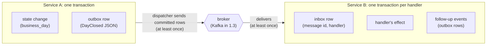
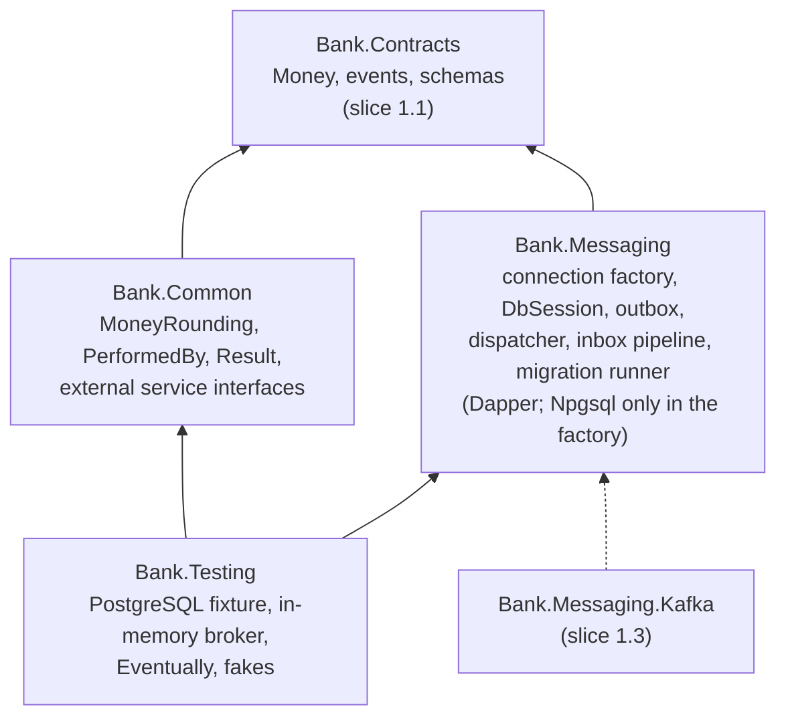
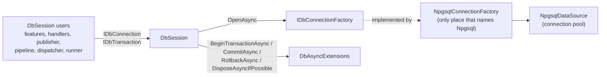
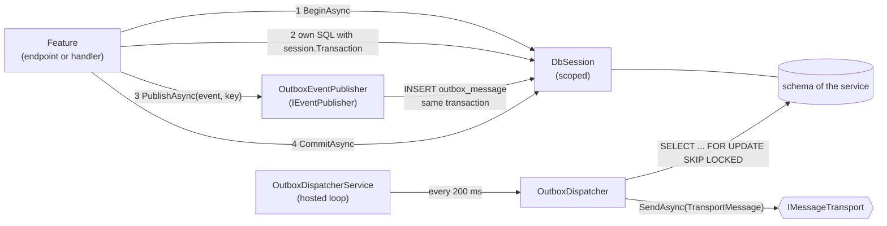
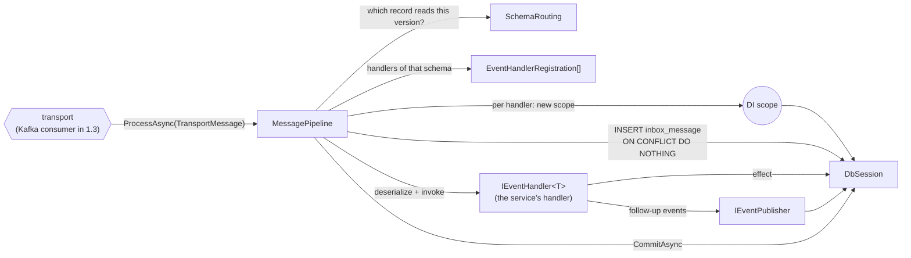
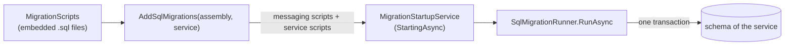
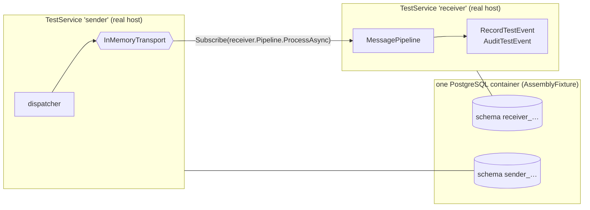

# Slice 1.2: Outbox and inbox

This document has three parts:

1. **The big picture**: what we are trying to achieve and why it is hard.
2. **The building blocks**: which projects, classes and tables we built, what each one does, and how they connect, first on the sending side, then on the receiving side, then for migrations and tests.
3. **Why it is designed this way**: the decisions, the alternatives we rejected, and the price we pay.

At the end: what was tested, what to watch later, and questions to check your understanding. `event-path.md` in this folder is the companion page: it follows one event step by step and says what a crash at each step leaves behind.

---

## Part 1. The big picture

### 1.1 The goal

Stage 1 must make this sentence true:

> An event can travel from one service's database transaction, through the broker, to another service's handler, **exactly once in effect**.

A concrete example: Operations closes the business day. That is a change in Operations' own table (`business_day`). Lending must hear about it (`DayClosed`) and run its end-of-day work exactly once, never zero times and never twice.

Slice 1.2 builds everything in that path **except Kafka**. Kafka arrives in slice 1.3 and plugs into a seam that this slice leaves for it.

### 1.2 Why it is hard: two problems

**Problem 1, the sending side (the dual write).** The feature must do two things: commit its change to PostgreSQL and send an event to the broker. These are two different systems, and no transaction covers both.

| Order | Crash in between | Result |
| --- | --- | --- |
| Commit, then send | The event is never sent | The day is closed, but Lending never knows |
| Send, then commit | The commit fails or never happens | Lending closes a day that Operations never closed |

Either order can lose a fact or invent one, and retrying does not fix it.

**Problem 2, the receiving side (duplicates).** No broker can promise "exactly once" across a crash. If the consumer crashes after doing the work but before telling the broker "done", the broker delivers the message again. So duplicates are certain, and the receiver must make them harmless.

### 1.3 The solution in one picture



- **Sending: transactional outbox.** The feature does not send the event. It writes the event as a row into its own `outbox_message` table, **in the same transaction** as the state change. Both commit or neither does. A separate loop, the **dispatcher**, sends committed rows to the broker and marks them as sent. If it crashes between sending and marking, it sends the row again. So delivery is **at least once**.
- **Receiving: inbox plus idempotent handler.** Before a handler runs, a row `(message id, handler name)` is inserted into `inbox_message`, **in the same transaction** as the handler's effect and any events the handler publishes. If the row already exists, this handler already applied this message, so it is skipped. Duplicates become harmless.
- **Business keys** close the last gap. When the same fact is published twice under two different message ids, the inbox cannot tell, because the ids differ. A unique constraint on the effect itself, such as `(loan_id, installment_no)`, rejects the second copy.

At least once on the wire, plus "a duplicate changes nothing" at the receiver, gives **exactly once in effect**.

### 1.4 What else this slice had to provide

To build the above with Dapper and hand-written SQL, four more things were needed:

- **A way to share one connection and transaction** between the feature's SQL, the outbox publisher and the inbox. This is the `DbSession`.
- **A single place that knows the database driver.** Everything else sees only `System.Data.IDbConnection`. This is the `IDbConnectionFactory`.
- **A way to create the tables** (outbox, inbox, and later every service's own tables) as versioned SQL scripts. This is the migration runner.
- **Test helpers** to run two "services" against a real PostgreSQL without Kafka. This is `Bank.Testing`.

It also provided `Bank.Common`, a small package of shared types that every service needs: money rounding, `PerformedBy`, `Result<T>` and the interfaces for external services.

---

## Part 2. The building blocks and how they connect

### 2.1 The projects

All of them live in `core_banking/bank-contracts/` and are built by `Bank.Contracts.slnx`.



An arrow means "references". `Bank.Messaging` does not reference `Bank.Common`, and neither of them references Kafka.

| Project | Packed as NuGet | Tests |
| --- | --- | --- |
| `src/Bank.Common` | yes | `tests/Bank.Common.Tests` (unit) |
| `src/Bank.Messaging` | yes | `tests/Bank.Messaging.UnitTests` (unit), `tests/Bank.Messaging.IntegrationTests` (PostgreSQL in Docker) |
| `src/Bank.Testing` | yes | used by the integration tests |

### 2.2 The tables

`src/Bank.Messaging/Migrations/0001_outbox_and_inbox.sql` creates two tables in each service's own schema.

**`outbox_message`**: one row per published event.

| Column | Meaning |
| --- | --- |
| `id` (PK) | The event's `EventId`. It travels as the `message-id` header and becomes the receiver's inbox key |
| `position` | Identity column; the order in which rows are sent |
| `schema_uri` | For example `iglu:se.bank/day_closed/jsonschema/1-0-0` |
| `message_key` | The broker key, the id of the entity the event is about |
| `payload` | The event JSON (`jsonb`) |
| `occurred_on`, `performed_by` | Copied from the event; they become headers |
| `created_at` | When the row was written (UTC, from `TimeProvider`) |
| `sent_at` | `NULL` until the broker has the message |
| `attempts`, `last_error` | Failed sends, for diagnosis |

A partial index `ix_outbox_message_unsent` on `position WHERE sent_at IS NULL` keeps the dispatcher's query cheap.

**`inbox_message`**: one row per message **and handler** that was applied.

| Column | Meaning |
| --- | --- |
| `message_id`, `handler_name` (PK together) | "This handler has applied this message" |
| `schema_uri` | The version that arrived |
| `performed_by`, `created_at` | Audit columns, as on every table |

The runner adds a third table, `schema_migration`, described in 2.6.

`Version`, required on every table, is PostgreSQL's hidden `xmin` column, so no table declares it.

### 2.3 Database access: the connection factory and `DbSession`

Every part of `Bank.Messaging` that touches the database (the feature through `DbSession`, the publisher, the dispatcher, the inbox and the migration runner) goes through the same two types. Only one class knows that the database is PostgreSQL.



#### `IDbConnectionFactory` and `NpgsqlConnectionFactory` (`Data/`)

`IDbConnectionFactory` has one method: `Task<IDbConnection> OpenAsync(CancellationToken ct)`, which returns a new open connection.

`NpgsqlConnectionFactory(connectionString)` implements it over an `NpgsqlDataSource`, which owns the connection pool, and opens connections with Npgsql's real `OpenConnectionAsync`. It is the only production class in the bank-contracts packages that names Npgsql. The connection string carries the service's own role, with its schema as the search path. A service registers it with `services.AddNpgsqlConnectionFactory(connectionString)`, and the container disposes the pool when the host stops.

#### `DbAsyncExtensions` (`Data/DbAsyncExtensions.cs`)

**The problem.** `IDbConnection` and `IDbTransaction` are older than async in .NET. They only have blocking `BeginTransaction`, `Commit` and `Rollback`. A blocking `Commit` holds a thread while PostgreSQL answers, and under load that starves the thread pool.

**The solution.** Every real ADO.NET provider's connection also derives from the abstract class `DbConnection`, and its transaction from `DbTransaction`. These classes do have real async methods. At run time our `IDbConnection` is an `NpgsqlConnection`, so the extension methods check the real type:

```csharp
public static Task CommitAsync(this IDbTransaction transaction, CancellationToken ct)
{
    if (transaction is DbTransaction db)
    {
        return db.CommitAsync(ct);   // Npgsql's real async commit
    }

    transaction.Commit();             // only for a provider without async
    return Task.CompletedTask;
}
```

`BeginTransactionAsync`, `RollbackAsync` and `DisposeAsyncIfPossible` work the same way. Dapper's async methods (`ExecuteAsync`, `QueryAsync`) use exactly the same check internally. They never use `Task.Run`: wrapping a blocking call in `Task.Run` only moves the blocked thread somewhere else ("async over sync").

`DbAsyncExtensionsTests` proves both paths. A transaction derived from `DbTransaction` gets `CommitAsync`, `RollbackAsync` and `DisposeAsync`. One that only implements `IDbTransaction` gets the blocking calls.

#### `DbSession` (`Data/DbSession.cs`)

The one connection and transaction of a unit of work. It is registered as **scoped** for an HTTP request, and the pipeline creates a scope per handler. The dispatcher (one poll) and the migration runner (one run) create their own `new DbSession(factory)`. So all connection and transaction handling is written once, here.

| Member | What it does |
| --- | --- |
| `OpenAsync` | Gets an open connection from the factory, without a transaction, for read-only work |
| `BeginAsync` | Opens the connection if needed and starts a transaction. Calling it twice throws |
| `CommitAsync`, `RollbackAsync` | End the transaction (async, through `DbAsyncExtensions`) |
| `Connection` (`IDbConnection`) | The open connection; throws if neither `OpenAsync` nor `BeginAsync` was called |
| `Transaction` (`IDbTransaction`) | The active transaction; throws with "Call BeginAsync" if there is none |
| `DisposeAsync` | Rolls back an uncommitted transaction and returns the connection to the pool |

It lives in the namespace `Bank.Messaging.Data`, so a feature adds `using Bank.Messaging.Data;`. A feature uses it like this:

```csharp
await session.BeginAsync(ct);
await session.Connection.ExecuteAsync(new CommandDefinition(sql, args, session.Transaction, cancellationToken: ct));
await publisher.PublishAsync(new DayClosed(...), key: "bank", ct);
await session.CommitAsync(ct);
```

### 2.4 The sending side



#### `IEventPublisher` and `OutboxEventPublisher` (`IEventPublisher.cs`, `Outbox/OutboxEventPublisher.cs`)

`IEventPublisher` is the public interface from the stage file: `PublishAsync<T>(T @event, string key, CancellationToken ct)`. Its only implementation, `OutboxEventPublisher`, is internal and scoped. It gets the same `DbSession` as the feature. `PublishAsync`:

1. checks that the key is not empty;
2. reads `session.Transaction`, which throws if the feature never called `BeginAsync`. An event can never be written outside the state change's transaction;
3. finds the record's `SchemaUri` through `EventSchemaUri` (see below), using the event's runtime type, so it also works when called through `IIntegrationEvent`;
4. serializes the event with `ContractJson.Options`, the same options the schemas were generated with;
5. inserts the outbox row.

Nothing is sent here. Sending is the dispatcher's job, after the commit.

#### `EventSchemaUri` (`Bank.Contracts/Schema/EventSchemaUri.cs`)

A small helper that reads the `public const string SchemaUri` of an event record by reflection and caches it. It used to live in the schema tool (`ContractCatalog.SchemaUriOf`). It moved into `Bank.Contracts` so that the tool, the publisher and the handler registration share one implementation.

#### `TransportMessage` and `IMessageTransport` (`Transport/`)

The **seam** between our messaging code and a broker.

- `TransportMessage(MessageId, SchemaUri, Key, Payload, PerformedBy, OccurredOn)` is an event as it travels: the JSON plus the values that become the Kafka headers `message-id`, `schema-uri`, `performed-by` and `occurred-on`.
- `IMessageTransport.SendAsync(message, ct)` sends one message. When it returns, the broker has the message. When it throws, the send failed.

`Bank.Messaging` contains no implementation. Slice 1.3 adds the Kafka one, and the tests use `InMemoryTransport` from `Bank.Testing`. The service registers exactly one.

#### `OutboxDispatcher` (`Outbox/OutboxDispatcher.cs`)

One call to `DispatchBatchAsync` is one poll:

1. Create its own `DbSession` from the factory and begin a transaction. One poll is its own unit of work, not part of any request.
2. `SELECT ... FROM outbox_message WHERE sent_at IS NULL ORDER BY position LIMIT @BatchSize FOR UPDATE SKIP LOCKED`. This locks up to 100 unsent rows. Rows locked by another dispatcher are skipped, not waited for.
3. Send each row through `IMessageTransport`, in order.
4. At the first failed send: store `attempts + 1` and `last_error` on that row, and stop. The rest of the batch waits for the next poll.
5. `UPDATE outbox_message SET sent_at = now WHERE id = ANY(sent ids)`, then commit.
6. Return how many rows were sent.

It is a public singleton, so tests can call it directly.

#### `OutboxDispatcherService` (`Outbox/OutboxDispatcherService.cs`)

The hosted background loop around the dispatcher, registered with `AddHostedService`. It calls `DispatchBatchAsync` in a loop:

- after a **full** batch, it polls again at once, because more rows are probably waiting;
- otherwise it waits `PollingInterval` (200 ms) using `TimeProvider`;
- an exception (for example the database is down) is logged, and the loop continues. The rows are safe in the outbox;
- it stops when the host stops.

#### `BankMessagingOptions` (`BankMessagingOptions.cs`)

| Option | Default | Meaning |
| --- | --- | --- |
| `ServiceName` | required | Such as `"operations"`; also names the topic `bank.<service>.events` in slice 1.3 |
| `PollingInterval` | 200 ms | Wait after a poll that found less than a full batch |
| `BatchSize` | 100 | Rows per poll |

They are validated when the host starts, so a missing `ServiceName` stops the service immediately.

### 2.5 The receiving side



#### `IEventHandler<T>` (`IEventHandler.cs`)

The interface a service implements for each event it reacts to: `HandleAsync(T @event, CancellationToken ct)`. A handler injects `DbSession` for its own SQL and `IEventPublisher` for follow-up events. It **never** begins or commits a transaction. The pipeline does that around it, so the effect, the inbox row and the follow-up events commit together. To undo everything, the handler throws.

#### `EventHandlerRegistration` (`Inbox/EventHandlerRegistration.cs`)

**The problem it solves.** Handlers are generic (`IEventHandler<DayClosed>`, `IEventHandler<TestEvent>`), but a message from the broker is only a JSON string with a schema URI. At compile time the pipeline cannot know which `T` it will receive. At run time it must know three things: which record type to deserialize into, which handlers to call, and which name to write into the inbox.

**What it is.** A non-generic description of one registered handler, created at startup by `AddEventHandler<TEvent, THandler>()`:

| Property | Example for `RecordTestEvent` | Used for |
| --- | --- | --- |
| `EventType` | `typeof(TestEvent)` | `JsonSerializer.Deserialize(payload, EventType, ...)` |
| `Schema` | `iglu:se.bank/test_event/jsonschema/1-0-0` (from the record's `SchemaUri`) | matching incoming messages, through `SchemaRouting` |
| `HandlerName` | `"RecordTestEvent"` (the class name) | the second half of the inbox key |
| `invoke` (private) | a delegate | resolving the handler from DI and calling `HandleAsync` |

**The trick.** `For<TEvent, THandler>()` runs at startup, while both types are still known, and captures them in a lambda:

```csharp
(services, @event, ct) => services.GetRequiredService<THandler>().HandleAsync((TEvent)@event, ct)
```

Later the pipeline calls this delegate with a plain `object`. The cast back to `TEvent` happens inside the lambda. So the pipeline calls the right generic handler without reflection and without knowing `T`. This is called *type erasure*: a generic type hidden behind a non-generic delegate.

#### `SchemaRouting`, `SchemaRoute`, `SchemaMatch` (`Inbox/SchemaRouting.cs`)

A **pure function** with no I/O, unit tested in `Bank.Messaging.UnitTests`. Given the incoming schema version and all versions this service has handlers for, it decides:

| `SchemaMatch` | When | What the pipeline does |
| --- | --- | --- |
| `Exact` | a handler's record has exactly this version | reads it with that record |
| `CompatibleAddition` | another version in a **known MODEL** (for example 1-0-3 when we know 1-0-1) | reads it with the **latest** known record of that MODEL; unknown optional fields are ignored |
| `UnknownModel` | the event is handled here, but not in this MODEL (2-0-0 when we know only 1-x-x) | throws `UnsupportedSchemaVersionException`; slice 1.3 sends it to the dead-letter topic |
| `NotSubscribed` | no handler for this event in any version | skips the message |

This applies the SchemaVer rule from slice 1.1: within one MODEL, versions only add optional fields, so any record of that MODEL can read any message of that MODEL.

#### `MessagePipeline` (`Inbox/MessagePipeline.cs`)

The receiving side. It is a singleton. Its constructor receives all `EventHandlerRegistration`s, refuses two handlers with the same name (they would share inbox rows), and groups them by schema.

`ProcessAsync(message, ct)`:

1. Parse the schema URI and ask `SchemaRouting` for the route. Return `NotSubscribed`, or throw for `UnknownModel`.
2. For **each** handler of the chosen schema, in its **own DI scope and its own transaction**:
   1. get a fresh `DbSession` from the scope and `BeginAsync`;
   2. `INSERT INTO inbox_message ... ON CONFLICT (message_id, handler_name) DO NOTHING`;
   3. if no row was inserted, this handler already applied the message: roll back, go to the next handler;
   4. otherwise deserialize the payload into `EventType` and call the handler through the registration's delegate;
   5. commit: inbox row, effect and follow-up outbox rows together.
3. Return `Handled` if at least one handler ran, otherwise `Duplicate`.

If a handler throws, or the payload does not deserialize, that handler's transaction rolls back and the exception propagates to the transport. In slice 1.3 the transport retries it and finally sends it to the dead-letter topic.

Two deliveries of the same message at the same moment are safe: the second `INSERT` waits on the primary key until the first transaction commits, then inserts nothing.

`ProcessOutcome` (`Handled`, `Duplicate`, `NotSubscribed`) and `UnsupportedSchemaVersionException` are declared in the same file.

### 2.6 Migrations



#### `MigrationScript` (`Migrations/MigrationScript.cs`)

A record `(Id, Sql)` with a computed `Checksum`: SHA-256 of the SQL with line endings normalized, so a checkout on Windows gives the same value. The id looks like `messaging/0001_outbox_and_inbox.sql`.

#### `MigrationScripts` (`Migrations/MigrationScripts.cs`)

Loads scripts from an assembly: every embedded resource named `migrations/*.sql`, ordered by file name. The project file embeds them like this:

```xml
<EmbeddedResource Include="Migrations\*.sql" LogicalName="migrations/%(Filename)%(Extension)" />
```

`MigrationScripts.Messaging` is the list of `Bank.Messaging`'s own scripts (outbox and inbox). `FromAssembly(assembly, source)` loads a service's scripts and prefixes their ids with the service name, so two assemblies can both have a `0001_` script.

#### `SqlMigrationRunner` (`Migrations/SqlMigrationRunner.cs`)

`RunAsync(scripts)` takes the connection factory and does this in **one transaction**, through its own `DbSession`:

1. `pg_advisory_xact_lock(hashtext(current_schema()))`. A second instance of the same service waits here; other services, with other schemas, do not.
2. `CREATE TABLE IF NOT EXISTS schema_migration (script_id, checksum, performed_by, created_at)`.
3. Read the ids and checksums already applied.
4. For each script, in order:
   - already applied with the same checksum: skip it;
   - already applied with a **different** checksum: stop with an error, because someone edited an applied script;
   - new: run it and record it.
5. Commit, log the applied ids, and return them.

#### `MigrationStartupService` (`Migrations/MigrationStartupService.cs`)

An `IHostedLifecycleService` that runs the runner in `StartingAsync`. The host calls `StartingAsync` of every lifecycle service **before** it starts any hosted service, so the outbox dispatcher never polls a table that does not exist yet.

### 2.7 Wiring: `ServiceCollectionExtensions`

A service connects all of the above in `Program.cs` like this:

```csharp
builder.Services.AddNpgsqlConnectionFactory(connectionString);                    // its own role and schema
builder.Services.AddSingleton<IMessageTransport, ...>();                          // Kafka from slice 1.3
builder.Services.AddBankMessaging(o => o.ServiceName = "lending");
builder.Services.AddSqlMigrations(typeof(Program).Assembly, "lending");
builder.Services.AddEventHandler<DayClosed, RunEndOfDay>();
```

| Call | Registers |
| --- | --- |
| `AddNpgsqlConnectionFactory` | the `IDbConnectionFactory` for the service's role and schema (singleton) |
| `AddBankMessaging` | options (validated at startup), `TimeProvider.System`, `DbSession` (scoped), `IEventPublisher` (scoped), `OutboxDispatcher` and `MessagePipeline` (singletons), the hosted `OutboxDispatcherService`. It also sets Dapper's `MatchNamesWithUnderscores`, so `created_at` maps to `CreatedAt` |
| `AddEventHandler<TEvent, THandler>` | the handler (scoped) and its `EventHandlerRegistration` (singleton) |
| `AddSqlMigrations` | `SqlMigrationRunner` and a `MigrationStartupService` with the messaging scripts followed by the service's scripts |

SQL in `Bank.Messaging` names no schema (`outbox_message`, not `lending.outbox_message`). The connection's search path picks the schema, so the same SQL works in all six services.

### 2.8 `Bank.Common`

Shared types with no I/O:

| Type | What it is |
| --- | --- |
| `MoneyRounding.Round(money, minorUnits)` | The only place money is rounded: `Math.Round` with `MidpointRounding.AwayFromZero`, so 1.005 SEK becomes 1.01 and −1.005 becomes −1.01. Minor units must be between 0 and 28 |
| `PerformedBy` | `System = "system"`, `HeaderName = "X-Performed-By"`, `MaxLength = 100`, and `From(value)`: an empty value becomes `"system"`, others are trimmed, and a value that is too long is rejected |
| `Result<T>` and `Error(Code, Message)` | The outcome of a use case that can fail for a business reason (later a 422 with `code`). A value or an `Error` converts to it implicitly. Reading `Value` of a failure, or `Error` of a success, throws |
| `IBusinessClock` | `DateOnly Today`; the business date, never the system clock |
| `IFileStorage` | `SaveAsync`, `OpenReadAsync`, `ExistsAsync`, `DeleteAsync` |
| `IEmailSender` and `EmailMessage(To, Subject, Body)` | Sending email |
| `IExchangeRateProvider` | `GetRateAsync(from, to, date)` |
| `IAccountNumberGenerator` | `NextAsync()`; the number format is still open |

Only the interfaces exist. Implementations come in the stages that need them.

### 2.9 `Bank.Testing` and the integration tests

#### `Bank.Testing`

| Type | What it is |
| --- | --- |
| `PostgresFixture` | The one place in test code that uses Npgsql directly, because its job is PostgreSQL itself. Starts one `postgres:18-alpine` container. `CreateServiceSchemaAsync(prefix)` creates a login role and a schema it owns, with a random name and a password generated at run time, and returns a connection string with that schema as the search path. This mirrors the platform's "one role and schema per service" |
| `InMemoryTransport` | An `IMessageTransport` in memory. It records every sent message in `Sent` and hands it to each subscriber. As with a real broker, a failing subscriber does not fail the send; its exception goes to `DeliveryErrors`. `FailSends = true` simulates a broker outage |
| `Eventually.AssertAsync` | Retries an assertion until it passes or a timeout ends, for work done by the background dispatcher |
| `FakeBusinessClock` | A settable `Today` with `AdvanceDays` |
| `InMemoryFileStorage`, `InMemoryEmailSender`, `FixedExchangeRateProvider`, `SequentialAccountNumberGenerator` | Fakes for the `Bank.Common` interfaces |

#### How the integration tests simulate two services



- `Support/AssemblyInfo.cs` registers `PostgresFixture` as an **assembly fixture**: one container for the whole run (about 2 s to start), while each test gets fresh schemas and can run in parallel.
- `Support/TestService.cs` builds a real host per "service" with `AddNpgsqlConnectionFactory`, `AddBankMessaging`, `AddSqlMigrations` and its own `InMemoryTransport`. Its helpers are `CountAsync(table, where)` and `QuerySingleAsync`. Each service has its own outbound broker, so a receiver's follow-up events do not loop back into itself.
- `Support/TestHandlers.cs` holds `RecordTestEvent` (writes the effect, can publish a reply, can fail after both) and `AuditTestEvent` (a second handler of the same event, can fail). `HandlerBehaviour` holds the switches a test flips.
- `Migrations/0001_test_tables.sql` creates `test_item` (the sender's state change), `received_test_event` (the receiver's effect, with the business key `uq_received_test_event_business_key` on `(message_key, sequence)`) and `audited_test_event`.
- `TestEvents.New(...)` and `TestEvents.AsMessage(...)` build a `TestEvent` and the `TransportMessage` a dispatcher would have sent.

---

## Part 3. Why it is designed this way

### 3.1 Decisions you made (D1)

#### Polling with `FOR UPDATE SKIP LOCKED` (ADR 0006)

**Why.** One SQL statement finds, orders and locks the rows, using nothing but PostgreSQL, so it behaves the same in tests, locally and on AWS. `SKIP LOCKED` lets several dispatcher instances work in parallel without blocking each other and without taking the same rows. The test with three concurrent dispatchers proves it.

**Rejected.** LISTEN/NOTIFY has lower latency, but a notification is lost when nobody is listening, so polling is still needed as a fallback: two code paths to save at most 200 ms. Debezium needs Kafka Connect, logical replication and more infrastructure to run.

**Price.** A small indexed query every 200 ms, up to 200 ms of extra latency, and possible out-of-order sends per key with more than one dispatcher instance (phase 1 runs one per service).

#### Inbox key `(message_id, handler_name)` (ADR 0007)

**Why.** One service can have two handlers for one event. If handler 1 commits and handler 2 fails, the broker redelivers the whole message. With the handler in the key, handler 1 is skipped and only handler 2 runs again. The test `Each_handler_applies_a_message_once_even_when_another_handler_failed` shows exactly this.

**Rejected.** A key of the message id alone: then either both handlers share one transaction, so one failure undoes the other's work, or the second handler sees "duplicate" and never runs.

**Price.** The class name is stored data. Renaming a handler makes it see old messages as new, so a rename must be deliberate.

#### A hand-written migration runner (ADR 0008)

**Why.** About a hundred lines you can read in full, showing the three things every migration tool solves: a journal, a lock against concurrent runs, and detection of edited scripts. One transaction per run uses PostgreSQL's transactional DDL, so a failing script changes nothing. The SQL stays plain SQL, which was the point of choosing Dapper (workspace ADR 0001).

**Rejected.** DbUp fits well and would be the first choice if we ever need more features. FluentMigrator hides SQL behind a C# DSL.

**Price.** We maintain it and its tests. There are no down migrations, and statements that cannot run in a transaction (such as `CREATE INDEX CONCURRENTLY`) are not supported.

#### A scoped `DbSession` (ADR 0009)

**Why.** The outbox and the inbox only work if the feature's SQL, the publisher and the inbox use the **same** transaction. A DI scope already exists per HTTP request, and the pipeline creates one per handler, so "one transaction per unit of work" falls out of normal dependency injection. `IEventPublisher` keeps its fixed signature without Npgsql types, and begin and commit stay visible in the feature code.

**Rejected.** Passing the transaction into `PublishAsync` is the most explicit, but it puts Npgsql into the public interface and every handler must pass it along. An ambient `TransactionScope` is implicit, awkward with async, and can escalate to a distributed transaction by accident.

**Price.** The dependency is hidden: forgetting `BeginAsync` fails at run time, not at compile time. That is why `PublishAsync` throws a clear error without a transaction.

#### `IDbConnection` through a connection factory (ADR 0010, amends 0009)

**Why.** The first version exposed `NpgsqlConnection` from `DbSession`, so the driver leaked into every feature and handler. Now only `NpgsqlConnectionFactory` knows the provider. Everything else, including the dispatcher and the runner, sees only `System.Data` types. Async is kept through `DbAsyncExtensions`, which reach the provider's real async methods. Because the dispatcher and the runner also use `DbSession`, connection and transaction handling is written once.

**Rejected.** `DbConnection` as the public type would be async without extensions, but you preferred the interface. Blocking calls only would hold a thread on every commit. `Task.Run` around blocking calls only moves the blocking to another thread.

**Price.** The SQL is still PostgreSQL (`SKIP LOCKED`, `ON CONFLICT`, `jsonb`, advisory locks). The factory hides the driver's types, not the database. A provider-specific feature, such as binary `COPY`, would need a new factory method instead of a cast.

### 3.2 Design choices I made (D2)

| Choice | Why |
| --- | --- |
| The outbox `id` is the event's `EventId` | The message id is the event id end to end. Publishing the same event object twice fails on the primary key |
| `position` identity column for order, not `created_at` | Timestamps can tie, and they come from the application clock |
| `payload` is `jsonb` | It can be inspected with SQL. Key order and whitespace may change, not the meaning |
| `attempts` and `last_error` on the outbox row | A stuck message can be diagnosed with one query |
| The dispatcher stops a batch at the first failed send | Later messages, possibly with the same key, must not overtake it |
| The dispatcher and the runner create their own `DbSession`, not a scoped one | Neither is part of a request; one poll or one run is its own unit of work. Using `DbSession` keeps begin, commit and dispose in one class |
| `DbSession` and the factory in the namespace `Bank.Messaging.Data` | Groups database access apart from the outbox and inbox logic |
| `NpgsqlConnectionFactory` owns its `NpgsqlDataSource` and is disposed by the container | One pool per service, closed when the host stops |
| The hosted loop polls again at once after a full batch | A backlog drains at full speed; an idle service still polls only every 200 ms |
| One scope and one transaction per handler | Handlers are independent: one failing does not undo another |
| Handler name is the class name, not the full name | Moving a class to another namespace does not change the inbox key. Duplicate names fail at startup |
| `NotSubscribed` messages are skipped, not dead-lettered | A topic holds every event of its publisher, and each consumer handles only some of them |
| Older and newer ADDITIONs are read with the latest known record of their MODEL | Within a MODEL every version only adds optional fields (slice 1.1) |
| `EventHandlerRegistration` uses a captured delegate | Calls the generic handler without reflection on every message |
| SQL names no schema; the search path decides | The same SQL works in every service. The platform roles in slice 1.4 get the same default |
| The migration runner lives in `Bank.Messaging` | It is the only shared database package. A separate `Bank.Data` package for about 100 lines is not worth it |
| Migrations run in `IHostedLifecycleService.StartingAsync` | It runs before every hosted service, whatever the registration order |
| `MigrationScript.Checksum` is computed on read | A stored value was copied unchanged by `with { Sql = ... }`. A test caught this bug |
| Advisory lock keyed by schema name | Instances of one service wait for each other; different services do not |
| `DbSession` is a class, not an interface | One implementation, and the tests use real PostgreSQL |
| Options validated with `Validate(...)` and `ValidateOnStart` | Fails at startup, without an extra DataAnnotations package for two checks |
| `EventSchemaUri` moved into `Bank.Contracts` | The tool, the publisher and the registration share one implementation |
| Added `tests/Bank.Common.Tests` (not in the stage file's layout) | `MoneyRounding` is financial logic and gets its test first |
| Each test gets its own role and schema; one container per run | Parallel tests that never see each other's rows, and a container that starts only once |
| Each `TestService` has its own outbound `InMemoryTransport` | A receiver's follow-up events must not loop back into itself |
| Kafka Testcontainers fixture moved to slice 1.3 | It would be untested code until a Kafka test exists |
| `postgres:18-alpine` | The current major version. Slice 1.4 should use the same image |
| Fake account numbers `TEST-000001` | The real format is still open |

### 3.3 Patterns used

- **Transactional outbox**: makes "change and announce" atomic without a distributed transaction.
- **Idempotent consumer with an inbox**: makes at-least-once delivery safe.
- **Unit of work through scoped DI**: the DI scope *is* the unit of work, without a repository or a unit-of-work wrapper on top.
- **Port and adapter (seam)**: `IMessageTransport` lets the whole messaging logic be built and tested before Kafka exists. Slice 1.3 adds an adapter, not a rewrite.
- **Competing consumers on a table**: `SKIP LOCKED` lets several dispatchers share the work.
- **Tolerant reader**: a consumer reads newer ADDITIONs with the record it knows and ignores unknown fields.
- **Abstract factory** (`IDbConnectionFactory`): the one place that chooses the database provider.
- **Runtime capability check** (`DbAsyncExtensions`): use the async members when the concrete type has them, without changing the public type.
- **Type erasure through a delegate**: `EventHandlerRegistration` hides the generic handler behind a non-generic call.
- **Fail fast**: a publish without a transaction, an edited migration, two handlers with the same name, or a missing `ServiceName` all fail at the earliest point.

---

## 4. What was tested

| Project | Count | What |
| --- | --- | --- |
| `Bank.Common.Tests` | 16 | Rounding (midpoints away from zero, 0 and 3 minor units, range), `PerformedBy`, `Result` |
| `Bank.Messaging.UnitTests` | 9 | `SchemaRouting`: exact, newer and older ADDITION, other MODEL, unknown MODEL, not subscribed. `DbAsyncExtensions`: async when the provider has it, blocking fallback otherwise |
| `Bank.Messaging.IntegrationTests` | 19 | Outbox, inbox and migrations against PostgreSQL, listed below |

The integration tests:

- **Outbox** (`OutboxTests`)
  - A committed event reaches the other service, and a poll before the commit sees nothing.
  - Rollback publishes nothing.
  - Disposing the session without a commit publishes nothing.
  - Publishing without a transaction fails.
  - A failed send stays in the outbox and is sent on a later poll.
  - Three concurrent dispatchers never send a row twice.
- **Inbox** (`InboxTests`)
  - A duplicate message is applied once, and so are five concurrent deliveries of one message.
  - The same fact under a new message id is stopped by the business key.
  - The effect, the inbox row and the follow-up event commit together or not at all.
  - Each handler applies a message once, even when another handler failed.
  - A newer ADDITION is read with the known record.
  - An unknown MODEL is rejected without any change.
  - An event without a handler is skipped.
- **Migrations** (`MigrationRunnerTests`)
  - Scripts are applied once.
  - An edited script stops the run.
  - A failing script rolls back the whole run.
  - Concurrent runs apply each script once.
  - Line endings do not change the checksum.

Command and result (run three times in a row, all green):

```
cd core_banking/bank-contracts && dotnet build && dotnet test
Build succeeded.  0 Warning(s)  0 Error(s)
Passed!  - Failed: 0, Passed:  16 - Bank.Common.Tests
Passed!  - Failed: 0, Passed:   9 - Bank.Messaging.UnitTests
Passed!  - Failed: 0, Passed: 106 - Bank.Contracts.Tests
Passed!  - Failed: 0, Passed:  19 - Bank.Messaging.IntegrationTests
```

## 5. What to watch later

- `outbox_message` and `inbox_message` grow without limit. A cleanup job (delete sent and old rows) is not built yet.
- With more than one dispatcher instance, per-key order can break (ADR 0006).
- Retries, the dead-letter topic and offset commits belong to the transport, in slice 1.3. Today an exception from `ProcessAsync` simply propagates.

## 6. Check your understanding

1. In `Each_handler_applies_a_message_once_even_when_another_handler_failed`, `RecordTestEvent` commits and `AuditTestEvent` throws. Walk through the redelivery: what happens to each handler, and what would go wrong if the inbox key were `message_id` alone?
2. The dispatcher process is killed right after the broker acknowledges a message but before `UPDATE outbox_message SET sent_at`. What does the broker hold afterwards, and which row makes sure Lending's effect still happens only once?
3. Why does the migration runner take its advisory lock **before** `CREATE TABLE IF NOT EXISTS schema_migration`, and not after?
4. `DbSession.Transaction` is an `IDbTransaction`, which has no `CommitAsync`. How does `session.CommitAsync` still commit without blocking a thread, and why would `Task.Run(() => transaction.Commit())` not achieve the same?
5. Why can `MessagePipeline` call `IEventHandler<TestEvent>` without knowing `TestEvent` at compile time? What does `EventHandlerRegistration.For<TEvent, THandler>()` capture, and when?
