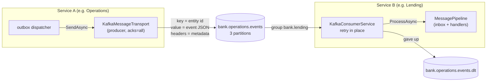
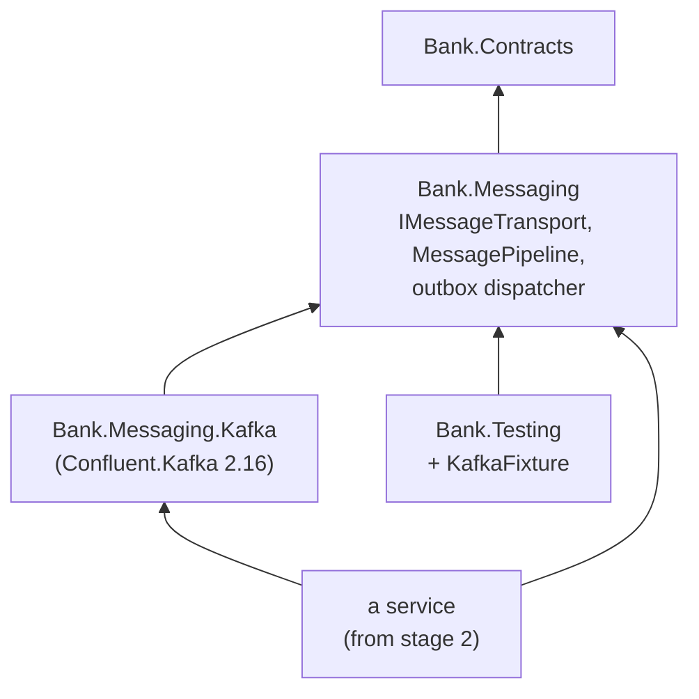
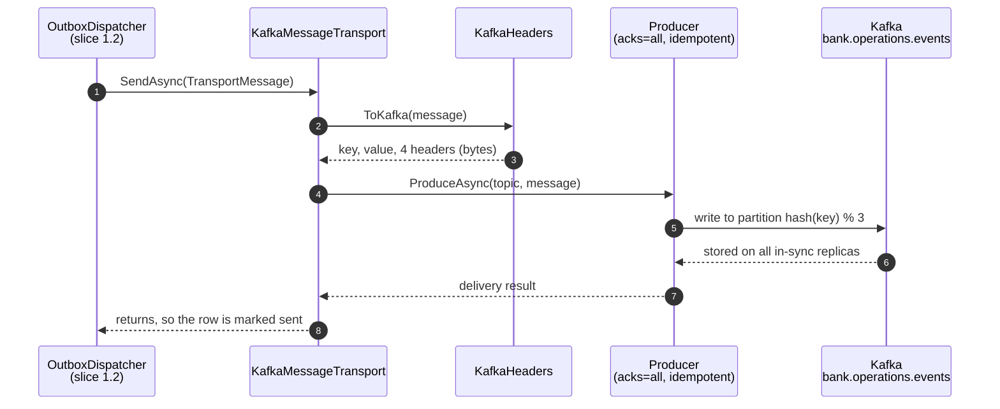
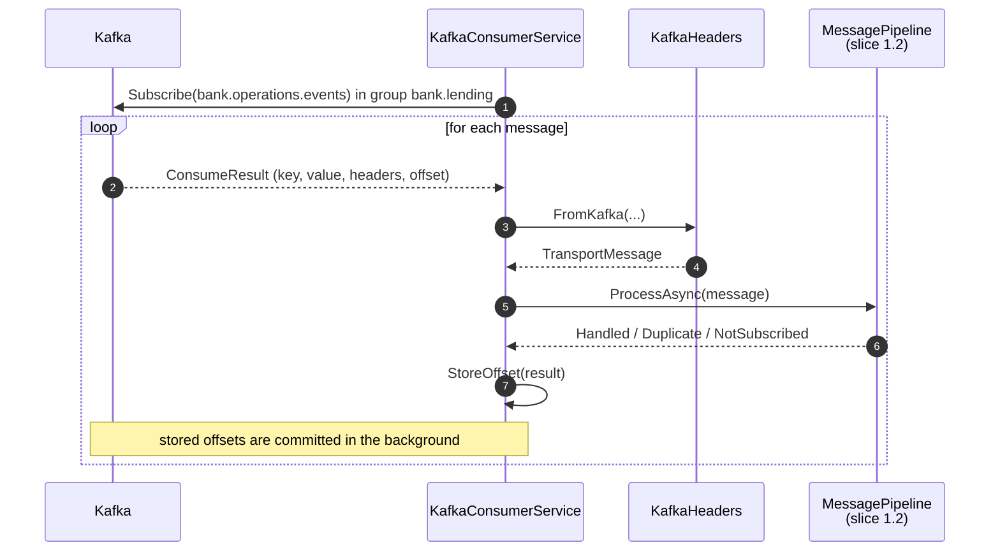
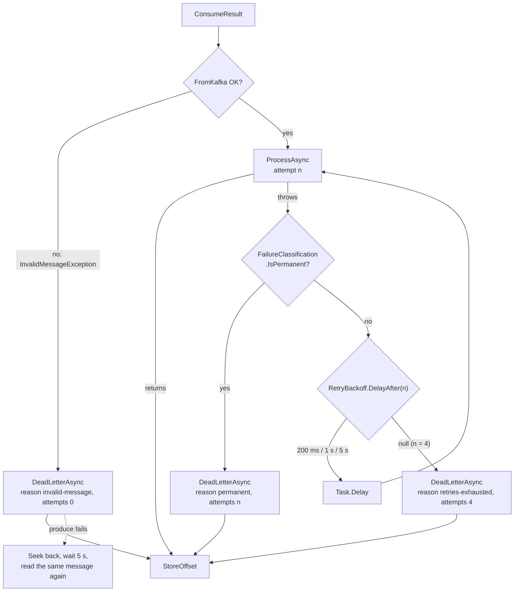

# Slice 1.3: Kafka transport

This document has three parts:

1. **The big picture**: what the transport must do, and why a broker makes failures hard.
2. **The building blocks**: the new project `Bank.Messaging.Kafka`, its classes, and how one message travels through them, first on the sending side, then on the receiving side, then when it fails.
3. **Why it is designed this way**: your decisions (retry strategy, topic subscription, the business-key rule), the alternatives you raised yourself, and my smaller choices.

At the end: what was tested, what to watch later, and questions to check your understanding. `event-path.md` in this folder follows one event through every step and says what a crash at each step leaves behind.

---

## Part 1. The big picture

### 1.1 The goal

Slice 1.2 left a seam, `IMessageTransport`, and tested everything behind it with an in-memory broker. Slice 1.3 puts a real broker behind the seam:

> An event that one service commits reaches the other service's handlers through Kafka, **in order per entity**, and a message that keeps failing is **set aside without being lost and without stopping the service**.

### 1.2 The Kafka concepts this slice uses

- **Topic.** A named, append-only log of messages. Each service writes all its events to one topic: `bank.<service>.events`.
- **Partition.** A topic is split into partitions (3 by default here). Each partition is its own log. **Order is kept only inside one partition.**
- **Key.** Kafka sends messages with the same key to the same partition. Our key is the id of the entity the event is about, so all events of one loan are in one partition, in order.
- **Consumer group.** All instances of one service read as group `bank.<service>`. Kafka gives each partition to exactly one instance of the group, so the instances share the work and each message is handled by one of them.
- **Offset.** A message's position in its partition. For each group and partition Kafka stores **one number**, the committed offset, meaning "everything before this is done". After a restart, the group continues from there.

### 1.3 Why it is hard

**Problem 1: when to say "done".** If the consumer commits the offset *before* the handler finishes and then crashes, the message is lost. If it commits *after*, a crash in between means the message is read again. We choose "after", so delivery is at least once, and the inbox from slice 1.2 makes the second read harmless.

**Problem 2: a message that keeps failing.** Because the committed offset is one number per partition, the consumer cannot skip one message and keep it for later. A message that fails every time (a *poison message*) would block its partition forever. It must be retried a few times for short failures, then moved aside to a **dead-letter topic** (DLT).

**Problem 3: order versus progress.** While a message is being retried, the next messages in its partition wait. Letting them go first would be faster, but then an `InstallmentPaid` could be applied before the `LoanDisbursed` it depends on.

**Problem 4: which topics to read.** An event does not say who published it, so a consumer cannot work out by itself which topics hold the events its handlers want.

### 1.4 The solution in one picture



- The producer sends each outbox row as one Kafka message and returns only when the broker has stored it.
- The consumer hands each message to the pipeline, retries it in place when it fails, and gives up to the DLT after four executions, or at once when a retry can never help.
- The offset is stored only when the message is done: handled, or safely in the DLT.
- Each service lists the services it reads from in configuration.

---

## Part 2. The building blocks and how they connect

### 2.1 The project and its place

`core_banking/bank-contracts/src/Bank.Messaging.Kafka` is a new NuGet package, the **only** project that references Confluent.Kafka.



`Bank.Messaging` still knows nothing about Kafka. Kafka plugs in behind two existing points: it **implements** `IMessageTransport`, and it **calls** `MessagePipeline.ProcessAsync`. Nothing in slice 1.2's code changed.

| File | Role |
| --- | --- |
| `ServiceCollectionExtensions.cs` | `AddKafkaTransport(configuration)`: options, producer, transport, topic initializer, consumer |
| `KafkaOptions.cs` | Settings: broker address, `SubscribeTo`, partitions, replication, retry delays |
| `KafkaTopics.cs` | Names: `bank.<service>.events`, `<topic>.dlt`, group `bank.<service>` |
| `KafkaHeaders.cs` | The message format: `TransportMessage` to Kafka bytes and back |
| `KafkaMessageTransport.cs` | The sending side: `IMessageTransport` on the producer |
| `KafkaTopicInitializer.cs` | Creates the topics at startup |
| `KafkaConsumerService.cs` | The receiving side: consume, retry, dead-letter, store offsets |
| `RetryBackoff.cs` | Pure function: how long to wait after each failed attempt |
| `FailureClassification.cs` | Pure function: can this failure ever succeed? Also `InvalidMessageException` |
| `DeadLetterHeaders.cs` | Names of the `dlt-*` headers and the three reasons |

### 2.2 Wiring: a service's `Program.cs`

```csharp
builder.Services.AddNpgsqlDbContext<LendingDbContext>(connectionString);   // Bank.Toolkit.Data
builder.Services.AddMigrationsOnStartup<LendingDbContext>();               // Bank.Toolkit.Data
builder.Services.AddBankMessaging(o => o.ServiceName = "lending");         // Bank.Messaging
builder.Services.AddKafkaTransport(builder.Configuration);                 // Bank.Messaging.Kafka
builder.Services.AddEventHandler<DayClosed, RunEndOfDay>();
```

```json
{
  "ConnectionStrings": { "kafka": "localhost:9092" },
  "Kafka": { "SubscribeTo": [ "operations" ] }
}
```

In slice 1.4 Aspire sets `ConnectionStrings:kafka` for every service that references the Kafka resource.

#### `AddKafkaTransport` and `KafkaOptions`

`AddKafkaTransport(configuration)`:

1. binds `KafkaOptions` from the `Kafka` section, and takes `BootstrapServers` from `ConnectionStrings:kafka`;
2. validates at startup, each with a message that says what to fix: a broker address is required; `SubscribeTo` holds service names (`operations`), not topic names; partitions, replication and delays must be positive;
3. registers one shared **producer** (`IProducer<byte[], byte[]>`), the transport, the topic initializer and the consumer service.

| Option | Default | Meaning |
| --- | --- | --- |
| `BootstrapServers` | from `ConnectionStrings:kafka` | Broker addresses |
| `SubscribeTo` | empty | Services whose topics this service reads; empty means publish only |
| `Partitions` | 3 | Partitions of each topic the service creates |
| `ReplicationFactor` | 1 | Copies of each partition; 1 for one local broker |
| `RetryDelays` | 200 ms, 1 s, 5 s | Wait before each retry |

`RetryDelays` starts empty and gets its default after binding. The .NET configuration binder **adds** configured array items to the existing ones instead of replacing them, so a default in the property would turn a configured `[50 ms]` into `[200 ms, 1 s, 5 s, 50 ms]`.

#### `KafkaTopics`

Three one-line functions, so names are built in one place: `Events("operations")` is `bank.operations.events`, `DeadLetter(topic)` is `<topic>.dlt`, `ConsumerGroup("lending")` is `bank.lending`.

#### `KafkaTopicInitializer`

An `IHostedLifecycleService`. In `StartingAsync`, which runs **before** any hosted service starts (the same trick as the migrations in slice 1.2), it creates the service's own topic, each subscribed topic, and the `.dlt` topic of each, with the configured partitions. A topic that already exists is left alone. So the outbox dispatcher never sends to a missing topic, the consumer never subscribes to one, and the services can start in any order.

### 2.3 The sending side



#### `KafkaHeaders` (`KafkaHeaders.cs`)

The message format (ADR 0014). It is `internal`, because its signatures use Confluent types and no service may see those; only the two test projects get access, through `InternalsVisibleTo` (changed at the stage 1 review). `ToKafka(TransportMessage)` builds:

| Part | Content |
| --- | --- |
| Key | the entity id, UTF-8 |
| Value | the event JSON, UTF-8, exactly what the schema snapshot describes |
| `message-id` | the `EventId`; the receiver's inbox key |
| `schema-uri` | for example `iglu:se.bank/day_closed/jsonschema/1-0-0`; the receiver's routing key |
| `performed-by` | who caused the event |
| `occurred-on` | the business date, `2026-10-30` |

`FromKafka(key, value, headers)` reads it back into a `TransportMessage`. When the key, the value or any header is missing or malformed (a GUID that is not a GUID, a schema URI that does not parse, a date in the wrong format), it throws `InvalidMessageException`, which names the header.

Keys and values are **bytes**, not strings, so a broken message can be copied to the DLT exactly as it arrived.

#### `KafkaMessageTransport` (`KafkaMessageTransport.cs`)

Implements `IMessageTransport.SendAsync`: convert with `ToKafka`, then `await producer.ProduceAsync("bank.<service>.events", ...)`.

The producer has `Acks = All` and `EnableIdempotence = true`. `ProduceAsync` returns only when the broker has stored the message, and throws when it could not. That is the promise the outbox dispatcher relies on: it marks a row as sent only after `SendAsync` returns, and stops its batch at the first exception (slice 1.2).

### 2.4 The receiving side



#### `KafkaConsumerService` (`KafkaConsumerService.cs`)

A `BackgroundService`. If `SubscribeTo` is empty it does nothing. Otherwise it runs its loop on a thread of its own, because `Consume` blocks.

The consumer's settings:

- `GroupId = bank.<service>`, `AutoOffsetReset = Earliest` (a new group starts at the beginning of the topic, so nothing published before its first start is missed);
- `EnableAutoCommit = true` with `EnableAutoOffsetStore = false`. Confluent's client commits in the background, but only offsets **we stored**. We store an offset only when its message is done. This gives "commit after processing" without a network round trip per message.

The loop: `Consume`, then `HandleAsync`, then `StoreOffset`. On shutdown, `Close` leaves the group at once and commits the stored offsets.

`NotSubscribed` and `Duplicate` outcomes are done too: their offsets are stored like a `Handled` one.

### 2.5 When a message fails



#### `RetryBackoff` (`RetryBackoff.cs`)

A pure function with no I/O, unit tested.

- `DefaultDelays` is 200 ms, 1 s, 5 s.
- `DelayAfter(failedAttempts, delays)` returns the wait after the n-th failed attempt: 1 → 200 ms, 2 → 1 s, 3 → 5 s, 4 → `null`, meaning "no retry left".
- `MaxExecutions(delays)` is `delays.Count + 1`: four.

#### `FailureClassification` and `InvalidMessageException` (`FailureClassification.cs`)

`IsPermanent(exception)` is true for failures that no retry can fix:

| Exception | Comes from | Meaning |
| --- | --- | --- |
| `UnsupportedSchemaVersionException` | `MessagePipeline` | a MODEL version this service does not know |
| `JsonException` | deserializing the payload | the JSON does not match the record |
| `InvalidMessageException` | `KafkaHeaders.FromKafka` | missing or malformed key, value or headers |

Everything else is transient: a timeout, a deadlock, a bug that throws, and also a **business-key violation** (`DbUpdateException`). That last one is your decision: retried, then dead-lettered, so a person sees it.

#### The retry loop (`KafkaConsumerService.HandleAsync`)

For attempt 1, 2, 3, … : call `ProcessAsync`. If it throws, either the error is permanent (go to the DLT now), or `DelayAfter` returns `null` (go to the DLT, all retries used), or wait the delay and try again. Each attempt is a fresh call of the pipeline, which opens a fresh scope, `DbContext` and transaction, so a failed attempt leaves nothing behind.

While this loop runs, the consumer does not read the next message. That is the **blocking** part: it keeps the order of every key in the partition.

#### `DeadLetterAsync` and `DeadLetterHeaders` (`DeadLetterHeaders.cs`)

Copies the message, **as it arrived**, to `<source topic>.dlt`: same key, same value bytes, all original headers, plus:

| Header | Example |
| --- | --- |
| `dlt-reason` | `invalid-message`, `permanent` or `retries-exhausted` |
| `dlt-exception` | `System.InvalidOperationException: RecordTestEvent failed on purpose.` (at most 1000 characters) |
| `dlt-attempts` | `4` |
| `dlt-original-topic`, `dlt-original-partition`, `dlt-original-offset` | where to find the original |
| `dlt-consumer-group` | `bank.lending`: which service gave up (two services can read one topic) |
| `dlt-failed-at` | UTC time from `TimeProvider` |

Only when the DLT produce is acknowledged is the original's offset stored. If the produce itself fails (Kafka down), the consumer **seeks back** to the same offset, waits 5 s, and reads the message again. A message is never dropped silently.

Logs name the message id, schema, topic, partition and offset, **never the payload**: later events will carry customer data.

### 2.6 Test helpers and tests

#### `KafkaFixture` (`src/Bank.Testing/KafkaFixture.cs`)

Starts one `apache/kafka-native:4.1.0` container (KRaft mode, no ZooKeeper; the native image starts in seconds) and exposes `BootstrapServers`. It uses `Testcontainers.Kafka`, which does not depend on Confluent.Kafka, so `Bank.Testing` stays free of it.

#### Changes in `tests/Bank.Messaging.IntegrationTests/Support`

- `TestService.StartWithKafkaAsync(postgres, kafka, name, subscribeTo)`: the same test service as in slice 1.2, but with `AddKafkaTransport` and in-memory configuration. Its retry delays are 50, 100 and 150 ms so the tests run fast; the real values are covered by the unit test. `Name` and `Transport` are new properties.
- `HandlerBehaviour.Calls` records every call of `RecordTestEvent`, failed ones included, and `FailWhen` makes it fail for chosen events. Together they let a test say "fail twice, then work" and count executions.
- `KafkaTopicReader` reads a topic from the start with a throw-away group, so a test can look at raw keys and headers and at the DLT. It is the only test code that uses Confluent types, through the transitive reference.

Every Kafka test makes its own service names (`sender1a2b3c4d`), so each gets its own topics and consumer groups. The tests share one broker per class without seeing each other's messages.

---

## Part 3. Why it is designed this way

### 3.1 How the design changed during the slice

| Step | What changed | Why |
| --- | --- | --- |
| 1. Briefing | Retry strategy presented as A (blocking), B (retry topics), C (no retry); plus a new D1 on topic subscription | The stage file lists the retry strategy as a decision to reconfirm; the subscription gap appeared while designing the consumer |
| 2. Your alternative D | "Keep a position per loan instead of one per topic" | Order is only needed per key, so blocking a whole partition is more than necessary. I described two ways to build it; the database version became alternative D |
| 3. Your alternative E | "Store the last offset per loan and seek back" | A sharper version of the same idea, using Kafka's ability to seek. It works, but has three limits (below), and became alternative E |
| 4. Decision | A, four executions, permanent errors straight to the DLT; topics from configuration; business-key violations to the DLT | Recorded in ADRs 0013 and 0015 |
| 5. Wording fixed | "3 attempts" became "three retries, four executions" in `implementation-decisions.md` and `.claude/rules/messaging.md` | The texts disagreed with each other and with the stage file's test |

### 3.2 Decisions you made (D1)

#### Retry inside the consumer, blocking the partition (ADR 0013)

**Why.** Order per key is a business requirement, and blocking is the only option that keeps it with no extra machinery. Most failures here are short (a database restart, a lock timeout), so a few seconds of retry fix them. At demo volume the cost, at most about 6 s of delay for one partition, is not felt.

**Rejected.**
- **B. Retry topics:** the partition never waits, but later events of the same loan overtake the failed one.
- **C. No retry:** every short failure needs a person.
- **D. Park the key in the database:** keeps order per key without blocking other keys. Rejected for phase 1 as more machinery than the problem needs: a table, a background job and a lookup per message. It is the upgrade path, and the inbox already makes it safe.
- **E. Last offset per key, seek back:** works, but Kafka has no index by key (each retry re-reads the partition from the stuck point), it does not replace the inbox (one message sent twice has two offsets), and offsets lose their meaning when the partition count changes or retention deletes the stuck message.

**Price.** One failing message delays every other key in its partition by up to about 6 s. During a longer outage, messages pile up in the DLT and need a manual replay.

#### Four executions; permanent failures straight to the DLT (ADR 0013)

**Why.** Three delays mean three retries, so four executions. A failure that no retry can fix (unknown MODEL, bad JSON, bad headers) only wastes the blocked seconds, so it skips the retries.

**Price.** The classification is a closed list. A new kind of permanent error is retried until someone adds it.

#### A business-key violation goes to the DLT (ADR 0013)

**Why.** The same fact arriving under a new message id means a publisher bug. Sending it to the DLT makes a person look at it, instead of hiding it in a log.

**Rejected.** Treating it as already applied: the end state would be right, but the bug would stay invisible.

**Price.** Each such duplicate first uses the full retry time.

#### Subscribed services listed in configuration (ADR 0015)

**Why.** One explicit line per service, no new concept in `Bank.Contracts`, and each service reads from only one or two others.

**Rejected.** A regex subscription (every service reads all traffic); naming the publisher on each record with `[PublishedBy]` (never drifts, but adds a concept and needs a workaround for `TestEvent`).

**Price.** A forgotten entry means a handler silently receives nothing; the service's own integration tests must catch it.

### 3.3 Design choices I made (D2)

| Choice | Why |
| --- | --- |
| Message format: key, JSON value, four headers, no envelope (ADR 0014) | Already decided in `implementation-decisions.md`; the consumer routes and deduplicates without parsing, and the value is exactly the schema's document |
| Keys and values as `byte[]` | The DLT keeps exactly what arrived, even invalid UTF-8 or JSON |
| `Acks = All`, `EnableIdempotence = true` | `SendAsync` returns only when the message is safe; no duplicates from the producer's own retries |
| One shared producer for the transport and the DLT | Producers are thread-safe and expensive; one per process is the recommended use |
| Auto-commit on, `EnableAutoOffsetStore = false`, `StoreOffset` after each message | "Commit after processing" without a synchronous commit per message |
| `AutoOffsetReset = Earliest` | A new consumer group must not miss events published before its first start |
| One DLT per source topic, `<topic>.dlt`, plus `dlt-consumer-group` | As decided in `implementation-decisions.md`; the header says which service gave up, since two services can read one topic |
| A failed DLT produce seeks back and waits 5 s | A message is never lost; the wait avoids a tight loop while Kafka is down |
| `KafkaTopicInitializer` in `StartingAsync`, also for subscribed and DLT topics | Services can start in any order; nothing sends to or reads from a missing topic |
| Default 3 partitions, replication 1, configurable | Enough to show parallel consumers; one local broker cannot hold more replicas |
| `RetryDelays` default applied after binding | The configuration binder appends array items instead of replacing them |
| Service names validated as `^[a-z][a-z0-9]*$` | Catches a topic name in `SubscribeTo` at startup |
| Exception header cut at 1000 characters; payload never logged | Headers stay small; later payloads hold customer data |
| The consumer loop on its own thread (`Task.Run`) | `Consume` blocks; the host must finish starting |
| `apache/kafka-native` image for tests | KRaft, no ZooKeeper, starts in seconds |
| Test retry delays of 50, 100, 150 ms | The integration tests check behaviour (four executions, order); the real delays are unit tested |
| Unique service names per Kafka test | Tests share one broker without seeing each other's topics or groups |
| `KafkaTopicReader` in the test project | Reading raw headers is what these tests must check; services still only see `IEventPublisher` and `IEventHandler<T>` |

### 3.4 Patterns used

- **Port and adapter**: `IMessageTransport` was the port in slice 1.2; `KafkaMessageTransport` and `KafkaConsumerService` are the adapter. Swapping Kafka for another broker means a new adapter, not new handlers (design plan ADR 05).
- **At-least-once delivery with an idempotent consumer**: offsets are stored after processing; the inbox absorbs every second read.
- **Bounded retry with backoff**: increasing waits for short failures, then give up.
- **Dead-letter channel**: a message that cannot be processed is moved aside with the reason, so the flow continues and nothing is lost.
- **Error classification**: transient errors are retried, permanent ones are not.
- **Pure functions for the rules**: `RetryBackoff` and `FailureClassification` hold the decisions and are unit tested without Kafka.
- **Fail fast**: a missing broker address, a topic name in `SubscribeTo` or a non-positive delay stops the service at startup with the fix in the message.

---

## 4. What was tested

| Project | New | What |
| --- | --- | --- |
| `Bank.Messaging.UnitTests` | 26 (32 in total) | `RetryBackoff`: default delays, the delay after attempts 1–3, none after 4, four executions, no delays, invalid input. `FailureClassification`: three permanent and three transient errors, including a business-key violation. `KafkaHeaders`: round trip, the bytes on the wire, each missing header, each malformed header, missing key or value |
| `Bank.Messaging.IntegrationTests` | 5 (18 in total) | `KafkaTransportTests`, below |

The Kafka integration tests, against real PostgreSQL and Kafka containers:

- **The happy path:** an event saved with the state change travels through the outbox and Kafka to the other service. The raw message has the entity id as key and the four headers.
- **Retry and DLT:** a handler that always fails runs exactly four times. The message lands in the DLT with its original key and message id, `dlt-reason = retries-exhausted`, `dlt-attempts = 4`, the exception text, the original topic and the consumer group. The next message with the same key is then handled, so the partition moved on.
- **Permanent error:** a message in MODEL 2 goes to the DLT after one attempt (`permanent`), the handler is never called, and the next message is handled.
- **Order:** ten messages for `loan-1` and ten for `loan-2`, interleaved. The third `loan-1` message fails twice and then works. Both keys are applied in the order 1 to 10, and the flaky message ran three times.
- **Duplicate:** the same message sent twice is applied once, and the handler is called once. The inbox skips the copy.

I also checked that the tests can fail. I changed `RetryBackoff.DelayAfter` to allow one retry fewer (`<` instead of `<=`). The DLT test failed on its execution count, and I reverted the change.

Command and result (run three times, all green):

```
cd core_banking/bank-contracts && dotnet build && dotnet test
Build succeeded.  0 Warning(s)  0 Error(s)
Passed!  - Failed: 0, Passed:  16 - Bank.Common.Tests
Passed!  - Failed: 0, Passed:  32 - Bank.Messaging.UnitTests
Passed!  - Failed: 0, Passed: 106 - Bank.Contracts.Tests
Passed!  - Failed: 0, Passed:   3 - Bank.Toolkit.Data.IntegrationTests
Passed!  - Failed: 0, Passed:  18 - Bank.Messaging.IntegrationTests

grep -rl "Confluent.Kafka" core_banking --include=*.csproj
bank-contracts/src/Bank.Messaging.Kafka/Bank.Messaging.Kafka.csproj
```

## 5. What to watch later

- Nothing reads the DLTs. Replaying a message is manual in phase 1 (Kafka UI). A small replay tool may be worth it in stage 8.
- A long database outage sends every message of that time to the DLT after about 6 s each. If that becomes a problem, alternative D in ADR 0013 is the upgrade path.
- Changing the partition count of an existing topic moves keys to other partitions, so order per key is not guaranteed across the change. Choose the count before real data exists.
- The services are not wired yet: Aspire sets `ConnectionStrings:kafka` in slice 1.4, and the first `SubscribeTo` entries come with Accounts and Lending in stages 4 and 5.
- A consumer instance that blocks on retries longer than Kafka's `max.poll.interval.ms` (5 minutes by default) is removed from its group. Our worst case is about 6 s plus handler time, far below that.

## 6. Check your understanding

1. The DLT produce succeeds, but the process is killed before `StoreOffset` runs. What happens to the message after the restart? Does it end up in the DLT twice, and is that a problem?
2. Why does an `UnsupportedSchemaVersionException` skip the retries, while a `DbUpdateException` from a business-key violation does not? What would change if both were retried?
3. `loan-1` and `loan-7` are in the same partition, and a `loan-1` message is being retried. What happens to `loan-7`'s messages meanwhile, and how would alternative D change that?
4. Why does the consumer store the offset itself (`EnableAutoOffsetStore = false`) instead of letting Kafka's auto-commit store the offset of every message it has read?
5. A new service lists `bank.operations.events` instead of `operations` in `Kafka:SubscribeTo`. When does it notice, and what does the message say?
