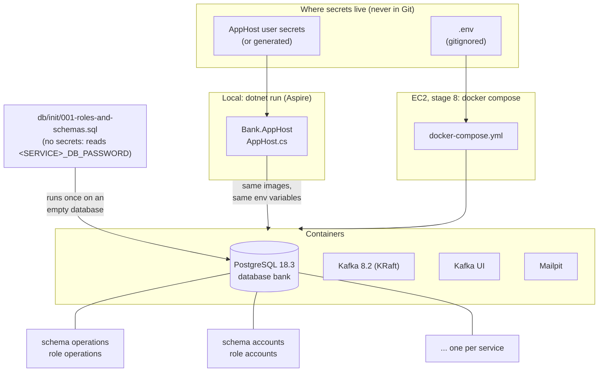
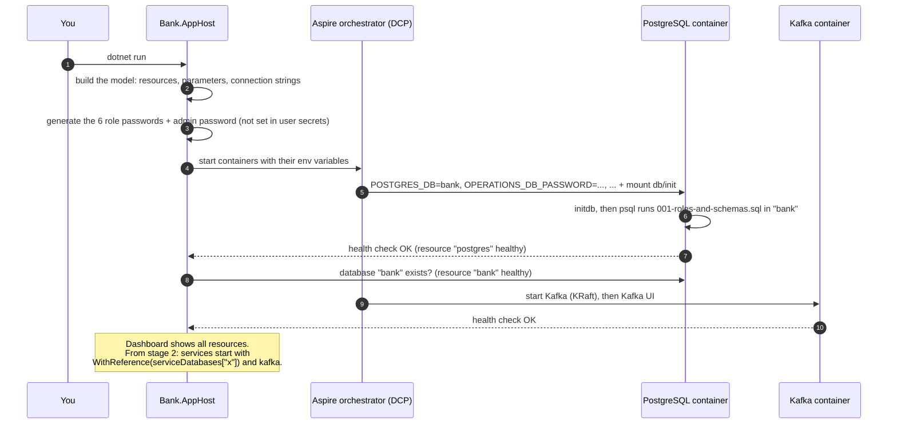
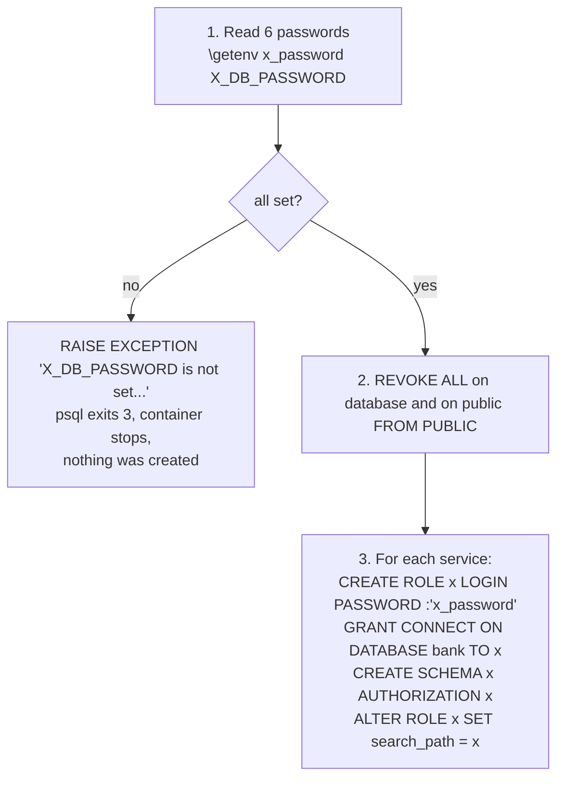
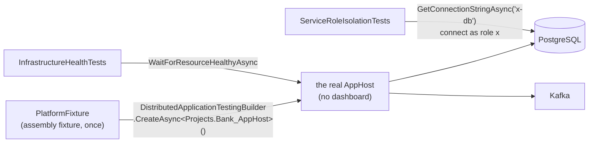

# Slice 1.4: Platform

This document has three parts:

1. **The big picture**: what the platform is for and why it is harder than "start a few containers".
2. **The building blocks**: the AppHost, the init script, Docker Compose, the service defaults and the tests, and how they connect.
3. **Why it is designed this way**: the decisions, the alternatives we rejected, and the price we pay.

At the end: what was tested, what to watch later, and questions to check your understanding.

---

## Part 1. The big picture

### 1.1 The goal

From stage 2 on, every service needs the same things around it: a PostgreSQL database, Kafka, somewhere to send emails, and a place to see logs and traces. This slice builds that ground floor once, in `core_banking/bank-platform`, so that:

- `dotnet run --project src/Bank.AppHost` starts all of it on a laptop with one command, and later starts the services too;
- the same infrastructure runs on the EC2 instance in stage 8 without Aspire (`docker compose up`);
- every service is **forced** to stay inside its own data, not just asked to.

### 1.2 Why it is hard: three problems

**Problem 1, the data boundary.** Design plan ADR 04 says services talk only through events. With one shared database and one shared user, nothing enforces that. A developer in a hurry writes `SELECT ... FROM accounts.account` inside Lending, the test passes, and two services are now coupled through a table. Nobody notices until Accounts changes its schema and Lending breaks in production.

**Problem 2, secrets in infrastructure code.** Each service needs a database password. The obvious place to put it is the init script or the compose file, both of which are tracked files. Then the password sits in Git history forever (`.claude/rules/secrets.md`).

**Problem 3, two environments that drift.** Locally we use Aspire; on AWS we use Docker Compose. If they use different images, different database setups or different scripts, "it works on my machine" returns.

### 1.3 The solution in one picture



- **Problem 1** is solved by PostgreSQL itself: one login role per service, which owns its schema and has no rights anywhere else. A cross-schema query fails with `permission denied`.
- **Problem 2** is solved by moving the secrets out: the script reads passwords from environment variables, and each environment fills them from its own secret store.
- **Problem 3** is solved by running one script and the same image tags in both environments, and by testing the real AppHost.

---

## Part 2. The building blocks and how they connect

### 2.1 The folder

```
core_banking/bank-platform/
  Bank.Platform.slnx  Directory.Build.props  Directory.Packages.props  nuget.config
  CLAUDE.md  README.md  .env.example  docker-compose.yml
  db/init/001-roles-and-schemas.sql
  docs/adr/0001-one-role-and-schema-per-service.md
  src/Bank.AppHost/            Aspire: what runs, and how it is wired
  src/Bank.ServiceDefaults/    what each service registers first
  tests/Bank.Platform.IntegrationTests/
```

Plus `.github/workflows/bank-platform.yml` at the workspace root. The build files follow `bank-contracts`: .NET 10, nullable, warnings as errors, central package versions.

### 2.2 What happens on `dotnet run`



### 2.3 `Bank.AppHost` (`src/Bank.AppHost/AppHost.cs`)

The AppHost is a small C# program that **describes** the system: which containers exist, which settings they get, and how they reference each other. Aspire's orchestrator (DCP) then runs that description, and the dashboard shows the result. It is infrastructure as code, in C#.

What it declares, top to bottom:

1. **`postgres`**: `AddPostgres("postgres")` with image `postgres:18.3`. Two additions:
   - `WithEnvironment("POSTGRES_DB", "bank")`: the official image runs its init scripts in this database, so the roles and schemas land in `bank`, not in the default `postgres` database.
   - `WithInitFiles("../../db/init")`: copies the init folder into the container's `/docker-entrypoint-initdb.d`.
2. **`bank`**: `postgres.AddDatabase("bank")`. A resource for the database itself: it shows in the dashboard and gets its own health check. Its connection string uses the admin user, so services never get it.
3. **One secret parameter per service**: `<service>-db-password`. `GenerateParameterDefault` makes Aspire generate a random value when you have not set one in the user secrets. `Special = false` keeps it to letters and digits, so it never breaks a connection string (`;`) or needs escaping.
4. **The password goes into the container** as `<SERVICE>_DB_PASSWORD`. This is the bridge between the AppHost and the SQL script.
5. **One connection string per service**: `<service>-db`, built with `ReferenceExpression` from the Postgres endpoint, the database name, the role name and the password parameter. The values are filled in only when something asks for them, because the port is random until the container runs. They are kept in the `serviceDatabases` dictionary; in stage 2, Operations gets its own with `.WithReference(serviceDatabases["operations"])`, and nothing else.
6. **`kafka`**: `AddKafka("kafka").WithKafkaUI()`. Image `confluentinc/confluent-local:8.2.0`, a single Kafka node in KRaft mode (Kafka's own controller, no ZooKeeper). Kafka UI (`kafbat/kafka-ui`) lets you browse topics and messages, which helps a lot when slice 1.3's dead-letter topic has something in it.
7. **`mailpit`**: `AddMailPit("mailpit")` from the Aspire Community Toolkit. A fake SMTP server with a web inbox, for `IEmailSender` locally.

`BankDatabase.Services` lists the six service names in one place. The project file sets a `UserSecretsId` (only an id; the values live in your user profile) and suppresses `ASPIRE010` (see 3.2).

### 2.4 The init script (`db/init/001-roles-and-schemas.sql`)

The PostgreSQL image runs every `.sql` file in `/docker-entrypoint-initdb.d` with `psql`, **once**, when the data directory is empty. Our script has three steps:



The pieces, in plain terms:

- **`\getenv` and `:'name'`** are psql features, not SQL. `\getenv` copies an environment variable into a psql variable; `:'name'` inserts it as a correctly quoted SQL string. So the password travels from the secret store to PostgreSQL without ever being written in a file.
- **`\if :{?name}`** asks "is this variable set?". If not, a `DO` block raises an exception with a clear message. `\set ON_ERROR_STOP on` makes psql stop at the first error, and the container's start fails.
- **`REVOKE ALL ... FROM PUBLIC`**: `PUBLIC` means "every role". By default every role may connect to any database and use the `public` schema. We take that away, then give back only what each service needs.
- **`AUTHORIZATION x`**: the role owns its schema. An owner may create, change and drop tables there, so the service can run its own EF Core migrations. No per-table grants are needed.
- **`search_path = x`**: unqualified names (`loan`, `outbox_message`) resolve to the service's schema. This is why EF Core models in this project never name a schema (bank-contracts ADR 0012).
- **What is missing on purpose**: no role gets `USAGE` on another role's schema. Without `USAGE`, a role cannot even look up a table there; PostgreSQL answers `42501 permission denied for schema`.

`:"DBNAME"` is a variable psql sets itself to the current database, so the script never hard-codes `bank`.

### 2.5 `docker-compose.yml` and `.env.example`

The same infrastructure without Aspire, for the EC2 instance in stage 8. How it maps to the AppHost:

| Aspire | Compose |
| --- | --- |
| Secret parameters, generated or from user secrets | `${OPERATIONS_DB_PASSWORD:?Set ... in .env}` from `.env` |
| No data volume: a fresh database every run | Volumes `postgres-data` and `kafka-data`: data survives restarts |
| Random host ports, shown in the dashboard | Fixed ports, bound to `127.0.0.1` only |
| Aspire health checks | `healthcheck:` per container; `up --wait` waits for them |

`${VAR:?message}` makes Compose refuse to start when a variable is missing, before any container runs. `.env.example` lists the keys with `change-me` placeholders; the real `.env` is gitignored.

Kafka has three listeners: `PLAINTEXT_HOST` on `localhost:9092` for programs on the machine, `PLAINTEXT_INTERNAL` on `kafka:9093` for other containers (Kafka UI now, the services in stage 8), and an internal one for the KRaft controller. A Kafka client first asks any broker "where are you?", and the broker answers with its *advertised* address, so each kind of client needs an address it can actually reach.

The image tags are the ones Aspire 13.6 uses (`postgres:18.3`, `confluentinc/confluent-local:8.2.0`, `kafbat/kafka-ui:v1.5.0`, `axllent/mailpit:v1.31.2`), read from the Aspire packages, so both environments run the same versions.

### 2.6 `Bank.ServiceDefaults` (`src/Bank.ServiceDefaults/Extensions.cs`)

Nothing uses it yet; from stage 2 every service's `Program.cs` starts with:

```csharp
builder.AddServiceDefaults();   // telemetry, health checks, service discovery, HTTP resilience
...
app.MapDefaultEndpoints();      // /health and /alive
```

- **OpenTelemetry**: logs, traces and metrics (ASP.NET Core, `HttpClient`, .NET runtime) exported over OTLP when `OTEL_EXPORTER_OTLP_ENDPOINT` is set. The AppHost sets it for each service, so everything appears in the Aspire dashboard. On AWS the standalone dashboard receives the same data (design plan ADR 22). Health probes are filtered out of traces.
- **Health checks**: `/alive` runs only checks tagged `live` ("the process answers"); `/health` runs all of them ("ready for traffic"). Each service will add its own readiness checks (database, Kafka) later.
- **HTTP resilience**: every `HttpClient` gets retries, timeouts and a circuit breaker. Services never call each other, so this protects only external calls such as the Riksbank exchange rates.

The namespace is `Microsoft.Extensions.Hosting`, as in the Aspire template, so `AddServiceDefaults()` is found without an extra `using`.

### 2.7 The tests (`tests/Bank.Platform.IntegrationTests`)



- **`PlatformFixture`** starts the real AppHost once for the whole test run with `Aspire.Hosting.Testing`, the same model as `dotnet run`, minus the dashboard. The test project references the AppHost project; that reference generates the `Projects.Bank_AppHost` type.
- **`InfrastructureHealthTests`** waits until `postgres`, `bank` and `kafka` report healthy. If the init script failed, PostgreSQL never becomes healthy and the test times out.
- **`ServiceRoleIsolationTests`** connects as each service role, with the connection string the AppHost would give that service. No password appears in the test code.

### 2.8 CI (`.github/workflows/bank-platform.yml`)

Restore, build, test, only when `core_banking/bank-platform/**` or the workflow changes. `ubuntu-latest` has Docker, so the tests start the real containers there too. It creates the empty `../.local-feed` folder that `nuget.config` names, and a development HTTPS certificate for the AppHost's internal endpoints.

---

## Part 3. Why it is designed this way

### 3.1 Decisions already made (no new D1 in this slice)

The stage file lists no new D1 for this slice. The design decisions come from the design plan and `docs/implementation-decisions.md`, and this slice puts them into practice:

#### One role and one schema per service (design plan ADR 11, bank-platform ADR 0001)

- **Why it wins:** the database enforces the boundary of ADR 04. A mistake fails at once instead of working by accident.
- **Rejected:** one shared user (the boundary becomes a convention only); a database per service (stronger, but more cost and operations on one small EC2 instance; rejected by ADR 11); roles created by each service at startup (every service would need the admin password).
- **Price:** reports cannot join across services. They must be built from events, which is what Ledger is for.

#### Secrets only in user secrets or `.env` (`.claude/rules/secrets.md`)

- **Why it wins:** the script, the AppHost and the compose file can all be committed and shown to anyone.
- **Price:** one more step to run Compose (`cp .env.example .env` and fill it in).

### 3.2 Design choices I made (D2)

| Choice | Why |
| --- | --- |
| Generated passwords by default (`GenerateParameterDefault`) | `dotnet run` works on a fresh clone with no setup, and no developer invents a weak password. You can still fix one in the user secrets. |
| Letters and digits only in generated passwords | No escaping problems in connection strings or SQL. Length 24 keeps them strong. |
| Passwords read in the SQL script with psql `\getenv` | One `.sql` file, as the stage file names it, that works in Aspire, Compose and the tests. A shell script could loop over the services, but the SQL is easier to read line by line. |
| All six passwords checked before anything is created | A missing password never leaves half the roles behind. My first version checked each one just before its role; testing it with one missing variable showed five roles already created, so I moved the checks to the top. |
| `RAISE EXCEPTION`, not `\quit`, when a password is missing | `\quit` ends psql with success, so the container would start without the roles. An error stops it, with the key named in the message. |
| No data volume in the AppHost | A fresh database every run, so the init script always matches the database. Compose has volumes because EC2 must keep data. |
| `AddDatabase("bank")` next to `POSTGRES_DB=bank` | The image creates the database before the init script; the Aspire resource only adds visibility and a health check. |
| Connection string resources `<service>-db` for all six services now | The isolation tests need them, and stage 2 just references one. |
| Compose ports bound to `127.0.0.1` | On EC2 nothing but the gateway should be reachable from outside. |
| Compose image tags copied from the Aspire packages | Both environments run the same versions. |
| `/health` and `/alive` mapped in every environment | The Aspire template maps them only in Development. Docker and the EC2 setup need them too, and they reveal nothing but "Healthy". |
| `ASPIRE010` suppressed | Aspire 13.6 warns when the Aspire CLI bundle is not used. We run with `dotnet run`; the SDK then takes the orchestrator and dashboard from NuGet packages, which works. With warnings as errors, the build would otherwise depend on this message. |
| `Aspire.Hosting.Testing` instead of plain Testcontainers | The stage asks that "the AppHost starts PostgreSQL and Kafka healthy". Starting the real AppHost tests the real wiring, including the init script and the connection strings. |
| `Bank.ServiceDefaults` packable as a NuGet package | Services live in other folders and reference shared code only as packages (bank-contracts ADR 0001). |

### 3.3 Patterns used

- **Infrastructure as code**: the AppHost and the compose file describe the system; nobody clicks anything together.
- **Least privilege**: every role starts with nothing and gets only what it needs (`CONNECT`, its own schema).
- **Database-per-service, light version (schema per service)**: the data ownership of microservices, enforced by permissions inside one server.
- **Externalized configuration**: the same code and script everywhere; only the configuration source differs (user secrets, `.env`, later Secrets Manager).
- **Fail fast**: a missing secret stops the start with a message naming the key, instead of a half-working system.
- **Health checks with liveness and readiness**: "is the process alive" and "is it ready for traffic" are different questions with different consequences.

---

## 4. What was tested

`Bank.Platform.IntegrationTests` (27 tests, real AppHost, Docker):

- **`InfrastructureHealthTests`**: `postgres`, `bank` and `kafka` become healthy.
- **`ServiceRoleIsolationTests`**, for each of the six roles:
  - it can create and read a table in its own schema, without naming the schema, and `current_schema()` is its own;
  - it cannot read a table in any of the other five schemas (`42501`);
  - it cannot create a table in any of the other five schemas (`42501`);
  - it cannot create tables in `public` or create new schemas (`42501`).

Command and result:

```
cd core_banking/bank-platform && dotnet build && dotnet test
Build succeeded.
Passed!  - Failed: 0, Passed: 27, Skipped: 0, Total: 27, Duration: 16 s - Bank.Platform.IntegrationTests.dll (net10.0)
```

Checks that the tests can fail, run by hand:

- **Mutation:** I added `GRANT USAGE ON SCHEMA operations TO PUBLIC` and default `SELECT` rights to the script. Exactly the five expected tests failed (`Role_cannot_read_another_schema` for every service except `operations`). Then I removed the lines.
- **Missing password:** a PostgreSQL container started with the script and no `LEDGER_DB_PASSWORD` stops with exit code 3 and `ERROR: LEDGER_DB_PASSWORD is not set. Set it in the AppHost user secrets or in .env.`, and no role is created.
- **Compose:** without `.env`, `docker compose config` refuses with `required variable ... is missing a value`. With a generated `.env` in a scratch folder, `docker compose up -d --wait` brought all four containers to healthy; `operations` could create a table, `customers` could not read it (`permission denied`). Then `docker compose down -v`.

## 5. What to watch later

- **Slice 1.3 is not built yet.** This slice was done before it at your request; it does not depend on it. The stage's "done when" check `grep -rl "Confluent.Kafka"` prints nothing until 1.3 adds `Bank.Messaging.Kafka`.
- **The init script runs only on an empty database.** A new role for existing data (Compose volume on EC2) needs a new script `002-...sql` run by hand or a migration step. Locally the AppHost always starts empty.
- **No data survives an AppHost restart.** Fine for now. Stage 7 (data import of about 100 customers) may want a volume, and then the passwords must be fixed in the user secrets, because the roles are created only once.
- **How services reference `Bank.ServiceDefaults`** (pack to the local feed, like `bank-contracts`) is settled in stage 2, when the first service needs it.
- **CI has not run yet**: the workflow runs only after you push. The dev certificate step is my best guess for GitHub's runners; if the first run fails there, that is the first place to look.
- **Kafka topics** are not created by the platform. Slice 1.3 decides whether the producer creates them or they are created up front.
- **AWS**: on EC2 the passwords will come from Secrets Manager into `.env` or the environment. How exactly is a D1 for stage 8.

## 6. Check your understanding

1. Lending's code runs `SELECT * FROM accounts.account`. Which line of the init script makes this fail, which error does it get, and why would it *work* if every service used the `postgres` user?
2. Why does the script read all six passwords before it creates anything? Describe what the Compose volume would contain on the next start if it created `operations` and then failed on `customers`.
3. The service `operations` will run its own EF Core migrations. Which grant lets it create tables, and why do its migrations never name a schema?
4. A Kafka client on your laptop and Kafka UI in a container both talk to the same broker. Why does the broker need two different advertised addresses for them?
5. What is the difference between `/alive` and `/health`, and why would it be wrong for a container orchestrator to restart a service because its database is slow?
