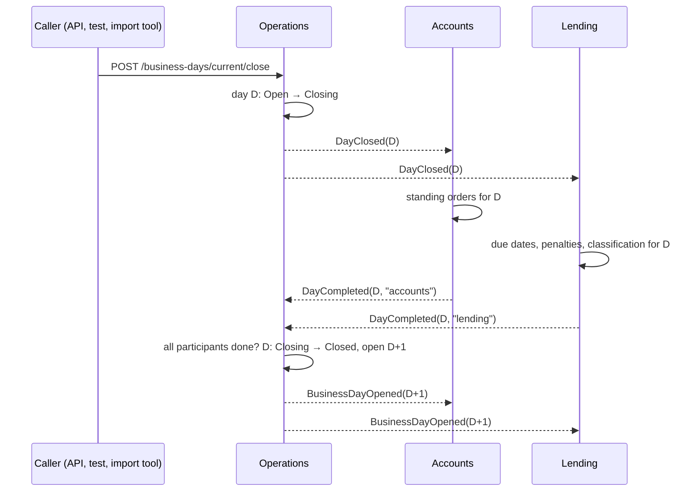
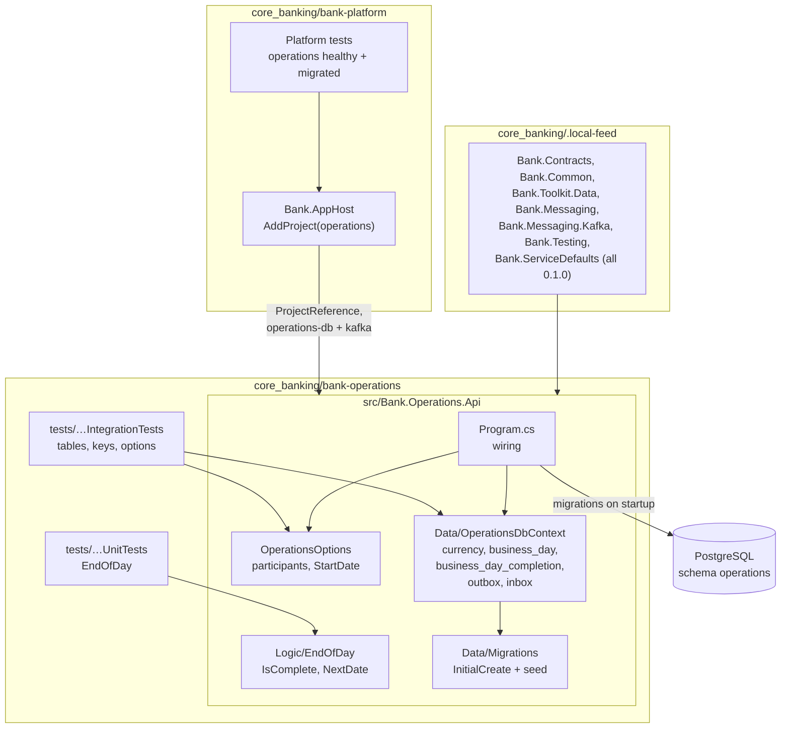
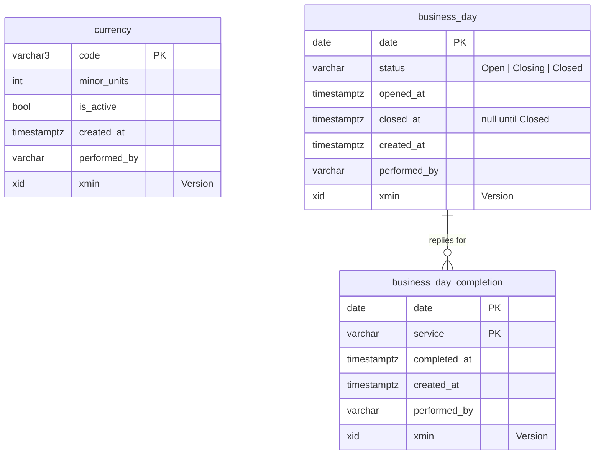

# Slice 2.1: Logic and data model of Operations

This document has three parts:

1. **The big picture**: what Operations is for, what this slice prepares, and why the end-of-day cycle is harder than it looks.
2. **The building blocks**: the new service folder, the two pure functions, the three tables, the configuration, the startup wiring, the AppHost and the CI. Then how they connect.
3. **Why it is designed this way**: the decisions, the alternatives we rejected, and the price we pay.

At the end: what was tested, what to watch later, and questions to check your understanding.

---

## Part 1. The big picture

### 1.1 The goal of stage 2

Every service in the bank needs two pieces of shared reference data that no single business service should own:

- **Which currencies exist and are active.** Accounts may open an account only in an active currency. Lending may lend only in one.
- **What day it is for the bank.** This is the *business date*, not the computer's clock. Interest, penalties, due dates and standing orders all depend on it. Design plan ADR 14 says business code never reads the system clock.

Operations owns both. It also runs the **end-of-day cycle** (design plan ADR 15):



No service tells another what to do. Each one reacts to an event and announces what it finished. This is **choreography**: there is no central orchestrator calling the others. Operations does keep a small amount of state, a list of who has replied, but it never calls anyone.

### 1.2 Why it is hard

The diagram looks simple. Three things make it harder:

1. **The day must move in one direction only.** A day that is closed twice sends `DayClosed` twice. Then Lending charges penalties twice. A day reopened while Accounts is still running standing orders mixes two dates. So the day needs a **state machine**: Open → Closing → Closed, never backwards and never skipping a step.
2. **Replies arrive in any order, and some arrive twice.** Kafka delivers at least once (stage 1), so `DayCompleted` from Accounts can come twice. A service that is not a participant at all could also send one. "Everyone has replied" must count each participant once and ignore everyone else.
3. **The list of participants changes over time.** Today the participants are Accounts and Lending. A later service may join. Tests want a single stub participant. A list hard-coded in the code would have to be edited each time.

There is a fourth problem, "two replies handled at the same moment both open the next day". That one belongs to slice 2.3b.

### 1.3 What slice 2.1 prepares

This slice builds the **foundation** of the cycle, but not the cycle itself. It adds no endpoint, handler or event yet.

- The rule "everyone has replied" and the rule "what is the next day", as **pure functions** that can be tested in milliseconds.
- The **tables** that hold the state machine, the replies and the currencies, with the database enforcing what it can.
- The **configuration** for the participant list and the start date, checked at startup.
- A **running service** in the AppHost, with its own schema, migrations and CI.

---

## Part 2. The building blocks and how they connect

### 2.1 The whole picture



Follow one start of the service. The AppHost starts PostgreSQL and Kafka, waits for both, and then starts `Bank.Operations.Api`. It passes two connection strings: `operations-db`, which logs in as the role `operations`, and `kafka`. `Program.cs` registers the DbContext, migrations on startup, messaging, Kafka and the options. Before any hosted service runs, the migration creates the five tables and inserts the three currencies. The options are validated, and an invalid participant list stops the start. Then `/health` answers and the AppHost marks the service healthy.

### 2.2 The service folder (`core_banking/bank-operations/`)

The folder follows the service layout in the root `CLAUDE.md`:

| File | What it does |
| --- | --- |
| `Directory.Build.props` | `net10.0`, nullable, warnings as errors, and `IsPackable=false`: a service is deployed, never packed. |
| `Directory.Packages.props` | Central package versions. The `Bank.*` packages use exact versions (`0.1.0`), as `implementation-decisions.md` asks. |
| `nuget.config` | nuget.org plus `../.local-feed`, where `bank-contracts` and `Bank.ServiceDefaults` are packed. |
| `dotnet-tools.json` | `dotnet-ef` 10.0.14, the same version as `bank-contracts`, used for `dotnet ef migrations add`. |
| `Bank.Operations.slnx` | The three projects. |
| `CLAUDE.md` | Short service notes: tables, events, configuration, gotchas. |
| `docs/adr/` | Empty for now. ADR 0002 (inactive currencies) comes in slice 2.2 and ADR 0001 (exactly once) in slice 2.3b. |

The service gets its shared code **only as packages**, never as project references to `bank-contracts` (bank-contracts ADR 0001). So Operations builds against exactly what Accounts or Lending would get.

### 2.3 The pure logic (`src/Bank.Operations.Api/Logic/EndOfDay.cs`)

```csharp
public static bool IsComplete(IReadOnlyCollection<string> participants, IReadOnlyCollection<string> completions)
public static DateOnly NextDate(DateOnly date)
```

**`IsComplete`** answers one question: has every participant replied? The answer is `participants.All(completions.Contains)`. That one line solves all three counting problems from section 1.2:

- **Replies in any order:** order does not matter for "contains".
- **Duplicates:** `["accounts", "accounts"]` still contains `lending` zero times, so it is not complete. A duplicate cannot stand in for a missing participant.
- **Unknown services:** `cards` in the completions is never looked at, because only participants are checked.

An **empty participant list throws** `ArgumentException`. Mathematically "all of none" is true, so every day would close at once without any end-of-day work. That is a configuration error, not a business outcome, so it is an exception and not a `false`. The options validation (section 2.5) stops it even earlier, at startup.

Names are compared **exactly** (ordinal). The `DayCompleted` contract only allows `^[a-z]+$`, so `"Accounts"` can never be a real reply.

**`NextDate`** is `date.AddDays(1)`. In phase 1 every calendar day is a business day, with no weekends or holidays (`implementation-decisions.md`, "Time and the business date"). The function exists anyway, for two reasons:

- the rule has a name, and the handler in slice 2.3a reads `EndOfDay.NextDate(day)` instead of a bare `AddDays(1)`;
- if holidays ever come, they change one function and its tests, not the handler.

Both functions are pure: they take inputs and return a result, with no clock, no database and no logging (`.claude/rules/financial-logic.md`).

### 2.4 The tables (`src/Bank.Operations.Api/Data/`)



Every table has `created_at`, `performed_by` and a `Version` (a workspace rule). `Version` is PostgreSQL's system column `xmin`, mapped with `.IsRowVersion()`. EF adds it to the `WHERE` of every update and throws `DbUpdateConcurrencyException` when someone else changed the row first. Its migration creates no SQL, because every PostgreSQL row already has `xmin`.

#### `Currency` (`Currency.cs`)

The primary key is the ISO code (`SEK`). `MinorUnits` is what `MoneyRounding` rounds to. `IsActive` is the only field that changes.

The first migration **seeds** SEK, EUR and USD with 2 minor units, **all inactive**. This was your decision at the start of the stage, and its ADR comes in slice 2.2. If they were seeded active, no `CurrencyActivated` would ever be published for them, and the local copies in other services would stay empty. The seed's `created_at` is a fixed date (2026-01-01 UTC), so the migration file is identical on every machine.

#### `BusinessDay` and `BusinessDayStatus` (`BusinessDay.cs`)

One row per business date. The **date is the primary key**, so the database refuses to open the same date twice. That is the first line of defence for slice 2.3b.

`Status` is the state machine: `Open`, `Closing`, `Closed`. This slice only defines it. The transitions (close: Open → Closing; all replied: Closing → Closed, plus a new Open row) come in slice 2.3a. It is stored **as text** (`'Closing'`), not as a number, because:

- it reads well in SQL and in the Aspire dashboard;
- if someone reorders the enum, old rows keep their meaning (with numbers, `1` would silently change from Closing to something else).

The table is **empty after the migration**. The service will open `Operations:StartDate` on its first start (slice 2.3a). The migration does not do it, because the start date is configuration, and a migration must be the same in every environment.

#### `BusinessDayCompletion` (`BusinessDayCompletion.cs`)

One row per `DayCompleted` that counted. The **primary key is `(date, service)`**, the stage file's "unique (date, service)". This is a different protection from the inbox:

| Protection | Stops | Example |
| --- | --- | --- |
| Inbox `(message_id, handler)` (stage 1) | The **same message** delivered twice | Kafka redelivers after a crash |
| Key `(date, service)` (this slice) | The **same fact** under a new message id | Accounts reruns its end of day and sends a second `DayCompleted(D)` |

This is the "unique business key" from design plan ADR 08: the inbox catches the same message, and the business key catches the same fact sent again.

#### `OperationsDbContext` (`OperationsDbContext.cs`)

The service's single `DbContext`. `OnModelCreating` does three things:

- calls `modelBuilder.AddBankMessaging()`, so the migration also creates `outbox_message` and `inbox_message` (bank-contracts ADR 0012);
- maps the three tables: singular names, keys, lengths, `xmin`, the text status and the seed;
- uses no schema name, because the role `operations` has `operations` as its search path (platform ADR 0001).

`OperationsDbContextDesignTimeFactory` lets `dotnet ef migrations add` build the model without a database. It calls `UseNpgsqlWithBankConventions`, the same provider settings as at runtime, so generated migrations use snake_case like the real service.

#### The migration (`Data/Migrations/…_InitialCreate.cs`)

The migration was generated with `dotnet ef migrations add InitialCreate`. It creates the five tables and inserts the three currencies. `AddMigrationsOnStartup` applies it before any hosted service starts, and EF Core's migration lock makes two instances starting together safe (bank-contracts ADR 0012).

### 2.5 Configuration (`src/Bank.Operations.Api/OperationsOptions.cs`, `appsettings.json`)

```json
"Operations": { "EndOfDayParticipants": [ "accounts", "lending" ], "StartDate": "2026-01-01" },
"Kafka":      { "SubscribeTo": [ "accounts", "lending" ] }
```

`OperationsOptions` binds the `Operations` section. `AddTo` registers it with three rules, checked **at startup** (`ValidateOnStart`):

| Rule | Why |
| --- | --- |
| At least one participant | Otherwise every day closes without end-of-day work (see `IsComplete`). |
| Each name matches `^[a-z]+$` | The same rule as `DayCompleted.Service`. A participant called `Accounts` or `bank.accounts.events` could never reply, so the cycle would hang forever. |
| No duplicates | Keeps the list honest; a duplicate means a typo or a merge mistake. |

Two details:

- `EndOfDayParticipants` **starts empty**. The .NET configuration binder appends configured array items to a default array instead of replacing it (the same gotcha as `KafkaOptions.RetryDelays` in stage 1). A default of `["accounts", "lending"]` plus a test's `["stub"]` would become three participants. The test `Configured_participants_replace_the_default_instead_of_being_added` guards this.
- `Kafka:SubscribeTo` is a separate list today and must match the participants, because Operations has to read the participants' topics to get their replies. Slice 2.3a removes this duplication, as the plan says.

The connection strings are empty keys in `appsettings.json`. The AppHost fills them in. `Program.cs` fails at startup with a message naming the key and how to set it, without a fallback value (`.claude/rules/secrets.md`).

### 2.6 Wiring (`src/Bank.Operations.Api/Program.cs`)

```csharp
builder.AddServiceDefaults();                                        // telemetry, /health, resilience
builder.Services.AddNpgsqlDbContext<OperationsDbContext>(connectionString);
builder.Services.AddMigrationsOnStartup<OperationsDbContext>();
builder.Services.AddBankMessaging(o => o.ServiceName = "operations"); // outbox, dispatcher, inbox pipeline
builder.Services.AddKafkaTransport(builder.Configuration);           // topic bank.operations.events, consumer
OperationsOptions.AddTo(builder.Services, builder.Configuration);
builder.Services.AddOpenApi();                                       // /openapi/v1.json
```

This is the first real `Program.cs` that uses all the stage 1 packages together, in the order `bank-contracts/CLAUDE.md` describes. `public partial class Program;` at the end lets `WebApplicationFactory<Program>` start the service in the slice 2.2 tests.

`Bank.ServiceDefaults` comes from the local feed as a package, like the `bank-contracts` packages. It was packed for the first time in this slice (slice 1.4 left this open).

### 2.7 The AppHost (`core_banking/bank-platform/src/Bank.AppHost/`)

```csharp
builder.AddProject<Projects.Bank_Operations_Api>("operations")
    .WithReference(serviceDatabases["operations"])   // ConnectionStrings:operations-db, role "operations"
    .WithReference(kafka)                           // ConnectionStrings:kafka
    .WaitFor(postgres).WaitFor(kafka)
    .WithHttpHealthCheck("/health");
```

`Bank.AppHost.csproj` now has a `ProjectReference` to `Bank.Operations.Api`. Aspire needs it to generate the `Projects.Bank_Operations_Api` type and to build the service before running it. The service only ever receives its own database connection string, so it cannot log in as another service, even by mistake.

### 2.8 CI (`.github/workflows/bank-operations.yml`, `bank-platform.yml`)

The local feed is gitignored, so a fresh CI runner has no `Bank.*` packages. Both workflows now **pack `bank-contracts` and `Bank.ServiceDefaults` from the same commit** into `../.local-feed` before restoring. Nothing is published. The platform workflow also runs when `bank-operations/src/**` changes, because the AppHost builds that project.

### 2.9 The tests

- **`tests/Bank.Operations.UnitTests/EndOfDayTests.cs`**: `IsComplete` and `NextDate`. These are pure, with no containers.
- **`tests/Bank.Operations.IntegrationTests/`**:
  - `Support/OperationsDatabase` creates a fresh role and schema in the shared PostgreSQL container (`PostgresFixture` from `Bank.Testing`) and applies the real migrations;
  - `DataModelTests` covers the tables, the seed, the text status and the two keys;
  - `OperationsOptionsTests` covers the configuration rules, including the shipped `appsettings.json`.
- **`bank-platform/tests/…/ServiceStartupTests`**: the real AppHost starts Operations. The test connects with `operations-db` and finds `currency` with 3 rows in the schema `operations`.

---

## Part 3. Why it is designed this way

### 3.1 How the design changed during the slice

- **Currencies seeded inactive.** The stage file said "Seeded SEK, EUR, USD", and `implementation-decisions.md` said "active". While planning, we found that active seeds never produce `CurrencyActivated`, so other services' copies would stay empty. You chose option B, inactive seeds activated through the API. `implementation-decisions.md`, `stage-2.md` and `stage-7.md` (the import tool activates them first) were updated in the planning commit.
- **Test names.** I first wrote the unit tests with sentence names. `.claude/rules/financial-logic.md` asks for `Method_Scenario_ExpectedResult` for `Logic/`, so I renamed them before implementing. The integration tests keep the sentence style used by the stage 1 integration tests.

### 3.2 Decisions you made (D1)

This slice had no D1 of its own. Two decisions from the start of the stage shape it:

- **Seeded currencies are inactive** (ADR bank-operations 0002, written in slice 2.2). The price: a fresh environment has no usable currency until someone calls the activation endpoint. Tests and the import tool must do it.
- **Claude writes all of stage 2.** That covers `EndOfDay` and its tests too, which the stage file had given to you.

### 3.3 Design choices I made (D2)

| Choice | Why | Rejected |
| --- | --- | --- |
| `(date, service)` as the **primary key** of `business_day_completion` | It is the unique constraint the stage asks for, and no other key is needed. | A surrogate `id` plus a separate unique index: one more column and one more index, for nothing. |
| `date` as the primary key of `business_day` | Each date is opened once, enforced by the database. | A surrogate id: a date could then be opened twice. |
| Status stored as **text** | Readable and safe when the enum is reordered. | Integer: smaller, but opaque, and fragile on reorder. |
| `IsComplete` **throws** on no participants | "All of none" is true and would close every day silently. It is a misconfiguration, not a business result. | Return `false`: the cycle would then hang forever, which is also wrong and harder to diagnose. |
| Options validated at **startup** | A bad list fails the deploy at once, not at the first close days later. | Validation when first used. |
| `EndOfDayParticipants` default **empty** | The binder appends to defaults (stage 1 gotcha). | Defaulting to `["accounts", "lending"]` in code. |
| Kept `opened_at` and `completed_at` next to `created_at` | The stage file names them, and they are business moments. Today they hold the same time as `created_at`. | Dropping them: shorter, but it would deviate from the spec for little gain. |
| Seed `created_at` fixed at 2026-01-01 UTC | The same migration file everywhere. | `DateTimeOffset.UtcNow` in `HasData`: a new migration diff on every `migrations add`. |
| `Bank.ServiceDefaults` as a **package** from the local feed | Services reference shared code only as packages (bank-contracts ADR 0001). Slice 1.4 planned this. | A cross-folder `ProjectReference`: it couples the service build to `bank-platform`'s source. |
| AppHost → service as a **`ProjectReference`** | It is how Aspire generates `Projects.Bank_Operations_Api` and builds the service. The standard way. | `AddProject` by path: no compile-time coupling, but no type safety, and the service is not built by the AppHost. |
| CI **packs** the shared packages from the same commit | The feed is gitignored and nothing may be published from CI. | Committing `.nupkg` files, or GitHub Packages (that is Majid's later step). |
| Options tests in the **integration** project | `UnitTests` is for `Logic/` only (root `CLAUDE.md`). These tests need no Docker, but they test wiring, not logic. | A third test project: too much for six tests. |
| `/health` as the AppHost health check | The tests can then wait for "migrated and ready". Migrations run before the host listens. | No health check: "running" does not mean "migrated". |

### 3.4 Patterns used

- **Functional core, imperative shell**: the rules (`EndOfDay`) are pure. The handlers that come later only load data, call the rule and save. Every edge case is then tested in milliseconds.
- **State machine as data**: the day's status lives in a column, and later slices change it only in allowed steps.
- **Database-enforced invariants**: "a date opens once" and "a service completes a date once" are primary keys, not `if` checks. Two concurrent writers cannot both pass a key.
- **Business key next to the inbox** (design plan ADR 08): the inbox stops duplicate messages, and the key stops duplicate facts.
- **Externalized, validated configuration (fail fast)**: participants and start date come from configuration and are checked at startup.
- **Seed data in migrations**: every environment starts from the same reference data.

---

## 4. What was tested

**`Bank.Operations.UnitTests`** (17 tests, no Docker):

- `IsComplete`: all participants, another order, one missing, none, unknown service instead of a participant, unknown service next to all participants, duplicate, name in another case, single participant, no participants throws.
- `NextDate`: an ordinary day, month end, 28 February in a common year and in a leap year, 29 February, year end, a Saturday.

**`Bank.Operations.IntegrationTests`** (19 tests, PostgreSQL in Testcontainers):

- `DataModelTests`:
  - the migration creates each of the five tables in the service schema;
  - the seed is SEK, EUR and USD, inactive, with 2 minor units;
  - no business day exists after the migration;
  - the status is stored as text;
  - the same date cannot be opened twice;
  - a service completes a date only once (`23505`);
  - different services and dates complete independently.
- `OperationsOptionsTests`:
  - the shipped `appsettings.json` is valid;
  - configured participants replace the default instead of being added;
  - the start date is read from configuration;
  - no participants, a name that is not lower case, and a duplicate each fail with a clear message.

**`Bank.Platform.IntegrationTests`** (29 tests, was 27): `operations` becomes healthy, and it migrated its own schema (`operations:3`).

Commands and results:

```
cd core_banking/bank-operations && dotnet build && dotnet test
Build succeeded.
Passed!  - Failed: 0, Passed: 17, Skipped: 0, Total: 17 - Bank.Operations.UnitTests.dll (net10.0)
Passed!  - Failed: 0, Passed: 19, Skipped: 0, Total: 19 - Bank.Operations.IntegrationTests.dll (net10.0)

cd core_banking/bank-platform && dotnet build && dotnet test
Build succeeded.
Passed!  - Failed: 0, Passed: 29, Skipped: 0, Total: 29 - Bank.Platform.IntegrationTests.dll (net10.0)
```

Checks that the tests can fail, run by hand and then reverted:

- I changed `participants.All(...)` to `participants.Any(...)`: 4 unit tests failed.
- I removed the "no duplicates" options rule: 1 options test failed.

## 5. What to watch later

- **`Kafka:SubscribeTo` repeats the participant list.** If someone adds a participant to one list and not the other, Operations never reads that service's replies, and the day never closes. Slice 2.3a derives one list from the other.
- **The service subscribes to `accounts` and `lending` topics that nobody writes to yet.** `KafkaTopicInitializer` creates them empty. This is harmless.
- **CI packs the shared packages from source at their current version (0.1.0).** If `bank-contracts` changes without a version bump, CI builds Operations against newer code than your local feed has. Bump the version whenever `bank-contracts` changes, as `implementation-decisions.md` asks.
- **CI has not run yet.** It runs when you push.
- **No database readiness check in `/health`.** Migrations prove the database was reachable at startup, but `/health` does not notice if PostgreSQL goes away later. A readiness check can be added when a stage needs it.

## 6. Check your understanding

1. The inbox already ignores a `DayCompleted` it has seen before. Why does `business_day_completion` still need `(date, service)` as its key? Give a concrete case where the inbox alone lets a wrong completion through.
2. Why does `EndOfDay.IsComplete` throw when there are no participants, instead of returning `true` or `false`? What would happen in each of those two cases?
3. What would go wrong if `OperationsOptions.EndOfDayParticipants` defaulted to `["accounts", "lending"]` in code, and a test configured `["stub"]`?
4. Why does the migration create no business day, while it does create the currencies?
