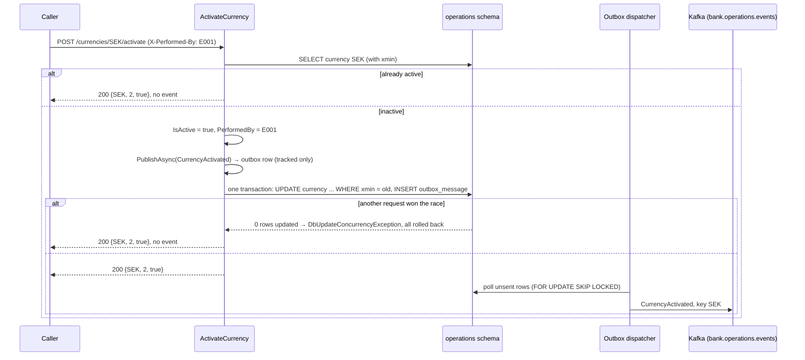

# Slice 2.2: Currency endpoints and CurrencyActivated

This document has three parts: the big picture (why a currency must be *announced*, not just stored), the building blocks (two endpoints, one event, the test host), and why it is designed this way. At the end: what was tested, what to watch later, and questions.

---

## Part 1. The big picture

### 1.1 The goal

Operations owns the list of currencies. Accounts, Cards and Lending each need to know which currencies are active. But they may not read the `operations` schema (design plan ADR 04, enforced by database roles since stage 1). So the knowledge has to travel as an event: `CurrencyActivated(Code, MinorUnits)`. Each service keeps its own copy, filled from that event.

This slice makes Operations able to **activate** a currency and **announce** it.

### 1.2 Why it is harder than "update a row"

Three things can go wrong:

1. **The update and the announcement can split.** If the row is saved but the event is lost, other services never learn about the currency. If the event is sent but the save fails, they believe in a currency that Operations does not consider active. This is the dual-write problem from stage 1, solved by the outbox.
2. **Two people can activate at the same moment.** Both read "inactive", both update, and both publish. Consumers are idempotent per message id, but the two messages have different ids, so every consumer would process the activation twice.
3. **Seeded currencies.** As decided at the start of the stage (ADR 0002), seeded currencies are inactive. Otherwise they would never be announced at all.

### 1.3 The solution in one picture



---

## Part 2. The building blocks and how they connect

### 2.1 `BusinessDayQueries` (`src/Bank.Operations.Api/Data/BusinessDayQueries.cs`)

Every event has an `OccurredOn`, which is the **business date**, not the system date (design plan ADR 14). Other services get the business date from `IBusinessClock`. Operations *owns* the date, so it reads it from its own table:

- `CurrentAsync()`: the day that is not Closed yet, either Open or Closing.
- `CurrentDateAsync()`: its date, or an exception when no day has been opened. In a running service that cannot happen, because the service opens `Operations:StartDate` at startup (slice 2.3a).

This is Operations' business clock. It is a query, not an `IBusinessClock`, because it must be awaited against the database inside the same request.

### 2.2 `ListCurrencies` (`Features/Currencies/ListCurrencies.cs`)

`GET /currencies` returns every currency, active or not, ordered by code, as `CurrencyResponse(Code, MinorUnits, IsActive)`. It is read-only and uses `AsNoTracking`.

### 2.3 `ActivateCurrency` (`Features/Currencies/ActivateCurrency.cs`)

`POST /currencies/{code}/activate` does the following, one step at a time:

1. It upper-cases the code, so `sek` means `SEK`.
2. It loads the currency. An unknown code returns **404 problem details** with `code = "currency_not_found"`.
3. If the currency is **already active**, it returns 200 and publishes nothing. This is what makes repeated calls (the import tool on every run) safe.
4. Otherwise it sets `IsActive` and `PerformedBy` (from `X-Performed-By`, default `system`), and calls `IEventPublisher.PublishAsync(CurrencyActivated, key: code)`. That call only *adds an outbox row to the context*.
5. Then it calls `SaveChangesAsync` once. The currency update and the outbox row commit together, or neither does.
6. If another request activated the same currency in between, the update's `WHERE xmin = <old>` matches no row. EF throws `DbUpdateConcurrencyException`, and the whole transaction, our outbox row included, is rolled back. The request still returns 200, because the currency *is* active. Only the winner's event exists.

The Kafka key is the currency code, so all events about one currency stay in order on one partition (design plan ADR 06).

### 2.4 Problem details (`Program.cs`)

`AddProblemDetails()` and `UseExceptionHandler()` make every error an RFC 9457 `application/problem+json` response (`implementation-decisions.md`, "APIs"). This includes unexpected exceptions, which return 500 without a stack trace.

### 2.5 The test host (`tests/Bank.Operations.IntegrationTests/Support/OperationsApp.cs`)

`OperationsApp` is a `WebApplicationFactory<Program>`. It runs the **real** `Program.cs`, with its endpoints, hosted services, migrations and outbox dispatcher, with three changes:

- **Its own database.** Each test gets a fresh role and schema from `PostgresFixture`. The connection string is passed with `UseSetting`, which `Program.cs` sees while it builds. `ConfigureAppConfiguration` would come too late for the minimal hosting model.
- **No Kafka.** The Kafka hosted services (consumer and topic initializer) are removed, and `IMessageTransport` is replaced by `InMemoryTransport` from `Bank.Testing`. The outbox dispatcher still runs for real and "sends" into `Broker.Sent`.
- **A faster dispatcher** (20 ms polling), so tests do not wait.

Helpers: `PostAsync` (with an optional `X-Performed-By`), `GetJsonAsync`, `Published<T>()` (decoded events from the broker), `OutboxDrainedAsync()` (every outbox row sent, so "nothing more was published" can be asserted), `DeliverAsync()` (hands an incoming event to the service's inbox pipeline, used from slice 2.3a), and `AddBusinessDayAsync()`.

---

## Part 3. Why it is designed this way

### 3.1 Decisions you made (D1)

- **Seeded currencies are inactive; the API is the only way in** (bank-operations ADR 0002). The price: a fresh environment has no usable currency until someone activates one.
- **Activating an active currency returns 200 with no event** (confirmed at the start of the stage).

### 3.2 Design choices I made (D2)

| Choice | Why | Rejected |
| --- | --- | --- |
| Optimistic concurrency on `xmin`, losing request returns 200 | The row version is already on every table (workspace rule). The loser's result is still true: the currency is active. | `SELECT … FOR UPDATE`: also correct, but it needs raw SQL and an explicit transaction for a rare race. A 409 to the loser: the caller asked for "active" and got it. |
| Upper-case the code | `sek` cannot mean anything else. | 404 for lower case: unfriendly for no gain. |
| `OccurredOn` from Operations' own table | Operations owns the business date and must not read the system clock. | `DateTime.UtcNow`: breaks design plan ADR 14. |
| Event key = currency code | Order per currency. | A random key: activation and a later change of the same currency could be reordered. |
| `currency_not_found` code on the 404 | Machine-readable, like the 422 codes in `implementation-decisions.md`. | A bare 404 without a body. |
| Test host replaces only the transport | The real outbox, dispatcher and pipeline run, so the tests cover the real path up to the broker. Kafka itself was tested in stage 1. | Real Kafka in every service test: slower, and it tests Kafka again instead of Operations. |

### 3.3 Patterns used

- **Transactional outbox**: the state change and the event commit in one transaction (design plan ADR 07).
- **Optimistic concurrency**: detect the conflict at write time instead of locking at read time.
- **Idempotent command**: repeating "activate" has no further effect.
- **Vertical slice**: one file per use case, with the endpoint and its logic together.

---

## 4. What was tested

`CurrencyTests` (7 tests, real service on PostgreSQL, in-memory broker):

- the list returns the seed, all inactive;
- activation publishes exactly one `CurrencyActivated`, with the code, the minor units, the business date, the actor and the key `SEK`, and stores the actor;
- activating again returns 200 and publishes nothing more;
- five concurrent activations publish exactly one event;
- the code is not case sensitive;
- an unknown code returns 404 `application/problem+json` with `code = currency_not_found` and writes no outbox row;
- the list shows the activation afterwards.

```
cd core_banking/bank-operations && dotnet test
Passed!  - Failed: 0, Passed: 17, Total: 17 - Bank.Operations.UnitTests.dll
Passed!  - Failed: 0, Passed: 26, Total: 26 - Bank.Operations.IntegrationTests.dll
```

Mutation check: I disabled the `catch (DbUpdateConcurrencyException)`, and the concurrency test failed in 3 out of 3 runs. So the race really happens and is really handled.

## 5. What to watch later

- In this slice, the tests add the business day by hand. From slice 2.3a the service opens it at startup.
- `OperationsApp` will be needed in a similar form by every service. If the copies start to drift, it can move to `Bank.Testing` (a shared package change, then a version bump).

## 6. Check your understanding

1. Two requests activate SEK at the same moment. Walk through what each one does, and explain why only one `CurrencyActivated` reaches Kafka.
2. Why does the endpoint publish *before* calling `SaveChangesAsync`, and why is that safe?
3. What would every other service see if `ActivateCurrency` saved the currency, then published the event directly to Kafka, and crashed in between?
