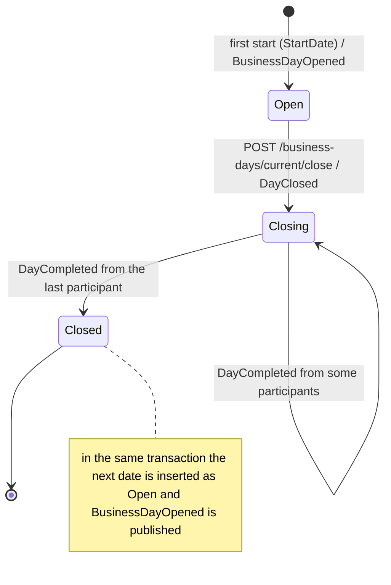
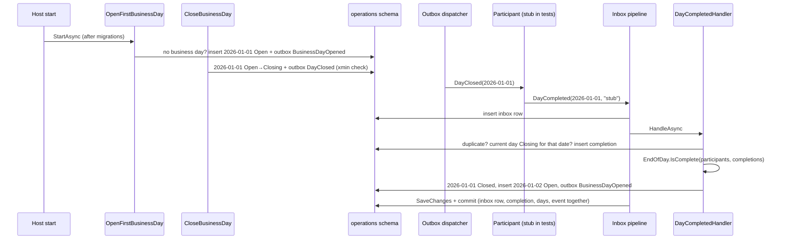

# Slice 2.3a: The close-day cycle, simple path

Three parts: the big picture (what "closing a day" means across services), the building blocks (startup opening, close endpoint, `DayCompleted` handler, stub participant), and why it is designed this way. Then what was tested, what to watch, and questions.

---

## Part 1. The big picture

### 1.1 The goal

Slice 2.1 built the rules and the tables. This slice makes the cycle from design plan ADR 15 actually run:



At every moment exactly one day is *current*: the one that is not Closed.

### 1.2 Why it is hard

- **The first day must come from somewhere.** Other services learn the business date only from `BusinessDayOpened`. If the first date were written by a migration, no event would announce it. This is the same trap as the seeded currencies in slice 2.2.
- **Closing must happen once.** Two clicks on "close" must not publish two `DayClosed`. Otherwise every participant runs its end-of-day work twice: standing orders twice, penalties twice.
- **Replies must be matched to the right day.** A late or misrouted `DayCompleted` for another date must not close today. You decided that this is an **error**, not a silent no-op.
- **Accounts and Lending do not exist yet.** The cycle has to be testable with a stand-in.

This slice handles replies that arrive **one at a time**. Two replies handled at the **same moment** are slice 2.3b.

---

## Part 2. The building blocks and how they connect

### 2.1 One full day, end to end



### 2.2 `OpenFirstBusinessDay` (`Features/BusinessDays/OpenFirstBusinessDay.cs`)

This is an `IHostedService`. The host calls every `IHostedLifecycleService.StartingAsync` (the migrations) before any `StartAsync`, so the tables exist when it runs. If `business_day` is empty, it does the following:

1. inserts `Operations:StartDate` as Open;
2. publishes `BusinessDayOpened(StartDate)` through the outbox, in the same `SaveChangesAsync`.

If the table already has a day (a restart), it does nothing. Two instances starting together both try to insert the same date. The primary key lets only one succeed, and the other catches the unique violation and continues. Only the winner's event exists.

### 2.3 `GetCurrentBusinessDay` (`Features/BusinessDays/GetCurrentBusinessDay.cs`)

`GET /business-days/current` returns `{ date, status }` of the current day, using `BusinessDayQueries.CurrentAsync` from slice 2.2. Before the first day is opened, which only happens for a moment during startup, it returns 503.

### 2.4 `CloseBusinessDay` (`Features/BusinessDays/CloseBusinessDay.cs`)

`POST /business-days/current/close`:

1. Loads the current day. If it is not Open (already Closing), it returns **409** with `code = business_day_not_open`.
2. Sets the day to Closing and `PerformedBy` from `X-Performed-By`, and publishes `DayClosed(D)` with `OccurredOn = D`.
3. Calls `SaveChangesAsync`. The update carries `xmin`, so of two concurrent closes only one changes the row. The other gets `DbUpdateConcurrencyException`, its outbox row is rolled back, and it returns 409.

The Kafka key of every business-day event is the date (`DayKey`, `yyyy-MM-dd`), so the events of one day stay in order.

### 2.5 `DayCompletedHandler` (`Features/BusinessDays/DayCompletedHandler.cs`)

The handler is registered with `AddEventHandler<DayCompleted, DayCompletedHandler>()`, and the inbox pipeline gives it one transaction per message. In order:

1. **Duplicate fact?** If `(date, service)` is already in `business_day_completion`, it returns, with no effect. This covers a participant that sends the same completion again under a new message id. The inbox only catches the *same* message id.
2. **Right day?** The current day must have this date and be Closing. Otherwise it throws `UnexpectedDayCompletedException` (your decision). The pipeline rolls everything back, including the inbox row, so the message is not marked as handled. The Kafka consumer retries it and then moves it to the dead-letter topic. The duplicate check comes *first* on purpose: a harmless repeat after the day is closed is a no-op, not an error.
3. **Record** the completion.
4. **Complete?** It loads the services that completed this date and calls `EndOfDay.IsComplete(participants, completions)` from slice 2.1. A service that is not a participant is recorded but does not count.
5. **If complete:** it marks the day Closed with `ClosedAt`, inserts `EndOfDay.NextDate(day)` as Open, and publishes `BusinessDayOpened(next)`.

The handler never calls `SaveChangesAsync`. The pipeline does, so the inbox row, the completion, both day rows and the event commit together.

### 2.6 One participant list (`Program.cs`)

In slice 2.1, `Kafka:SubscribeTo` repeated the participants. Now `Program.cs` derives it:

```csharp
builder.Services.AddOptions<KafkaOptions>()
    .PostConfigure<IOptions<OperationsOptions>>((kafka, operations) => kafka.SubscribeTo = operations.Value.EndOfDayParticipants);
```

Operations therefore reads exactly the topics of the services it waits for, and the two lists cannot drift apart. `Kafka:SubscribeTo` was removed from `appsettings.json`.

### 2.7 The stub participant (`tests/.../Support/StubParticipant.cs`)

`app.ReplyToDayClosed("stub")` subscribes to the in-memory broker. When Operations sends `DayClosed(D)`, the stub delivers `DayCompleted(D, "stub")` into Operations' own inbox pipeline, exactly as the Kafka consumer would. This lets the whole cycle run before Accounts and Lending exist.

---

## Part 3. Why it is designed this way

### 3.1 How the design changed during the slice

**A configuration trap, found by a failing test.** The first run of the stub cycle failed: the completion was recorded, but the day never closed. The cause is that .NET configuration merges arrays **by index** across sources. The test set `Operations:EndOfDayParticipants:0 = stub`. `appsettings.json` has `["accounts", "lending"]`. The result was `["stub", "lending"]`, so the day waited for a `lending` that never came. The fix and its consequences:

- The test host now removes the `appsettings*.json` sources and sets every value itself.
- `Kafka:SubscribeTo` is derived from the *bound* options, not read from configuration a second time.
- **The same trap exists in production.** An environment variable `Operations__EndOfDayParticipants__0=stub` does not replace the list; it only changes its first element. This is written in the service's `CLAUDE.md` under Gotchas.

### 3.2 Decisions you made (D1)

- **A `DayCompleted` for another day is an error.** The price: such a message blocks its partition for about 6 seconds of retries, then lands in `bank.<participant>.events.dlt`. It stays visible there instead of disappearing.

### 3.3 Design choices I made (D2)

| Choice | Why | Rejected |
| --- | --- | --- |
| First day opened by a hosted service, not by the migration | It must be announced with `BusinessDayOpened`, and the start date is configuration. | `HasData` for the first day: no event, and one fixed date everywhere. |
| Duplicate check before the date check | A repeated completion after the day closed is harmless and should not go to the DLT. | Date check first: every late duplicate would become a DLT entry. |
| 409 for the losing concurrent close (xmin) | The caller asked to close a day that is no longer Open, which is a real conflict. Unlike activation, the result differs from what was asked. | 200 for both: the second caller would believe it started the close. |
| Event key = the date | Order per day on one partition. | The service name or a random key. |
| 503 when no day exists yet | It only happens during startup; "try again" is the right message. | 404: suggests a wrong URL. |
| Test host drops JSON configuration | Arrays merge by index (see 3.1). | Overriding with empty strings: fails validation and is confusing. |
| `UnexpectedDayCompletedException` as its own type | Tests and logs can tell it apart from a database failure. | `InvalidOperationException`. |

### 3.4 Patterns used

- **Choreography**: Operations publishes facts and reacts to facts. It never calls Accounts or Lending.
- **State machine with guarded transitions**: close only from Open; Closed only from Closing, when complete.
- **Transactional outbox and inbox**: every state change and its event commit together. The handler's effect commits with its inbox row.
- **Idempotent consumer with a business key**: the inbox handles the same message, and `(date, service)` handles the same fact.
- **Test double at the boundary**: the stub participant replaces whole services at the broker, not inside Operations.

---

## 4. What was tested

`BusinessDayTests` (12 tests) and the updated `CurrencyTests`:

- **Startup:**
  - startup opens the configured start date and publishes `BusinessDayOpened`;
  - a restart (even with another `StartDate`) opens nothing new and publishes nothing new.
- **Closing:**
  - close moves to Closing and publishes `DayClosed` with the date, the actor and the key;
  - closing twice returns 409 `business_day_not_open`, and `DayClosed` is published once;
  - five concurrent closes give one 200 and four 409, and `DayClosed` is published once.
- **The cycle:**
  - with the stub participant, the day closes, the next one opens, and two `BusinessDayOpened` events exist in order;
  - three days in a row close and open in order;
  - with two participants, the day stays Closing after the first reply and closes after the second;
  - a non-participant's completion is recorded but does not count.
- **Errors and configuration:**
  - a `DayCompleted` for another date throws and leaves no completion and no inbox row;
  - a `DayCompleted` while the day is still Open throws;
  - Operations subscribes to exactly the participants' topics.

```
cd core_banking/bank-operations && dotnet test
Passed!  - Failed: 0, Passed: 17, Total: 17 - Bank.Operations.UnitTests.dll
Passed!  - Failed: 0, Passed: 38, Total: 38 - Bank.Operations.IntegrationTests.dll
```

## 5. What to watch later

- **Two replies at the same moment.** Two handlers running in parallel can each see only their own completion and both stop, so the day never closes. Or they can both see two completions and both try to open the next day. That is exactly slice 2.3b.
- **No timeout for a missing participant.** If Lending never replies, the day stays Closing forever. That is by design (ADR 15 has no timeout), but it is visible only through `GET /business-days/current`.

## 6. Check your understanding

1. Why does `OpenFirstBusinessDay` publish an event at all, when the migration could just insert the first day?
2. Why does the handler check for a duplicate *before* checking that the date is the Closing day? What would change if the order were reversed?
3. An operator sets `Operations__EndOfDayParticipants__0=cards` as an environment variable, expecting `["cards"]`. What list does the service really use, and what happens at the next close?
