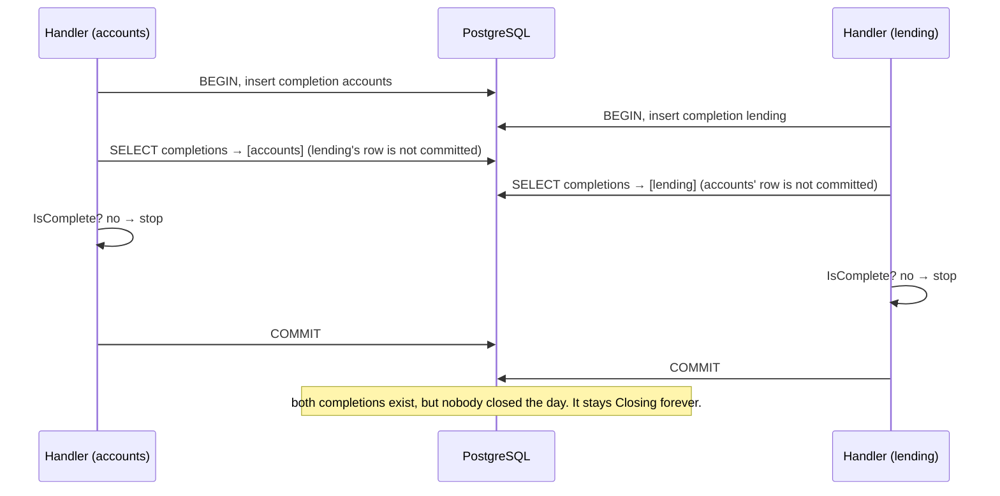
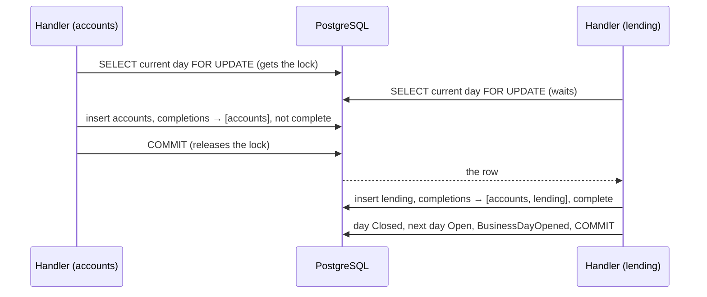

# Slice 2.3b: Opening the next day exactly once

Three parts: the big picture (the race between two replies), the building blocks (one locked query, one reordered handler, four tests), and why a row lock won. Then what was tested, what to watch, and questions.

---

## Part 1. The big picture

### 1.1 The goal

When the last participant replies, the next business day must open **exactly once**: not zero times and not twice.

### 1.2 Why it is hard: two transactions that cannot see each other

Accounts and Lending finish their end of day at about the same time. Their two `DayCompleted` messages are handled in parallel, each in its own transaction (READ COMMITTED, PostgreSQL's default):



This is the **lost close**. The test showed it on its very first race. With other timings, both handlers can see both rows and both open the next day: the **double open**. The inbox cannot help, because these are two different messages.

### 1.3 The idea of the fix

The decision "is the day complete?" needs a **queue**: one handler decides at a time. The natural place for the queue is the row both handlers care about, the current `business_day`. Lock it first, and the second handler waits until the first commits. By then it sees the first handler's completion.



---

## Part 2. The building blocks and how they connect

### 2.1 `CurrentForUpdateAsync` (`src/Bank.Operations.Api/Data/BusinessDayQueries.cs`)

```csharp
days.FromSql($"SELECT *, xmin FROM business_day WHERE status <> 'Closed' ORDER BY date DESC LIMIT 1 FOR UPDATE")
```

- It is raw SQL, because LINQ has no `FOR UPDATE` (the root `CLAUDE.md` allows raw SQL exactly in this case).
- `xmin` is named explicitly, because `SELECT *` leaves out system columns, and EF needs it for the `Version` property. The outbox dispatcher has the same gotcha.
- The lock lasts until the **caller's transaction** ends. The handler runs inside the transaction that the inbox pipeline opened (bank-contracts ADR 0012), so the lock covers the whole handler, up to the pipeline's commit.

### 2.2 `DayCompletedHandler`, reordered (`Features/BusinessDays/DayCompletedHandler.cs`)

The steps are now:

1. **Lock** the current day.
2. Is this a duplicate `(date, service)`? Then return.
3. Is it the current Closing day? If not, throw (your rule from slice 2.3a).
4. Record the completion, evaluate `EndOfDay.IsComplete`, and close and open if complete.

The lock comes **before** the duplicate check. Two copies of the same fact arriving together are then also serialized: the second one sees the first one's row and returns, instead of failing on the primary key.

### 2.3 The safety net

`business_day.date` is still the primary key, so even a bug that skipped the lock could not insert the next day twice. It would fail, roll back and be retried.

---

## Part 3. Why it is designed this way

### 3.1 The decision (ADR bank-operations 0001)

This was a D1 for you in the stage file. Under your delegation of 2026-10-31, I took my recommendation and marked the ADR for your review.

| Option | Prevents double open | Prevents lost close | Cost |
| --- | --- | --- | --- |
| Unique constraint only | yes | **no** | none |
| Optimistic concurrency (touch the day row, `xmin`) | yes | yes, through a retry | exceptions, broker retries (200 ms or more, blocking the partition), and a valid message can reach the DLT after four conflicts |
| SERIALIZABLE isolation | yes | yes, through a retry | the same retry cost, plus a pipeline option for one handler |
| **Row lock `FOR UPDATE`** (chosen) | yes | yes, on the first attempt | raw SQL, and a lock held for a few milliseconds once per participant per day |

The lock wins because it is correct without retries and easy to reason about. The contention it causes is negligible: one row, a few messages a day.

### 3.2 Design choices I made (D2)

- **Lock before the duplicate check**, so that two copies of one fact are also serialized.
- **15 races in one test** instead of one. A single race can pass by luck. Fifteen in a row, without the lock, failed on the first.

### 3.3 Patterns used

- **Pessimistic locking**: serialize the critical decision at its one shared row.
- **Defence in depth**: lock, primary key, inbox, and the `(date, service)` business key, each catching a different failure.
- **Test-first for a race**: the test reproduced the bug before the fix, and fails again when the fix is removed.

---

## 4. What was tested

`ExactlyOnceTests` (4 tests):

- two `DayCompleted` messages at the same time open the next day exactly once, over 15 consecutive days, with 16 `BusinessDayOpened` in order and 15 Closed days;
- a duplicate `DayCompleted` under a new message id has no extra effect;
- the same message delivered twice is handled once (the inbox), even after the day closed;
- a late duplicate after the day closed is a no-op, not an error.

```
cd core_banking/bank-operations && dotnet test
Passed!  - Failed: 0, Passed: 17, Total: 17 - Bank.Operations.UnitTests.dll
Passed!  - Failed: 0, Passed: 42, Total: 42 - Bank.Operations.IntegrationTests.dll
```

Evidence that the test can fail:

- **Before the fix**, the race test failed twice in two runs at "race 1": expected `2026-01-02 Open`, but it was `2026-01-01 Closing`. That is the lost close.
- **After the fix**, it passed 3 out of 3 runs.
- **With the lock replaced by the plain query again**, it failed.

## 5. What to watch later

- When a waiting handler gets the lock after the day was closed, its `WHERE status <> 'Closed'` no longer matches, so it gets no row. It then becomes a duplicate (no-op) or an "unexpected day" error, which is the right behaviour, but it is subtle (see ADR 0001, Consequences).
- If a future handler also needs to change the current day, it must take the same lock first, or it reintroduces the race.

## 6. Check your understanding

1. Why can't the inbox prevent this race, when it does prevent duplicate messages?
2. Why is the lost close (day stuck in Closing) more likely than the double open under READ COMMITTED?
3. What would go wrong if the handler took the lock *after* inserting its completion?
