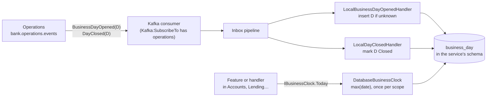

# Slice 2.4: The business-day consumer for every other service

Three parts: the big picture (how a service knows "today" without a clock), the building blocks (one table, two handlers, one clock, one registration), and why it lives in `Bank.Messaging`. Then what was tested, what to watch, and questions.

---

## Part 1. The big picture

### 1.1 The goal

Interest, penalties, due dates and standing orders all depend on the **business date**. Design plan ADR 14 forbids business code to read the system clock. Business code asks `IBusinessClock.Today` instead. Operations owns the date (slices 2.1–2.3). Every other service has to *follow* it, without reading Operations' schema.

`implementation-decisions.md` already said how: each service keeps a local `business_day` table, filled from `BusinessDayOpened` and `DayClosed`, and `IBusinessClock` reads it. Five services need exactly this. The slice writes it once, in `bank-contracts`.

### 1.2 Why it is hard

- **Duplicates and old news.** Kafka delivers at least once. Day events are keyed by date, so `BusinessDayOpened(D+1)` can sit on a different partition than `DayClosed(D)` and arrive first. The clock must never go backwards.
- **One request, one date.** A transfer that starts on day D must not finish on day D+1 because a new day opened halfway through.
- **No date yet.** A service that started before Operations, or that forgot to subscribe, must fail loudly instead of using a wrong date.

### 1.3 The solution in one picture



---

## Part 2. The building blocks and how they connect

All new code is in `core_banking/bank-contracts/src/Bank.Messaging/BusinessDays/`.

### 2.1 `LocalBusinessDay` (`LocalBusinessDay.cs`)

The service's copy of one date: `date` (PK), `status` (`Open` or `Closed`, as text), `created_at`, `performed_by` and `xmin`. `modelBuilder.AddLocalBusinessDays()` maps it to the table `business_day`, with explicit column names like the messaging tables. The service's own migration creates the table, next to the outbox and inbox.

### 2.2 The two handlers (`BusinessDayHandlers.cs`)

- **`LocalBusinessDayOpenedHandler`** inserts the date if it is unknown and otherwise does nothing.
- **`LocalDayClosedHandler`** marks the date Closed. If the opening was never seen, for example because the service was started later, it inserts the date as Closed.

Both are idempotent. Their names begin with `Local` on purpose. The handler class name is part of the inbox key, and Accounts will have its own `DayClosed` handler for its end-of-day work. Two handlers with the same name in one service fail at startup.

### 2.3 `DatabaseBusinessClock` (`DatabaseBusinessClock.cs`)

It implements `IBusinessClock`, scoped:

- `Today` = `max(date)` in `business_day`. Because it takes the **latest** date, a late or repeated event can never move the clock back. A Closed day still counts: between `DayClosed(D)` and `BusinessDayOpened(D+1)`, the business date is still D. That is when the end-of-day work for D runs.
- It reads the date **once per scope** and keeps it. One request or one handled message sees one date.
- Before the first `BusinessDayOpened`, it throws, with a hint to check `Kafka:SubscribeTo`.

### 2.4 `AddBusinessDayConsumer()` (`BusinessDayExtensions.cs`)

A service writes three lines:

```csharp
services.AddBusinessDayConsumer();          // the two handlers + scoped IBusinessClock
modelBuilder.AddLocalBusinessDays();        // in OnModelCreating, then add a migration
"Kafka": { "SubscribeTo": [ "operations" ] }
```

### 2.5 Packaging

`Bank.Messaging` now references `Bank.Common`, for `IBusinessClock`. All `bank-contracts` packages moved to **0.2.0** and were packed to the local feed. Operations moved to 0.2.0 as well, as a compatibility check, and its 59 tests still pass. Operations itself does not use the consumer: it owns the date.

---

## Part 3. Why it is designed this way

### 3.1 The decision (bank-contracts ADR 0016)

This was a D1 for you. Under your delegation of 2026-10-31, I took my recommendation and marked the ADR for your review.

| Option | Verdict |
| --- | --- |
| `Bank.Common` | Its rule (ADR 0011) forbids I/O and external packages, and the consumer needs EF Core and handlers. Rejected. |
| **`Bank.Messaging`** (chosen) | It already has the handler interface, the pipeline, and the "add these tables to your model" pattern, and every service references it. |
| A new package `Bank.BusinessDays` | The cleanest boundary, but one more package for about 150 lines that always travel with `Bank.Messaging`. It can be split out later. |
| A copy in every service | Five copies of subtle code. Rejected. |

### 3.2 Design choices I made (D2)

| Choice | Why | Rejected |
| --- | --- | --- |
| Latest date wins | Safe against duplicates and reordering across partitions, with no extra state. | Trusting arrival order. |
| Read once per scope | One date per request or message. | Reading on every access: a request could see two dates. |
| Scoped clock that reads the database | Always what is committed, and the same for every instance. | A singleton cache updated by the handler: it changes before the commit, even if the transaction rolls back, and instances disagree. |
| A Closed day still counts for `Today` | The end-of-day work for D runs after `DayClosed(D)`. | Only Open days: there would be no date at all during the end of day. |
| `Local…` handler names | They do not collide with a service's own `DayClosed` handler. | Generic names. |

### 3.3 Patterns used

- **Local read model** (event-carried state transfer): each service keeps its own copy of data it does not own, filled from events.
- **Idempotent, order-tolerant consumer**: insert-if-absent plus "latest wins".
- **Unit of work snapshot**: one date per scope.

---

## 4. What was tested

`BusinessDayConsumerTests` in `Bank.Messaging.IntegrationTests` (6 tests, real pipeline and PostgreSQL):

- `Today` follows the latest `BusinessDayOpened`;
- an older or repeated `BusinessDayOpened` does not move the date back;
- `DayClosed` marks the day Closed and `Today` stays the same until the next day opens;
- `DayClosed` for an unseen day records it as Closed;
- `Today` throws with a hint before the first `BusinessDayOpened`;
- one scope keeps one date even if a new day opens in the meantime.

```
cd core_banking/bank-contracts && dotnet test
Passed!  - Bank.Common.Tests 16, Bank.Contracts.Tests 110, Bank.Messaging.UnitTests 32,
           Bank.Toolkit.Data.IntegrationTests 3, Bank.Messaging.IntegrationTests 24 — all passed
cd core_banking/bank-operations && dotnet test      # on 0.2.0
Passed!  - UnitTests 17, IntegrationTests 42
```

## 5. What to watch later

- Stage 4 is the first real user: Accounts and Customers add `AddBusinessDayConsumer()`, the table and the subscription.
- `Today` runs one synchronous query on first use per scope. That is fine for `max(date)` on a tiny table.

## 6. Check your understanding

1. `BusinessDayOpened(2026-01-02)` arrives before `DayClosed(2026-01-01)`. What does `Today` return before and after the `DayClosed` arrives, and why?
2. Why does the clock read the database once per scope, instead of being a singleton updated by the handler?
3. Why can't this code live in `Bank.Common`?
