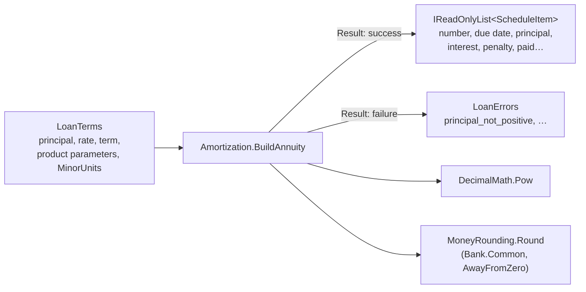

# Slice 3.1: Loan types and the annuity schedule

Three parts: the big picture (why loan logic comes first and alone), the building blocks (the types and `BuildAnnuity`), and why it is designed this way. Then tests, what to watch, and questions.

---

## Part 1. The big picture

### 1.1 The goal

A loan is a promise about money over time. The bank lends P today, and the customer repays it with interest on agreed dates. Everything Lending will later do builds on one artifact: the **schedule**, the list of what is due when. This includes automatic collection, penalties, classification, payoff and accounting. If the schedule is off by one öre, every later number is off too.

Stage 3 builds the calculations as **pure functions** (design plan ADR 02), before any database or endpoint exists. They can then be tested exhaustively and in milliseconds. This slice builds the vocabulary (the types) and the first calculation: the annuity schedule used by CAR and MORTGAGE loans.

### 1.2 Why it is hard

- **The formula gives fractions of an öre.** A = P·r(1+r)^n/((1+r)^n−1) is exact in theory, but money is paid in whole öre. Round each item independently and the principal no longer adds up to P. The rule: round each part once, and let the **last item absorb the difference** (financial-logic rule).
- **Floating point is not allowed.** `Math.Pow` works in `double`, which cannot represent 0.0695 exactly. The power must be computed in `decimal`.
- **Calendars are irregular.** Same day each month is easy until the loan is disbursed on 31 January.
- **Invalid input must be reported, not thrown** (financial-logic rule), with a code the API can return.

---

## Part 2. The building blocks and how they connect



### 2.1 `LoanTerms` (`Logic/LoanTerms.cs`)

`LoanTerms` holds every parameter a calculation needs, copied from the product at disbursement (design plan section 2). That way a product change never alters an existing loan, and `Logic/` never contains a literal rate.

- **Rates are fractions**: 6.95% is `0.0695`.
- **`MinorUnits`** was added to the stage file's list (D2). Rounding needs the currency's minor unit, and hard-coding 2 would break the "no hard-coded values" rule.
- **`MaxStages`** was added too (D2), for staged loans in slice 3.2.
- **`FirstDueDate`** is optional. Without it, the first due date is one month after disbursement.

`Stage` and `StagePlan` describe a staged loan's agreed stages (slice 3.2). `RepaymentType` is `Annuity` or `Staged`.

### 2.2 `ScheduleItem` (`Logic/ScheduleItem.cs`)

One installment: `Number`, `DueDate`, the amounts due (`PrincipalDue`, `InterestDue`, `PenaltyDue`) and the amounts paid (`PaidPrincipal`, `PaidInterest`, `PaidPenalty`). It is an immutable record (ADR 0001). `UnpaidPrincipal`, `Unpaid`, `Status` and `IsPaid` are **computed**, so a status can never disagree with the amounts. A paid installment that later gets a penalty becomes `PartiallyPaid` again.

### 2.3 `LoanErrors` (`Logic/LoanErrors.cs`)

This file holds every rejection as an `Error(Code, Message)` (from `Bank.Common`), in one place. The codes become the `code` of a 422 response in stage 5 (ADR 0002).

### 2.4 `DecimalMath.Pow` (`Logic/DecimalMath.cs`)

`DecimalMath.Pow` computes x^n by repeated squaring in `decimal`, so (1+r)^n never passes through `double`. For n = 360 it takes about 9 squarings.

### 2.5 `Amortization.BuildAnnuity` (`Logic/Amortization.cs`)

The function runs in four steps:

1. **Validate**: the repayment type, principal > 0, term ≥ 1, rate ≥ 0, the payoff cap in the loan currency, and a first due date after disbursement. Any failure returns its `LoanErrors` code.
2. **Payment**: r = annual / 12, and A = P·r(1+r)^n/((1+r)^n−1), **rounded** to the minor unit. With a zero rate, A = P/n.
3. **Items**: for each month, interest = round(outstanding × r) and principal = A − interest. The **last** item takes all the remaining principal.
4. **Due dates** (`DueDate`): counted from the **anchor**, never from the previous due date. The anchor is the disbursement date, or the explicit first due date if one is given.

---

## Part 3. Why it is designed this way

### 3.1 How the design changed during the slice

The month-end test failed first. I had computed due date *n* as `firstDueDate.AddMonths(n − 1)`. For a loan disbursed on 31 Jan 2028, the first due date is 29 Feb, and counting from 29 Feb gives **29 Mar** instead of 31 Mar. `DateOnly.AddMonths` clamps to the last day, and the clamped day then became the new "same day". The fix counts every due date from the disbursement date: `DisbursedOn.AddMonths(n)`. This is now a gotcha in the service's `CLAUDE.md`.

### 3.2 Decisions made on your delegation (D1, for your review)

- **Immutable schedule records** (bank-lending ADR 0001). The alternative was mutable items changed in place.
- **`Result<T>` with error codes** (bank-lending ADR 0002). The alternative was validating before the call.

### 3.3 Design choices I made (D2)

| Choice | Why |
| --- | --- |
| Round A before building the items | Customers pay a fixed amount in whole öre; the last item absorbs the drift. ADR 0003 records this interpretation. |
| `MinorUnits` and `MaxStages` on `LoanTerms` | No hard-coded rounding or limits in `Logic/`. |
| Status computed, not stored | It can never contradict the amounts. |
| `LoanClassification` (not `Classification`) for the enum | `Classification.For` is the function's class; C# cannot have both names in one namespace. |
| `Bank.Lending.Api` uses the Web SDK, with a placeholder `Program.cs` | The stage file asks for this layout, and stage 5 adds the service without moving files. |

### 3.4 Patterns used

- **Functional core**: pure functions, with values in and values out.
- **Result type**: rejections are data, not exceptions.
- **Make illegal states unrepresentable (partly)**: the status is derived, so it cannot be wrong.

---

## 4. What was tested

`AmortizationAnnuityTests` (16 tests):

- **Worked examples:**
  - CAR worked example (items 1 and 2);
  - CAR last item takes the rounding difference: 6,170.79 instead of 6,170.85, with the principal summing to 200,000;
  - MORTGAGE first and last items and total interest 1,541,966.48;
  - zero rate (333.33, 333.33, 333.34);
  - one-month term.
- **Due dates:**
  - same day each month;
  - 31 Jan in a leap year (29 Feb, 31 Mar, 30 Apr, 31 May);
  - explicit first due date.
- **Rejections and status:**
  - a new schedule is unpaid;
  - four invalid inputs with their codes;
  - wrong repayment type;
  - first due date not after disbursement;
  - the status follows the amounts.

The expected values were checked independently with a short Python `Decimal` script that implements the same rules. It is not part of the repository.

```
cd core_banking/bank-lending && dotnet test
Passed!  - Failed: 0, Passed: 16, Total: 16 - Bank.Lending.UnitTests.dll
```

## 5. What to watch later

- The last installment differs from A by a few öre. The customer communication in stage 5 must show the real amount of each item, not "A × n".

## 6. Check your understanding

1. Why does rounding A first and then letting the last item take the remainder keep the principal exactly equal to P?
2. Why would `DueDate(n) = previousDueDate.AddMonths(1)` give wrong dates for a loan disbursed on 31 January?
3. Why is `Math.Pow` not allowed here, even though the result is rounded to two decimals anyway?
