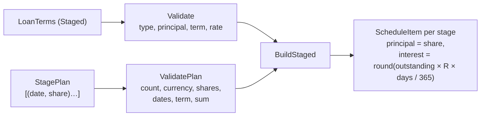

# Slice 3.2: Staged loans

Three parts: the big picture (a loan repaid in agreed chunks), the building blocks (`BuildStaged` and its validation), and why it is designed this way. Then tests, what to watch, and questions.

---

## Part 1. The big picture

### 1.1 The goal

PURCHASE loans are not repaid in equal installments. At approval, the bank and the customer agree on **stages**: on each date, a share of the principal is repaid, together with the interest accrued since the previous stage. The product only limits how many stages there may be and how long the loan may run (design plan section 2). The function turns the agreed plan into a schedule.

### 1.2 Why it is hard

- **Interest is Actual/365, not 30/360.** Stages are irregular, so interest follows the real number of days. A leap year still divides by 365, which is the design plan's rule even though the year has 366 days.
- **The plan comes from a person**, so it can be wrong in many ways: too many stages, shares that miss the principal by one öre, dates in the wrong order, a stage after the term ends. Each mistake needs its own code (ADR 0002).

---

## Part 2. The building blocks and how they connect



### 2.1 `Amortization.BuildStaged` (`Logic/Amortization.cs`)

The function walks the stages in order, keeping two running values: the **outstanding principal** and the **previous date** (disbursement at first). For each stage:

- `days` = actual days from the previous date to the stage date (`Days`, using `DateOnly.DayNumber`);
- interest = round(outstanding × R × days / 365);
- principal = the agreed share;
- then outstanding −= share, and previous = the stage date.

### 2.2 `ValidatePlan`

The checks run in this order, so the first problem wins:

1. **No stages**: `no_stages`.
2. **More than `MaxStages`**: `too_many_stages`. A product without a maximum (`null`) allows any number.
3. **A share in another currency**: `currency_mismatch`.
4. **A share ≤ 0**: `share_not_positive`.
5. **A date on or before the previous one** (the first compared with disbursement): `dates_not_increasing`.
6. **The last date after disbursement + term**: `stage_past_term`. A stage exactly on the last day of the term is allowed.
7. **Shares not summing exactly to the principal**: `shares_do_not_sum_to_principal`. One öre off is rejected.

---

## Part 3. Why it is designed this way

### 3.1 Design choices I made (D2)

| Choice | Why |
| --- | --- |
| The rate is applied once per stage on the outstanding balance *before* the stage's repayment | That is "interest accrued up to that date": the share is repaid on the due date, so it earned interest until then. |
| `DayNumber` difference for days | Exact, and calendar-correct across months and leap days. |
| A stage on the maturity date is allowed, one day later is not | "Past the term" means after disbursement + term months. |
| The checks run in a fixed order | Each wrong plan gets one predictable code. The cheapest and most fundamental check comes first. |
| No rounding remainder handling for staged loans | Shares are agreed in whole öre and must sum exactly, so principal never needs adjusting. Interest is rounded per stage, once. |

### 3.2 Patterns used

- **Guard clauses returning errors**: validation as data (`Result`), not exceptions.
- **Running-state fold**: one pass over the stages carrying the outstanding principal and the previous date.

---

## 4. What was tested

`AmortizationStagedTests` (18 tests):

- **Worked examples:**
  - PURCHASE worked example: four quarters of 25,000 with interest 2,095.89, 1,589.38, 1,071.23 and 535.62, the arithmetic in comments;
  - 29 Feb inside a stage: 91 days, still / 365;
  - a single stage of 181 days;
  - zero rate;
  - a stage on the last day of the term is allowed.
- **Rejections:**
  - five stages when four are allowed;
  - shares one öre short or one öre too much;
  - a zero share;
  - four date mistakes (decreasing, the same day, on the disbursement date, before it);
  - one day past the term;
  - an empty plan;
  - a share in EUR;
  - annuity terms passed in.
- **No maximum:** a product without `MaxStages` allows any number of stages.

```
cd core_banking/bank-lending && dotnet test
Passed!  - Failed: 0, Passed: 34, Total: 34 - Bank.Lending.UnitTests.dll
```

## 5. What to watch later

- Stage 5 receives the plan in the loan application. The 422 codes above are what the API returns for a bad plan.

## 6. Check your understanding

1. Why does stage 2's interest use 75,000 and not 100,000?
2. A plan has stages on 15 Apr and 15 Jul 2028 (a leap year). Why is the first stage's interest computed on 91 days but divided by 365?
3. Why reject shares that miss the principal by one öre instead of adjusting the last share?
