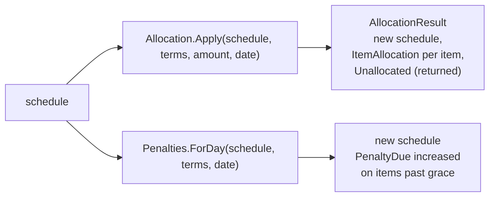

# Slice 3.3: Payment allocation and late penalties

Three parts: the big picture (what happens to money paid and money not paid), the building blocks (`Allocation.Apply`, `Penalties.ForDay`), and why they are designed this way. Then tests, what to watch, and questions.

---

## Part 1. The big picture

### 1.1 The goal

Once a schedule exists, two things change it every day:

- **A payment arrives.** It must be split over what is owed in a fixed order, so the customer, the bank and the ledger agree on what was paid. The order (design plan section 2): oldest installment first, and within one installment **penalty, then interest, then principal**.
- **A payment does not arrive.** After the grace period, a daily penalty is added to the overdue amount (5 days of grace means the first penalty falls on day 6).

### 1.2 Why it is hard

- **The order matters for money.** Paying principal before interest would leave the bank with unpaid interest that keeps a loan overdue, while the customer believes they paid. The order is a business rule, not a detail.
- **Overpayment.** Money left after the due items prepays the next items in order. A partly covered item gets the money split between principal and interest in proportion (ADR 0003, point 5). Only money left after the whole loan is paid is returned.
- **Grace boundaries.** Day 5 is still free and day 6 is not. An off-by-one here charges every late customer one day too many or too few.
- **No penalty on penalty.** The base is unpaid principal plus unpaid interest only.

---

## Part 2. The building blocks and how they connect



### 2.1 `Allocation.Apply` (`Logic/Allocation.cs`)

1. **Rejections:** an amount ≤ 0 returns `payment_not_positive`, and an amount in another currency returns `currency_mismatch`.
2. **Eligible items:** every item not fully paid, ordered by due date and then number. Items due on or before the payment date therefore come first.
3. For each item, while money is left:
   - a due item, or a later item the money covers in full: `Take` pays the unpaid penalty, then the unpaid interest, then the unpaid principal. `Take` never pays more than is owed;
   - a later item the money covers only in part: `ProRata` splits all the money between unpaid principal and unpaid interest in proportion. Principal is rounded with the loan's `MinorUnits` (the reason `Apply` takes `LoanTerms`), and interest takes the rest, so no cent is lost.
4. **Result:**
   - the new schedule (the input is unchanged, ADR 0001);
   - one `ItemAllocation(Number, Penalty, Interest, Principal)` per item touched. Stage 6's ledger needs this split to book interest income separately from principal;
   - `Unallocated`, what is left after every item is paid, to be returned.

### 2.2 `Penalties.ForDay` (`Logic/Penalties.cs`)

This is called once per business day during the end of day (stage 5). For each item:

- **the condition:** `DueDate + GraceDays < date` and unpaid principal + interest > 0;
- **the charge:** add round((unpaid principal + unpaid interest) × daily rate) to `PenaltyDue`.

It is one day per call and charged per item, rounded once per item per day. Because it is called day by day, "penalty on day 6, 7, 8…" is simply six, seven, eight calls.

---

## Part 3. Why it is designed this way

### 3.1 Interpretations (bank-lending ADR 0003, for your review)

- **Prepayment (changed by Majid on 2026-11-02).** The first version paid only items due on or before the payment date and returned the rest, the most conservative reading of the stage file. In the review Majid chose to let the money prepay later items: in order, a partly covered one split pro rata between principal and interest, with no interest waived and no recalculated schedule. The price: a customer who prepays and later pays off early does not get back interest already prepaid. Majid accepted that for the demo scope.
- **Unpaid penalty alone does not earn more penalty** (stated in the stage file), but it does keep the item unpaid. That matters for classification (slice 3.4).

### 3.2 Design choices I made (D2)

| Choice | Why |
| --- | --- |
| `ItemAllocation` breakdown in the result | The ledger (stage 6) books penalty, interest and principal to different accounts. |
| Penalty rounded per item per day | "round(...)" in the stage file applies per item. Summing first and rounding once would hide which installment caused what. |
| `ForDay` returns the schedule unchanged for items not past grace | One rule, no special cases for paid items: their overdue base is zero. |
| Payment exactly on the due date is eligible | Due means "payable from that day". |

### 3.3 Patterns used

- **Waterfall allocation**: a fixed priority order consumes the money until it runs out.
- **Daily accrual by repeated application**: the end of day calls the same pure function once per day; there is no "days late × rate" shortcut that would ignore payments made in between.

---

## 4. What was tested

**`AllocationTests`** (13 tests):

- exact payment on the due date;
- partial payment (interest before principal);
- a payment smaller than the interest;
- an item with a penalty: 3.09 penalty, 1,158.33 interest and 5,009.43 principal, so 3.09 of principal stays unpaid;
- two due items, oldest first;
- an older item's penalty paid before a newer item's interest;
- an overpayment of 829.15 prepays item 2 pro rata (677.41 principal, 151.74 interest);
- an overpayment covering item 2 in full moves on to item 3;
- more than the whole loan pays every item and returns the rest;
- a payment before any due date prepays item 1 pro rata, and a second one splits on what is still unpaid;
- paid items are skipped;
- the input is unchanged;
- non-positive amounts and another currency are rejected.

**`PenaltiesTests`** (12 tests):

- no penalty on the due date or on grace days 1 and 5;
- day 6 charges 6,170.85 × 0.0005 = 3.09;
- day 7 makes 6.18, with no penalty on penalty;
- partly paid during grace, the remainder is charged: 2.51;
- fully paid during grace, nothing;
- only penalty unpaid, nothing more;
- two overdue items charged separately;
- the MORTGAGE rate (2.95);
- a PURCHASE stage (13.55);
- zero grace days.

```
cd core_banking/bank-lending && dotnet test
Passed!  - Failed: 0, Passed: 59, Total: 59 - Bank.Lending.UnitTests.dll
```

## 5. What to watch later

- **Manual payment "for a specific installment"** (design plan, cards) needs an item filter. It is a small addition for stage 6.
- **The end of day must call `ForDay` exactly once per date.** Stage 5 needs a business key such as (loan, date) so that a replayed `DayClosed` does not charge twice.

## 6. Check your understanding

1. A customer owes 50 penalty and 1,158.33 interest on an old installment, and pays 1,000. What is left unpaid, and why does that order protect the bank?
2. Why is 20 Feb (due 15 Feb, grace 5) still penalty-free, while 21 Feb is not?
3. Why does `ForDay` take the unpaid principal and interest as its base but not the unpaid penalty?
