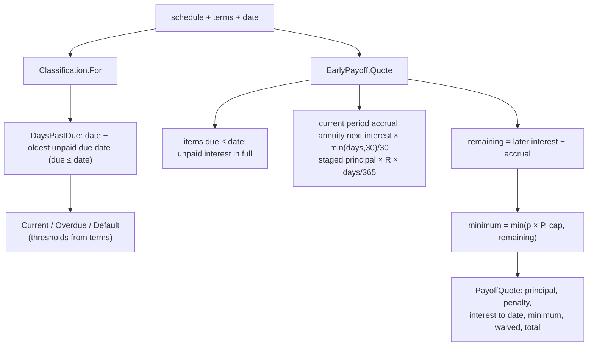

# Slice 3.4: Classification and early payoff

Three parts: the big picture (how late is a loan, and what does it cost to end it now), the building blocks (`Classification.For`, `EarlyPayoff.Quote`), and why. Then tests, what to watch, and questions.

---

## Part 1. The big picture

### 1.1 The goal

Two questions a bank asks about every loan:

- **How healthy is it?** Current, Overdue (from 1 day late) or Default (from 90 days late). The thresholds are on the product (design plan section 2). The classification drives provisioning in the ledger (stage 6) and what the agent may say in phase 2.
- **What does it cost to close it today?** That is the outstanding principal, the interest earned so far, any penalty, and a **minimum interest**, which compensates the bank for losing future interest. The rest of the future interest is waived.

### 1.2 Why it is hard

- **"Late" needs an exact start.** Is a loan late on its due date? This design says no: an item due today gives 0 days past due. The thresholds are inclusive (exactly 90 days is Default).
- **Payoff in the middle of a period.** The customer used the money for part of the current period, so interest for those days is fair. The two loan types count days differently: days/30 for annuity, Actual/365 for staged.
- **Little interest left.** Near the end of a loan the remaining interest can be below the minimum. The rule then is "no discount", and the minimum becomes whatever is left.

---

## Part 2. The building blocks and how they connect



### 2.1 `Classification.For` and `DaysPastDue` (`Logic/Classification.cs`)

- `DaysPastDue` looks at the items due on or before the date that are not fully paid (penalty included, ADR 0003). It returns the days since the oldest one, or 0 if there is none.
- `For` compares that number with `DefaultAfterDays` first, then `OverdueAfterDays`.
- The enum is called `LoanClassification`, because the function's class is `Classification`.

### 2.2 `EarlyPayoff.Quote` and `PayoffQuote` (`Logic/EarlyPayoff.cs`)

1. **Split** the schedule into items due on or before the date, and later items.
2. **Outstanding principal** = all unpaid principal. **Unpaid penalty** = all unpaid penalty.
3. **Accrual** for the current period, counted from the last due date on or before the date (or from disbursement):
   - annuity: the next item's interest × min(days, 30)/30, so it never accrues more than one period's interest;
   - staged: the principal still scheduled × R × days/365.
4. **Interest to date** = the due items' unpaid interest + the accrual.
5. **Remaining scheduled interest** = the later items' interest − the accrual (never below 0).
6. **Minimum** = min(round(percent × original principal), cap, remaining).
7. **Waived** = remaining − minimum.
8. **Total** = principal + penalty + interest to date + minimum.

---

## Part 3. Why it is designed this way

### 3.1 Interpretations (bank-lending ADR 0003, for your review)

Points 6, 8 and 9 of the ADR are used here:

- an unpaid penalty keeps a loan Overdue;
- a loan is not late on its due date;
- the payoff details above.

They are the most conservative readings, and they are business choices for you to confirm.

### 3.2 Design choices I made (D2)

| Choice | Why |
| --- | --- |
| `PayoffQuote` lists every component | The customer, the ledger and the agent need to explain the total, not just see it. |
| Accrual capped at 30/30 | A 31-day period must not accrue more than its own scheduled interest. |
| `DaysPastDue` public | Stage 5 and the reports want the number, not only the label. |

### 3.3 Patterns used

- **Derived classification**: computed from the schedule each time, never stored as a source of truth.
- **Explainable result**: the quote is a breakdown, and the total is the sum of its parts.

---

## 4. What was tested

**`ClassificationTests`** (9 tests):

- before the first due date: Current;
- on the due date: Current;
- exactly 1 day late: Overdue;
- 89 days late: Overdue;
- exactly 90 days late: Default;
- the oldest unpaid item decides;
- everything due paid: Current;
- only the penalty unpaid: Overdue;
- the thresholds come from the terms.

**`EarlyPayoffTests`** (8 tests):

- CAR mid-period: total 197,514.49, with every component checked;
- on a due date: total 198,116.78;
- remaining interest below the minimum: the minimum becomes 25.89 and nothing is waived;
- a large loan has its minimum capped at 5,000;
- an overdue item with a penalty;
- a staged loan with Actual/365 accrual: total 101,698.63;
- the annuity accrual is capped at one period;
- a fully paid loan quotes 0.

```
cd core_banking/bank-lending && dotnet test
Passed!  - Failed: 0, Passed: 76, Total: 76 - Bank.Lending.UnitTests.dll
```

## 5. What to watch later

- Stage 5 calls `Classification.For` every end of day and publishes a change of classification as an event. Only *changes* should be published.

## 6. Check your understanding

1. A CAR installment was due 15 Feb and is unpaid. What is the classification on 15 Feb, 16 Feb and 16 May? Why?
2. In the "remaining interest below the minimum" example, why is the minimum 25.89 and not 200?
3. Why does the payoff charge item 2's full interest when paying off on 15 Mar, but only part of it when paying off on 1 Mar?
