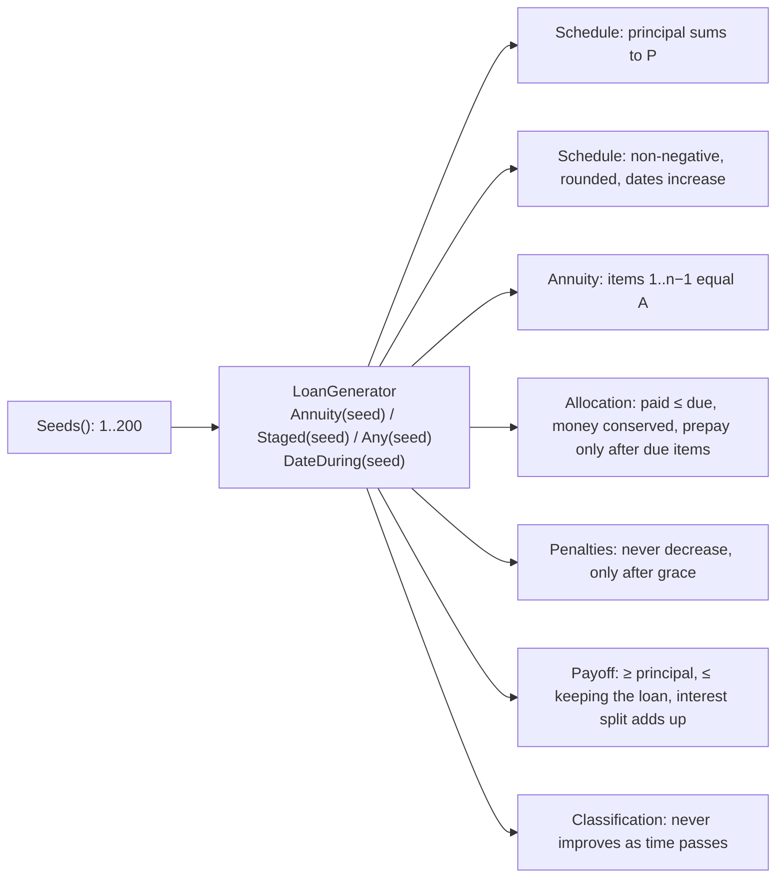

# Slice 3.5: Property-based invariants

Three parts: the big picture (examples prove a few cases, invariants protect all of them), the building blocks (a reproducible loan generator and seven properties), and why. Then tests, what to watch, and questions.

---

## Part 1. The big picture

### 1.1 The goal

Slices 3.1–3.4 pinned exact numbers with hand-calculated examples. Examples are precise, but they only cover the cases someone thought of. An **invariant** is a rule that must hold for *every* loan, whatever the numbers:

- the principal of a schedule sums exactly to the loan;
- a payment never pays more than is due, and no öre is lost;
- paying off early never costs more than keeping the loan.

Checking such rules on hundreds of generated loans finds the edge cases nobody listed: a 31st in a short month, a zero rate, a one-day stage, a 30-year term with a tiny principal.

### 1.2 Why it is hard

- **The inputs must be valid.** A random plan whose shares do not sum to the principal tests only the rejection path. The generator builds plans that are valid by construction.
- **Failures must be reproducible.** A random test that fails once and passes on the rerun is useless. Every case comes from a fixed seed.

---

## Part 2. The building blocks and how they connect



### 2.1 `LoanGenerator` (`tests/.../Support/LoanGenerator.cs`)

- **`Seeds()`** supplies 200 seeds as xUnit `TheoryData`. Each seed is its own test case, so a failure names the seed.
- **`Annuity(seed)`**: a principal of 1,000–10,000,000, a rate of 0–20% (zero in about 1 of 5 cases), a term of 1–360 months, a disbursement date over four years (so every day of the month occurs), and 0–10 grace days.
- **`Staged(seed)`**: 1–4 distinct dates inside a 3–24-month term, with shares in whole kronor and the remainder in the last share, so the plan is always valid.
- **`Any(seed)`** alternates between the two kinds. **`DateDuring(seed, …)`** picks a date from disbursement to 120 days after the last due date, so overdue and post-maturity states occur.

### 2.2 The properties (`tests/.../InvariantTests.cs`)

| Property | What it protects |
| --- | --- |
| Principal sums to P | The last-item rounding rule (3.1) and the share check (3.2) |
| Amounts non-negative, rounded to the öre, dates strictly increasing | Rounding and due date rules |
| Annuity items 1..n−1 all equal A | "Equal installments" |
| Allocation: paid ≤ due per component; allocated + unallocated = payment; later items prepaid only when every due item is paid; money returned only when every item is paid | Waterfall correctness, conservation of money, the prepayment order (ADR 0003 point 5, changed 2026-11-02) |
| Penalties never decrease, and grow only on items past due + grace | Grace boundary, no negative penalty |
| Payoff ≥ outstanding principal; ≤ the sum of everything unpaid; interest to date + minimum + waived = all unpaid interest | The payoff formula's internal consistency |
| Classification at date + 30 is never better than at date (unchanged schedule) | Monotonic days past due |

---

## Part 3. Why it is designed this way

### 3.1 Design choices I made (D2)

| Choice | Why | Rejected |
| --- | --- | --- |
| xUnit theories over seeds | The stage file asks for "property-style tests (xUnit theories)". No new package. | FsCheck or CsCheck: shrinking would be nice, but it is a new dependency for 200 cases that run in one second. |
| Fixed seeds 1..200 | Reproducible, and the seed is in the test name. | `new Random()` without a seed: flaky. |
| Valid-by-construction plans | Invariants test the calculation, not the validation, which the examples already cover. | Random plans plus filtering: most would be rejected. |
| "Payoff ≤ keeping the loan" | It catches a double-counted accrual, which is the most likely payoff bug. | Only "≥ principal" (the stage's minimum): too weak. |

### 3.2 Patterns used

- **Property-based testing**: rules over generated inputs, next to example-based tests.
- **Test oracle by invariant**: no expected numbers needed, only relations between outputs.

---

## 4. What was tested

7 properties × 200 seeds = 1,400 cases, plus the 76 example tests.

```
cd core_banking/bank-lending && dotnet test
Passed!  - Failed: 0, Passed: 1476, Total: 1476, Duration: 1 s - Bank.Lending.UnitTests.dll
```

Mutation check: changing the grace comparison in `Penalties.ForDay` from `<` to `<=` made 3 of the 1,400 invariant cases fail. The penalty example tests catch it as well.

## 5. What to watch later

- The generator covers SEK with 2 minor units only. If a currency with 0 or 3 minor units is ever activated, add it to the generator.

## 6. Check your understanding

1. Which bug would "payoff total ≤ sum of everything unpaid" catch that "payoff total ≥ outstanding principal" would not?
2. Why must the generator build staged plans that are valid by construction?
3. Why is a fixed seed better than a new random seed on every run, even though the latter "tests more"?
