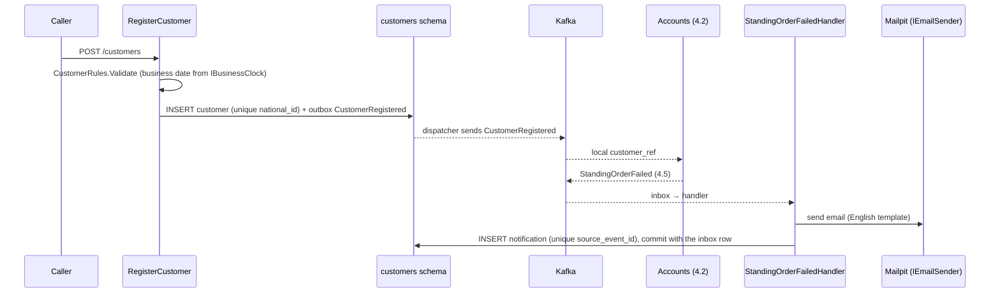

# Slice 4.1: Customers, registration and notifications

Three parts: the big picture (a customer must exist everywhere, and hear from the bank), the building blocks (contracts, the Customers service, its email path, the shared test host), and why it is designed this way. Then tests, what to watch, and questions.

---

## Part 1. The big picture

### 1.1 The goal

Before anyone can hold an account or a loan, the bank must know the person. Customers owns that knowledge. It does three things:

- it **registers** a customer, with a unique national id and contact details;
- it **announces** the customer with `CustomerRegistered`, so Accounts (slice 4.2) and Lending (stage 5) can keep their own copies. They are not allowed to read the `customers` schema;
- it **talks to** the customer. The first message is "your standing order failed" (`StandingOrderFailed` from Accounts, slice 4.5).

The slice also prepares the whole of stage 4 in the shared packages: all six new event contracts, a richer exchange-rate interface, and a shared test host.

### 1.2 Why it is hard

- **A duplicate customer is a real risk.** Two clicks on "register" must not create two people with one national id. The database must decide, not an `if`.
- **Emails cannot be rolled back.** The notification row and the inbox row commit together, but the SMTP send happens outside the transaction. One of "never twice" and "never zero times" must be given up.
- **Every event carries the business date**, so Customers also needs the business-day consumer from slice 2.4.

---

## Part 2. The building blocks and how they connect



### 2.1 The new contracts (`bank-contracts/src/Bank.Contracts/Events`, version 0.3.0)

| Event | Fields (besides EventId, OccurredOn, PerformedBy) | Used in |
| --- | --- | --- |
| `CustomerRegistered` | CustomerId, Name, PreferredLanguage | 4.1 → Accounts, Lending |
| `AccountOpened` | AccountId, AccountNumber (`^[1-9][0-9]{8}$`), CustomerId, AccountType, Currency | 4.2 |
| `MoneyDeposited` / `MoneyWithdrawn` | AccountId, EntryId, Amount, BalanceAfter | 4.2 → Ledger |
| `MoneyTransferred` | TransferId, From/ToAccountId, Amount, ConvertedAmount, FxRate (decimal string), FxSource, StandingOrderId?, Fee? | 4.3, 4.5 → Ledger |
| `StandingOrderFailed` | StandingOrderId, CustomerId, FromAccountId, Amount, RunDate, Reason | 4.5 → Customers |

Notes:

- `CustomerRegistered` carries no national id or contact details. Other services need only the id and a name, so personal data stays where it is owned.
- `FxRate` is a string, because contracts forbid `decimal` (bank-contracts `CLAUDE.md`). `Fee` is always null in phase 1, but exists so that a fee is never a breaking change (design plan: "the event contracts have room for a fee").

### 2.2 `ExchangeRate` and `BankServiceApp` (bank-contracts ADR 0017)

- `IExchangeRateProvider` now returns `ExchangeRate(From, To, Rate, Source, ObservedOn)`, and throws `ExchangeRateUnavailableException` when no rate can be had. It is used in slice 4.3.
- `Bank.Testing.BankServiceApp<TProgram>` generalizes Operations' test host. It runs the real service on a fresh schema, swaps Kafka for an in-memory broker, drops the appsettings files, and offers helpers for events and HTTP.

### 2.3 Pure logic (`bank-customers/src/Bank.Customers.Api/Logic/`)

- **`CustomerRules`**: required fields and their lengths, a well-formed email, a supported language (en default, sv, fa), and a date of birth before the **business** date. Errors come back keyed by field, ready for a 400 validation problem. There is no KYC (design plan section 2).
- **`EmailTemplates.StandingOrderFailed`**: the English email. Amounts are formatted with the invariant culture (`1,500.00 SEK`), so a server set to Swedish does not write `1 500,00`.

### 2.4 Data (`Data/`)

- `customer`, with a unique index on `national_id`;
- `notification`, with a unique `source_event_id`;
- the local `business_day`, and the outbox and inbox.

### 2.5 Features (`Features/`)

- **`RegisterCustomer`**: validate (400) → check the national id (409 `national_id_taken`) → insert → publish `CustomerRegistered` keyed by the customer id. It catches a concurrent duplicate through the unique index, so it still returns 409.
- **`GetCustomer`** and **`UpdateContactDetails`** (PATCH: only email, phone, address and language). `CustomerAccess.IsOtherCustomer` returns 404 when `X-Customer-Id` names someone else.
- **`StandingOrderFailedHandler`** runs these steps: has a notification for this event already been recorded? → load the customer → send the email → record the notification.

### 2.6 Email (`Email/SmtpEmailSender.cs`)

`SmtpEmailSender` sends with `System.Net.Mail` to the host and port parsed from Aspire's `mailpit` connection string (`Endpoint=smtp://host:port`). The sender address comes from `Email:From`, a placeholder. Tests replace it with `InMemoryEmailSender`.

### 2.7 Platform and CI

- The AppHost starts `customers` with its database, Kafka and Mailpit. The platform tests check that it becomes healthy and has migrated its schema.
- `.github/workflows/bank-customers.yml` was added.

---

## Part 3. Why it is designed this way

### 3.1 Decisions made on your delegation (for your review)

- **`ExchangeRate` record and shared test host** (bank-contracts ADR 0017).

### 3.2 Design choices I made (D2)

| Choice | Why | Rejected |
| --- | --- | --- |
| 400 validation problem for malformed input, 409 for a duplicate | Malformed input is not a business rule; a duplicate is a conflict with existing state. | 422 for everything. |
| Unique index plus pre-check for the national id | The pre-check gives the normal answer; the index catches the race. | Only the pre-check: two concurrent requests both pass it. |
| Email before commit (at least once) | A customer missing a warning is worse than receiving it twice. | Sending after commit through an outbox of emails: correct, but a second dispatcher for one email type. |
| No PII beyond the name in `CustomerRegistered` | Data minimization; Accounts only needs to know the customer exists. | The full customer. |
| `Guid.CreateVersion7()` for ids | Time-ordered keys index better than random v4 ids. | `Guid.NewGuid()`. |

### 3.3 Patterns used

- **Data ownership with published facts**: Customers owns the person and announces only what others need.
- **Idempotent consumer with a business key** (`source_event_id`).
- **At-least-once side effects**: the email is sent inside the handler, before the commit.

---

## 4. What was tested

**`Bank.Customers.UnitTests`** (18 tests):

- `CustomerRules`: a valid customer, the default language, supported and unsupported languages, a blank name, malformed emails, a birth date not before the business date, several errors at once, a value that is too long;
- `EmailTemplates`: the content, and the same format in Swedish culture.

**`Bank.Customers.IntegrationTests`** (16 tests):

- **Registration:**
  - registration publishes `CustomerRegistered` with the business date, the actor and the key;
  - the language defaults to English;
  - invalid input gives 400 with the field names;
  - a duplicate national id gives 409;
  - five concurrent registrations give one 201, four 409 and one event.
- **Reading and updating:**
  - GET returns the customer or 404;
  - a call for another customer gets 404;
  - PATCH changes only the fields given;
  - PATCH with a bad email gives 400.
- **Notifications:**
  - `StandingOrderFailed` sends one email and records a notification;
  - the same event twice sends one email;
  - an unknown customer throws and records nothing;
  - Mailpit connection strings are parsed, and malformed ones are rejected.

**Platform:** `customers` becomes healthy and migrates (31 tests in total). **Contracts:** 146 tests, including the six new snapshots.

```
cd core_banking/bank-customers && dotnet test
Passed!  - UnitTests 18, IntegrationTests 16
cd core_banking/bank-platform && dotnet test
Passed!  - 31
```

## 5. What to watch later

- Notifications in other languages (sv, fa) come with phase 2. The language is already stored.
- No email is retried if SMTP is down: the handler throws, the consumer retries four times, then the event goes to the dead-letter topic. Mailpit is local, so this is acceptable for now.

## 6. Check your understanding

1. Why does `RegisterCustomer` both check for an existing national id *and* catch the unique violation?
2. The handler sends the email and then crashes before commit. What happens next, and why is that the chosen trade-off?
3. Why does `CustomerRegistered` not contain the email address?
