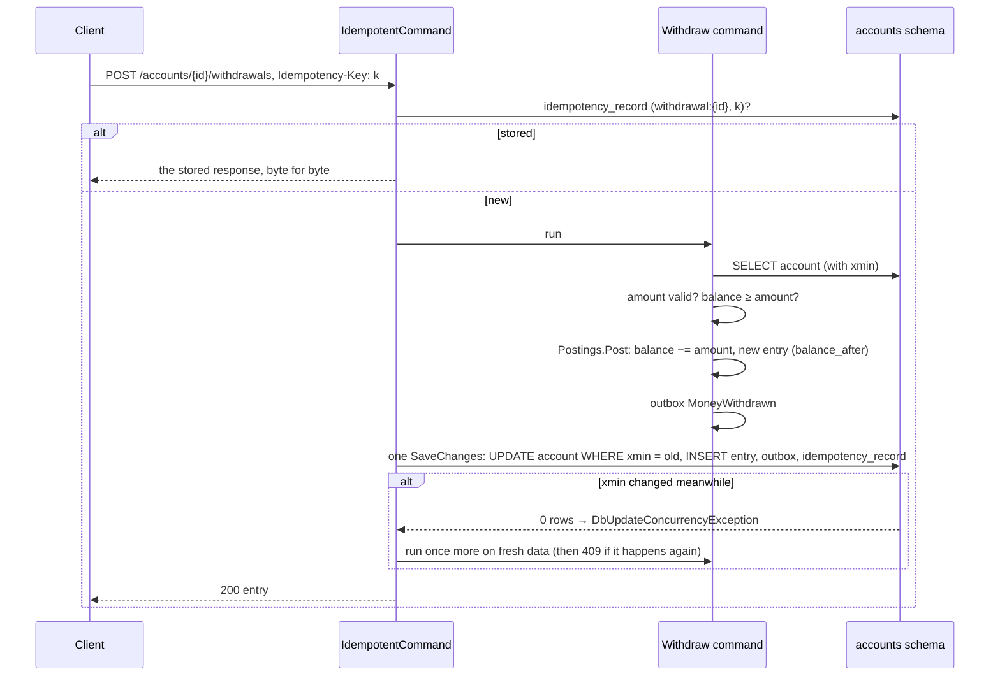

# Slice 4.2: Accounts, reference data, deposits and withdrawals

Three parts: the big picture (money that is never created or lost), the building blocks (the tables, the two protections, the endpoints), and why. Then tests, what to watch, and questions.

---

## Part 1. The big picture

### 1.1 The goal

Accounts holds the customers' money. This slice opens accounts and moves cash in and out. Three promises must hold under every timing:

- **No overdraft** (design plan section 2). A balance never goes below zero, even when two withdrawals arrive at the same moment.
- **No double movement.** A client that retries after a timeout must not deposit twice.
- **Local knowledge only.** Accounts may open an account only for a customer and a currency it knows, and it learns both from events, so with a delay.

### 1.2 Why it is hard

- **Check-then-act races.** "Balance ≥ 80? Then subtract 80" is two steps. Two requests can both see 100, both pass, and leave −60.
- **Retries are normal.** Networks time out after the server committed. The client cannot tell, so it must be able to send the same request again safely.
- **Eventual consistency.** A customer registered a moment ago may not be in `customer_ref` yet.

---

## Part 2. The building blocks and how they connect



### 2.1 Pure logic (`src/Bank.Accounts.Api/Logic/`)

- **`Luhn.CheckDigit` / `Luhn.IsValid`**: the mod-10 check digit. `AccountNumbers.Compose(body)` turns 8 digits (10,000,000–99,999,999, so there is never a leading zero) into a 9-digit number.
- **`AmountScale.Normalize(amount, minorUnits)`** gives every amount exactly the currency's decimals: 250 → 250.00.

### 2.2 Tables (`Data/`)

| Table | Role |
| --- | --- |
| `account` | Number (unique), customer, type, currency, **stored balance** (ADR 0002), `xmin`, `CHECK (balance >= 0)` |
| `account_entry` | Append-only movements: signed amount, `balance_after`, business date, `sequence` for order |
| `idempotency_record` | (operation, key) → body hash, status, response text (ADR 0003) |
| `customer_ref`, `currency_ref` | Local copies from `CustomerRegistered` and `CurrencyActivated` |
| `business_day` | From the business-day consumer (slice 2.4), for `IBusinessClock` |

Amount columns are unconstrained `numeric`, which keeps exactly the scale written (always the currency's minor units).

### 2.3 Reference data (`Features/Reference/ReferenceDataHandlers.cs`)

`CustomerRegisteredHandler` and `CurrencyActivatedHandler` insert a row if it is missing, so a repeated event changes nothing.

### 2.4 Opening accounts (`Features/Accounts/`)

- **`OpenAccount`** (`POST /accounts`) checks, in order:
  - the type (400 `invalid_account_type`);
  - the customer is known (422 `customer_not_found`, ADR 0001);
  - the currency is active (422 `currency_not_active`).

  It then draws a number from `IAccountNumberGenerator` and publishes `AccountOpened`. If the number is taken, the unique index says so and it draws again, up to 5 times.
- **`RandomAccountNumberGenerator`** uses `RandomNumberGenerator`, a cryptographic source, so numbers reveal nothing.
- **`GetAccounts`**: the list per customer, and a single account. Another customer's account gives 404.

### 2.5 Moving money (`Features/Movements/`)

- **`IdempotentCommand.RunAsync`** is the wrapper every money POST goes through (ADR 0003). It holds the key check, the replay, the one retry on a conflict, and the concurrent-key case.
- **`Postings.Post`** is the only code that changes a balance. It updates the balance and appends the entry with `balance_after`. **`Postings.CheckAmount`** rejects amounts that are not positive (400), in the wrong currency (422) or in fractions of an öre (400).
- **`CashMovements`**: deposits and withdrawals, publishing `MoneyDeposited` and `MoneyWithdrawn` with the amount and the new balance. A withdrawal above the balance gives 422 `insufficient_funds`.

### 2.6 Platform and CI

The AppHost starts `accounts`, and the platform tests check health and migration. `.github/workflows/bank-accounts.yml` was added.

---

## Part 3. Why it is designed this way

### 3.1 How the design changed during the slice

The first idempotency test failed: the replayed body had its keys in a different order and amounts with 8 decimals.

- **Key order:** `jsonb` normalizes JSON, which reorders keys. The response is now stored as `text`, so the replay is the same bytes.
- **Decimals:** `numeric(28,8)` returned `250.00000000`. The columns are now unconstrained `numeric`, and `AmountScale` writes exactly the minor units, so the database, the API and the events all say `250.00`.

### 3.2 Decisions made on your delegation (for your review)

- **Reject an unknown customer with 422** (ADR 0001). The alternatives were pending accounts, or waiting inside the request.
- **Stored balance under `xmin`** (ADR 0002). The alternative was computing the balance from entries with a lock.
- **Idempotency records in the same transaction** (ADR 0003). The alternative was a cache, which could lose the key after a crash.

### 3.3 Design choices I made (D2)

| Choice | Why |
| --- | --- |
| Operation in the idempotency key (`deposit:{id}`) | A client can use simple keys without colliding across accounts and actions. |
| Business failures not stored | A retry after a deposit should succeed. |
| `CHECK (balance >= 0)` | Defence in depth: the database refuses an overdraft even if the code had a bug. |
| 400 for malformed amounts, 422 for a currency mismatch | A malformed number is bad input; the wrong currency breaks a business rule. |
| Up to 5 number draws | A collision is about 1 in 90 million per existing account; 5 failures in a row means something else is wrong. |

### 3.4 Patterns used

- **Optimistic concurrency with retry**, on the account's `xmin`.
- **Idempotent receiver** for HTTP: idempotency key plus request fingerprint.
- **Transactional outbox**: the event commits with the movement.
- **Append-only ledger of entries**, with a running `balance_after`.
- **Local read model** for customers and currencies.

---

## 4. What was tested

**`Bank.Accounts.UnitTests`** (21 tests):

- Luhn check digits, including the textbook example and the two values I first got wrong by hand (10000001 → 7, 99999999 → 8);
- valid numbers, typos and swaps;
- composing account numbers;
- `AmountScale`.

**`Bank.Accounts.IntegrationTests`** (24 tests):

- **Accounts:**
  - opening publishes `AccountOpened` with a valid Luhn number;
  - an unknown customer gives 422, then succeeds after `CustomerRegistered`;
  - an inactive currency gives 422;
  - an unknown type gives 400;
  - a taken number is drawn again;
  - accounts are listed per customer and hidden from other customers;
  - reference events are idempotent.
- **Cash movements:**
  - a deposit and a withdrawal with their events;
  - an overdraft gives 422 and changes nothing;
  - the whole balance can be withdrawn.
- **Idempotency:**
  - a repeated key returns the same bytes and moves money once;
  - the same key with another body gives 422;
  - five concurrent requests with one key move money once;
  - a failed withdrawal is not stored, so the key works later.
- **Concurrency:**
  - **two concurrent withdrawals cannot overdraw**, over 10 rounds;
  - ten concurrent deposits all land or get 409, and the balance equals the entries.
- **Rejections:**
  - invalid amounts;
  - a missing key;
  - an unknown account.

**Platform:** 33 tests.

```
cd core_banking/bank-accounts && dotnet test
Passed!  - UnitTests 21, IntegrationTests 24
```

## 5. What to watch later

- Idempotency records grow forever; a retention job is open work.
- Transfers (4.3) touch two accounts in one transaction. Both rows carry `xmin`, so the same retry wrapper applies.

## 6. Check your understanding

1. Walk through two concurrent withdrawals of 80 from a balance of 100. Which request ends with 422, and why does it not end with 409?
2. Why is the idempotency record saved in the same `SaveChangesAsync` as the balance change, and what could go wrong if it were saved right after?
3. What does the `CHECK (balance >= 0)` constraint protect against if the code already checks the balance?
