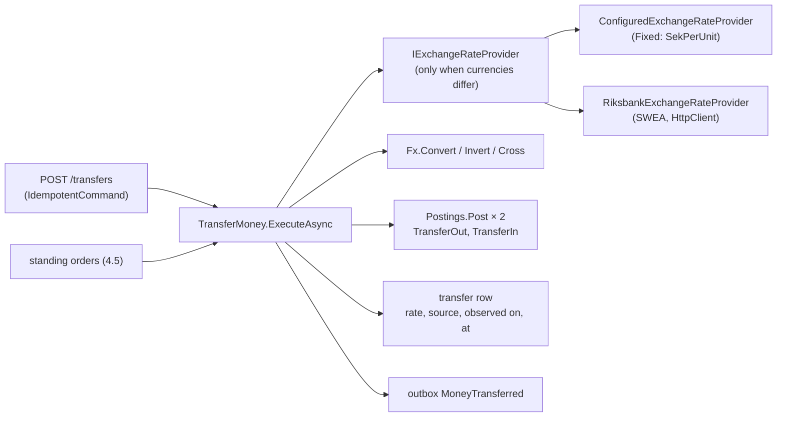

# Slice 4.3: Transfers with currency conversion

Three parts: the big picture (moving money between two accounts, maybe in two currencies), the building blocks (`Fx`, the rate providers, `TransferMoney`), and why. Then tests, what to watch, and questions.

---

## Part 1. The big picture

### 1.1 The goal

A transfer moves money between two accounts in the bank. The design plan allows different currencies with "on-the-spot conversion". The rate, its source and the timestamp are stored on the transaction, and the rate comes from the free Riksbank API (design plan section 2, ADR 20).

### 1.2 Why it is hard

- **Two accounts in one unit of work.** The debit and the credit must both happen or neither, and both rows can be changed concurrently by others.
- **Opposite transfers deadlock.** A → B locks A then B, while B → A locks B then A. PostgreSQL resolves this by aborting one of them.
- **Rates are external and fallible.** The Riksbank can be unreachable, and then the transfer must fail cleanly with `fx_unavailable`, not half-happen.
- **Rounding.** A converted amount must be rounded to the target currency's minor units. A tiny amount can round to zero.

---

## Part 2. The building blocks and how they connect



### 2.1 `Fx` (`Logic/Fx.cs`, pure, tested first)

- `Convert(money, rate, target, minorUnits)` multiplies and rounds AwayFromZero to the target's minor units, using `AmountScale`.
- `Invert(rate)` and `Cross(sekPerFrom, sekPerTo)` derive rates, kept to 10 decimals.

### 2.2 Rate providers (`ExchangeRates/ExchangeRateProviders.cs`)

- **`SekQuotedExchangeRateProvider`**: every rate is built from "SEK per unit" quotes, which is how the Riksbank publishes them. SEK → X is inverted, X → SEK is direct, X → Y is crossed. The observation date is the older of the two quotes.
- **`ConfiguredExchangeRateProvider`** (`Provider = Fixed`, the default) reads `ExchangeRates:SekPerUnit` (EUR 11.50, USD 10.60, from `implementation-decisions.md`).
- **`RiksbankExchangeRateProvider`** (`Provider = Riksbank`) calls `Observations/Latest/SEK{CUR}PMI`. Any HTTP, timeout or JSON failure, or a non-positive value, becomes `ExchangeRateUnavailableException`, which turns into 422 `fx_unavailable`.

### 2.3 `TransferMoney.ExecuteAsync` (`Features/Transfers/TransferMoney.cs`)

The core is shared by the endpoint and by standing orders (slice 4.5). It never saves.

1. Same account → `SameAccount`. Balance too low → `InsufficientFunds`.
2. Different currencies → get the rate, convert, and return `AmountTooSmall` if the result rounds to zero.
3. Store the `transfer` row with the rate, source, observation date and `fx_at`.
4. `Postings.Post` twice: TransferOut on the source, TransferIn on the target.
5. Publish `MoneyTransferred`, keyed by the transfer id. `FxRate` is a string, and `Fee` is null.

### 2.4 The endpoint (`Features/Transfers/TransferEndpoints.cs`)

`POST /transfers` runs inside `IdempotentCommand` (operation `transfer:{fromAccountId}`). The source account must belong to the caller when `X-Customer-Id` is set. The target can be any account in the bank. Each failure maps to its 422 code.

### 2.5 Deadlocks (`Features/Movements/IdempotentCommand.cs`)

A PostgreSQL deadlock (`40P01`) is now handled like a version conflict: one rerun on fresh data, then 409.

---

## Part 3. Why it is designed this way

### 3.1 How the design changed during the slice

**A test infrastructure limit.** With transfers added, the full test run sometimes failed with 500s and `53300: remaining connection slots are reserved`. Each test's service host keeps its own idle connection pool, and the test PostgreSQL had the default 100 connections. `Bank.Testing` 0.3.1 now:

- starts the container with `max_connections=500`;
- clears a host's pool when the host is disposed.

The full suite then passed 3 out of 3 runs. This was not a product bug, but it looked like one (500 instead of 409), which is why the cause was found before moving on.

### 3.2 Design choices I made (D2)

| Choice | Why | Rejected |
| --- | --- | --- |
| Rates from SEK quotes | It is how the Riksbank publishes, and SEK is the base currency. One quote per currency serves every pair. | A table of all pairs. |
| 10 decimals for derived rates | Far more precise than the öre result needs, and stable as a stored value. | Full 28-digit precision: noisy, and a different representation from source to source. |
| Event key = transfer id | The event is about the transfer; Ledger posts one entry per transfer. | The source account id. |
| Fixed provider by default | Development and tests never touch the network (`implementation-decisions.md`). | Riksbank by default. |
| Deadlock = conflict | Both mean "someone else touched the same rows; try again on fresh data". | A 500. |

### 3.3 Patterns used

- **Strategy** (rate providers chosen by configuration) behind an anti-corruption interface (`IExchangeRateProvider`).
- **Template method**: the SEK-quote base class with per-source `QuoteAsync`.
- **Shared domain operation without a repository**: `TransferMoney` takes the `DbContext` and changes entities; the caller owns the transaction.

---

## 4. What was tested

**Unit** (`FxTests`, 9 tests):

- EUR → SEK; SEK → EUR, rounded;
- midpoint AwayFromZero;
- the result has exactly the target's decimals;
- a zero-decimal currency;
- cross and invert;
- non-positive rates.

**Integration** (`TransferTests`, 11 tests):

- **Conversion:**
  - same currency, with no FX fields in the event;
  - EUR → SEK 1,150.00, with the rate, source, observation date and `fx_at` stored and the event carrying `"11.50"`;
  - SEK → EUR 8.70;
  - EUR → USD crossed: 10.85.
- **Failures:**
  - no rate gives `fx_unavailable` and moves nothing;
  - insufficient funds;
  - an amount too small;
  - the same account, an unknown target;
  - another customer's source account gives 404.
- **Safety:**
  - a repeated key transfers once;
  - 20 opposite concurrent transfers keep the total at 2,000.

**`RiksbankProviderTests`** (6 tests, stubbed HTTP):

- the observation becomes the rate and its date;
- inversion;
- crossing, using the older date;
- 404, bad JSON and a zero value all mean no rate.

```
cd core_banking/bank-accounts && dotnet test
Passed!  - UnitTests 30, IntegrationTests 41 (3 full runs in a row)
```

## 5. What to watch later

- **The Riksbank response shape** `{date, value}` is taken from the public documentation. It is not tested against the live API (no network in tests). Check it once before switching `Provider` to `Riksbank`.
- **Ledger (stage 6)** posts the FX entry from `MoneyTransferred` when the currencies differ.

## 6. Check your understanding

1. Why can two transfers in opposite directions deadlock, and why is rerunning the command a correct reaction?
2. 0.01 SEK to EUR is rejected with `amount_too_small`. What would happen to the money without that check?
3. Why does the provider return the *older* observation date when it crosses two quotes?
