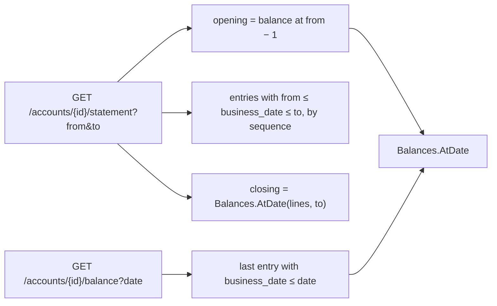

# Slice 4.4: Statements and balance at a date

Three parts: the big picture (history from entries), the building blocks (`Balances.AtDate`, two read endpoints), and why. Then tests, what to watch, and questions.

---

## Part 1. The big picture

### 1.1 The goal

Customers and auditors ask two questions about the past:

- **What happened between two dates?** That is a statement: the opening balance, each movement with the balance after it, and the closing balance.
- **What was the balance at the end of a given business day?**

The design plan says both are derived from the transaction table, using the balance after each entry, without a second "balance history" table (section 2).

### 1.2 Why it is hard

- **Several entries can share one business date**, so "the balance at the end of the date" means the balance after the *last* entry of that date. The order is the entry's `sequence`, not its timestamp.
- **Days without entries** must still answer, with the balance carried over from before.
- **Business dates, not calendar time.** A deposit on business date D belongs to D even if the clock already shows the next morning.

---

## Part 2. The building blocks and how they connect



### 2.1 `Balances.AtDate` (`Logic/Balances.cs`)

`Balances.AtDate` takes `BalancePoint(BusinessDate, Sequence, BalanceAfter)` items and returns the balance after the entry with the highest sequence whose business date is on or before the date, or 0 when there is none. It is pure, and it is the single definition of "balance at a date".

### 2.2 `Statements` (`Features/Accounts/Statements.cs`)

- **`GET /accounts/{id}/statement?from=&to=`**:
  - **opening balance**: the balance at `from − 1`;
  - **lines**: every entry in the period, by sequence, with kind, signed amount, balance after, description and reference (for example a transfer id);
  - **closing balance**: the balance at `to`.

  `from > to` gives 400 `invalid_period`.
- **`GET /accounts/{id}/balance?date=`**: a date after the current business date gives 400 `date_in_future`.
- Both load only what they need. The balance at a date reads one entry, the last one on or before the date, and passes it to `Balances.AtDate`.
- Another customer's account gives 404.

---

## Part 3. Why it is designed this way

### 3.1 Design choices I made (D2)

| Choice | Why | Rejected |
| --- | --- | --- |
| Order by `sequence` | An identity column gives the true posting order, even inside one business date. | `created_at`: two entries in one transaction share a timestamp. |
| Load only the last entry for a balance | One indexed row instead of the whole history. | Summing all entries on every call. |
| Reject future dates | A balance "at the end of" a day that has not happened is a guess. | Answering with today's balance. |
| Show the reference on each line | The customer can match a line with its transfer. | Only the description. |

The unit tests and `Balances.AtDate` were written in the same step this time, not as a separate red step first. The tests define the behaviour, and every case passed on the first run.

### 3.2 Patterns used

- **Derived read model from an append-only log**: the entries are the truth, and statements are queries over them.
- **Running balance** (`balance_after`): reading history needs no aggregation.

---

## 4. What was tested

**Unit** (`BalancesTests`, 6 tests):

- before the first entry: 0;
- a day with several entries: the last one;
- a day without entries: the previous balance;
- after the last entry: the latest balance;
- entries given in any order: the sequence decides;
- no entries: 0.

**Integration** (`StatementTests`, 8 tests, over three business days):

- the statement for days 2–3: opening 1,000, lines −200 → 800 and +50 → 850, closing 850;
- an empty period: opening equals closing;
- the balance at four dates: 0, 1,000, 850, 850;
- the closing balance equals the account balance, and opening plus lines equals closing;
- an invalid period, a future date, and another customer are rejected.

```
cd core_banking/bank-accounts && dotnet test
Passed!  - UnitTests 36, IntegrationTests 49
```

## 5. What to watch later

- Stage 7's import compares each account balance with its statement sum. `The_statement_closing_balance_matches_the_account_balance` is the same check in small.

## 6. Check your understanding

1. Two entries are posted on the same business date. Why does the balance at that date use the sequence and not the timestamp?
2. What is the opening balance of a statement that starts on the account's first business day?
3. Why is the balance at a date read from one entry instead of summing all entries?
