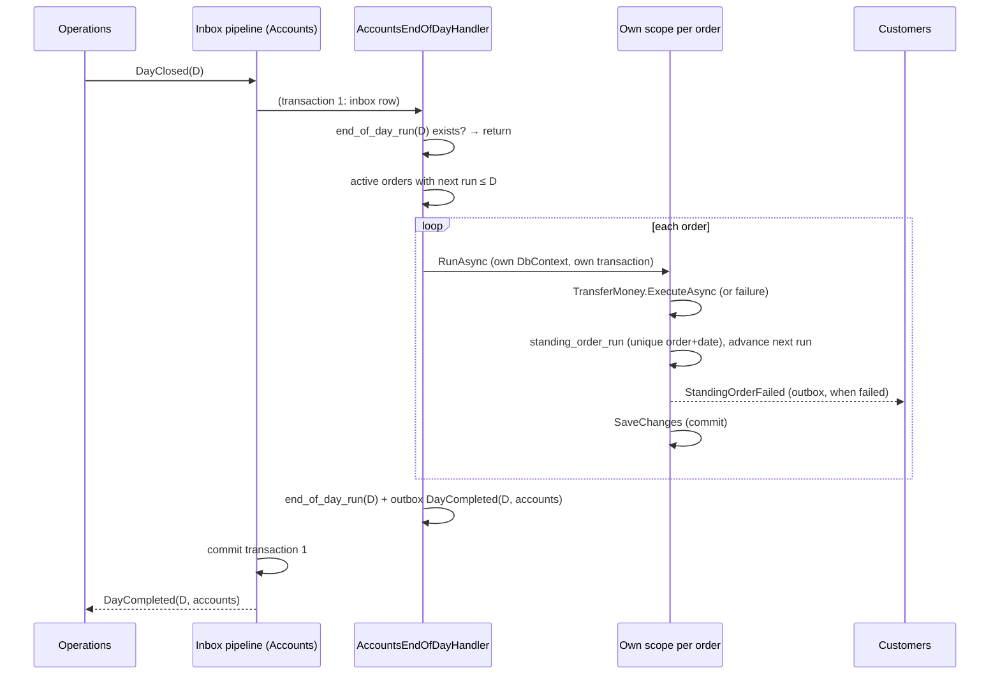

# Slice 4.5: Standing orders at end of day

Three parts: the big picture (Accounts joins the end-of-day cycle), the building blocks (the schedule rule, the order endpoints, the end-of-day handler), and why. Then tests, what to watch, and questions.

---

## Part 1. The big picture

### 1.1 The goal

A standing order is a recurring transfer: "move 300 SEK to my savings every month". The design plan's rules (section 2):

- an order can be **created without enough money**;
- at execution the **full balance** is required;
- if it is missing, that run is recorded as **failed**, the customer is **notified**, and there is **no retry**.

Runs happen during the end of day. On `DayClosed(D)`, Accounts runs the orders due on D and then tells Operations `DayCompleted(D, "accounts")`. That makes Accounts the first real participant in the cycle built in stage 2.

### 1.2 Why it is hard

- **The calendar.** An order on the 31st must run on the last day of shorter months, then return to the 31st (`implementation-decisions.md`).
- **One bad order must not stop the others.** Each order needs its own transaction, but the `DayCompleted` must still be sent exactly once, after all of them.
- **Replays.** Kafka can redeliver `DayClosed`, and a different message can carry the same date. Nothing may run twice, and `DayCompleted` must not be sent twice.

---

## Part 2. The building blocks and how they connect



### 2.1 `StandingOrders.NextRunDate` (`Logic/StandingOrders.cs`)

Run *n* = start + *n* weeks, + *n* months, or + 3*n* months, always counted from the **start date**. `NextRunDate(schedule, after)` returns the first run after `after`, or null if that run falls after the end date. `DateOnly.AddMonths` clamps to the month's last day, so counting from the start returns to the 31st after February.

### 2.2 The order endpoints (`Features/StandingOrders/StandingOrderEndpoints.cs`)

- **`POST /standing-orders`**:
  - frequency: Weekly, Monthly or Quarterly;
  - dates: start ≥ today's business date, end ≥ start;
  - the source account must be owned by the caller, and the amount in its currency;
  - the target account must exist and must not be the source.

  There is no balance check, by design. The next run is the start date.
- **`GET /standing-orders/{id}`**, and **`DELETE`**, which sets Cancelled and clears the next run.

### 2.3 `AccountsEndOfDayHandler` (`Features/EndOfDay/AccountsEndOfDayHandler.cs`)

1. If `end_of_day_run` already has D, return. That covers a new message id for the same date.
2. Select the active orders due on or before D.
3. For each order, `RunAsync` runs in a **new scope**, with its own `DbContext` and transaction:
   - an existing `standing_order_run` for the date means only advance;
   - otherwise `TransferMoney.ExecuteAsync` (slice 4.3) runs with `StandingOrderId`, and the run is recorded as Succeeded or Failed with a reason;
   - a failure publishes `StandingOrderFailed` (Customers emails the customer, slice 4.1);
   - the next run advances, and the order becomes Completed after its end date;
   - an `xmin` conflict, for example a concurrent withdrawal from the same account, reruns the order once.
4. Insert `end_of_day_run(D)` and publish `DayCompleted(D, "accounts")`. The pipeline commits both with the inbox row.

---

## Part 3. Why it is designed this way

### 3.1 Design choices I made (D2)

| Choice | Why | Rejected |
| --- | --- | --- |
| A scope and transaction per order | The stage file asks for it; one failing order cannot roll back the others. | One transaction for the whole day. |
| `standing_order_run` unique per (order, date) **and** an advanced next run | Two independent guards against a second run of the same date. | Only the next run date. |
| `end_of_day_run` per date | `DayCompleted` once per date, even for a new `DayClosed` message. Operations would ignore a duplicate, but each service should keep its own promise. | Relying on Operations. |
| Catch up with a loop (`while next ≤ D`) | If a date was ever skipped, every missed run is recorded once instead of being lost. | Running only when next = D. |
| FX failures also count as failed runs | "No retry" applies to every reason; the reason is recorded. | Retrying `fx_unavailable` the next day. |

### 3.2 How it connects to earlier stages

- Operations (stage 2) already lists `accounts` as a participant, so a close now completes once Lending also replies (stage 5).
- Customers (slice 4.1) turns `StandingOrderFailed` into an email.
- `TransferMoney` (slice 4.3) is reused unchanged.

### 3.3 Patterns used

- **Choreographed end of day** (design plan ADR 15).
- **Idempotent batch job**: per-item business keys plus a per-date marker.
- **Unit of work per item**: a failure is isolated.

---

## 4. What was tested

**Unit** (`StandingOrdersTests`, 16 tests):

- weekly runs;
- monthly runs, including the year end;
- the 31st in 2026 and in the leap year 2028;
- quarterly runs;
- before the start date;
- after and on the end date;
- the first run.

**Integration** (`StandingOrderTests`, 11 tests):

- **Running:**
  - an order can be created without money;
  - the due order runs, advances one month, publishes `MoneyTransferred` with the order id and `DayCompleted(accounts)`;
  - insufficient funds give a failed run, `StandingOrderFailed` with every field, the next run plus 7 days, no money moved, and the day still completes;
  - the same `DayClosed` twice, and the same date under a new id, run once and complete once;
  - a day without orders still completes.
- **Lifecycle:**
  - orders not yet due and cancelled orders do not run;
  - an order past its end date completes;
  - three orders on one day succeed or fail independently.
- **Rejections:**
  - invalid frequency and dates;
  - another customer's order is hidden.

```
cd core_banking/bank-accounts && dotnet test
Passed!  - UnitTests 52, IntegrationTests 60
```

## Review changes (2026-10-31)

- **Catch-up wording:** the stage file says "next run date = D". The handler runs every order with next run ≤ D and books it on D. Normally that is the same thing; it only differs if a date was ever skipped, and then nothing is lost.
- **A stuck order:** an order that still fails after its one rerun (a conflict or deadlock twice) is recorded as a failed run with reason `technical_error`, published as `StandingOrderFailed`, and the day goes on. Otherwise one order could block `DayCompleted` for the whole bank. Customers' email now explains each reason.
- **Idempotency:** `POST /standing-orders` now takes an Idempotency-Key, and a stored answer is never replayed to another customer.

## 5. What to watch later

- The whole cycle across Operations, Accounts and Customers through real Kafka is tested end to end in stage 8.
- Many due orders on one day run one after another. That is fine for 100 customers, but a large bank would batch them.

## 6. Check your understanding

1. Why does each order run in its own scope instead of inside the handler's transaction?
2. A `DayClosed(D)` with a new message id arrives after D was completed. Which guard stops a second run, and which stops a second `DayCompleted`?
3. A monthly order starts on 31 January. List its next three run dates and explain why the third is not the 28th.
