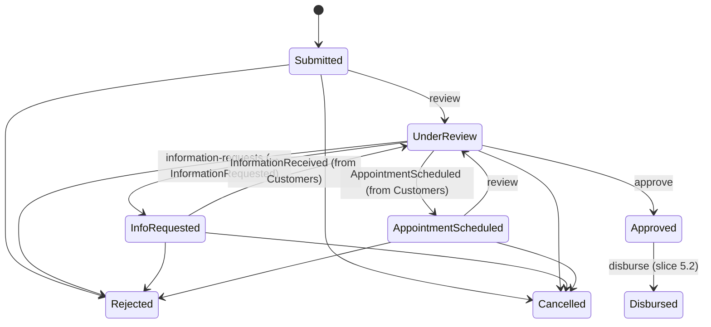

# Slice 5.1: Contracts, products and loan applications

Three parts: the big picture (a loan starts as an application that moves through a review), the building blocks (15 contracts, the Lending service, the state machine, the endpoints), and why. Then tests, what to watch, and questions.

---

## Part 1. The big picture

### 1.1 The goal

Stage 3 built the loan calculations. Stage 5 turns them into a running service. Everything starts with an **application**: a customer asks for an amount and a term on a product, and the bank reviews it. The review can ask for more information, book an in-person appointment, and end in approval, rejection or cancellation. The system never decides approval (design plan section 2). Staff or, in phase 2, the agent make the calls.

### 1.2 Why it is hard

- **Illegal steps.** Approving without review or reviewing a cancelled application must be impossible, from API calls and from events alike.
- **Several services take part.** Customers holds documents and appointments (slice 5.6) and Lending holds statuses, so they speak through events, which can arrive late.
- **The input must fit the product.** The amount, term, repayment account and, for staged loans, a stage plan that the stage 3 logic accepts.

---

## Part 2. The building blocks and how they connect

### 2.1 Contracts (`bank-contracts` 0.4.0)

All 15 stage 5 events were added at once, generated from one table: applications (`LoanApplicationSubmitted`, `LoanApplicationStatusChanged`, `InformationRequested`, `InformationReceived`, `AppointmentScheduled`), money (`LoanDisbursed`, `InstallmentDue`, `PaymentCollected`, `PaymentFailed`, `CardPaymentCaptured`, `LoanPaymentAllocated`, `LoanPayoffRequested`, `LoanPaidOffEarly`) and reporting (`PenaltyAccrued`, `LoanClassificationChanged`). Two design notes:

- `InstallmentDue`, `PaymentCollected` and `PaymentFailed` carry a **`CollectionId`**, the business key against double debits (ADR 0005, slice 5.4).
- Lists are sent as text (`RequestedItems`, one item per line), because the schema generator supports no nested records.

### 2.2 The service (`core_banking/bank-lending`)

The stage 3 folder became a full service:

- **Data:** `LendingDbContext`, with every stage 5 table in one migration:
  - products (seeded CAR, MORTGAGE and PURCHASE, from `implementation-decisions.md`);
  - applications and their status history;
  - loans and schedule items;
  - payments;
  - the local copies `customer_ref`, `account_ref` and `currency_ref`;
  - the run markers.
- **Messaging:** the business-day consumer, and Kafka subscriptions to operations, customers, accounts and cards.
- **Platform:** the AppHost entry, platform tests and CI.

### 2.3 `ApplicationStateMachine` (`Logic/`, ADR 0004)

`ApplicationStateMachine` is a dictionary `(status, action) → status`. `Apply` returns the new status or `invalid_transition`.

### 2.4 `Transitions.ApplyAsync` (`Features/Applications/Transitions.cs`)

This is the only code that changes a status: it asks the state machine, appends the history row and publishes `LoanApplicationStatusChanged`.

### 2.5 Endpoints (`Features/Applications/ApplicationEndpoints.cs`)

- `GET /loan-products`.
- `POST /loan-applications` checks the product, the customer (`customer_ref`), the repayment account (the customer's own, in the product currency; `account_ref`), the amount and term ranges, the purpose, and for staged products the plan, through `Amortization.BuildStaged`. It publishes `LoanApplicationSubmitted`.
- `GET /loan-applications/{id}` returns the application with its history.
- `review`, `information-requests` (which publishes `InformationRequested`), `approve`, `reject` and `cancel` all go through `Transitions`. An illegal step gives 409, a review action by a customer gives 403, and another customer's application gives 404.

### 2.6 Handlers

- `CustomerRegistered`, `AccountOpened` and `CurrencyActivated` fill the local copies.
- `InformationReceived` and `AppointmentScheduled` move the status, or log and ignore an illegal step.

---

## Part 3. Why it is designed this way

### 3.1 How the design changed during the slice

Cancel and reject seemed to work (200), but the status stayed Submitted. This is a classic EF Core trap. A new history row with its Guid id already set, added through `application.History`, looked like an *existing* row, so EF issued an UPDATE that matched nothing. `ValueGeneratedNever()` on that id makes EF insert it.

### 3.2 Decisions made on your delegation (for your review)

- **Transition table in `Logic/`** (ADR 0004). The alternatives were the Stateless library or checks in each endpoint.
- **Collection id as the business key** (ADR 0005, written in slice 5.4).

### 3.3 Design choices I made (D2)

| Choice | Why |
| --- | --- |
| The repayment account is chosen at application time | The loan currency must equal the account currency (design plan section 2), and the account can be checked up front. |
| Stage plans are checked against today as a provisional disbursement date | The real check runs again at disbursement. |
| Late events for a moved-on application are ignored | The fact is true, but it no longer applies; a DLT entry would only be noise. |
| 403 for review actions by customers | A customer must not approve their own loan. |

### 3.4 Patterns used

- **State machine as data**, with **a single writer** for statuses.
- **Choreography** with Customers.
- **Local read models** for customers, accounts and currencies.

---

## 4. What was tested

- **Unit** (`ApplicationStateMachineTests`): all 15 allowed transitions, all 57 rejected pairs, the final statuses, and that the rejected set covers every other pair. The unit project now holds 1,567 tests, including stage 3's.
- **Integration** (`ApplicationTests`, 20 tests):
  - **submitting:** the products are listed; a submission creates history and publishes its event;
  - **validation:** six cases outside the product; a valid and an invalid stage plan; a stage plan on an annuity product; the repayment account rules;
  - **the full review path:** information requested and received, an appointment, review again, approve, with the history and six status events;
  - **reject and cancel:** with a reason;
  - **illegal steps:** they give 409; an approved application cannot go back;
  - **a late appointment** for a cancelled application is ignored;
  - **customer calls:** a customer can cancel but not review, and cannot see another customer's application.
- **Platform:** `lending` becomes healthy with its 3 products (35 tests).

## 5. What to watch later

- Disbursement (5.2) uses `Transitions` for Approved → Disbursed.

## 6. Check your understanding

1. Why does the state machine live in `Logic/` and not in the endpoints?
2. Why does an `AppointmentScheduled` for a cancelled application get ignored instead of thrown?
3. What did EF do wrong with the new history row, and why does `ValueGeneratedNever()` fix it?
