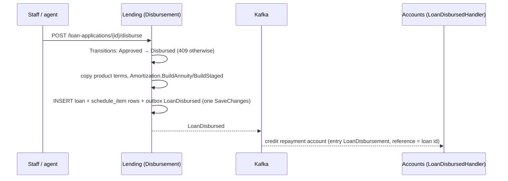

# Slice 5.2: Disbursement and the schedule

## Part 1. The big picture

An approved application becomes a **loan** when the bank pays the money out. Three things must happen together:

- the loan exists, with a copy of its product's parameters, so later product changes do not touch it (design plan section 2);
- its schedule is built by the stage 3 logic;
- the customer's account is credited.

Accounts owns the account, so the credit travels as `LoanDisbursed`. The hard part is that a disbursement must happen **once**, both in Lending and in Accounts.

## Part 2. The building blocks and how they connect



- **`Features/Loans/Disbursement.cs`** (Lending): staff only. It runs the state machine, builds the schedule with the business date as the disbursement date (a staged plan is checked again here), stores the loan and its items, links the application to the loan, and publishes `LoanDisbursed`. A concurrent second disburse fails on the application's `xmin` or on the unique `loan.application_id`, and gets 409.
- **`Features/Loans/LoanResponse.cs`, `LoanQueries`** (Lending): `GET /loans?customerId=` and `GET /loans/{id}` return the loan with its schedule, outstanding principal, overdue amount (unpaid items due before today) and days past due (`Classification.DaysPastDue`).
- **`ScheduleItemRow.ToLogic` / `Apply`** map between the stored row and the stage 3 `ScheduleItem`. The logic stays pure.
- **`Features/Loans/LoanDisbursedHandler.cs`** (Accounts): credits the repayment account through `Postings.Post` (entry kind `LoanDisbursement`, reference = loan id). It publishes **no** `MoneyDeposited`, because Ledger posts the loan from `LoanDisbursed`, and a deposit event would count it twice. It is idempotent: one disbursement entry per loan.

## Part 3. Why it is designed this way

| Choice (D2) | Why |
| --- | --- |
| The schedule is built at disbursement, with the business date as `DisbursedOn` | Due dates count from disbursement (stage 3, ADR 0003). |
| The stage plan is checked again at disbursement | A stage date accepted at submission may have passed by now. |
| No event from Accounts for the credit | One fact, one journal entry: Ledger uses `LoanDisbursed`. |
| The disbursement entry is booked on the event's business date | It belongs to the day the loan was paid out. |

Patterns: copy-on-write terms (an immutable snapshot of product parameters), choreography, idempotent consumer with a business key (entry reference + kind).

## 4. What was tested

- **Lending (`DisbursementTests`, 5 tests):**
  - a CAR loan with 36 items, the first one matching stage 3, and `LoanDisbursed`, with the application now Disbursed and linked;
  - a PURCHASE loan with 3 stages (first interest 1,886.30);
  - a second disburse gives 409 and still one loan;
  - only an Approved application can be disbursed, and not by a customer;
  - loans are listed per customer, and other customers get 404.
- **Accounts (`LoanDisbursedTests`):** the account is credited once (also for the same fact under a new id), the statement shows a `LoanDisbursement` line, and no `MoneyDeposited` is published.

```
bank-lending: IntegrationTests 25 passed; bank-accounts: IntegrationTests 64 passed
```

## 5. Check your understanding

1. Why does Accounts not publish `MoneyDeposited` when it credits a loan?
2. What two things stop a loan from being created twice for one application?
