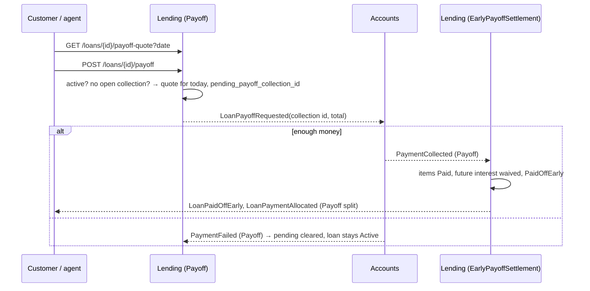

# Slice 5.5: Early payoff

## Part 1. The big picture

A customer may close a loan early. They pay the outstanding principal, the interest earned so far, any unpaid penalty, and a **minimum interest** (1% of the principal, capped per product). The rest of the future interest is waived (design plan section 2, stage 3 `EarlyPayoff.Quote`). The money is in Accounts and the loan in Lending, so the payoff is a request and an answer, like an installment. If the account is short, the loan stays Active.

The hard part: the payoff must not overlap with an installment collection, or the same money is taken twice.

## Part 2. The building blocks and how they connect



- **`Features/Loans/Payoff.cs`**:
  - `GET /loans/{id}/payoff-quote?date=`: today or later; a closed loan gives 409.
  - `POST /loans/{id}/payoff`: 409 `collection_pending` while a payoff **or any installment collection** is open. Otherwise it quotes for today, opens the payoff collection and publishes `LoanPayoffRequested`. It answers 202 Accepted, because the money moves later.
- **`Features/Payments/EarlyPayoffSettlement.cs`**: every unpaid item gets principal and penalty paid, and its unpaid interest is written down (waived). The interest actually collected (to date plus the minimum) is booked on the next item, so the schedule adds up. The loan becomes PaidOffEarly. It publishes `LoanPaymentAllocated` (Payoff: principal, interest, penalty) and `LoanPaidOffEarly` with the waived amount.
- **Accounts** (slice 5.4): `LoanPayoffRequested` debits the whole amount or fails.

## Part 3. Why it is designed this way

| Choice (D2) | Why |
| --- | --- |
| No payoff while an installment collection is open | Both could succeed and take the same money (ADR 0005's rule, applied to payoffs). |
| 202 Accepted | The request is accepted; the result arrives as events. |
| Interest = collected − principal − penalty at settlement | If a day passed between request and answer, the ledger books what was really paid. |
| Waived interest written down on the items | The schedule shows what was owed and paid; nothing remains unpaid. |

## 4. What was tested

`PayoffTests` (5 tests, with the fake Accounts):

- the quote equals the stage 3 hand calculation (197,514.49; waived 18,465.20);
- with enough money:
  - the debit is 197,514.49;
  - the loan is PaidOffEarly, every item is Paid, and the outstanding principal is 0;
  - `LoanPaidOffEarly` carries the waived amount;
  - the Payoff split is 194,987.48 principal, 2,527.01 interest and 0 penalty;
- with too little money: the loan stays Active, the pending payoff is cleared, and a new request is accepted;
- a second payoff while one is pending gives 409 `collection_pending`;
- a quote for a past date gives 400.

```
bank-lending IntegrationTests 36 passed
```

## 5. Check your understanding

1. Why is a payoff refused while an installment collection is open?
2. Where does the waived interest go in the schedule, and why does the interest the customer paid get booked on the next item?

## Review changes (2026-10-31)

- **The settlement uses the quote stored at request time** (`loan.payoff_principal`, `payoff_penalty`, `payoff_interest`, `payoff_waived`). If the collected amount differs, it throws. Before this fix, a re-quote at settlement time could move money between penalty and interest, and even make the interest negative, if an end of day ran in between.
- **No penalties while a payoff is pending.**
- **End of day writes `loan.last_end_of_day` every day.** A payoff request (which writes the loan row too) and an end-of-day installment request therefore conflict on `xmin`, and can never both be open.
- **A collection for a loan that is no longer Active throws**, so it is never booked as silently unallocated money.
