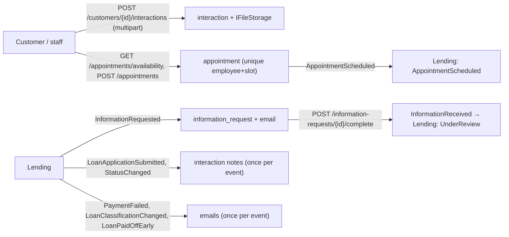

# Slice 5.6: Documents, information requests and appointments in Customers

## Part 1. The big picture

Lending decides statuses, but the evidence for a review lives with the customer:

- the documents they upload, the emails they send, and the bank's notes, all in one **interaction store**;
- the **information requests** the reviewer sends;
- the **in-person appointments** during review.

Customers owns all of this (design plan section 2). It also turns Lending's events into emails and history notes. The hard parts are:

- **no double booking**, because an employee has one appointment per slot;
- slots in **Stockholm time**, across daylight saving;
- uploaded files that are stored safely behind an interface.

## Part 2. The building blocks and how they connect



- **`Logic/AppointmentSlots.cs`** (pure, tested): the starts 09:00–15:00 Europe/Stockholm, `IsSlot`, and the local date. The time zone handles daylight saving.
- **`Logic/EmailTemplates.cs`**: four new English templates (information requested, payment failed, late-loan warning, paid off early).
- **`Data/ReviewEntities.cs`**:
  - `employee`, seeded E001–E005;
  - `interaction`, with a unique `source_event_id` for event notes;
  - `information_request`, whose id is the one Lending chose;
  - `appointment`, with a partial unique index on (employee, starts_at) where status is Scheduled, so cancelling frees the slot.
- **`Files/LocalFileStorage.cs`**: `IFileStorage` on a folder (`Files:Root`, gitignored `.data/`). Paths cannot leave the root, and the stored name is the interaction id, never the customer's file name. S3 comes in stage 8.
- **`Features/Interactions/InteractionEndpoints.cs`**:
  - multipart upload, email reply or note (files at most 10 MB);
  - the list, and a download of the file;
  - information requests by application, and completing one, which publishes `InformationReceived` once.
- **`Features/Appointments/AppointmentEndpoints.cs`**: availability (free employee/slot pairs on a day after the business date), booking (409 `slot_taken`, publishes `AppointmentScheduled`) and cancelling.
- **`Features/Notifications/LendingEventHandlers.cs` and `Notifier.cs`**: one email or one history note per event.

## Part 3. Why it is designed this way

| Choice (D2) | Why |
| --- | --- |
| A partial unique index for appointments | The database refuses a double booking even under concurrency; a cancelled booking does not block the slot. |
| No email when a loan returns to Current | The design plan calls this email a warning. |
| The stored file key is ours, the file name only metadata | A file name like `../../x` can never become a path. |
| An information request has no due date | No rule for one exists in the design plan; it is left open rather than invented. |
| UTC bounds in queries | Npgsql writes only UTC to `timestamptz`; the first availability test failed with a 500 until the bounds were converted. |

Patterns: interaction log; idempotent notifications by event id; database-enforced invariant for bookings; storage behind an interface.

## 4. What was tested

- **Unit** (34 tests): slots in winter, in summer and on the day the clocks change; `IsSlot`; the local date; the four new templates.
- **Integration** (`ReviewSupportTests`, 7 tests):
  - **interactions:** an upload is stored and downloaded byte for byte; a note without text and an unknown kind are rejected; application events are recorded once in the history;
  - **information requests:** an `InformationRequested` creates a request and an email, and completing it twice publishes `InformationReceived` once;
  - **emails:** a failed payment, a late loan and a payoff send one email each, and a return to Current sends none;
  - **appointments:** 35 free slots; booking; a double booking gives 409; cancelling frees the slot; invalid slots are rejected.

```
bank-customers: UnitTests 34, IntegrationTests 23 passed
```

## 5. Check your understanding

1. Why is the appointment index *partial* (`WHERE status = 'Scheduled'`)?
2. Why does the upload store the file under the interaction id instead of the customer's file name?
