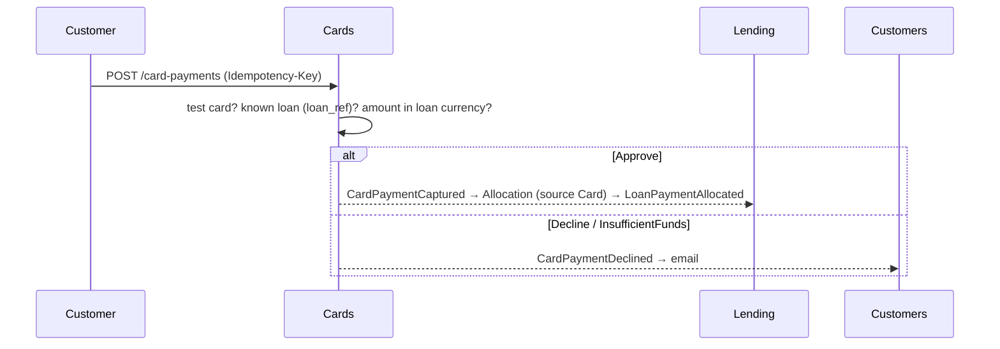

# Slice 6.1: Cards

## Part 1. The big picture

Besides automatic collection from the account, a customer can pay an installment **manually with a card** (design plan section 2). There is no real payment gateway in phase 1. Instead, three test cards have fixed behaviour: always approve, always decline, and insufficient funds. They let every path be tested without real money. Cards owns the card side and publishes the result. Lending (already, since stage 5) allocates a captured payment, and Customers emails a declined one.

## Part 2. The building blocks and how they connect

- **`bank-contracts`**: the new event `CardPaymentDeclined` (0.5.0).
- **`bank-cards`** (new service):
  - `Logic/CardDecision`: behaviour → outcome, number normalization and masking (pure, tested);
  - `Data/CardsDbContext`: `test_card` (seeded), `card_payment` (unique idempotency key), `loan_ref` from `LoanDisbursed`;
  - `Features/CardPayments`: the endpoint, which stores the payment and publishes the result through the outbox;
  - the AppHost entry, platform tests and CI.
- **Customers**: `CardPaymentDeclinedHandler` with an English email that names the reason.
- **Lending**: already allocates `CardPaymentCaptured`. New tests show it pays an overdue item with source Card and never prepays a future item (that money is kept as unallocated and logged).

## Part 3. Why it is designed this way

| Choice (D2) | Why |
| --- | --- |
| Cards keeps a `loan_ref` | A payment for an unknown loan is refused up front (422) instead of failing later in Lending's handler. |
| The idempotency key is a unique column on `card_payment` | One table is enough; it is simpler than Accounts' generic record because Cards has one money endpoint. |
| 200 for both captured and declined | The request was processed; a decline is a normal answer from the card network, not an API error. |
| Numbers masked in responses | Even test card numbers are treated like card data. |

## 4. What was tested

- **Unit** (7 tests): the three outcomes, normalization, masking.
- **Cards integration** (6 tests):
  - Approve captures and publishes `CardPaymentCaptured`;
  - Decline and InsufficientFunds publish `CardPaymentDeclined` with their reason and the customer;
  - an unknown card and an unknown loan give 422;
  - a repeated key returns the same payment and captures once, and another body gives 422;
  - another customer's loan, and a wrong currency or decimals, are rejected.
- **Customers:** a declined card sends one email naming the reason.
- **Lending** (2 new tests): a card payment pays an overdue installment with source Card; one for a future installment prepays it (changed on 2026-11-02 to follow the stage 3 prepayment rule, ADR bank-lending 0003 point 5; before, it was returned as unallocated).
- **Platform:** `cards` becomes healthy with its 3 test cards (37 tests).

## 5. Check your understanding

1. Why does Cards check the loan itself instead of letting Lending reject an unknown loan?
2. A card payment names installment 2, which is not due yet. What happens to the money, and why?
