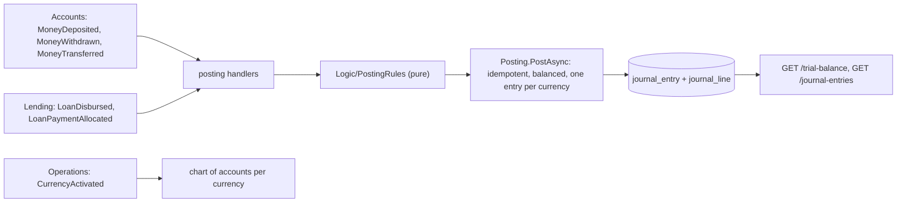

# Slices 6.2 and 6.3: The ledger, posting rules, handlers and trial balance

## Part 1. The big picture

Every financial fact in the bank must also appear in the books. A deposit raises the bank's cash and its debt to the customer. A loan payment lowers the receivable and raises income. Double-entry bookkeeping records each fact as debits and credits that **balance**, per currency. The design plan (section 2) says the ledger is posted **only from events**, per currency, on a **cash basis**: interest and penalties count as income when they are collected, so waived interest is never booked. The **trial balance**, the sum of all debits and credits, must therefore always be zero.

The hard parts:

- an event must post **once**, even if it arrives twice;
- a cross-currency transfer touches two currencies, so it needs two balanced entries;
- the rules must be checkable against the design plan's table.

## Part 2. The building blocks and how they connect

- **`Logic/PostingRules.cs`** (pure, tested first):
  - `GlCode` and the chart, the seven accounts of the stage file;
  - one function per event, returning `JournalDraft`s (ADR 0001);
  - `IsBalanced`;
  - `TrialBalance.From` (debits and credits per account, with the balance on the account's normal side).
- **`Data/LedgerDbContext.cs`**:
  - `gl_account` (code, currency);
  - `journal_entry`, unique on (source message id, currency);
  - `journal_line`, with a check constraint that each line is exactly one of debit or credit, and an FK to its account.
- **`Features/Posting.cs`**: the `CurrencyActivated` handler creates the chart. The five posting handlers call `Posting.PostAsync`, which skips an already-posted message, throws on an unbalanced draft or a missing chart, and stores one entry per draft.
- **`Features/Reports.cs`**: `GET /journal-entries?from=&to=` and `GET /trial-balance?date=&currency=`.

## Part 3. Why it is designed this way

- **D1 on your delegation:** one pure function per event (bank-ledger ADR 0001), instead of a data-driven rule table. The transfer and payment rules have shapes a table cannot express without exceptions.
- **D2:**

| Choice | Why |
| --- | --- |
| Two entries for a cross-currency transfer, keyed (message, currency) | Each entry has one currency (design plan section 5), and each balances through FxPosition. |
| The chart created on `CurrencyActivated` | "One per currency" without hard-coding currencies. |
| Unbalanced → throw | It is a bug in a rule, never a business case; the dead-letter topic makes it visible. |
| A check constraint on lines | The database refuses a line with both or neither side. |

Patterns: double-entry bookkeeping as code; a projection (journal) built from events; idempotent posting by business key.

## 4. What was tested

- **Unit** (21 tests):
  - each rule against the stage file's table, including the cross-currency transfer and every payment source;
  - zero parts are skipped, and nothing allocated posts nothing;
  - an unknown source throws;
  - every rule's entries balance per currency;
  - the trial balance from a small scenario;
  - the chart.
- **Integration** (5 tests):
  - one event of each type posts 8 entries, all balanced, with the card payment on CardClearing;
  - a duplicate event posts nothing;
  - after a mixed scenario the trial balance is zero in SEK and EUR, and the balances are right (loans 0, interest 3,685.34, penalty 3.09, cash 9,000, card clearing 1,000);
  - a trial balance at an earlier date leaves out later entries;
  - a currency without a chart fails and posts nothing.

My first scenario was wrong by 1,000 in its own arithmetic (I forgot the card payment). The test caught it, and the scenario was corrected.

## 5. Check your understanding

1. Why does a cross-currency transfer produce two entries and a same-currency transfer none?
2. Why does the ledger never post from `PaymentCollected`?
3. Why is waived interest absent from the books?
