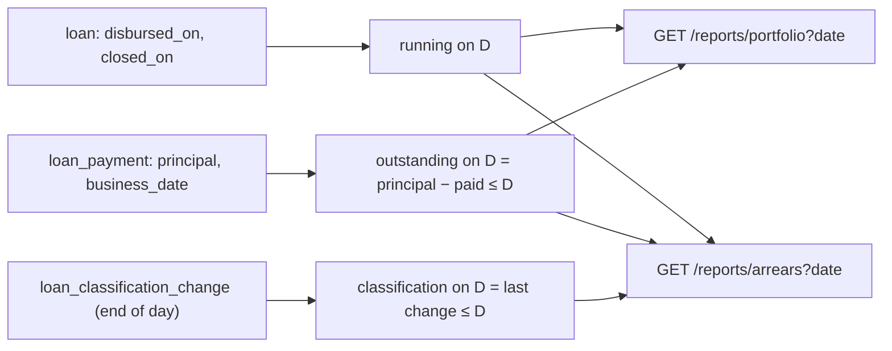

# Slice 6.4: Lending reports

## Part 1. The big picture

The bank wants two views of its loans, each as of a business date (design plan section 2):

- **the portfolio:** how many loans are running and how much principal is outstanding, per product;
- **arrears:** how many loans are Current, Overdue or in Default, and how much they owe.

Reports are built from data the service owns (stage 6 file). The hard part is "as of a date": most tables hold today's state.

## Part 2. The building blocks and how they connect



- **`loan.closed_on`**: set when a loan is paid off, normally or early.
- **`loan_classification_change`**: written by the end of day, next to `LoanClassificationChanged`.
- **`Features/Loans/LendingReports.cs`**: the two staff-only endpoints. Running loans are those disbursed on or before D and not closed on or before D. Outstanding comes from the payments' principal up to D. The classification is the last change up to D, Current otherwise.

## Part 3. Why it is designed this way

- **D1 on your delegation:** queries over Lending's own tables, plus one small history (bank-lending ADR 0006), instead of a projection per report. Payments already carry the principal and date; only the classification is overwritten in place, so only it needs a history.
- **D2:** reports are staff only (403 for customers); a missing date means the business date.

Pattern: read model from the write model's own tables (a light CQRS), plus an append-only history for the one overwritten fact.

## 4. What was tested

`ReportTests` (4 tests):

- the portfolio by product on the disbursement day (CAR: 2 loans, 300,000) and after the first collection (MORTGAGE 1,997,244.53);
- arrears move from Current to Overdue to Default on the right dates, with the outstanding amount;
- a loan paid off on a date leaves the portfolio from that date;
- customers get 403.

```
bank-lending IntegrationTests 44 passed
```

## 5. Check your understanding

1. Why does the arrears report need `loan_classification_change` while the portfolio needs no new table?
2. A loan was paid off early on 10 Feb. Is it in the portfolio for 9 Feb? For 10 Feb?
