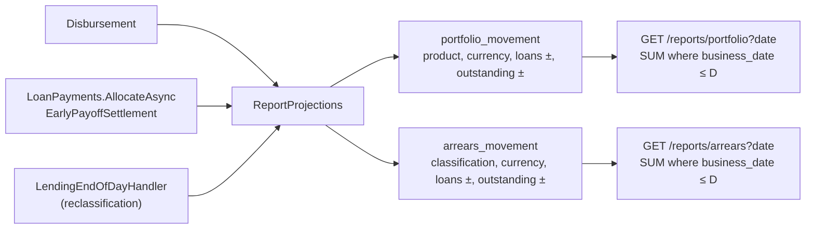

# Slice 6.4: Lending reports

## Part 1. The big picture

The bank wants two views of its loans, each as of a business date (design plan section 2):

- **the portfolio:** how many loans are running and how much principal is outstanding, per product;
- **arrears:** how many loans are Current, Overdue or in Default, and how much they owe.

Reports are built from data the service owns (stage 6 file). The hard part is "as of a date": most tables hold today's state, and a report for 9 Feb must not see a payment from 10 Feb.

## Part 2. The building blocks and how they connect

Each report has its own projection table. Every feature that changes a loan adds a movement row to it, in the same transaction as the change. A report on date D is the sum of the rows up to D.



### 2.1 The movements (`Features/Loans/ReportProjections.cs`)

| Change | Who calls it | Portfolio row | Arrears row |
| --- | --- | --- | --- |
| `Disbursed` | `Disbursement` | +1 loan, +principal | Current: +1, +principal |
| `PrincipalPaid` | `LoanPayments.AllocateAsync`, `EarlyPayoffSettlement` | −principal | the loan's current class: −principal |
| `Closed` | same, when the loan is paid off | −1 loan | current class: −1, written before the class is reset to Current |
| `Reclassified` | end of day, when the class changes | none | old class: −1, −outstanding; new class: +1, +outstanding |

The rows are added to the same `LendingDbContext` as the change, so they are saved by the same `SaveChangesAsync`. Example: an Overdue loan of 200,000 gets a card payment with 1,841.67 principal on 20 Feb. Arrears for 19 Feb still shows 200,000 Overdue, and for 20 Feb it shows 198,158.33.

### 2.2 The tables (`Data/Entities.cs`, migration `ReportProjections`)

`portfolio_movement` and `arrears_movement` each have an id, the loan, the business date, the grouping columns, the two deltas and a `reason`, plus the audit columns. Both are indexed on `business_date`. The migration drops `loan_classification_change` from the first version.

### 2.3 The endpoints (`Features/Loans/LendingReports.cs`)

- **Portfolio:** sum by product and currency up to D, keeping the products with at least one loan.
- **Arrears:** sum by classification and currency up to D, with every classification for each currency that has running loans. Amounts in different currencies are never added.
- Both are staff only (403 for customers). A missing date means the business date.

## Part 3. Why it is designed this way

- **D1, decided by Majid on 2026-11-02 (bank-lending ADR 0006):** a projection per report, written with each change, as movement rows.
  - **How the design changed:** my first version (on your delegation) queried Lending's own tables, loans and payments, plus a small classification history. You chose a projection per report in the review, and movement rows rather than daily snapshots.
  - **Why it wins:** each read is one grouped sum, and the projection cannot drift from the loan because it is saved in the same transaction. It is also idempotent for free: the end of day is guarded by `loan_day_run`, a payment by its unique `source_id`, and disbursement by the status transition.
  - **Movements versus snapshots:** movements answer any date, today included. A snapshot only exists once the day is closed, and it grows every day.
  - **The price:** every feature that changes principal, status or classification must call `ReportProjections`. A forgotten call makes a report silently wrong, and only the report tests catch it.
- **D2:** reports are staff only, and a missing date means the business date. There is no backfill in the migration: nothing is deployed, so local databases are recreated.

Patterns: a read model per query (a light CQRS), event-style deltas summed to a state (like a ledger), and writing the read model in the same transaction as the write model.

## 4. What was tested

`ReportTests` (7 tests), each ending with a per-loan invariant (a running loan's rows sum to 1 and its unpaid principal in its current class, a closed loan's to 0):

- the portfolio by product on the disbursement day (CAR: 2 loans, 300,000) and after the first collection (MORTGAGE 1,997,244.53);
- arrears move from Current to Overdue to Default on the right dates, with the outstanding amount;
- a payment while Overdue lowers the Overdue outstanding from its date only (200,000 on 19 Feb, 198,158.33 on 20 Feb);
- a loan paid off while Overdue leaves the Overdue class on that date;
- a loan paid off on a date leaves the portfolio and arrears from that date;
- a card payment while a payoff is pending is not allocated (owed back), so the payoff's quoted principal is taken off once;
- customers get 403.

```
bank-lending UnitTests 1,574 passed; IntegrationTests 47 passed
```

## 5. What to watch later

- A new feature that changes a loan's principal, status or classification needs a `ReportProjections` call. The invariant in `ReportTests` catches a forgotten one only if a test drives that feature.
- A payment always writes the loan row, so it conflicts with a concurrent end of day on `xmin` instead of skewing the projection with stale data.
- Local databases created before 2026-11-02 must be recreated: the projections start empty.

## 6. Check your understanding

1. Why must the `Closed` row be written before the classification is reset to Current?
2. A loan was paid off early on 10 Feb. Is it in the portfolio for 9 Feb? For 10 Feb? Which rows decide it?
3. What would go wrong if `ReportProjections` saved its rows with a separate `SaveChangesAsync` after the change?
