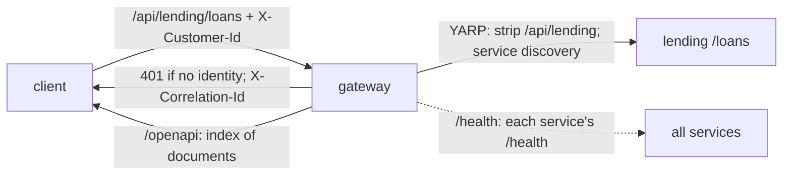

# Slices 7.1 and 7.2: The gateway, routing, headers, OpenAPI and health

## Part 1. The big picture

Until now every service had its own address. A client, the agent in phase 2, or the import tool would have to know all six. A **gateway** gives one address. It also centralizes two cross-cutting concerns:

- **who is calling:** simulated authentication. A customer's call carries `X-Customer-Id`; staff, the agent or the import carry `X-Performed-By` (design plan ADR 13);
- **following one call everywhere:** a correlation id.

The services keep their own rules (for example "another customer's account is 404"). The gateway only makes sure every call says who it is.

## Part 2. The building blocks and how they connect

- **`Routes.cs`** builds one YARP route and cluster per service: `/api/{service}/{**rest}`, the prefix removed, destination `http://{service}`. Aspire service discovery turns that name into the real address (`AddServiceDiscoveryDestinationResolver`).
- **`GatewayMiddleware.cs`** applies to `/api` only: a call without identity gets 401, a malformed customer id 400, and the correlation id is kept or added on both the request and the response. YARP forwards all headers.
- **`DownstreamHealthCheck.cs`** checks one service's `/health`. The gateway's `/health` runs all of them (`ready`), while `/alive` checks only the gateway.
- **`Program.cs`** reads `Gateway:Services` (blank entries ignored, duplicates removed) and serves `/openapi`, the list of each service's document through the gateway.
- **AppHost**: the gateway references all six services, which injects their addresses, waits for them, and is the only resource with external endpoints.

## Part 3. Why it is designed this way

| Choice (D2) | Why |
| --- | --- |
| Routes in code from a configured list | Six identical routes; one loop instead of six blocks of YARP JSON. |
| Identity is checked at the gateway, ownership in the services | The gateway cannot know who owns an account; the services already enforce it. |
| An `/openapi` index instead of a merged document | Each service keeps its own schema names; merging six documents adds conflicts for no gain in phase 1. |
| Blank list entries ignored | The array-merge trap again, now a documented way to switch a service off. |

Patterns: API gateway / reverse proxy; correlation id for distributed tracing; aggregated health.

## 4. What was tested

- **Gateway** (9 tests, the real gateway plus a stub service on a random port):
  - routing without the prefix, with the headers forwarded and a correlation id created and echoed;
  - a given correlation id is kept;
  - no identity, or a blank `X-Performed-By`, gives 401, and a malformed customer id 400;
  - a correlation id that is too long or has unsafe characters is replaced (added after the review);
  - the OpenAPI index;
  - `/health` is unhealthy when a downstream service is down, while `/alive` stays OK.
- **Platform** (8 new tests): through the real AppHost, each of the six services answers through the gateway (products, currencies, OpenAPI documents), and anonymous calls are refused. 47 tests in total.

## 5. What to watch later

- **The correlation id is forwarded and echoed, but no service logs it yet.** Following one call through every log needs a logging scope or a trace tag in the services (`Bank.ServiceDefaults`).
- **Identity is simulated.** Any caller can send `X-Performed-By` without `X-Customer-Id` and act as staff. The stage file allows this for now; it must change before the bank is reachable from outside (stage 8 opens only the gateway port, so keep the instance's security group narrow).

## 6. Check your understanding

1. Why does the gateway check *that* a caller identifies itself, but not *whether* the caller may see a resource?
2. How does the gateway find the lending service without a hard-coded address?
